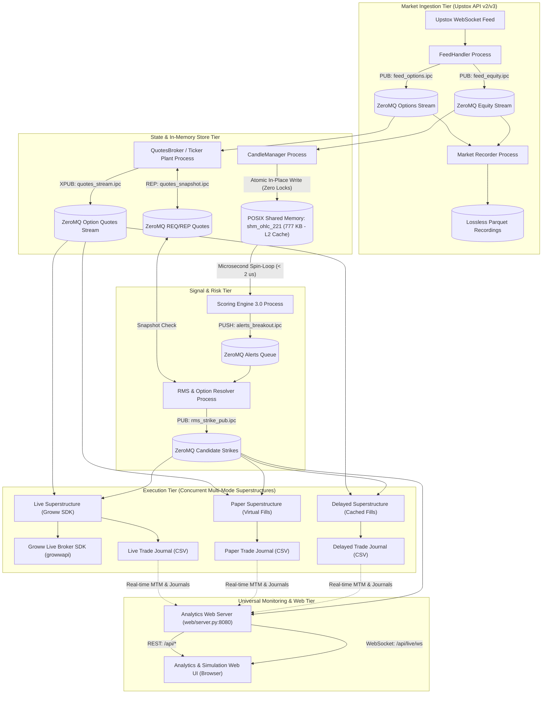
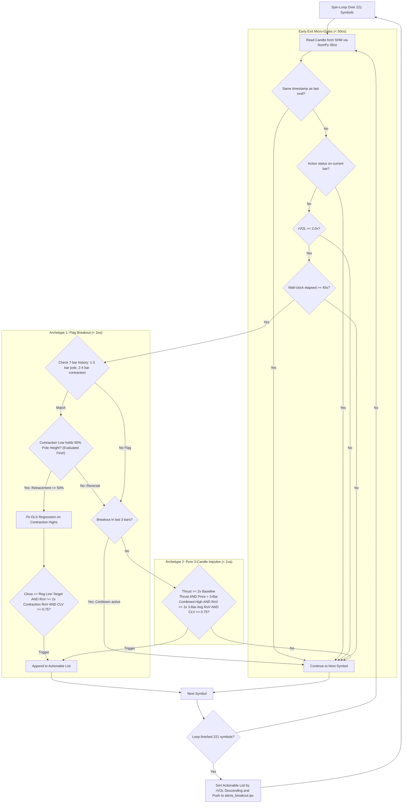
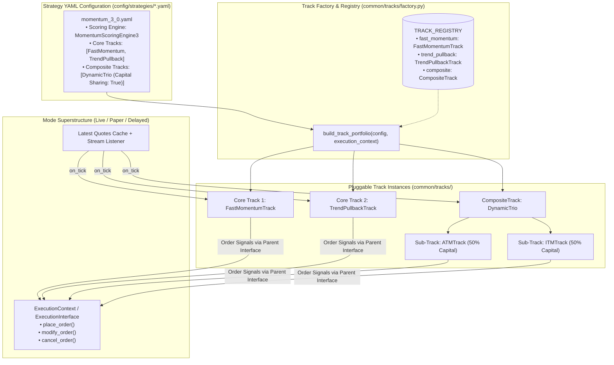
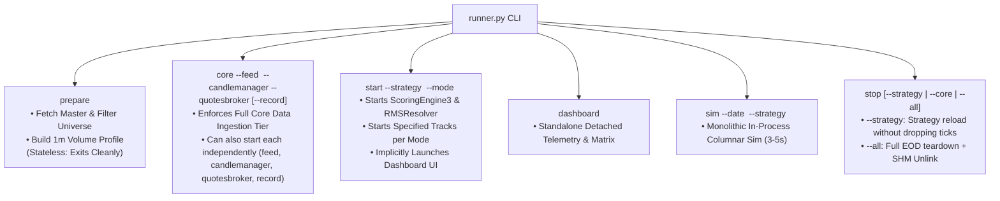

# Low-Level Design (LLD) Specification 2.0: Modular Distributed Trading Engine

> **Document Type**: Low-Level Engineering & Implementation Specification  
> **Version**: 2.0 (Track C Production Architecture & Scoring Engine 3.0)  
> **Status**: Ready for Implementation Planning  
> **Master Architecture**: [`ARCHITECTURE_SPEC_2_0.md`](file:///Users/yorha/Documents/Trading%20Stuff/ARCHITECTURE_SPEC_2_0.md)  
> **Signal & Strategy Spec**: [`SCORING_ENGINE_3_0.md`](file:///Users/yorha/Documents/Trading%20Stuff/SCORING_ENGINE_3_0.md)  
> **System Audit Registry**: [`SELF_AUDIT.md`](file:///Users/yorha/Documents/Trading%20Stuff/SELF_AUDIT.md)  

---

## 1. System Architecture & Component Topology

The system transitions from a single-threaded synchronous monolith into a distributed, multi-process, low-latency architecture connected by **POSIX Shared Memory** and **ZeroMQ Inter-Process Communication (IPC)**.



---

## 2. Directory Hierarchy & Codebase Layout

```
Trading Stuff/
├── core/
│   ├── __init__.py
│   ├── shm/
│   │   ├── __init__.py
│   │   ├── layout.py                  # CandleStruct NumPy dtype, symbol offsets, memory mapping
│   │   └── candle_shm.py              # PosixSharedMemory writer/reader with atomic fences
│   ├── feed/
│   │   ├── __init__.py
│   │   ├── feed_handler.py            # Splits equity cash vs derivatives into separate IPC sockets
│   │   ├── upstox_feed.py             # Upstox WebSocket v2/v3 market data client
│   │   └── replay_feed.py             # High-speed deterministic tick replay from recordings
│   ├── recorder/
│   │   ├── __init__.py
│   │   ├── market_recorder.py         # Subscribes to feeds, writes chunked compressed Parquet
│   │   └── parquet_writer.py          # PyArrow chunked table stream writer
│   ├── candles/
│   │   ├── __init__.py
│   │   ├── candle_manager.py          # Aggregates 5m candles, ATR(14), strict current candle rVOL
│   │   └── volume_profile.py          # 20-day historical time-of-day volume lookup
│   ├── quotes/
│   │   ├── __init__.py
│   │   ├── quotes_broker.py           # Ticker plant: REQ/REP snapshots + XPUB stream
│   │   └── lvc_cache.py               # In-memory last-value depth cache with heartbeat pulse
│   ├── scoring/
│   │   ├── __init__.py
│   │   ├── engine.py                  # Spin-loop engine over POSIX SHM
│   │   ├── archetypes.py              # Pure functions: flag_breakout & pure_impulse
│   │   └── metadata.py                # SymbolMetadata, status caching, cooldown tracking
│   └── rms/
│       ├── __init__.py
│       ├── option_resolver.py         # Instrument token resolver (ITM/ATM/OTM strikes)
│       ├── risk_manager.py            # Pre-trade risk, spread filter, liquidity gating
│       └── rms_service.py             # Subscribes to alerts, queries broker, pubs to tracks
├── execution/
│   ├── __init__.py
│   ├── superstructures/
│   │   ├── __init__.py
│   │   ├── base.py                    # BaseSuperstructure lifecycle & socket bindings
│   │   ├── delayed.py                 # DelayedSuperstructure: prevailing cached quote fills
│   │   ├── paper.py                   # PaperSuperstructure: real-time zero-delay paper trading
│   │   └── live.py                    # LiveSuperstructure: live broker order reconciliation
│   └── adapters/
│       ├── __init__.py
│       ├── groww_live_adapter.py      # Groww API SDK live execution adapter (TOTP, SL, reconciliation)
│       └── mock_adapter.py            # Paper execution ledger adapter
├── web/
│   ├── __init__.py
│   ├── server.py                      # AnalyticsWebServer (aiohttp, REST, WebSockets, teardown)
│   ├── live_service.py                # LiveService (ZeroMQ LVC, real-time MTM, active cash)
│   ├── simulation_service.py          # SimulationService (isolated worker process, batch queue, Parquet cache)
│   ├── candle_service.py              # CandleService (OHLCV scanning & aggregation)
│   ├── alert_service.py               # AlertService (direct POSIX SHM read & trigger overlays)
│   ├── historical_service.py          # HistoricalService (multi-session discovery & journal parsing)
│   └── static/                        # SPA web assets (HTML, CSS, ChartEngine, UI tabs)
├── ui/
│   ├── __init__.py
│   ├── dashboard.py                   # Universal Terminal Dashboard (ANSI / Rich live telemetry, retired in favor of web)
│   └── views/
│       ├── alerts_view.py             # Active alerts, time created, elapsed counters, strikes
│       └── performance_matrix.py      # Live trackwise P&L matrix per mode (Paper, Delayed, Live)
├── common/
│   ├── __init__.py
│   ├── tracks/
│   │   ├── __init__.py
│   │   ├── base_track.py              # BaseTrack state machine (PENDING, ACTIVE, EXITING)
│   │   ├── composite_track.py         # CompositeTrack: pooled capital sharing container
│   │   ├── track1_fast_momentum.py    # Archetype 2 impulse track
│   │   ├── track2_trend_pullback.py   # Archetype 1 flag breakout track
│   │   └── factory.py                 # Track factory instantiating from strategy YAML
│   ├── models/
│   │   ├── __init__.py
│   │   ├── messages.py                # Msgpack serialization schemas & dataclasses
│   │   └── instruments.py             # Instrument token database, lot sizes, tick sizes
│   └── utils/
│       ├── __init__.py
│       ├── clock.py                   # Replay vs wall-clock time abstraction
│       ├── affinity.py                # Linux sched_setaffinity / macOS QoS nice pinning
│       └── logging.py                 # Structured JSON zero-overhead logger
├── simulation/
│   ├── __init__.py
│   ├── columnar_sim_engine.py         # Polars/Arrow memory-mapped columnar backtester
│   └── asof_matcher.py                # Binary search ASOF join fill evaluator
├── config/
│   ├── settings.yaml                  # Global configuration (symbols, limits, delays)
│   ├── instruments.json               # Master contract specification file
│   └── strategies/
│       └── momentum_3_0.yaml          # Strategy tracks, capital allocations, scoring config
├── docs/
│   └── archive/                       # Archived brainstorm & legacy audit specs
├── runner.py                          # Unified CLI Orchestrator (prepare, start, sim, replay, status, stop)
├── scripts/
│   ├── run_distributed.py             # Process supervisor (orchestrates core & mode processes)
│   └── clean_shm.py                   # Emergency cleanup utility for orphaned SHM blocks
├── ARCHITECTURE_SPEC_2_0.md
├── ARCHITECTURE_EVOLUTION.md
├── SCORING_ENGINE_3_0.md
├── SCORING_EVOLUTION.md
├── LOW_LEVEL_DESIGN_2_0.md
└── SELF_AUDIT.md
```

---

## 3. Data Schemas & Binary Layouts

### 3.1 POSIX Shared Memory Layout (`shm_ohlc_221`)

The shared memory block is fixed-size and pre-allocated at startup. It holds candles for all 221 F&O stocks across a dedicated **5-minute timeframe (75 bars/day)**.

#### Exact NumPy Structured DType (`CANDLE_DTYPE`):
```python
import numpy as np

CANDLE_DTYPE = np.dtype([
    ('timestamp', '<i8'),   # 8 bytes: Unix timestamp in seconds (int64)
    ('open',      '<f4'),   # 4 bytes: Open price (float32)
    ('high',      '<f4'),   # 4 bytes: High price (float32)
    ('low',       '<f4'),   # 4 bytes: Low price (float32)
    ('close',     '<f4'),   # 4 bytes: Close / Current LTP (float32)
    ('volume',    '<u8'),   # 8 bytes: Cumulative bar volume (uint64)
    ('rvol',      '<f4'),   # 4 bytes: Strict Current Candle rVOL (float32)
    ('atr',       '<f4'),   # 4 bytes: 14-period Average True Range (float32)
    ('is_closed', '?'),     # 1 byte:  Boolean flag (True if bar finished, False if active)
    ('_reserved', 'V7')     # 7 bytes: Explicit padding to align struct to 48 bytes
], align=True)

assert CANDLE_DTYPE.itemsize == 48, f"DType size must be 48 bytes, got {CANDLE_DTYPE.itemsize}"
```

#### Memory Sizing & Slicing:
$$\text{Total Memory} = 221 \text{ symbols} \times 75 \text{ bars} \times 48 \text{ bytes} = \mathbf{795,600\text{ bytes} \approx 777\text{ KB}}$$
- Fits completely inside the CPU's **L2 cache** (typical core L2: 1–2 MB; Apple Silicon: 4–16 MB).
- **Zero Cache Thrashing**: Data for all 221 symbols across the entire trading day resides directly within the CPU's fastest on-die cache.
- **Index Lookup Formula**:
  $$\text{Row Index} = \text{Symbol Index} \times 75 + \text{Bar Index}$$
  - Where `Bar Index` runs from $0 \dots 74$ ($09:15 \dots 15:30$ IST).
- **Seqlock Memory Synchronization Protocol (Lightweight Zero-Mutex Sync)**:
  To eliminate torn reads during in-place bar mutations without paying the steep cost of OS mutexes or semaphore context switches, `shm_layout.py` pre-allocates a 16-byte `SEQLOCK_DTYPE` header per symbol:
  ```python
  SEQLOCK_DTYPE = np.dtype([
      ("sequence_id", "<u8"),     # 8 bytes: sequence counter (odd = updating, even = stable)
      ("last_update_ns", "<i8"),  # 8 bytes: nanosecond timestamp of last tick
  ], align=False)
  ```
  - **Single Writer Protocol (`CandleManager`)**:
    1. Read current `seq = headers[idx]["sequence_id"]`.
    2. Mark write in-progress: `headers[idx]["sequence_id"] = seq + 1` (odd).
    3. Write candle values in-place (`close, high, low, volume, rvol, atr`).
    4. Mark write complete: `headers[idx]["sequence_id"] = seq + 2` (even).
  - **Lock-Free Reader Protocol (`ScoringEngine3`)**:
    1. Read `seq1 = headers[idx]["sequence_id"]`. If `seq1 & 1` (odd), writer is updating; spin/retry.
    2. Copy 48-byte candle data from Shared Memory into local register/stack.
    3. Read `seq2 = headers[idx]["sequence_id"]`.
    4. If `seq1 == seq2`, the read was atomic, consistent, and untorn.
    5. If `seq1 != seq2`, writer mutated data during copy; discard and retry (up to 10 iterations, typical retry count: 0).

#### Lifecycle & Process Ownership (Creator vs. Readers):
- **Why `prepare` Does NOT Allocate SHM**: If a short-lived CLI command like `prepare` creates a Python `SharedMemory` segment and terminates, Python's internal `resource_tracker` daemon automatically unlinks the memory from the OS.
- **`CandleManager` as Creator & Owner**:
  The `CandleManager` is the Single Writer and stays running throughout the trading session. It creates the segment on startup:
  ```python
  # In core/candles/candle_manager.py (Single Writer)
  from multiprocessing.shared_memory import SharedMemory
  
  try:
      self.shm = SharedMemory(name="shm_ohlc_221", create=True, size=795600)
  except FileExistsError:
      # Attach and clean legacy segment if orphaned from abnormal crash
      self.shm = SharedMemory(name="shm_ohlc_221", create=False)
      self.shm.unlink()
      self.shm = SharedMemory(name="shm_ohlc_221", create=True, size=795600)
      
  self.candles = np.ndarray((221, 75), dtype=CANDLE_DTYPE, buffer=self.shm.buf)
  self.candles[:] = 0  # Zero-initialize
  ```
- **`ScoringEngine3` as Lock-Free Reader**:
  The scoring engine attaches to the named segment without creating it (`create=False`):
  ```python
  # In strategies/momentum/scoring_engine.py (Lock-Free Reader)
  import time
  from multiprocessing.shared_memory import SharedMemory
  
  # Retry loop waiting for CandleManager to initialize SHM
  for _ in range(30):
      try:
          self.shm = SharedMemory(name="shm_ohlc_221", create=False)
          break
      except FileNotFoundError:
          time.sleep(0.5)
  else:
      raise RuntimeError("FATAL: CandleManager SHM 'shm_ohlc_221' not found. Is CandleManager running?")
      
  self.candles = np.ndarray((221, 75), dtype=CANDLE_DTYPE, buffer=self.shm.buf)
  ```
- **Strategy Restart Decoupling**: If strategy execution is stopped, updated, or restarted, `CandleManager` continues running uninterrupted. The shared memory segment remains intact, and the newly spawned scoring process attaches immediately without loss of intraday OHLCV history.

---

### 3.2 ZeroMQ Wire Protocols & Serialization

All inter-process messages utilize MessagePack (`msgpack`) for sub-microsecond binary serialization without JSON string parsing overhead.

#### A. Equity Feed (`feed_equity.ipc`)
- **Pattern**: ZeroMQ `PUB` / `SUB`
- **Topic**: `EQ.<token>` (e.g., `EQ.2885` for Reliance)
- **Payload (`msgpack`)**:
  ```python
  {
      "token": 2885,           # int: Instrument token
      "ltp": 2542.50,          # float: Last Traded Price
      "vol": 1254000,          # int: Cumulative day volume
      "ts": 1700000000         # int: Timestamp (seconds)
  }
  ```

#### B. Options Feed (`feed_options.ipc`)
- **Pattern**: ZeroMQ `PUB` / `SUB`
- **Topic**: `OPT.<token>`
- **Payload (`msgpack`)**:
  ```python
  {
      "token": 45120,          # int: Option instrument token
      "ltp": 85.50,            # float: Last Traded Price
      "bid": 85.40,            # float: Best Bid Price
      "ask": 85.55,            # float: Best Ask Price
      "bid_qty": 1800,         # int: Best Bid Quantity
      "ask_qty": 2250,         # int: Best Ask Quantity
      "oi": 450000,            # int: Open Interest
      "ts": 1700000000         # int: Timestamp (seconds)
  }
  ```

#### C. Scoring Alerts (`alerts_breakout.ipc`)
- **Pattern**: ZeroMQ `PUSH` (Scoring Engine) / `PULL` (RMS)
- **Payload (`msgpack`)**:
  ```python
  {
      "symbol": "TATAMOTORS",
      "archetype": "FLAG_BULL_BREAKOUT", # or "PURE_BULL_BREAKOUT", etc.
      "direction": "BULL",               # "BULL" or "BEAR"
      "rvol": 3.42,                      # float: Relative Volume
      "trigger_price": 685.20,           # float: Underlying cash trigger price
      "trigger_ts": 1700000300.5         # float: Unix timestamp with millisecond precision
  }
  ```

#### D. Quotes Broker SNAPSHOT & STREAM
- **Snapshot & Dynamic Sub/Unsub (`quotes_router.ipc`)**:
  - **Pattern**: ZeroMQ `ROUTER` (QuotesBroker) / `DEALER` (Superstructures & RMS)
  - **Requests**:
    - `{"action": "GET_QUOTES", "tokens": ["NSE:45120"], "best_depth": true}` (Queries snapshot with 1-lot `best_depth=True` or full 5-level `best_depth=False`)
    - `{"action": "SUBSCRIBE", "tokens": ["NSE:45120"], "client_id": "paper"}` (Registers subscription with client identification)
    - `{"action": "UNSUBSCRIBE", "tokens": ["NSE:45120"], "client_id": "paper"}` (Decrements client subscription reference count)
  - **Multi-Client Reference Counting**:
    - `QuotesBroker` maintains `subscribers_by_token[token] = set(client_ids)` where `ref_count = len(subscribers_by_token[token])`.
    - Multiple concurrent superstructures (`paper`, `paper_delayed`, `live`) can hold open trades on the same strike concurrently.
    - When one mode exits and unsubs, `QuotesBroker` decrements that mode's subscription. Only when `ref_count == 0` (all holding superstructures have exited) does `QuotesBroker` stop broadcasting ticks for that contract.
  - **Response**:
    ```python
    {
        "status": "SUCCESS",
        "subscribed_tokens": ["NSE:45120"],
        "ref_counts": {"NSE:45120": 2},
        "quotes": {
            "NSE:45120": {"token": "NSE:45120", "ltp": 85.5, "bid": 85.4, "ask": 85.55, "bid_qty": 1800, "ask_qty": 2250, "timestamp": 1700000300}
        }
    }
    ```
- **Stream (`quotes_stream.ipc`)**:
  - **Pattern**: ZeroMQ `PUB` (QuotesBroker) / `SUB` (Superstructures)
  - **Topic**: `QUOTE.<token>` or `HEARTBEAT`
  - **Payload (`msgpack`)**:
    ```python
    {
        "token": "NSE:45120",
        "symbol": "TATAMOTORS",
        "ltp": 85.5,
        "bid": 85.4,
        "ask": 85.55,
        "bid_qty": 1800,
        "ask_qty": 2250,
        "timestamp": 1700000301
    }
    ```
  - **Heartbeat Payload**:
    ```python
    {
        "type": "HEARTBEAT",
        "timestamp": 1700000301,
        "active_quotes_count": 3500,
        "subscribed_count": 14,
        "ref_counts": {"NSE:45120": 2}
    }
    ```

#### E. RMS Resolved Candidate Strikes (`rms_strike_pub.ipc`)
- **Pattern**: ZeroMQ `PUB` (RMS) / `SUB` (Superstructure)
- **Topic**: `STRIKE.<symbol>`
- **Payload (`msgpack`)**:
  ```python
  {
      "alert_id": "TATAMOTORS_1700000300",
      "symbol": "TATAMOTORS",
      "direction": "BULL",
      "archetype": "FLAG_BULL_BREAKOUT",
      "underlying_price": 685.20,
      "trigger_ts": 1700000300.5,
      "strikes": {
          "ITM": {"token": 45119, "strike": 680.0, "type": "CE", "ltp": 12.5, "bid": 12.4, "ask": 12.55},
          "ATM": {"token": 45120, "strike": 685.0, "type": "CE", "ltp": 8.5,  "bid": 8.45, "ask": 8.55},
          "OTM": {"token": 45121, "strike": 690.0, "type": "CE", "ltp": 5.2,  "bid": 5.15, "ask": 5.25}
      },
      "lot_size": 1425,
      "max_lots": 2
  }
  ```

---

## 4. Component Implementation Specifications

### 4.1 FeedHandler (`core/feed/feed_handler.py`)
- **Objective**: Multi-source market data ingestion engine (Upstox WebSocket v3 Protobuf, high-speed REST poller failover, and Mock engine) with strict separation of Cash Equities and Derivatives Options onto two physically distinct ZeroMQ IPC sockets:
  - `feed_equity_ipc` (`ipc:///tmp/feed_equity.ipc`): Broadcasts `TICK.EQ` (consumed exclusively by `CandleManager` and `MarketRecorder`).
  - `feed_options_ipc` (`ipc:///tmp/feed_options.ipc`): Broadcasts `TICK.OPT` (consumed exclusively by `QuotesBroker` and `MarketRecorder`).
- **Dynamic Strike Subscription & Capacity Management**:
  - Upstox imposes an account limit of **5,000 streamed instruments**. With 221 F&O equities and 35,000+ option strikes, streaming every strike simultaneously is physically impossible.
  - `FeedHandler` maintains a dynamic **Popular Options Window**:
    - Evaluates ATM strike on underlying price updates: $K_{\text{atm}} = \arg\min_K |K - \text{LTP}|$.
    - Subscribes to ATM $\pm 3$ strikes (7 strikes total: 7 CE + 7 PE = 14 contracts per stock).
    - Hysteresis Retention Window: ATM $\pm 4$ strikes (prevents unneeded sub/unsub oscillations when price fluctuates around strike edges).
    - Capacity Ceiling (`max_stream_contracts` = 1,800): Enforces a hard budget (215 equities + ~1,500 active options), auto-pruning unheld dynamic options when capacity is reached.
- **Critical Active Position Protection Guard**:
  - Queries `ProtectedPositionRegistry.get_instance().get_protected_keys()`.
  - Any contract key associated with an open position in ANY execution mode (`live`, `paper`, `paper_delayed`, `sim`) or track is **unconditionally protected**:
    $$\text{keys\_to\_remove} = \text{keys\_to\_remove} - \text{protected\_keys}$$
    $$\text{keys\_to\_add} = \text{keys\_to\_add} \cup (\text{protected\_keys} \cap \text{all\_options\_for\_symbol})$$
  - Open positions are NEVER unsubscribed until the trade exits and position registry clears.
- **Depth Preservation**:
  - Full 5-level market depth arrays (`bids: [[p, q, o], ...]`, `asks: [[p, q, o], ...]`) are extracted from Protobuf `MarketLevel` and serialized in `TickEvent` for archival and simulation parity.

```python
class FeedHandler:
    def __init__(self, feed_equity_ipc="ipc:///tmp/feed_equity.ipc", feed_options_ipc="ipc:///tmp/feed_options.ipc"):
        self.ctx = zmq.Context()
        self.pub_eq = self.ctx.socket(zmq.PUB)
        self.pub_eq.bind(feed_equity_ipc)
        self.pub_opt = self.ctx.socket(zmq.PUB)
        self.pub_opt.bind(feed_options_ipc)
        self.position_registry = ProtectedPositionRegistry.get_instance()

    def publish_tick(self, token: str, symbol: str, ltp: float, bid: float = 0.0, ask: float = 0.0,
                     bid_qty: int = 0, ask_qty: int = 0, exchange_ts: float = 0.0, received_ts: float = 0.0,
                     bids: list = None, asks: list = None):
        canonical_token = normalize_instrument_token(token)
        is_opt = is_option_contract(canonical_token)
        event = TickEvent(
            token=canonical_token, symbol=symbol, ltp=ltp, bid=bid, ask=ask,
            bid_qty=bid_qty, ask_qty=ask_qty, exchange_timestamp=exchange_ts,
            received_timestamp=received_ts, bids=bids or [], asks=asks or []
        )
        payload = pack_message(event)
        if is_opt:
            self.pub_opt.send_multipart([b"TICK.OPT", payload])
        else:
            self.pub_eq.send_multipart([b"TICK.EQ", payload])
            if self.enable_dynamic_options:
                self.evaluate_dynamic_options(canonical_token, ltp)
```

---

### 4.2 CandleManager (`core/candles/candle_manager.py`)
- **Objective**: Aggregates 5-minute candles (75 bars/day) in RAM, computes incremental ATR(14) and strict current candle rVOL with linear minute-boundary extrapolation, and commits atomic rows into `shm_ohlc_221`.
- **Key Modules**:
  - `VolumeProfileTable`: Holds pre-calculated 20-day median volume for each of the 375 one-minute buckets of the day for all 221 stocks (shape: `[221, 375]`).
  - `IncrementalATR`: Running 14-period Wilder ATR:
    $$\text{ATR}_t = \frac{\text{ATR}_{t-1} \times 13 + \text{TR}_t}{14}$$
  - **Strict Current Candle rVOL with Minute-Boundary Linear Extrapolation**:
    Evaluates institutional volume surge strictly on the active 5-minute candle without lagging rolling windows:

```python
class VolumeProfileTable:
    """
    Evaluates strict current candle rVOL with linear extrapolation to minute boundaries.
    """
    def __init__(self, median_1m_matrix: np.ndarray, symbol_to_idx: dict[str, int]):
        # shape: (221, 375) representing 375 minutes of the NSE trading day
        self.baseline = median_1m_matrix
        self.symbol_to_idx = symbol_to_idx
        
    def calculate_strict_rvol(self, symbol: str, bar_idx: int, elapsed_sec: float, 
                              cum_bar_vol: int, vol_at_last_min_edge: int) -> float:
        sym_idx = self.symbol_to_idx[symbol]
        m0 = bar_idx * 5            # Starting minute of day for this 5m bar (0..370)
        k = int(elapsed_sec // 60)  # Completed minutes in this bar (0..4)
        tau = elapsed_sec % 60.0    # Seconds into current fractional minute
        
        # 1. Exact Minute Edge Boundary (e.g. at 60s, 120s, 180s, 240s, 300s)
        if tau == 0.0 and k > 0:
            expected_vol = np.sum(self.baseline[sym_idx, m0 : m0 + k])
            return float(cum_bar_vol / max(1.0, expected_vol))
            
        # 2. Intra-Minute Linear Extrapolation (between minute boundaries)
        intra_min_vol = cum_bar_vol - vol_at_last_min_edge
        if tau > 0:
            extrapolated_min_vol = intra_min_vol * (60.0 / tau)
        else:
            extrapolated_min_vol = float(intra_min_vol)
            
        projected_vol = vol_at_last_min_edge + extrapolated_min_vol
        expected_up_to_next_edge = np.sum(self.baseline[sym_idx, m0 : m0 + k + 1])
        return float(projected_vol / max(1.0, expected_up_to_next_edge))
```

  - **Shared Memory Writer**:
    Maintains active bar in local RAM; on tick update, writes `close`, `high`, `low`, `volume`, `rvol`, and `atr` directly to the active row of the symbol in `shm_ohlc_221`. On bar boundary close (every 300 seconds), marks `is_closed = True`, advances bar index, resets `vol_at_last_min_edge`, and initializes new bar.

---

### 4.3 QuotesBroker / Ticker Plant (`core/quotes/quotes_broker.py`)
- **Objective**: Act as an in-memory Last Value Cache (LVC) and subscription broker for derivatives quotes.
- **State**:
  - `quotes_cache`: Flat array / dict storing `{token: (ltp, bid, ask, bid_qty, ask_qty, ts)}`. Memory footprint $< 200\text{ KB}$ for all traded strikes.
- **Dual Interfaces**:
  1. **REQ/REP Snapshot Server** (`ipc:///tmp/quotes_snapshot.ipc`): Serves instantaneous quotes to RMS during alert qualification.
  2. **XPUB/XSUB Subscription Proxy** (`ipc:///tmp/quotes_stream.ipc`): Forwards live ticks for subscribed strikes to Superstructures.
- **Heartbeat Emitter**: Emits a `HEARTBEAT` message with current timestamp every time a new timestamp second is observed, waking up lazy delayed execution engines.

```python
class QuotesBroker:
    def __init__(self, feed_opt_url="ipc:///tmp/feed_options.ipc",
                 snap_url="ipc:///tmp/quotes_snapshot.ipc",
                 stream_url="ipc:///tmp/quotes_stream.ipc"):
        self.ctx = zmq.Context()
        self.opt_sub = self.ctx.socket(zmq.SUB)
        self.opt_sub.connect(feed_opt_url)
        self.opt_sub.setsockopt(zmq.SUBSCRIBE, b"OPT.")
        
        self.snap_rep = self.ctx.socket(zmq.REP)
        self.snap_rep.bind(snap_url)
        
        self.stream_xpub = self.ctx.socket(zmq.XPUB)
        self.stream_xpub.bind(stream_url)
        
        self.cache = {}
        self.last_heartbeat_sec = 0

    def step(self):
        # Poll opt_sub, snap_rep with zmq.Poller
        # If tick: update cache, forward to stream_xpub if topic subscribed
        # If snap_rep: return latest quotes for requested tokens
        # Check second boundary: emit HEARTBEAT if advanced
        ...
```

---

### 4.4 Scoring Engine 3.0 (`strategies/momentum/scoring_engine.py`)
- **Objective**: Sub-microsecond spin-loop scanning `shm_ohlc_221` for all 221 symbols, applying early exits, evaluating Flag Breakouts (50% retracement guard) and Pure 3-Candle Impulses, and pushing sorted actionable candidates to RMS.



#### Detailed Archetype 1 Implementation (50% Retracement Evaluated First):
```python
def check_flag_breakout(shm_reader, symbol: str, current_candle) -> Optional[dict]:
    # Lookback 7 closed bars: 1-3 pole bars + 2-4 contraction bars
    hist = shm_reader.get_history(symbol, count=8)
    if len(hist) < 8:
        return None
    bars = hist[-8:-1] # 7 closed bars
    
    for pole_len in (1, 2, 3):
        pole = bars[:pole_len]
        contraction = bars[pole_len:]
        if len(contraction) < 2:
            continue
            
        pole_vol = sum(b['volume'] for b in pole) / len(pole)
        contr_vol = sum(b['volume'] for b in contraction) / len(contraction)
        if pole_vol <= contr_vol:
            continue
            
        pole_low = min(b['low'] for b in pole)
        pole_high = max(b['high'] for b in pole)
        pole_height = pole_high - pole_low
        if pole_height <= 0.01:
            continue
            
        # --- Bull Flag ---
        contr_low = min(b['low'] for b in contraction)
        retracement = (pole_high - contr_low) / pole_height
        
        # Invariant: 50% Retracement Check FIRST
        if retracement <= 0.50:
            xs = np.arange(len(contraction))
            ys = np.array([b['high'] for b in contraction])
            m, c_val = np.polyfit(xs, ys, 1)
            proj_target = m * len(contraction) + c_val
            
            avg_contr_rov = sum(b['volume'] / 300.0 for b in contraction) / len(contraction)
            curr_rov = current_candle['volume'] / max(1.0, (time.time() - current_candle['timestamp']))
            clv = (current_candle['close'] - current_candle['low']) / max(0.01, (current_candle['high'] - current_candle['low']))
            
            if (current_candle['close'] >= proj_target and 
                curr_rov >= 2.0 * avg_contr_rov and 
                clv >= 0.75):
                return {
                    "symbol": symbol,
                    "archetype": "FLAG_BULL_BREAKOUT",
                    "direction": "BULL",
                    "rvol": float(current_candle['rvol']),
                    "trigger_price": float(current_candle['close']),
                    "trigger_ts": time.time()
                }
                
        # --- Bear Flag ---
        contr_high = max(b['high'] for b in contraction)
        bear_retrace = (contr_high - pole_low) / pole_height
        if bear_retrace <= 0.50:
            xs = np.arange(len(contraction))
            ys = np.array([b['low'] for b in contraction])
            m, c_val = np.polyfit(xs, ys, 1)
            proj_target = m * len(contraction) + c_val
            
            avg_contr_rov = sum(b['volume'] / 300.0 for b in contraction) / len(contraction)
            curr_rov = current_candle['volume'] / max(1.0, (time.time() - current_candle['timestamp']))
            clv_bear = (current_candle['high'] - current_candle['close']) / max(0.01, (current_candle['high'] - current_candle['low']))
            
            if (current_candle['close'] <= proj_target and 
                curr_rov >= 2.0 * avg_contr_rov and 
                clv_bear >= 0.75):
                return {
                    "symbol": symbol,
                    "archetype": "FLAG_BEAR_BREAKDOWN",
                    "direction": "BEAR",
                    "rvol": float(current_candle['rvol']),
                    "trigger_price": float(current_candle['close']),
                    "trigger_ts": time.time()
                }
    return None
```

---

### 4.5 RMS & Option Resolver (`core/rms/rms_service.py`)
- **Objective**: Consumes breakout alerts, resolves ITM/ATM/OTM option contracts, performs pre-trade risk and liquidity checks against QuotesBroker snapshot, and publishes qualified strike bundles.
- **Workflow**:
  1. Pulls alert from `alerts_breakout.ipc`.
  2. Resolves strikes for underlying symbol:
     - Strike interval determined from instrument master (e.g. ₹5 for Tata Motors, ₹20 for Reliance).
     - Resolves ITM (1 strike deep), ATM (closest strike), and OTM (1 strike out).
  3. Queries `QuotesBroker` snapshot:
     ```python
     snap_req.send_json({"cmd": "SNAPSHOT", "tokens": [itm_token, atm_token, otm_token]})
     resp = snap_req.recv_json()
     ```
  4. **Liquidity & Spread Gating**:
     - $\text{Spread} = \frac{\text{Ask} - \text{Bid}}{\text{LTP}} \le 1.5\%$
     - $\text{Bid Qty} \ge 500$ contracts, $\text{Ask Qty} \ge 500$ contracts
     - If spread exceeds $1.5\%$ or liquidity is insufficient, reject candidate (log reason: `SPREAD_REJECT` / `ILLIQUID_REJECT`).
  5. **Risk Budget & Account Limit Checks**:
     - Check current open margin utilization against max account limit.
     - Check sector concentration limits.
  6. If all checks pass, publish resolved strikes bundle to `ipc:///tmp/rms_strike_pub.ipc`.

---

### 4.6 Strategy Configuration & Dynamic Track Architecture

To support multiple independent strategies and pluggable execution tracks without hardcoded coupling, the system utilizes a **Strategy-Track-Mode Inversion of Control (IoC)** design.



#### A. The Track Hierarchy & Composite Pattern (Zero Metaprogramming)
Dynamic behavior does **not** require runtime class synthesis (`type()`). Instead, it uses the **Composite Design Pattern**:
- Every track implements `BaseTrack`.
- A `CompositeTrack` is *itself* a `BaseTrack`. To the superstructure, a composite track behaves identically to any core track.
- The `CompositeTrack` wraps child core tracks, manages a shared capital pool (`total_capital`, `allocated_capital`), and enforces capital-sharing rules across its sub-tracks.

```python
class ExecutionContext(ABC):
    """Abstract interface provided by Mode Superstructures to Tracks."""
    @abstractmethod
    def place_order(self, track_id: str, symbol: str, token: int, side: str, 
                    qty: int, order_type: str = "MARKET", price: float = 0.0) -> str:
        """Submits an order; returns order_id."""
        pass

    @abstractmethod
    def modify_order(self, order_id: str, new_price: float, new_qty: int) -> bool:
        """Modifies active limit or trailing stop order."""
        pass

    @abstractmethod
    def cancel_order(self, order_id: str) -> bool:
        """Cancels an outstanding order."""
        pass

    @abstractmethod
    def get_latest_quote(self, token: int) -> Optional[dict]:
        """Queries the in-memory quotes cache."""
        pass


class BaseTrack(ABC):
    """Abstract State Machine for all trading tracks."""
    def __init__(self, track_id: str, capital: float, params: dict):
        self.track_id = track_id
        self.capital = capital
        self.params = params
        self.state = "IDLE"  # IDLE, PENDING_ENTRY, ACTIVE, EXITING, CLOSED
        self.active_order_id = None
        self.position = None

    @abstractmethod
    def on_alert(self, alert: dict, ctx: ExecutionContext):
        """Called when a qualified setup alert arrives from RMS."""
        pass

    @abstractmethod
    def on_tick(self, token: int, quote: dict, ctx: ExecutionContext):
        """Called when a subscribed option tick arrives."""
        pass

    @abstractmethod
    def on_fill(self, order_id: str, fill_price: float, fill_qty: int, fill_ts: float):
        """Called when an order fill is confirmed."""
        pass


class CompositeTrack(BaseTrack):
    """
    Composite Pattern: Groups multiple core tracks with pooled capital sharing.
    """
    def __init__(self, track_id: str, shared_capital: float, sub_track_configs: list[dict]):
        super().__init__(track_id, shared_capital, {})
        self.sub_tracks: list[BaseTrack] = []
        self.capital_sharing = True
        self.available_capital = shared_capital
        
        # Instantiate child tracks via factory registry
        for cfg in sub_track_configs:
            child = TRACK_REGISTRY[cfg["type"]](
                track_id=f"{track_id}_{cfg['name']}",
                capital=shared_capital * cfg.get("weight", 0.5),
                params=cfg.get("params", {})
            )
            self.sub_tracks.append(child)

    def on_alert(self, alert: dict, ctx: ExecutionContext):
        # Enforce pooled capital constraint before delegating to children
        if self.available_capital <= 0:
            return  # Capital pool exhausted
            
        for child in self.sub_tracks:
            child.on_alert(alert, ctx)

    def on_tick(self, token: int, quote: dict, ctx: ExecutionContext):
        for child in self.sub_tracks:
            child.on_tick(token, quote, ctx)

    def on_fill(self, order_id: str, fill_price: float, fill_qty: int, fill_ts: float):
        for child in self.sub_tracks:
            child.on_fill(order_id, fill_price, fill_qty, fill_ts)
```

#### B. Strategy Configuration Schema (`config/strategies/momentum_3_0.yaml`)
```yaml
strategy:
  name: "momentum_3_0"
  scoring_engine: "MomentumScoringEngine3"
  timeframe: "5m"
  min_rvol: 2.0
  cooldown_bars: 3
  
  tracks:
    core:
      - name: "fast_scalp"
        type: "FastMomentumTrack"
        capital: 50000
        strike_selection: "ATM"
        params:
          target_pct: 0.08
          stop_pct: 0.04
          trail_at_1r: true

      - name: "trend_pullback"
        type: "TrendPullbackTrack"
        capital: 75000
        strike_selection: "ITM1"
        params:
          target_pct: 0.15
          stop_pct: 0.06
          trail_ema_period: 9

    composite:
      - name: "dynamic_trio"
        type: "CompositeTrack"
        shared_capital: 150000
        capital_sharing: true
        sub_tracks:
          - name: "atm_leg"
            type: "ATMTrack"
            weight: 0.50
          - name: "itm_leg"
            type: "ITMTrack"
            weight: 0.50
```

#### C. Mode Superstructure Responsibilities
The Mode Superstructure is strictly the **Execution Host**:
1. Connects to `rms_strike_pub.ipc` and `quotes_stream.ipc`.
2. Maintains `quotes_cache = {token: LatestQuote}`.
3. Implements `ExecutionContext` for order routing.
4. Fans out alerts to its track list: `[t.on_alert(alert, self) for t in tracks]`.
5. Fans out quote ticks to active tracks: `[t.on_tick(token, q, self) for t in active_tracks]`.

- **`LiveSuperstructure`**: Order placement calls live broker API; checks order status asynchronously.
- **`PaperSuperstructure`**: Order placement fills immediately against `quotes_cache.ask` in local paper journal.
- **`DelayedSuperstructure`**: Order placement queues order with $T_{\text{target}} = T_{\text{trigger}} + \Delta t$; on tick/heartbeat $\ge T_{\text{target}}$:
  - Resolves fill price from latest cached quote `quotes_client.get_quote()`, or falls back safely to original setup order price `req.price`.
  - Performs **Capital Sufficiency Gate**: If market moved against buyer during delay, calculates `capital_delta = (fill_price - req.price) * qty`. If `capital_delta > 0` and `available_capital < capital_delta`, rejects order cleanly (`status="REJECTED"`).
  - Checks slippage guard ($3.5\%$) and fills trade, updating committed capital.
- **`Per-Process Quotes Client ID Isolation`**: Every superstructure uses `client_id = f"{self.mode}_{'_'.join(sorted(self.track_names))}_{os.getpid()}"` when registering or unsubscribing from `QuotesBroker`, preventing multi-track unsubscription collisions.
- **`Active Position Protection Registry`**: `ProtectedPositionRegistry` protects open position tokens across all modes from unsubscription until explicit `TRADE_EXIT`.
- **`State Recovery Protocol (--continue)`**: On startup with `--continue`, superstructures scan today's trade journals, reconstruct active open positions, resubscribe to QuotesBroker, and seed snapshot prices.

---

### 4.7 Columnar Simulation Engine (`simulation/columnar_sim_engine.py`)

- **Objective**: Monolithic high-performance simulation testing strategies across 221 stocks in seconds without running multi-process IPC.
- **Mechanism**:
  - Memory-maps option quote recordings using **Polars / Apache Arrow**:
    ```python
    df_options = pl.scan_parquet("recordings/options_2026_11_15.parquet")
    ```
  - Streams cash equity bars sequentially through `ScoringEngine3` logic.
  - When an alert triggers, calls `asof_join` or binary search `np.searchsorted` to extract the option quote at $T_{\text{trigger}} + \Delta t$ instantaneously.
  - Full trading day simulation completes in 3–5 seconds.

---

### 4.8 Market Data Recorder (`core/recorder/market_recorder.py`)

- **Objective**: Lossless streaming recorder capturing every raw equity and option tick from the local ZeroMQ bus to disk without introducing backpressure or latency to trading components.
- **Mechanism**:
  - Runs as an independent process subscribing to `feed_equity.ipc` and `feed_options.ipc`.
  - Buffers incoming ticks in memory in 5,000-tick chunks.
  - Uses `pyarrow.parquet.ParquetWriter` with Snappy compression to write partitioned files:
    `recordings/<YYYYMMDD>/equity_ticks_<chunk>.parquet` and `recordings/<YYYYMMDD>/option_ticks_<chunk>.parquet`.
  - Completely non-blocking and decoupled; does not affect live order execution.

```python
class MarketRecorder:
    def __init__(self, session_date: str, chunk_size: int = 5000):
        self.session_dir = f"recordings/{session_date}"
        os.makedirs(self.session_dir, exist_ok=True)
        self.ctx = zmq.Context()
        self.sub = self.ctx.socket(zmq.SUB)
        self.sub.connect("ipc:///tmp/feed_equity.ipc")
        self.sub.connect("ipc:///tmp/feed_options.ipc")
        self.sub.setsockopt(zmq.SUBSCRIBE, b"")
        self.chunk_size = chunk_size
        self.buffer = []

    def run(self):
        while True:
            topic, payload = self.sub.recv_multipart()
            tick = msgpack.unpackb(payload)
            self.buffer.append(tick)
            if len(self.buffer) >= self.chunk_size:
                self._flush_chunk()

    def _flush_chunk(self):
        # Convert buffer to Arrow Table and append to session parquet
        table = pa.Table.from_pylist(self.buffer)
        pq.write_to_dataset(table, root_path=self.session_dir)
        self.buffer.clear()
```

- **Guaranteed Flush Invariants**:
  - `atexit.register(self.flush)` ensures buffers are flushed upon unexpected exit.
  - Event loop in `start()` is wrapped in `try ... finally: self.flush()`.
  - Graceful `stop()` flushes before ZeroMQ context termination.

---

### 4.9 Modern Analytics & Simulation Web UI (`web/server.py`)

- **Objective**: Full-featured institutional browser observability and backtesting command center. Full details in [`WEB_VIEW_FLOW.md`](file:///Users/yorha/Documents/Trading%20Stuff/WEB_VIEW_FLOW.md).
- **Core Architecture**:
  - `AnalyticsWebServer`: `aiohttp` web server hosting static assets, REST APIs, and WebSockets.
  - `LiveService`: Subscribes to `feed_options.ipc` and `quotes_stream.ipc`, updates Latest Value Cache (LVC), computes dynamic MTM, and streams updates every 1.0s over `/api/live/ws`.
  - `SimulationService`: Spawns independent OS process (`multiprocessing.Process` executing `_simulation_worker_process`), completely bypassing the Python GIL to prevent UI freezing. Implements columnar DataFrame caching (`cached_equity_df`, `cached_options_df`) for sub-second re-runs, and manages batch simulation queues.
  - `AlertService` & `CandleService`: Directly accesses `shm_ohlc_221` (POSIX Shared Memory) in $< 2\ \mu\text{s}$ to render live candlestick charts with alert breakout trigger overlays.
  - `HistoricalService`: Scans historical directories, parses trade journals, and delivers closed-trade analytics.

---

### 4.4 Track-Specific Exit Rules, Ask-Based Pricing & Ingestion Safeguards

To prevent any regression against the verified baseline code while maintaining clean separation of concerns, risk controls are architected into two distinct tiers:
1. **Universal Portfolio Controls** (reside in Superstructures and RMS): Daily loss limits (`kill_switch_loss_pct`), max lots per trade, exchange EOD square-offs, and instance locks.
2. **Track-Specific Trade Exit & Ratchet Rules** (implemented strictly inside individual track classes in `common/tracks/`):
   - **Target Decay Over Time**: If an open position does not hit its primary profit target within `target_decay_minutes` (default: 15 min), the active profit target decays linearly down to `target_decay_floor_pct` (default: 2.5%) to prevent open gains from evaporating.
   - **Stagnation Timeout**: If a position has not hit its target or stopped out after `stagnation_timeout_minutes` (default: 30 min), it is automatically closed at market to free margin.
   - **Breakeven SL Trigger**: When unrealized return reaches `trail_breakeven_trigger_pct` (default: 2.5%), the stop-loss order is immediately ratcheted to the entry execution price.
   - **Stepped Trailing SL**: For every incremental gain of `step_size_pct` (default: 2.5%), the trailing stop-loss is advanced by `step_sl_pct` (default: 2.5%).
   - **Fixed Target Track (`FIXED_TGT_*`)**: Books profits immediately upon hitting a fixed rupee threshold `fixed_target_inr` (default: ₹750) with an independent `fixed_target_timeout_minutes` (default: 10 min).
   - **Exchange 25-Modification Limit**: On Groww / Indian exchanges, an order can be modified at most 25 times (`broker_max_order_modifications: 25`). Upon reaching 25 modifications, the Live Superstructure cancels the resting SL order and places a fresh resting SL order.
   - **Symbol Settlement Quarantine**: Upon closing a position on a symbol, that symbol is placed in a cooldown quarantine for `settlement_quarantine_sec` (default: 10 sec) to allow exchange clearing and broker reconciliation before re-entry.
   - **Midday Lull Freeze**: If `midday_freeze_enabled: true`, new trade entries are automatically blocked between `11:00` and `13:30` IST to avoid low-volume lunchtime chop, while active positions continue trailing exits.

3. **Strict Ask-Based Target & SL Computations**:
   - Entry execution price for BUY option orders is anchored strictly to the **latest Ask** from the Quotes Broker depth cache:
     $$\text{Entry Price} = \text{Quote.Ask}$$
   - Target price and initial stop-loss boundaries are computed strictly from the **Entry Ask**, never from stale or non-executable LTP:
     $$\text{Target Price} = \text{Entry Ask} \times (1.0 + \text{Target \%})$$
     $$\text{Stop-Loss Price} = \text{Entry Ask} \times (1.0 - \text{SL \%})$$
   - In delayed execution, stop-loss and profit target prices are anchored to the **prevailing Ask at trigger time**, eliminating chased stop-outs caused by filling after a quick pop.
   - For short/SELL exits, fill evaluation compares against prevailing **Bid** depth.

4. **Market Data Streaming Guards**:
   - **Active Position Protection Guard**: An option contract is **strictly retained in the live feed subscription** as long as an open position is held in ANY active mode (`Paper`, `Delayed`, or `Live`). It is never pruned or unsubscribed during active trade lifecycle.
   - **Dynamic Option Subscription**: When an underlying stock moves, the feed dynamically subscribes to newly near-the-money strikes within the Upstox 5,000 instrument cap.
   - **Upstox Protobuf Protocol**: Preserves native `MarketDataFeed.proto` binary parsing for low serialization overhead.

---

### 4.5 Universal Strategy Dashboard (`ui/dashboard.py`)

- **Objective**: Strategy-agnostic terminal dashboard providing real-time telemetry, incoming alerts with archetype flags, elapsed time counters, available strike grids, and **mode-separated multi-track performance matrices**.
- **Process Decoupling**: Runs as a detached process (`python3 runner.py dashboard`). If the operator closes, resizes, or restarts the dashboard, the background trading engines experience zero disruption.

```
┌────────────────────────────────────────────────────────────────────────────────────────────────────────┐
│ TRADING ENGINE 2.0 LIVE TELEMETRY | UNIVERSE: 221 F&O | MODES: [PAPER, DELAYED, LIVE] | TIME: 10:15:32  │
├────────────────────────────────────────────────────────────────────────────────────────────────────────┤
│ 🚨 ACTIVE BREAKOUT ALERTS (from Scoring Engine 3.0 via RMS)                                            │
│ Symbol     | Direction | Archetype Flag       | Spot Price | rVOL  | Created  | Elapsed | Available Strikes │
│ TATAMOTORS | BULL      | FLAG_BULL_BREAKOUT   | 685.20     | 3.42x | 10:14:30 | 01m 02s | CE: 680, 685, 690 │
│ BOSCHLTD   | BEAR      | PURE_BEAR_BREAKDOWN  | 49210.00   | 2.81x | 10:15:05 | 00m 27s | PE: 49500, 49000  │
├────────────────────────────────────────────────────────────────────────────────────────────────────────┤
│ 📄 [PAPER EXECUTION MATRIX]                                                                            │
│ Track Name       | Active Pos | Realized Trades | Win Rate | Realized P&L | Unrealized MTM | Max Drawdown   │
│ FastMomentum     | 1 (ATM CE) | 4               | 75.0%    | +₹ 8,110.00  | +₹ 450.00      | -₹ 1,200.00    │
│ TrendPullback    | 1 (ITM1 CE)| 2               | 100.0%   | +₹11,400.00  | +₹ 920.00      | -₹   650.00    │
│ DynamicTrio      | 2 (ATM/ITM)| 6               | 83.3%    | +₹19,510.00  | +₹1,370.00     | -₹ 1,850.00    │
├────────────────────────────────────────────────────────────────────────────────────────────────────────┤
│ ⏱️ [PAPER-DELAYED EXECUTION MATRIX]                                                                    │
│ Track Name       | Active Pos | Realized Trades | Win Rate | Realized P&L | Unrealized MTM | Slippage vs Paper│
│ FastMomentum     | 1 (ATM CE) | 4               | 75.0%    | +₹ 7,950.00  | +₹ 420.00      | -1.97% (-₹160) │
│ TrendPullback    | 1 (ITM1 CE)| 2               | 100.0%   | +₹11,180.00  | +₹ 890.00      | -1.93% (-₹220) │
│ DynamicTrio      | 2 (ATM/ITM)| 6               | 83.3%    | +₹19,130.00  | +₹1,310.00     | -1.95% (-₹380) │
├────────────────────────────────────────────────────────────────────────────────────────────────────────┤
│ 🔴 [LIVE BROKER MATRIX (Groww)]                                                                         │
│ Track Name       | Active Pos | Realized Trades | Win Rate | Realized P&L | Broker Order Status | Margin   │
│ FastMomentum     | 1 (ATM CE) | 4               | 75.0%    | +₹ 7,920.00  | Resting SL Active   | ₹48,500  │
│ DynamicTrio      | 2 (ATM/ITM)| 6               | 83.3%    | +₹19,050.00  | Resting SL Active   | ₹95,200  │
└────────────────────────────────────────────────────────────────────────────────────────────────────────┘
```

#### Dashboard Component Breakdown:
1. **Alerts & Strikes Stream Viewer**:
   - Subscribes to `ipc:///tmp/rms_strike_pub.ipc`.
   - Displays incoming breakout alerts with the exact quantitative archetype detected (`FLAG_BULL_BREAKOUT`, `PURE_BULL_BREAKOUT`).
   - **Time Created & Time Elapsed Tabs**: Displays the wall-clock trigger time and a live dynamic elapsed-time counter ($T_{\text{now}} - T_{\text{trigger}}$) with visual color gradation (Green $< 30\text{s}$, Yellow $< 60\text{s}$, Dim $> 120\text{s}$).
   - **Available Strikes Grid**: Lists the resolved ITM, ATM, and OTM strike tokens, bid/ask prices, and current spreads verified by RMS.
2. **Strategy Trade Journal Watcher**:
   - Watches `recordings/<session_date>/trade_journal_<mode>.csv` across all active modes (`paper`, `delayed`, `live`).
   - Aggregates position status, realized P&L, unrealized P&L, win rate, and realized slippage against $P_{\text{trigger}}$.
   - Refreshes at 2 Hz without touching IPC sockets or trading shared memory.

---

## 5. System Runner, Process Supervisor & Operational Lifecycle

### 5.1 Central Operational Runner (`runner.py`)

The system is operated via a unified CLI entry point (`runner.py`) orchestrating all pre-market, live, replay, simulation, and teardown workflows.



#### Detailed CLI Subcommands:

1. **`python3 runner.py prepare [--reset] [--date YYYYMMDD]`**:
   - **Instrument Master Retrieval**: Downloads today's NSE/NFO security master from broker API.
   - **F&O Universe Filtering**: Filters exactly the active 221 F&O underlying equities and writes `data/filtered_fno.csv`.
   - **Volume Index Baseline Generation**: Analyzes the last 30 trading sessions to compute the median volume for every one-minute bucket ($09:15 \dots 15:30$ IST = 375 minutes) across all 221 stocks, saving `data/volume_profile_221.npy` of shape `(221, 375)`.
   - **Stateless & Clean**: Prepares static files and exits immediately. Does **not** allocate shared memory (preventing Python resource-tracker unlinking upon exit).

2. **`python3 runner.py core --feed <ws|mock> --candlemanager --quotesbroker [--record]`**:
   - **Enforces Core Data Tier**: Requires `--feed`, `--candlemanager`, and `--quotesbroker` with their appropriate parameters, ensuring the entire foundational data infrastructure starts in harmony.
   - **`--feed <ws|mock>`**: Starts `FeedHandler` connected to live Upstox WebSocket or replay server.
   - **`--candlemanager`**: Starts `CandleManager`, which **creates, initializes, and owns** the 777 KB POSIX Shared Memory segment `shm_ohlc_221`.
   - **`--quotesbroker`**: Starts `QuotesBroker` maintaining the Last Value Cache and 1-second heartbeat pulses.
   - **`--record` (Optional)**: Forks `MarketRecorder` to stream raw ticks to Parquet in `recordings/YYYYMMDD/`.
   - **Independent Component Invocations**: Any of these options can also be run completely independently if desired:
     - `python3 runner.py feed --mode <ws|mock>`
     - `python3 runner.py candlemanager` (allocates and owns `shm_ohlc_221`)
     - `python3 runner.py quotesbroker` (maintains LVC & streams quotes/heartbeats)
     - `python3 runner.py record` (optional standalone tick recorder)

3. **`python3 runner.py start --strategy momentum_3_0 --mode <paper,paper_delayed,live> [--no-dashboard]`**:
   - **Decoupled Strategy Lifecycle**: Can be launched, stopped, re-tuned, and restarted **without touching the live feed or dropping ticks**.
   - **Attaches to Running SHM**: Connects to `shm_ohlc_221` with `create=False` and accesses the live 5-minute candles accumulated by `CandleManager`.
   - **Dual Instance Protection**: Acquires an exclusive lock via `fcntl.flock` on `/tmp/strategy_momentum.lock`.
   - **Spawns Signal Tier**: Launches `ScoringEngine3` (SHM spin-loop) and `RMSOptionResolver`.
   - **Multi-Mode Concurrency**: Parses comma-separated modes (`paper`, `paper_delayed`, `live`) and forks an independent child process for each requested mode superstructure (`Superstructure_Paper`, `Superstructure_Delayed`, `Superstructure_Live`), which instantiates and executes its specified core and composite tracks.
   - **Implicit Dashboard Launch**: Automatically spawns the **Universal Strategy Dashboard** (`ui/dashboard.py`) as a child process. (Pass `--no-dashboard` if running headless on server).
   - **Full Reconciled Operational Flags**:
     - `--confirm-live`: Strict required safety authorization flag; live execution will abort order transmission without this flag.
     - `--mcx` / `--exchange MCX`: Full support for MCX commodities (09:00 to 23:30 IST) alongside default NSE equities/F&O.
     - `--start-time HH:MM`: Enables mid-day startup; pre-start ticks are ingested in warm-up mode, and trade execution starts at `--start-time`.
     - `--no-backfill`: Disables automatic priming backfill from today's session recording on startup.
     - `--dynamic-lookback <min>`: Rolling lookback window for dynamic trio track allocation (default: 15 min).
     - `--capital <float>`: Overrides starting capital per simulation track.
     - `--track <name>`: Filter active strategy tracks (`ALL`, `ATM`, `ITM`, `OTM`, `DYNAMIC_TRIO`, `COMBINED_*`).
     - `--view <name>`: Selects default dashboard telemetry view (`all`, `matrix`, `positions`, `alerts`, etc.).

4. **`python3 runner.py dashboard`**:
   - Standalone command to launch or reattach to the universal terminal dashboard (`ui/dashboard.py`).
   - Subscribes to `rms_strike_pub.ipc` and continuously watches session trade journals to render live performance telemetry across all active modes.

5. **`python3 runner.py sim --date YYYYMMDD --strategy momentum_3_0`**:
   - Bypasses ZeroMQ multi-process IPC.
   - Runs `simulation/columnar_sim_engine.py`, loading memory-mapped Polars/Arrow option depth tables and running equity bars through `ScoringEngine3` and `common/tracks/`.
   - Completes the entire 375-minute day across 221 stocks in **3 to 5 seconds**, printing trade journal, win rate, Sharpe ratio, and slippage metrics.

6. **`python3 runner.py replay --date YYYYMMDD --strategy momentum_3_0 --mode paper_delayed [--speed 1.0]`**:
   - Runs deterministic multi-process replay through ZeroMQ sockets using recorded parquet files.

7. **`python3 runner.py status`**:
   - Inspects PIDs for Core Ingestion Tier and Strategy Tier.
   - Verifies active `write_sequence` counter in `shm_ohlc_221`.
   - Pings `QuotesBroker` snapshot socket and checks recent heartbeat timestamps.

8. **`python3 runner.py stop [--strategy | --core | --all]`**:
   - **`--strategy`**: Sends `SIGTERM` to `ScoringEngine`, `RMSResolver`, all mode superstructures/tracks, and the dashboard. **Leaves Core Data Tier, Recorder, and CandleManager running!** Allows instant strategy reloads during live market sessions.
   - **`--core`**: Sends `SIGTERM` to `FeedHandler`, `CandleManager`, `QuotesBroker`, and `Recorder`.
   - **`--all`**: Complete End-of-Day shutdown. Terminates all processes, cleanly flushes open recordings, unlinks `shm_ohlc_221`, and releases all instance file locks.

9. **`python3 runner.py freeze --mode <live|paper|paper_delayed|all>`**:
   - **Preserved & Hardened Operational Command**: Freezes the designated execution mode (or all modes).
   - **Behavior**: Strictly blocks all NEW order entries while leaving existing positions active to be managed, trailed, and squared off at EOD.
   - **IPC + Disk Persistence**: Touches `logs/.freeze_<mode>` for persistence across restarts AND emits a ZeroMQ control message so active superstructures toggle an atomic in-memory `is_frozen = True` flag immediately with zero per-tick disk I/O.

10. **`python3 runner.py unfreeze --mode <live|paper|paper_delayed|all>`**:
    - Unfreezes the designated execution mode (removes disk flag and publishes resume signal to superstructures), resuming normal new order entries.

11. **`python3 runner.py stop-live`**:
    - **Convenience Shortcut**: Equivalent to `runner.py freeze --mode live`. Instantly blocks new live broker orders while allowing active live positions to trail their stop-losses and exit normally.

12. **`python3 runner.py report [--date YYYYMMDD] [--mode <paper|delayed|live>] [--pdf]`**:
    - **Reconciled Operational Command**: Invokes `infrastructure/pnl/report_generator.py` (`DailyReportGenerator`) and `pdf_report.py` (`PDFReportGenerator`).
    - Generates comprehensive End-of-Day P&L analytics, track-wise performance matrices, hourly return distribution, terminal Unicode equity curve, and compiles a vector PDF report to `recordings/YYYYMMDD/report_YYYYMMDD.pdf`.

13. **`python3 runner.py post-market [--date YYYYMMDD] [--all] [--delete-raw]`**:
    - **Reconciled Archiving Command**: Compresses raw session recordings (`market_events.jsonl`, `ticks.*`, `options_depth.*`, `metadata.json`) into compressed archives (`recordings/YYYYMMDD.tar.gz`).
    - Fixes **CRIT-001** (missing `Tuple` import in typing header).
    - Preserves raw data by default; safely removes raw files only when `--delete-raw` is explicitly passed.

14. **`python3 runner.py reconcile [--confirm-live]`**:
    - **Reconciled Broker Audit Command**: Triggers `GrowwLiveAdapter.reconcile_broker_positions()`.
    - Queries Groww live REST API for active positions, compares against local state (`logs/live_positions_state.json`), closes external ghost positions, adopts orphan positions into local risk tracking, and reconciles lot quantity discrepancies.

15. **`python3 runner.py rest-fallback [--action status|enable|disable]`**:
    - **Reconciled Market Data Failover Command**: Dynamically checks or toggles the `.allow_rest_fallback` flag in `logs/`.
    - When enabled, permits `FeedHandler` / `Listener` to fall back from dropped WebSockets to REST quote polling.

16. **`python3 runner.py test`**:
    - **Reconciled Test Suite Runner**: Executes unit, integration, simulation, and execution adapter tests across `tests/` (fixing **HIGH-004** by removing deprecated `legacy/tests/` coupling).

---

### 5.2 Process Supervisor Architecture (`scripts/run_distributed.py`)

The supervisor supports modular tier orchestration (`--tier core|strategy|all`), enabling independent process lifecycles:

```python
"""
Process Supervisor: Multi-Tier Distributed Process Orchestration
Decouples Core Data Tier (Feed, Recorder, CandleManager, QuotesBroker) from Strategy Tier.
"""
import argparse
import fcntl
import os
import signal
import subprocess
import sys
import time

LOCK_CORE = "/tmp/trading_core.lock"
LOCK_STRATEGY = "/tmp/trading_strategy.lock"

def get_core_manifest(feed_mode: str = "ws", candlemanager: bool = True, quotesbroker: bool = True, record: bool = False):
    manifest = []
    if feed_mode:
        manifest.append(("FeedHandler", [sys.executable, "-m", "core.feed.feed_handler", "--mode", feed_mode]))
    if candlemanager:
        manifest.append(("CandleManager", [sys.executable, "-m", "core.candles.candle_manager"]))
    if quotesbroker:
        manifest.append(("QuotesBroker", [sys.executable, "-m", "core.quotes.quotes_broker"]))
    if record:
        manifest.append(("MarketRecorder", [sys.executable, "-m", "core.recorder.market_recorder"]))
    return manifest

def get_strategy_manifest(strategy: str, modes: list[str], no_dashboard: bool = False):
    manifest = [
        ("ScoringEngine", [sys.executable, "-m", "strategies.momentum.scoring_engine", "--strategy", strategy]),
        ("RMSResolver",   [sys.executable, "-m", "core.rms.rms_service"])
    ]
    for m in modes:
        mode_clean = m.strip().lower()
        if mode_clean == "paper":
            manifest.append(("Superstructure_Paper",   [sys.executable, "-m", "execution.superstructures.paper", "--strategy", strategy]))
        elif mode_clean == "paper_delayed":
            manifest.append(("Superstructure_Delayed", [sys.executable, "-m", "execution.superstructures.delayed", "--strategy", strategy]))
        elif mode_clean == "live":
            manifest.append(("Superstructure_Live",    [sys.executable, "-m", "execution.superstructures.live", "--strategy", strategy]))
            
    # Implicitly launch Dashboard unless --no-dashboard is specified
    if not no_dashboard:
        manifest.append(("TerminalDashboard", [sys.executable, "-m", "ui.dashboard"]))
        
    return manifest

def acquire_instance_lock():
    lock_fd = open(LOCK_FILE, "w")
    try:
        fcntl.flock(lock_fd, fcntl.LOCK_EX | fcntl.LOCK_NB)
    except BlockingIOError:
        print("[SUPERVISOR] FATAL: Another trading engine instance is already running!")
        sys.exit(1)
    return lock_fd

def main():
    lock_fd = acquire_instance_lock()
    procs = []
    print("[SUPERVISOR] Starting Trading Engine 2.0...")
    
    # Register clean shutdown
    def shutdown(signum, frame):
        print("\n[SUPERVISOR] Clean shutdown initiated. Terminating process group...")
        # Send SIGTERM to entire process group
        try:
            os.killpg(os.getpgrp(), signal.SIGTERM)
        except ProcessLookupError:
            pass
            
        time.sleep(1.0)
        for name, p in procs:
            if p.poll() is None:
                p.kill()
                
        # Clean up POSIX SHM
        try:
            from core.shm.candle_shm import unlink_shm
            unlink_shm()
        except Exception:
            pass
            
        print("[SUPERVISOR] Teardown complete. Exiting.")
        sys.exit(0)
        
    signal.signal(signal.SIGINT, shutdown)
    signal.signal(signal.SIGTERM, shutdown)
    
    # Spawn child processes in current process group
    for name, cmd in PROCESSES:
        p = subprocess.Popen(cmd)
        procs.append((name, p))
        print(f"[SUPERVISOR] Spawned {name} (PID: {p.pid})")
        time.sleep(0.2) # Staggered startup for socket binding
        
    # Monitor children
    while True:
        for name, p in procs:
            if p.poll() is not None:
                print(f"[SUPERVISOR] CRITICAL: {name} exited unexpectedly with code {p.returncode}")
                shutdown(None, None)
        time.sleep(1.0)

if __name__ == "__main__":
    main()
```

### 5.3 CPU Affinity & OS Optimization (`common/utils/affinity.py`)

- **Linux Environments**: Hard core pinning using `os.sched_setaffinity`:
  - Core 1: `FeedHandler`
  - Core 2: `CandleManager`
  - Core 3: `QuotesBroker`
  - Core 4: `ScoringEngine` (dedicated spin core)
  - Core 5: `RMS & Superstructure`
- **macOS Environments**:
  - macOS does not support thread core pinning via standard `sched_setaffinity`.
  - We configure high-priority POSIX scheduling via `os.nice(-10)` to lock processes to Apple Silicon Performance Cores (P-cores) and prevent scheduling onto Efficiency Cores (E-cores).

---

## 6. Self-Audit Bug Reconciliation Matrix

This Low-Level Design natively eradicates the architectural vulnerabilities identified in [`SELF_AUDIT.md`](file:///Users/yorha/Documents/Trading%20Stuff/SELF_AUDIT.md):

| Bug ID | Severity | Root Cause in Legacy Code | Architectural Resolution in LLD 2.0 |
| :--- | :--- | :--- | :--- |
| **CRIT-001** | Critical | Typo `Tuple` import in `trading_system.py` | Legacy file replaced; new modules use standard Python 3.10+ native tuple hints `tuple[int, ...]` with full mypy validation. |
| **CRIT-002** | Critical | Silent `except: pass` in `run_trading_system.py` | Replaced by Process Supervisor; crashes trigger structured logging and graceful system shutdown. |
| **CRIT-003** | Critical | Unjoined daemon threads hanging shutdown | Replaced by single-threaded event loops and ZeroMQ sockets; zero unmanaged background threads. |
| **CRIT-004** | Critical | Dual instance file lock missing | Supervisor acquires an exclusive `fcntl.flock` on `/tmp/trading_engine.lock` before spawning. |
| **CRIT-005** | Critical | Orphaned processes on termination | Supervisor uses `os.setsid` and sends `SIGTERM` to process group `os.killpg`. |
| **CRIT-006** | Critical | Hardcoded 23:30 MCX trading hours for NSE | Market hours isolated in `config/settings.yaml` (09:15 to 15:30 IST for NSE cash and options). |
| **HIGH-007** | High | Replay timestamp leaping past pending orders | Virtual clock driven strictly by feed timestamps; QuotesBroker heartbeat pulses every second without skipping. |
| **HIGH-008** | High | `max_qty` clipping causing unhedged orders | RMS pre-validates lot size multipliers and NSE freeze quantities prior to strike publication. |
| **HIGH-009** | High | Zero-score dud inflation from Nifty regime | Continuous score abolished; setups evaluated exclusively on stock-intrinsic momentum and rVOL. |
| **MED-010** | Medium | Aspect ratio degree slope trap on high-value stocks | Removed degree slope; replaced by strict 50% retracement invariant evaluated before regression. |

---

## 7. Testing Architecture, Suite Organization & Verification Strategy

To guarantee zero regressions and complete architectural integrity, the system implements a standardized testing matrix where every new component, schema, and edge-case rule has a dedicated test suite under `tests/`:

### 7.1 Test Suites Directory Structure

```
tests/
├── core/
│   ├── test_shm_layout.py             # 48-byte struct stride, Seqlock concurrency, memory alignment
│   ├── test_candle_manager.py         # 5m bar synthesis, incremental ATR-14, strict rVOL extrapolation
│   ├── test_quotes_broker.py          # LVC latency (< 50us), REQ/REP batching, heartbeat streams
│   ├── test_market_recorder.py        # Lossless Parquet streaming, clean flush on SIGTERM
│   ├── test_scoring_engine_3_0.py     # 50% retracement tested FIRST, Pure Impulse, CLV >= 0.75
│   └── test_rms_service.py            # Strike resolution, hybrid tick spread gate, daily loss circuit breaker
├── execution/
│   ├── test_superstructures.py        # Multi-mode process isolation, zero exit cross-talk (Gap 1)
│   ├── test_paper_delayed.py          # Event-driven timestamp queue, cached quote fills (CRIT-007)
│   ├── test_live_adapter.py           # Groww TOTP, 401 auto-freeze, resting SL, 25-mod limit, reconciliation
│   ├── test_freeze_mode.py            # In-memory atomic IPC toggle, zero disk polling (Gap 5)
│   └── test_trade_journal.py          # Single-owner CSV logging, zero duplicate records (Gap 3)
├── common/
│   ├── test_tracks.py                 # BaseTrack lifecycle, FastMomentum, TrendPullback
│   ├── test_composite_track.py        # Capital sharing, dynamic trio re-weighting without math bypass (Gap 6)
│   └── test_risk_rules.py             # Target decay (15m), stagnation (30m), breakeven SL, fixed INR (₹750)
├── simulation/
│   ├── test_columnar_sim_engine.py    # Polars/Arrow exact ASOF join (Sim Bugs A & B), MCX hours (CRIT-006)
│   └── test_historical_replay.py      # Historical timestamp preservation (HIGH-007)
├── ui/
│   └── test_dashboard.py              # ZeroMQ IPC telemetry consumption, low CPU (< 1%)
└── integration/
    └── test_e2e_pipeline.py           # Full system startup, replay -> scoring -> RMS -> execution -> report -> stop

```

### 7.2 Testing Philosophy & Invariants
1. **Zero Synthetic Prices for Market Validation**: Real captured ticks from `recordings/` are used to test breakout detection, option strike resolution, and fill matching.
2. **Nanosecond Determinism**: Simulation and replay tests verify that delayed orders fill at the exact quote prevailing at `trigger_ts + delay_sec`.
3. **Automated Regression Suite Runner**: Executed directly via `python3 runner.py test` (or `python3 -m unittest discover tests/ -p "test_*.py"`).

---

## 8. Next Steps & Implementation Sequencing

With `ARCHITECTURE_SPEC_2_0.md`, `SCORING_ENGINE_3_0.md`, and this `LOW_LEVEL_DESIGN_2_0.md` completed, the next phase is executing the **Master Implementation Plan**:
1. **Phase 1**: Core Data Infrastructure (`CANDLE_DTYPE`, POSIX SHM layout, ZeroMQ msgpack schemas, `tests/core/test_shm_layout.py`).
2. **Phase 2**: Ingestion & State Layer (`FeedHandler`, `CandleManager`, `QuotesBroker`, `tests/core/test_candle_manager.py`, `tests/core/test_quotes_broker.py`).
3. **Phase 3**: Scoring Engine 3.0 & RMS Option Resolver (`tests/core/test_scoring_engine_3_0.py`, `tests/core/test_rms_service.py`).
4. **Phase 4**: Mode Superstructures & Common Tracks (`tests/execution/test_superstructures.py`, `tests/common/test_composite_track.py`, `tests/common/test_risk_rules.py`).
5. **Phase 5**: Columnar Simulation Engine with Polars/Arrow (`tests/simulation/test_columnar_sim_engine.py`).
6. **Phase 6**: Supervisor, Verification Suite & End-to-End Replay Testing (`tests/integration/test_e2e_pipeline.py`).


