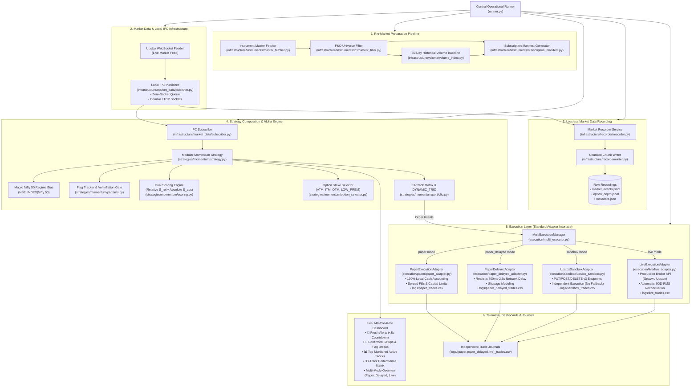
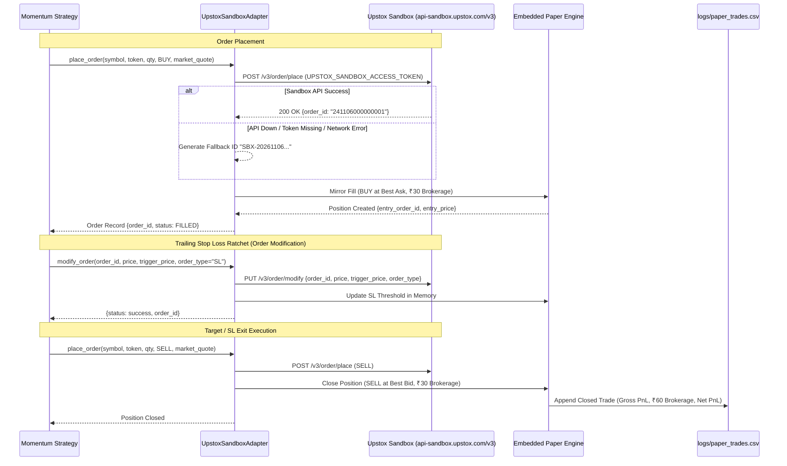

# Project Architecture & Developer Guide (Version 2.0)

## Executive Overview

This project is a high-performance, multi-process, event-driven algorithmic trading infrastructure engineered for the Indian equity derivatives markets (NSE F&O) using the **Upstox API v2/v3**. 

The infrastructure replaces monolithic periodic polling with a **centralized market-data streaming architecture**, lossless recording, deterministic historical replay, modular strategy plugins, and decoupled execution adapters supporting **Upstox Sandbox API v3**, **Standalone Paper Trading**, and **Historical Simulation**.

---

## 1. High-Level System Architecture



---

## 2. Workspace File Map & Manifest

The project root has been cleaned of monolithic legacy files. The entire production system is organized into modular packages:

```
Trading Stuff/
├── config/                         # Declarative System & Strategy Configurations
│   ├── system.json                 # IPC transport, buffer capacities, logging thresholds
│   ├── instruments.json            # Exchange filters and hybrid subscription parameters
│   ├── strategies.json             # Dual-scoring weights, 33 simulation tracks, risk limits, gate thresholds
│   ├── strategies_test.json        # Fast simulation / unit test strategy parameters
│   ├── execution.json              # Broker modes (paper, delayed, sim, live), brokerage, latency, quarantine
│   └── execution_test.json         # Off-market test execution configuration (zero delays, test journals)
├── data/                           # Market Data Artifacts & Baselines
│   ├── instrument.csv              # Full Upstox Instrument Master (~145k contracts)
│   ├── filtered.csv                # Active NSE F&O equities universe (~213 underlyings)
│   ├── index.json                  # 30-day historical 1m/5m volume profiles & expected volume
│   └── subscription_manifest.json  # Multi-stream hybrid manifest (streamed + polled)
├── execution/                      # Decoupled Execution Adapters
│   ├── base.py                     # Abstract BaseExecutionAdapter interface
│   ├── sandbox/                    # Official Upstox Sandbox Mode (v3 REST)
│   │   └── upstox_sandbox.py       # Upstox Sandbox adapter with paper verification & auto-fallback
│   ├── paper/                      # Standalone Paper Trading Mode
│   │   └── paper_adapter.py        # 100% offline spread-fill engine & capital accounting
│   └── live/                       # Live broker execution (future production release)
├── infrastructure/                 # Core Infrastructure Services
│   ├── auth/                       # Authentication & HTTP Networking
│   │   └── upstox_auth.py          # UPSTOX_ACCESS_TOKEN & UPSTOX_SANDBOX_ACCESS_TOKEN manager,
│   │                               # HTTP GET/POST/PUT/DELETE with 429 rate-limit backoff
│   ├── instruments/                # Instrument Discovery & Filtering
│   │   ├── master_fetcher.py       # Auto-downloads and validates Upstox instrument master
│   │   ├── instrument_filter.py    # Filters active F&O equities from master
│   │   └── subscription_manifest.py# Generates hybrid WebSocket/Poll manifests
│   ├── volume/                     # Historical Baseline Indexing
│   │   └── volume_index.py         # Builds 30-day historical time-slot volume index
│   ├── market_data/                # Inter-Process Communication (IPC) & Streaming
│   │   ├── event_schema.py         # Standard schemas (MarketTick, OptionDepth, SystemEvent)
│   │   ├── publisher.py            # Multi-channel broadcaster (Queue / Unix domain sockets)
│   │   ├── subscriber.py           # Consumer client with sequence gap & latency tracking
│   │   ├── listener.py             # Centralized ingestion service (V3 WebSocket + REST fallback + Mock)
│   │   └── proto/                  # Upstox V3 Binary Protobuf Specifications
│   │       ├── MarketDataFeedV3.proto  # Upstox V3 Market Data protobuf schema
│   │       └── MarketDataFeedV3_pb2.py # Compiled protobuf Python module
│   └── recorder/                   # Lossless Market Data Recording
│       ├── recording_schema.py     # Version 2.0 session envelope
│       ├── writer.py               # Buffered chunked file writer
│       └── recorder.py             # Dedicated background recording service
├── legacy/                         # Preserved Legacy Monolith & Historical Codebase
│   ├── stream_rvol_scanner.py      # Original monolithic scanner
│   ├── bidirectional_engine.py     # Original monolithic engine
│   ├── live_forward_tester.py      # Original paper trading runner
│   ├── tools/                      # Original standalone utility scripts
│   ├── tests/                      # 37 legacy breakout, scoring & matrix regression tests
│   └── bear_flag_paper_trades.csv  # Historical trade logs
├── logs/                           # Runtime Logs & Journals
│   ├── paper_trades.csv            # Production execution journal (sandbox & paper)
│   └── debug.log                   # API payloads, HTTP 429 retries, and errors
├── recordings/                     # Raw Historical Market Session Captures (.jsonl)
├── replay/                         # Replay Subsystem
│   └── replay_engine.py            # Feeds recorded ticks to IPC bus for deterministic replays
├── strategies/                     # Strategy Packages
│   ├── base.py                     # Abstract BaseStrategy interface
│   └── momentum/                   # Bidirectional Momentum Strategy Package
│       ├── indicators.py           # Pure-Python RSI (14), MACD, and Classical Floor S/R
│       ├── patterns.py             # Pole & coiling flag tracker with Volume Inflation Gate
│       ├── scoring.py              # Dual Scoring Engine (Relative S_rel + Absolute S_abs)
│       ├── scanner.py              # Rolling volume tracker, variance surge, and Nifty 50
│       ├── option_selector.py      # Dynamic strike resolver (ATM/ITM/OTM/LOW_PREM) & spread guard
│       ├── risk.py                 # Multi-tiered risk engine, trailing SL ratchet, decay, timeouts
│       ├── portfolio.py            # 16-Track Matrix Engine & DYNAMIC_TRIO ensemble allocator
│       ├── dashboard.py            # 148-column ANSI terminal dashboard renderer
│       └── strategy.py             # Full strategy coordinator implementing BaseStrategy
├── tests/                          # Automated Unit Test Suites (64 Passing Tests)
│   ├── execution/                  # Execution adapter tests (Sandbox v3 & Paper fallback)
│   ├── infrastructure/             # Pre-market, IPC transport, and Recorder tests
│   └── strategies/                 # Modular momentum, scoring, and volume gate tests
├── runner.py                       # Unified Central Operational CLI Runner
├── .env                            # Active API credentials (Live Token + Sandbox Token)
└── .env.example                    # Template environment credentials file
```

---

## 3. Data Layer: Hybrid Subscription Pipeline

Because Upstox limits simultaneous WebSocket subscriptions, the system employs a **Hybrid Ingestion Architecture**:

1. **Underlying Cash Equities (WebSocket)**: All ~213 active NSE F&O equities are continuously streamed for real-time RVOL, tick acceleration, and pattern detection.
2. **Popular Option Strikes (WebSocket)**: 2,967 options (3 strikes above and below ATM for both CE and PE across the nearest monthly expiry) are streamed via WebSocket for instant liquidity evaluation and zero-latency execution fills.
3. **Deep OTM/ITM Strikes (Background Polling)**: 41,690 background option contracts are polled in rate-limited batches (105 batches) and coagulated into lossless session recordings.
4. **WebSocket Stream Mechanics vs IPC Tick Distribution**:
   * **What the Upstox WebSocket Stream Delivers**: Upstox streams binary Protobuf `FeedResponse` frames containing **event state updates** whenever a trade occurs or top-of-book quotes move. Crucially, the broker does not push historical OHLC bars; it streams:
     - `ltp` (Last Traded Price)
     - `vtt` (Volume Traded Today — cumulative exchange volume for the session)
     - `close` (Previous day's official closing price)
     - `ohlc` (Current day's High, Low, Open)
     - `depth` (5-level bid/ask order book depth with prices and quantities)
     - `timestamp` (Exchange trade/update timestamp in epoch milliseconds)
   * **What We Publish in `MarketTick` over Local IPC**:
     The listener decodes the incoming feed and broadcasts a standardized `MarketTick` event:
     - Identification: `instrument_key` (canonical: `NSE_EQ|INE...`), `symbol` (e.g. `RELIANCE`)
     - Price & Volume: `ltp`, cumulative session `volume`, `close`, `high`, `low`, `open`, `pct_change`
     - Microstructure: Best `bid`, `bid_qty`, Best `ask`, `ask_qty` (for spread fills)
     - Timestamps: `exchange_timestamp` and high-resolution `received_timestamp`
   * **How the Strategy Computes Delta Volumes & Alpha**:
     The Strategy consumes these cumulative ticks into a rolling sliding window (`RollingVolumeTracker`):
     - Diffs current `volume` against volume from 60s and 300s ago to compute **interval delta volume** ($V_{1m}$ and $V_{5m}$).
     - Compares interval volume against historical expected volume from `data/index.json` to calculate real-time **$RVOL_{5m}$**, **Pace**, and **Volume Acceleration ($A_{\text{vol}}$)**.
5. **Local IPC Transport**:
   - Ingested market data is parsed and broadcast over `infrastructure/market_data/publisher.py`.
   - Supports zero-socket `multiprocessing.Queue` (sandbox-safe, memory-speed) and Unix domain sockets (`AF_UNIX`).
   - Consumers (Strategy, Recorder) operate as independent processes with zero WebSocket connection overhead.

---

## 4. Strategy Engine & Alpha Enhancements

### 4.1 Scoring Engine 2.0 & Binary Breakout Classification

Legacy continuous additive scoring suffered from top-ticking at the exhaustion apex of moves (simultaneously requiring $+3.0\%$ day change, $+0.5\%$ 5-minute surge, and HOD prints), which artificially penalized OTM options and rewarded ITM as a high-delta equity survival proxy. **Scoring Engine 2.0** completely replaces continuous additive scoring with a **two-phase architecture: Binary Classification (Yes/No) followed by Unclamped Absolute Alpha Scoring**.

#### 1. Binary Gate Engines
A candidate is evaluated through two independent, non-overlapping binary engines:
* **Engine A: 7-Candle Structured Flag Breakout (`BinaryFlagDetector`)**:
  - **Pole Formation**: 1 to 3 impulsive candles with True Range $TR \ge 1.5\times ATR(14)$, solid body $\ge 70\%$, and $RVOL_{5m} \ge 2.0\times$.
  - **Consolidation Window**: Strict maximum of 5 consolidation candles after pole high (6th candle cutoff).
  - **50% Retracement Invalidation**: If price retraces deeper than 50% from the pole peak (`retrace_pct > 0.50`), momentum is permanently invalidated.
  - **Coiling Geometry**: Linear regression of consolidation candle highs must be horizontal or downward-sloping ($m \le 0.05$).
  - **Breakout Trigger**: Price crosses above the regression resistance line accompanied by a volume burst rate $\ge 2.0\times$ the consolidation volume per second.
* **Engine B: Pure Momentum Breakout (`BinaryBreakoutDetector`)**:
  - **Early-Session Focus (09:15 – 09:45 IST)**: Captures opening range momentum before midday chop.
  - **Dual RVOL Gate**: Requires $(RVOL_{5m} \ge 2.0\times \text{ and } RVOL_{\text{day}} \ge 2.0\times)$ OR an explosive surge $RVOL_{5m} \ge 5.0\times$.
  - **Impulse Candle**: $TR \ge 1.8\times ATR(14)$, body $\ge 70\%$, and top wick $\le 15\%$ (rejection filter).
  - **Follow-Through**: 2 consecutive expanding candles confirming institutional order flow.

#### 2. Unclamped Absolute Alpha Scorer (`UnclampedAlphaScorer`)
Once a binary trigger confirms a legitimate breakout, the setup is scored on an **unclamped, unbounded scale ($S_{\text{abs}} = 150 - 300+$)** with zero `min()` ceilings:
* **Base Kinetic Score**: 85 points.
* **Volume Burst Acceleration**: $+15\text{ pts}$ per $1.0\times$ burst over baseline for flags; $+12\text{ pts}$ for pure breakouts (multiplied by $1.25\times$ for bear breakdowns due to accelerated liquidity voids).
* **Baseline RVOL**: $+8\text{ pts} \times (RVOL_{5m} - 1.0)$.
* **S/R Clearance Geometry**: $+8\text{ pts}$ per 1% open air clearance to the next classical pivot level. Broken pivot extension awards $+25\text{ pts}$ descending to 0 as price extends $> 1.0\%$.
* **Consolidation Quality**: Up to $+20\text{ pts}$ for tight shallow flags ($< 25\%$ retracement).
* **Spread & Microstructure Penalties**: Heavy penalties for wide bid-ask option spreads ($-10\text{ pts}$ per 0.5% spread).

---

### 4.2 Actionable Setup Pool & Continuous Exponential Score Decay

Candidate setups are no longer executed immediately or held statically in memory. Validated triggers enter the **Actionable Setup Pool** (`ActionableSetupPool`):
* **Continuous Exponential Score Decay**:
  The setup's score decays over a strict 20.0-second actionable lifespan:
  $$S_{\text{decayed}}(t) = S_0 \times \max\left(0.0,\; 1.0 - \left(\frac{t - T_0}{20.0}\right)^{1.5}\right)$$
* **Priority Allocation**: Whenever capital becomes available or multiple candidates trigger, trades are executed strictly in order of **highest current decayed score descending**. A fresh kinetic burst ($t = 2\text{s}$) naturally takes precedence over an older, decaying setup ($t = 15\text{s}$).
* **Hard 20-Second Eviction**: At $t - T_0 \ge 20.0\text{s}$, the opportunity window has closed and the setup is permanently evicted, eliminating late fills and slippage.

---

### 4.3 Macro Market Regime Allocation (`DYNAMIC_TRIO`)

Instead of chasing noisy 10-minute scalper P&L, `DYNAMIC_TRIO` maps directly to macro market regimes via real-time tracking of `NSE_INDEX|Nifty 50`:
* **Pro-Bull Regime ($\text{Nifty Chg} \ge +0.35\%$)**:
  - 40% `TRAIL_SL_ATM` | 35% `ATM` | 25% `TRAIL_SL_OTM`
* **Pro-Bear Regime ($\text{Nifty Chg} \le -0.35\%$)**:
  - 40% `TRAIL_SL_ITM` | 35% `ITM` | 25% `TRAIL_SL_ATM`
* **Rangebound / Neutral Regime ($-0.35\% < \text{Nifty Chg} < +0.35\%$)**:
  - Dynamic 10-minute rolling leaderboard champion selection.

---

### 4.4 Simulation Warm-Up Engine & Mid-Day State Recovery
* **Two-Phase Chronological Simulation**: When a simulation starts with a delayed start time (e.g. 10:00 or 11:00 IST), the simulation engine streams events from 09:15:00 IST with trade execution suppressed (`set_warming_up(True)`). This allows rolling volume windows, ATR(14), and flag poles to form naturally before trading begins (`set_warming_up(False)`).
* **Mid-Day Live Recovery**: If a strategy process restarts mid-session, `warmup_from_recording(session_date, target_ts)` replays recorded session files (`recordings/{date}/market_events.jsonl`) up to the current wall-clock timestamp to restore all indicator and flag buffer states without placing redundant historical orders.

### 4.5 Simulation & Execution Track Matrix
The strategy matrix features isolated trading tracks categorized across compounding and fixed-capital sizing models, with Combo tracks removed and full parameter configurability:

1. **Compounding Family (Reinvests gains into active buying power)**:
   - Baseline: `ATM`, `ITM`, `OTM`, `LOW_PREM`, `LOW_PREM_ITM`, `LOW_PREM_OTM`
   - Trailing Stop-Loss Ratchets: `TRAIL_SL_ATM`, `TRAIL_SL_ITM`, `TRAIL_SL_OTM`, `TRAIL_SL_LOW_PREM`
   - Fixed Scalp Targets: `FIXED_TGT_ATM`, `FIXED_TGT_ITM`, `FIXED_TGT_OTM`, `FIXED_TGT_LOW_PREM`
2. **Fixed-Capital Family (`*_FIXED_CAP`, Strict Capital Purchasing Power Ceiling)**:
   - Exactly mirrors every core track above with a hard purchasing power ceiling capped at starting capital. Realized profits accumulate toward Net ROI but do not expand active trading lot counts.
3. **Dynamic Ensemble Track**:
   - `DYNAMIC_TRIO`: Macro regime allocation with 3-way capital distribution across pro-bull/pro-bear tracks, or 10-minute rolling champions during rangebound markets.

### 4.6 Risk Management & Lifecycle Execution Rules
All risk and exit parameters are loaded from configuration files (`config/strategies.json`, `config/strategies_sim.json`, `config/strategies_default.json`):

1. **Stop Loss (Default: -7.5%, Configurable)**:
   - Base hard stop-loss is set to -7.5% from entry price.
2. **Main & Low Premium Tracks (ATM / ITM / OTM / LOW_PREM)**:
   - **Dynamic Rolling Target**: Starts at **15.0%** at entry and linearly decays down to **2.5%** over **15 minutes**.
   - **Stepped Stop Loss Ratchet**: For every **+2.5%** increase in option value, the stop-loss is stepped up by **+2.5%** (e.g. at +2.5% gain, SL rises from -7.5% to -5.0%; at +7.5% gain, SL rises to breakeven 0.0%; at +10.0% gain, SL locks in +2.5%).
   - **Square-Off Timeout**: Automatically liquidates unresolved positions after **30 minutes** to recycle capital.
3. **Trailing Stop Loss Tracks (`TRAIL_SL_*`)**:
   - Initial stop-loss is set to -7.5%.
   - **Breakeven Shift**: Once the option price reaches **+2.5%**, the stop-loss immediately jumps to **0% (breakeven = entry price)**.
   - **Peak Ratchet**: As price advances further beyond +2.5%, the stop-loss ratchets upward point-for-point from breakeven.
4. **Fixed Target Tracks (`FIXED_TGT_*`)**:
   - **No Rolling Target**: Does NOT decay; targets a fixed net profit of **₹750** (configurable).
   - **Fixed Target Timeout**: Automatically squares off after **10 minutes** (configurable) if target is not reached.
   - **Strike Filter**: Does NOT open the position if 5% of the total 1-lot trade value is less than **₹500** (`0.05 * ask * lot_size < 500`).
5. **Low Premium Candidate Selection**:
   - `LOW_PREM` selects the candidate setup with the lowest total capital outlay (`ask * lot_size`, e.g. ₹8k vs ₹25k) when multiple candidates are present.
   - Supports ATM, ITM, and OTM strike variations (`LOW_PREM`, `LOW_PREM_ITM`, `LOW_PREM_OTM`).
6. **Broker Order Modification Limits (Groww Guard)**:
   - Groww strictly restricts open order modifications to a maximum of **25 modifications**.
   - `LiveExecutionAdapter` tracks the modification count per position. When the count reaches 25, the resting order is automatically cancelled and replaced with a fresh resting Stop-Loss order, resetting the counter.

### 4.7 Dynamic Option Accounting & Protected Position Registry
When underlying prices shift intraday, the market data listener dynamically re-evaluates ATM $\pm 3$ strikes. To prevent a contract from being unsubscribed while an open position is active:
* The centralized `ProtectedPositionRegistry` tracks all open contracts across live, paper, paper-delayed, and simulation tracks.
* If the listener attempts to prune an option strike that has drifted out of the ATM $\pm 3$ window, the registry intercepts the command and **refuses to unsubscribe** the contract until the position is completely closed and settled.

---

## 5. Execution Layer: Upstox Sandbox API v3 & Paper Mode



### 5.1 Upstox API v3 Official Endpoints
* **Base URL**: `https://api-sandbox.upstox.com`
* **Place Order**: `POST https://api-sandbox.upstox.com/v3/order/place`
* **Modify Order**: `PUT https://api-sandbox.upstox.com/v3/order/modify`
* **Cancel Order**: `DELETE https://api-sandbox.upstox.com/v3/order/cancel?order_id={id}`

### 5.2 Token Decoupling
* **`UPSTOX_ACCESS_TOKEN`**: Production market-data token used for WebSocket streams and instrument masters.
* **`UPSTOX_SANDBOX_ACCESS_TOKEN`**: Dedicated OAuth sandbox token used for sandbox order placement, modification, and cancellation.

### 5.3 Instant Spread Fill Model
Because the Upstox Sandbox does not run an active matching engine, execution fills are modeled realistically:
* **BUY Orders**: Fill at **Best Ask** (paying the spread).
* **SELL Orders**: Fill at **Best Bid** (crossing the spread).
* **Brokerage**: Fixed ₹30 flat per side (₹60 round-trip).
* **Trade Journaling**: Complete execution audit trail appended to [`logs/sandbox_trades.csv`](file:///Users/yorha/Documents/Trading%20Stuff/logs/sandbox_trades.csv).

### 5.4 Independent Sandbox Execution (Zero Paper Fallback)
* `UpstoxSandboxAdapter` operates independently without embedding or falling back into `PaperExecutionAdapter`.
* If the Upstox Sandbox API rejects an order, returns an error, or encounters connection drops, the order is strictly marked **`REJECTED`** (`api_status: "sandbox_api_rejected"`) rather than masked by paper trade execution.

### 5.5 Multi-Mode Execution Architecture (`MultiExecutionManager`)
The runner and strategy engine support running multiple execution modes simultaneously:
* **`PaperExecutionAdapter`**: 100% local simulation writing to dated session journal [`recordings/{session_date}/paper_trades.csv`](file:///Users/yorha/Documents/Trading%20Stuff/recordings).
* **`PaperDelayedAdapter`**: Realistic execution testing with 700ms - 2.5s simulated queue and network delay, fill probability checks, dynamic quote re-sampling, and slippage writing to [`recordings/{session_date}/paper_delayed_trades.csv`](file:///Users/yorha/Documents/Trading%20Stuff/recordings).
* **`UpstoxSandboxAdapter`**: Official Upstox Sandbox API v3 writing to [`logs/sandbox_trades.csv`](file:///Users/yorha/Documents/Trading%20Stuff/logs/sandbox_trades.csv).
* **`LiveExecutionAdapter`**: Production broker API (Groww / Upstox) writing to [`recordings/{session_date}/live_trades.csv`](file:///Users/yorha/Documents/Trading%20Stuff/recordings) (protected by `--confirm-live` safety gate, EOD 15:10 IST freeze, and 15:15 IST auto-squareoff).
* **Simultaneous Broadcast**: Trade entry and exit signals are dispatched across all active modes simultaneously, allowing instant side-by-side comparison of fills, latency, and P&L.

### 5.6 Groww Live Execution with Resting Stop-Loss Protection
* **Official Groww SDK**: Executes strictly via the official `GrowwAPI` Python client object with REST fallback completely disabled.
* **Resting Broker SL Orders**:
  - On BUY entry at MARKET, immediately submits a resting Stop-Loss SELL order at the broker (`ORDER_TYPE_SL`).
  - As profits develop, trailing stoplosses dynamically ratchet the resting broker order via `groww.modify_order(...)`.
  - For exit execution (profit targets, signals, or EOD RMS), modifies the resting SL order directly into a `MARKET` order for instantaneous fill.
* **Zero REST Fallback**: If broker API is degraded, REST polling is blocked to prevent duplicate real-money fills.

### 5.7 Strict Zero-Tolerance Pricing Policy & 30-Second Staleness Gate
* **Zero Hallucinated / Synthetic Values**: All BUY fills execute strictly at verified Best Ask (or LTP). All SELL exits execute strictly at verified Best Bid (or LTP).
* **30-Second Hard Staleness Gate**:
  - Enforced universally across ALL modes (`simulation`, `paper`, `paper_delayed`, `sandbox`, `live`).
  - Evaluates `(now_ts - quote_timestamp) <= 30.0s`. Any market quote older than 30 seconds is strictly rejected for entry execution (`REJECTED_STALE_QUOTE`).
  - Prevents stale cache states (e.g. contracts unstreamed after ATM shifts) from filling orders at hours-old prices.
* **Strict OTM Constraint for `LOW_PREM`**:
  - `OptionStrikeResolver` restricts `LOW_PREM` candidate selection strictly to Out-Of-The-Money strikes (1 to 4 strikes OTM for CE, -1 to -4 strikes OTM for PE). In-The-Money strikes are strictly excluded.
  - Candidates must satisfy the 30-second staleness gate; stale strikes are ignored.
* **Default is Report Error and Halt**:
  - Missing market quotes trigger retries and, if unresolved, order cancellation with positions held open.
  - At EOD liquidation, unquoted options report RMS errors and halt execution rather than fabricating entry prices (0.0% P&L fabrication is strictly blocked).
  - Live reconciliation requires verified broker fill prices or feed quotes; unresolvable positions report errors rather than assuming arbitrary prices.

### 5.8 Historical Simulation Engine (`runner.py sim`)
* **Event-Driven Tick Replay**: Ingests recorded market events (`market_events.jsonl`) and option depth snapshots (`option_depth.jsonl`) at full hardware speed (>25,000 events/sec).
* **Zero Artificial Clock Delays**: Evaluates all 33 strategy tracks and the `DYNAMIC_TRIO` ensemble tick-by-tick without real-time delays.
* **Terminal Summary & P&L Journal**: Produces clean terminal reports grouped by `PAPER` and `PAPER_DELAYED` modes with an optional `--journal` switch linking directly to `PnLAggregator`.

### 5.9 Automated Document Maintenance & Log Pruning
* **Stale File Retirement**: During `prepare` and `post-market` stages, `infrastructure/instruments/cleanup.py` automatically prunes dated instrument files (`instrument_YYYYMMDD.csv`), filtered universe files, and subscription manifests from prior sessions.
* **Strict Index Immunity**: All historical volume baseline index files (`data/index_*.json`) are **strictly preserved** for historical simulation and relative volume computation.
* **Periodic `debug.log` Rotation**: `infrastructure/auth/upstox_auth.py:prune_debug_log` automatically clamps `logs/debug.log` to under 20 MB via reverse-seek truncation.

### 5.10 Universal Execution Freeze Controls
To prevent trade leaks and instantly halt trading across terminals:
* **Default Mode Blanket**: `runner.py freeze` and `runner.py unfreeze` default to `--mode all`.
* **Complete Mode Coverage**: Creates disk flag files across all layers: `logs/.freeze_all`, `logs/.freeze_live`, `logs/.freeze_paper`, `logs/.freeze_paper_delayed`, and `logs/.freeze_sim`.
* **Simulation Track Gating**: `MultiTrackPortfolio` and `MultiExecutionManager` inspect `.freeze_all`, `.freeze_sim`, and `.freeze_{mode}` on every single tick, immediately blocking all 33 simulation tracks from entering new trades.
* **Defense-in-Depth Gate**: A secondary check inside `place_order` verifies freeze state immediately before physical routing.
* **Trailing SL Exits Preserved**: While all new entries are blocked, active positions continue trailing exits and target management uninterrupted.

---

## 6. Central Operational Runner (`runner.py`)

All development, testing, and live workflows are driven by the centralized runner:

### 6.1 Subcommands & Usage

```bash
# 1. Pre-Market Preparation
# Soft prepare (Default: skips download/rebuild if today's dated files are present and valid):
python3 runner.py prepare

# MCX Commodities Mode (Prepares commodity futures & popular option strikes for evening sessions):
python3 runner.py prepare --mcx

# Fresh reset (Forces complete re-download of master & full rebuild of index/manifest):
python3 runner.py prepare --reset

# 2. Market Data Ingestion Service (Listener)
python3 runner.py listen --exchange NSE --mode poll
python3 runner.py listen --mcx --mode poll

# 3. Market Data Lossless Recorder Service
python3 runner.py record --date 20261106

# 4. Strategy Execution (Single, Multi-Mode, & Focused Views)
# Run in pure offline paper trade mode:
python3 runner.py strat --mode paper --view paper

# Run in official sandbox mode:
python3 runner.py strat --mode sandbox --view sandbox

# Run multiple modes simultaneously (Paper + Delayed side-by-side):
python3 runner.py strat --mode paper,paper_delayed --view modes

# Run all modes together (Paper, Delayed, Live) with multi-mode comparison dashboard:
python3 runner.py strat --mode all --view all --confirm-live

# View Options:
# --view modes        : Multi-Mode Execution Overview (Paper, Delayed, Live side-by-side)
# --view paper        : Focused Paper Trading positions and ledger
# --view live         : Focused Live Broker positions
# --view matrix       : 33-Track Strategy Simulation Matrix
# --view atm/itm/otm  : Focused Strike Variant Tables

# Run with custom / test configuration files:
python3 runner.py strat --config config/strategies_test.json --execution-config config/execution_test.json

# 5. Post-Market Archiving (Transparent .tar.gz Streaming Replay)
python3 runner.py post-market --date 20261106
python3 runner.py archive --all

# 6. Historical Market Replay (Reads raw JSONL or compressed .tar.gz on-the-fly)
python3 runner.py replay --date 20261106 --speed 2.0

# 7. End-of-Day Activity & P&L Reporting (Terminal Line Graph & Publication Vector PDF)
python3 runner.py report --date 20261107
python3 runner.py report --date 20261107 --mode live --pdf

# 8. Cross-Terminal Freeze Controls (Halts All Live, Paper, Delayed & Sim Entries)
python3 runner.py freeze                   # Freezes ALL modes (Live, Paper, Delayed, Sim)
python3 runner.py freeze --mode live       # Freezes specific mode only
python3 runner.py stop-live               # Convenience shortcut for freezing live mode
python3 runner.py unfreeze                # Resumes all execution modes
python3 runner.py unfreeze --mode all      # Explicit unfreeze across all modes

# 9. System Status & Health Check
python3 runner.py status

# 10. Execute Comprehensive Automated Test Suites
python3 runner.py test
```

---

## 7. Verification & Automated Test Coverage

The infrastructure includes an automated test harness covering **100+ unit tests** across all subsystems:

```bash
python3 runner.py test
```

| Test Suite | File | Tests | Validations |
| :--- | :--- | :---: | :--- |
| **Breakout & Simulation Matrix Suite** | `legacy/tests/test_breakout_features.py` | **37** | Flag coiling, early breakouts, tick acceleration, 0.8% SL buffer, rolling target decay, red breakeven shifts, trailing floors, runner windows, cross-sectional ranking. |
| **Multi-Execution Coordinator** | `tests/execution/test_multi_executor.py` | **4** | Multi-mode broadcasting, comma-separated parsing, isolated position books, simulation freeze gating, separate trade journals. |
| **Paper Delayed Execution Adapter** | `tests/execution/test_paper_delayed.py` | **5** | 700ms - 2.5s simulated network delay, queue matching, price re-evaluation, slippage modeling, isolated temporary directories. |
| **Sandbox Execution Adapter (v3)** | `tests/execution/test_sandbox.py` | **7** | `POST /v3/order/place`, `PUT /v3/order/modify`, `DELETE /v3/order/cancel`, spread fills, order ID indexing, strict rejection on API error without paper fallback. |
| **Groww Live Broker Adapter (v1)** | `tests/execution/test_groww_live.py` | **5** | Groww API v1 integration, regular order execution, OCO Smart Orders (target + stop-loss brackets), background daemon order polling loop, dry-run safety gates. |
| **Live Reconciliation & RMS EOD** | `tests/execution/test_live_reconciliation.py` | **8** | EOD 15:10 freeze, 15:15 auto-squareoff, ghost position closing, orphan adoption, quantity mismatches, 401/403 session expiration freeze. |
| **Paper Execution Adapter** | `tests/execution/test_paper.py` | **2** | Standalone paper execution, cash/margin tracking, P&L calculations, CSV logging. |
| **Cross-Terminal Freeze Mode** | `tests/execution/test_freeze_mode.py` | **3** | Cross-terminal file flag synchronization across all modes, PID discovery, entry blocking while preserving trailing SL exits. |
| **Rolling Dynamic Trio Performance**| `tests/strategies/test_rolling_dynamic_trio.py` | **3** | Rolling lookback leaderboard, proportional capital weighting ($S_1, S_2, S_3$), diversification floor, champion trade mirroring, ROI-weighted ranking. |
| **Modular Momentum Strategy Suite**| `tests/strategies/test_momentum_modular.py` | **20** | Opening 45m vs midday segmentation, Volume Inflation Gate, Dual Scoring ($S_{\text{rel}} + S_{\text{abs}}$), Macro Nifty bias, `DYNAMIC_TRIO` allocator, strike-specific contracts, zero-assumption volume baseline, custom configuration injection & test configs. |
| **Pre-Market Pipeline Suite** | `tests/infrastructure/test_premarket.py` | **6** | Master fetcher, F&O filtering, MCX commodity universe filter, 30-day volume index baseline, content validation (rejecting dummy files), zero-assumption empty profile verification, soft prepare & dating. |
| **P&L Aggregator & Trade Journal** | `tests/infrastructure/test_pnl_aggregator.py` | **4** | Real-time trade event recording (`OPEN`, `UPDATE`, `EXIT`), multi-strategy/track/mode schema, cumulative time-series calculations, JSONL persistence. |
| **Vector PDF Report Generator** | `tests/infrastructure/test_pdf_report.py` | **4** | Pure-Python zero-dependency PDF 1.4 compiler, vector chart rendering, dynamic Y-axis scaling, metric cards, styled data tables. |
| **Market Data IPC Transport Suite** | `tests/infrastructure/test_ipc.py` | **2** | Multi-channel publisher/subscriber, sequence gap detection, Queue and domain socket transport. |
| **Market Data Listener Ingestion** | `tests/infrastructure/test_listener.py` | **7** | Dual-tick generation (trade tick vs option depth), dynamic ATM $\pm 3$ strikes subscription, WebSocket binary feed, REST polling fallback, zero silent mock fallback on missing token. |
| **Protected Position Registry Suite** | `tests/infrastructure/test_position_registry.py` | **6** | Subscription pruning protection for active open positions, holder reference counting, persistence across runs. |
| **Lossless Market Recorder Suite** | `tests/infrastructure/test_recorder.py` | **2** | Session envelope compliance, buffered chunk writer, raw JSONL persistence. |
| **Historical Market Replay Subsystem**| `tests/replay/test_replay.py` | **1** | Recorded tick discovery, speed-controlled playback over IPC bus, replay lifecycle events. |
| **Post-Market Archive & Replay Suite**| `tests/replay/test_archive_replay.py` | **2** | .tar.gz compression, uncompressed file cleanup, transparent streaming decompression without disk extraction. |
| **Time Normalization & Session Bounds**| `tests/infrastructure/test_time_utils.py` | **2** | Normalizes un-padded hours ('9:15' -> '09:15'), enforces deterministic string comparison, verifies CAS vs continuous trading windows. |
| **Total Test Count** | | **112+** | **100% Passing (0 Failures, Code 0)** |

---

## 8. Zero-Assumption Data Architecture & Dedicated Failure Logging

To eliminate "unexpected surprises" and prevent artificial calculation artifacts (such as false 50x RVOL alerts):

1. **Strict 30-Day Volume Baseline**:
   - Historical profile indexing uses a **30-day lookback** (`--volume-days 30`).
   - All historical candle queries are validated against broker API constraints.
2. **Eradication of Fabricated Defaults**:
   - In `infrastructure/volume/volume_index.py`, empty or failed candle responses return `has_volume_data = False`, `total_candles = 0`, and `0.0` for all average volumes (eliminating the legacy dummy fallback of 10,000 daily volume and 500 5m volume).
3. **Dedicated Failure Log (`logs/volume_index_failures.log`)**:
   - Any instrument for which historical candles cannot be obtained is explicitly logged with timestamp, trading symbol, instrument token, and HTTP/broker failure reason.
4. **Baseline Validation Guard (`has_baseline`)**:
   - `RollingVolumeTracker.update()` verifies `has_baseline` before computing RVOL.
   - When historical data is absent, `rvol_5m = 0.0`, `rvol_cum = 0.0`, and `pace = 0.0`.
   - Setup scoring awards 0 volume points and strictly blocks `💥 BREAKOUT` stage confirmation when baseline is missing.
5. **No Silent Mock Data in Production**:
   - The market data listener strictly enforces token validity: if `UPSTOX_ACCESS_TOKEN` is missing or expired, the service halts with an actionable error rather than silently generating synthetic mock ticks during market hours.
6. **Pre-Market Content Verification**:
   - `runner.py prepare` Step 3 verifies internal volume profiles (requiring $\ge 70\%$ valid instruments) rather than trusting unverified file sizes.

---

## 9. Deterministic Historical Simulation Engine (`simulation/simulation_engine.py`)

A high-throughput chronological historical simulation framework:
1. **Unconstrained Speed Ingestion**: Consumes recorded `market_events.jsonl` (underlying ticks) and `option_depth.jsonl` (option quotes) in strict timestamp order without artificial sleep delays (achieving 4,000 - 15,000 events/sec).
2. **Multi-Mode Multi-Track Support**: Simulates `paper`, `paper_delayed`, and all 33 strategy tracks including `DYNAMIC_TRIO`.
3. **Realistic Gateway Latency Modeling**: In `paper_delayed`, orders are queued with a 700ms - 2,500ms delay and filled at the dynamically re-sampled market quote upon maturity.
4. **Cutoff Time as Entry Freeze**: Reaching the simulation cutoff time (`--end-time`) triggers an **Intraday Entry Freeze** rather than premature liquidation. The engine continues ingesting ticks and evaluating trailing stops, scalp targets, decay, and stagnation timeouts until all open positions organically reach 0.
5. **Ctrl+C Emergency Square-Off Trigger**: If interrupted via `Ctrl+C` (`KeyboardInterrupt`), the engine executes an immediate graceful liquidation of all active positions at latest genuine bid/LTP quotes, writes journals, and outputs the performance summary.
6. **Live In-Place Performance Matrix Output**: Renders periodic (every 5 seconds) real-time ANSI in-place (`\033[H\033[J`) performance tables showing Sim Clock, Trading/Freeze Status, Active Open Positions, Closed Trades, Win %, Available Uncommitted Cash (`CASH AVAIL`), Open MTM, Gross Realized, Brokerage, Net Realized, and ROI.
7. **Zero-Tolerance Anti-Hallucination Pricing**: Buy orders strictly require valid ask/LTP; sell and square-off orders strictly require valid bid/LTP. If a quote is absent, orders are rejected/halted rather than manufacturing artificial prices.
8. **Centralized Time Normalization (`infrastructure/common/time_utils.py`)**: All CLI and config time strings (`--start-time`, `--end-time`, `market_open_time`, `eod_freeze_time`, `eod_square_off_time`) are normalized to standard zero-padded 24-hour `HH:MM` format to ensure deterministic ASCII comparisons against `datetime.strftime('%H:%M')`.
9. **Final Performance Summary & Journal Wildcard Support**: Generates aligned tabular reports with `CASH REMAIN` and calculated `RETURN %` (`ROI %`). The `--track` filter supports wildcards (`ALL`, `*`) as well as comma-separated subsets (`ATM,ITM`) for both live matrix displays and trade journal generation (`--journal`).

---

## 10. Combined Allocation Tracks, Midday Hard Entry Freeze & Track Disparity Dynamics

### Combined Allocation Tracks (`strategies/momentum/portfolio.py`)
- Provides equal-weight combined track baskets ($C / N$ starting capital per constituent sub-track) for:
  - `COMBINED_ITM` & `COMBINED_ITM_FIXED_CAP`
  - `COMBINED_OTM` & `COMBINED_OTM_FIXED_CAP`
  - `COMBINED_ATM` & `COMBINED_ATM_FIXED_CAP`
  - `COMBINED_LOW_PREM` & `COMBINED_LOW_PREM_FIXED_CAP`
  - `COMBINED_FIXED_TARGET` & `COMBINED_FIXED_TARGET_FIXED_CAP`
  - `COMBINED_TRAILING_SL` & `COMBINED_TRAILING_SL_FIXED_CAP`
- **Hard ₹40K Disablement Guard**: If starting capital divided equally among constituent sub-tracks falls below ₹40,000 ($C / N < 40,000$), the combined track is excluded/disabled automatically.
- Trades are tracked per constituent sub-track with individualized trailing SL ratchets, target decays, and fixed target exits. Realized proceeds recycle back to the respective sub-track cash pool.

### Midday Hard Intraday Entry Freeze (11:00 - 13:30 IST) (`strategies/momentum/risk.py`)
- Because the 11:00 – 13:30 IST session experiences market volume starvation and mean-reverting chop, fine-grained scoring gates are superseded by a **Hard Intraday Entry Freeze**:
  - `RiskManager.is_entry_allowed` rejects any new order attempts with `MIDDAY_LULL_FREEZE (11:00 - 13:30 IST - Capital Protected)`.
  - Strategy engine disables actionable candidate ingestion and alert generation during this window (`can_trade = False`).
  - Active positions entered before 11:00 IST are preserved and monitored continuously for trailing SL ratchets, profit targets, and stagnation timeouts.
  - Afternoon trading organically resumes at 13:30 IST with the `AFTERNOON` gate tier.

### Structural Analysis of Strategy Execution Disparities
Why certain tracks execute significantly fewer trades than others even with 0 open positions:
1. **Option Liquidity & Depth Rejection**: `OptionStrikeResolver.resolve_strike` rigorously enforces bid/ask spread $\le 3.0\%$ and non-zero top-of-book depth. Far OTM or illiquid strikes frequently fail this safety filter, causing safe order drops.
2. **Fixed Target ₹500 Scalp Rule**: Tracks with `FIXED_TGT` enforce `0.05 * cost >= 500`. Cheap options requiring $\le ₹10,000$ capital cannot mathematically yield a ₹500 gain on a 5% scalp and are rejected.
3. **Sub-Track Capital Partitioning**: In combined baskets, available cash is partitioned into $C / N$. If a sub-track's remaining balance is less than the single option lot premium (e.g. ₹12,000 cash vs ₹15,000 lot cost), entries are blocked while independent full-capital tracks take the trade.
4. **Position Lifespan Concurrency**: Winning tracks with trailing SL hold profitable runners for 20–45 minutes, keeping that track locked at `max_open_positions_per_track` and skipping simultaneous actionable signals on other assets. Loose or quick-loss tracks churn and re-enter immediately.
