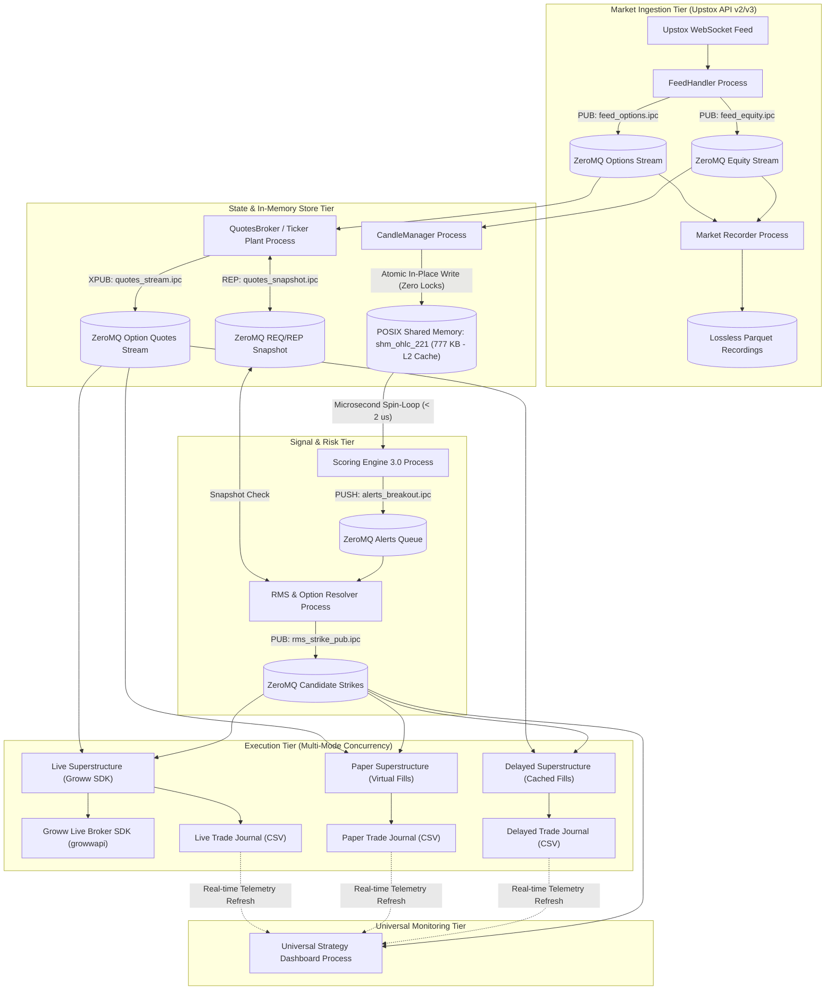

# Algorithmic Trading Infrastructure (NSE F&O)

> **Architecture Status**: Distributed Architecture 2.0 & Scoring Engine 3.0  
> **Target Universe**: 221 National Stock Exchange (NSE) Equity Derivatives Underlyings  
> **Execution Modes**: Live Broker Gateway, Instant Paper Trading, Stream-Driven Delayed Fills, Columnar Sim  

---

## 1. System Overview

This platform is a high-performance, distributed, low-latency algorithmic trading infrastructure engineered for the Indian equity derivatives markets (NSE F&O). It captures institutional momentum expansion (Call CE and Put PE buying) using **strict physical price action invariants**, eliminating lagging indicators, continuous 0–100 scores, and market regime bias.

The architecture strictly decouples market domains:
- **Cash Equity Ticks (~2,000/s)**: Aggregate into a dedicated **777 KB POSIX Shared Memory** cache (`shm_ohlc_221`) fitting completely within the CPU's **L2 cache**, evaluated in $< 2\ \mu\text{s}$ by a lock-free spin-loop.
- **Derivatives Option Ticks (~30,000/s)**: Isolated from strategy computation and routed directly to an in-memory **Quotes Broker (Ticker Plant)** maintaining a Last Value Cache ($< 200\text{ KB}$ RAM) with instantaneous snapshot lookups and active strike subscription streams.

---

## 2. High-Level Architecture Topology



---

## 3. Core Pillars & Breakthroughs

### 1. 90%+ Feed Noise Elimination
In NSE F&O, 221 underlying stocks generate ~2,000 ticks/sec, while their active option strikes generate over 30,000 ticks/sec. The `FeedHandler` partitions the feed into `feed_equity.ipc` and `feed_options.ipc`. The Scoring Engine and Candle Manager process **only equity ticks**, cutting strategy CPU overhead by $> 90\%$.

### 2. 777 KB POSIX Shared Memory in L2 Cache
All 221 F&O stocks across 75 five-minute bars per day ($221 \times 75 = 16,575\text{ bars}$) are pre-allocated in POSIX Shared Memory (`shm_ohlc_221`). At 48 bytes per bar struct, the total footprint is **$777\text{ KB}$**, fitting entirely inside the CPU's **L2 cache** (1–2 MB typical, 4–16 MB on Apple Silicon). Zero DRAM thrashing, zero deserialization overhead, lock-free evaluation in $< 2\ \mu\text{s}$.

### 3. Scoring Engine 3.0: Physical Price Action Invariants
- **No Continuous Score**: Continuous 0–100 sums and curve-fitting thresholds are abolished.
- **No Market Regime Dependency**: High relative volume ($\text{rVOL} \ge 2.0\times$) proves institutional participation has uncoupled the stock from Nifty.
- **Strict Current Candle rVOL**: Evaluated against a pre-compiled 1-minute historical baseline (`[221, 375]`) with linear intra-minute extrapolation to the upcoming minute edge.
- **Archetype 1 (Flag Breakout)**: 1–3 bar pole, 2–4 bar contraction. **50% Retracement Invariant** evaluated first as an anti-reversal guard before fitting an OLS regression line to define dynamic resistance.
- **Archetype 2 (Pure 3-Candle Impulse)**: Directional thrust $|open - high| \ge 2.0\times \max(\overline{\text{Thrust}}_3, 0.35\text{ATR})$ with a Close Location Value ($\text{CLV} \ge 0.75$) anti-wick guard.

### 4. Quotes Broker Ticker Plant & Stream-Driven Delayed Fills
- Quotes Broker maintains latest depth for traded options ($< 200\text{ KB}$ RAM) with REQ/REP snapshots and active subscription streams.
- **Prevailing Cached Quote Semantics**: Delayed orders fill at the **cached quote established prior to target time $T_{\text{target}}$**, not the waking future tick. Eliminates ghost slippage and models physical exchange order matching with zero thread timers and zero locks.

### 5. In-Process Columnar Simulation Engine
Simulates an entire trading day across 221 stocks in **3 to 5 seconds** using memory-mapped **Polars / Apache Arrow** option depth tables and binary search `asof_join` fill matching.

---

## 4. Directory Structure

```
Trading Stuff/
├── core/
│   ├── shm/            # POSIX Shared Memory allocator, layout, and 48-byte struct dtype
│   ├── feed/           # FeedHandler splitting equity and derivative feeds
│   ├── candles/        # CandleManager (5m bars), Wilder ATR(14), and strict rVOL profiles
│   ├── quotes/         # QuotesBroker (Ticker plant, LVC, snapshot REQ/REP, heartbeat)
│   ├── scoring/        # ScoringEngine3 spin-loop, Archetype 1 & 2 mathematical models
│   └── rms/            # Option Resolver, liquidity and spread verification, strike publisher
├── execution/
│   ├── superstructures/# Delayed (stream-driven cached fills), Paper, and Live modes
│   └── adapters/       # Broker API execution and paper trading ledger adapters
├── common/
│   ├── tracks/         # Pluggable Core & Composite tracks (Composite Pattern for capital sharing)
│   ├── models/         # MessagePack schemas, instrument database, dataclasses
│   └── utils/          # Affinity pinning (Linux / macOS QoS), clock, structured logger
├── simulation/         # Fast monolithic Polars/Arrow columnar option depth backtester
├── config/             # YAML configurations, market calendar (09:15-15:30 IST), instrument master
├── scripts/            # run_distributed.py (Process Supervisor with process group cleanup)
├── runner.py           # Central Operational Orchestrator (CLI Entry Point)
├── ARCHITECTURE_SPEC_2_0.md
├── ARCHITECTURE_EVOLUTION.md
├── SCORING_ENGINE_3_0.md
├── SCORING_EVOLUTION.md
├── LOW_LEVEL_DESIGN_2_0.md
├── SELF_AUDIT.md
└── docs/archive/       # Historical brainstorms and legacy 1.0 audit documents
```

---

## 5. Operational Commands (`runner.py`)

All system operations are driven through the central runner CLI:

```bash
# 1. Pre-Market Preparation (08:30 AM IST)
# Downloads instrument master, filters 221 F&O universe, precomputes 1m volume profiles (Stateless, exits cleanly):
python3 runner.py prepare

# 2. Start Core Data Tier (09:00 AM IST)
# Enforces --feed, --candlemanager (allocates 777 KB SHM), and --quotesbroker, with --record optional:
python3 runner.py core --feed ws --candlemanager --quotesbroker --record

# (Alternatively, each core component can also be launched independently:
#  python3 runner.py feed --mode ws
#  python3 runner.py candlemanager
#  python3 runner.py quotesbroker
#  python3 runner.py record)

# 3. Launch Strategy & Execution Superstructures (09:15 AM IST)
# Starts ScoringEngine3, RMS, all tracks per mode, and launches Dashboard implicitly:
python3 runner.py start --strategy momentum_3_0 --mode paper,paper_delayed,live

# 4. Universal Strategy Dashboard (Standalone command to reopen/reattach)
python3 runner.py dashboard

# 5. Fast Columnar Simulation (3–5 seconds per full session)
# Runs monolithic Polars/Arrow option depth backtester:
python3 runner.py sim --date 20261114 --strategy momentum_3_0

# 6. Multi-Process Historical Replay
# Replays recorded ticks through the multi-process ZeroMQ topology:
python3 runner.py replay --date 20261114 --strategy momentum_3_0 --mode paper_delayed

# 7. System Health & Process Status
# Queries supervisor PIDs, SHM write counter, and QuotesBroker heartbeat:
python3 runner.py status

# 8. Operator Freeze Control (Blocks new entries while trailing active positions)
# Freeze specific mode or all:
python3 runner.py freeze --mode live
python3 runner.py freeze --mode all

# Shortcut to immediately freeze live execution:
python3 runner.py stop-live

# Unfreeze mode to resume normal order entries:
python3 runner.py unfreeze --mode live

# 9. Graceful Shutdown & Teardown
# Stop strategy only (leaves feed, candle manager, and recorder running for zero tick loss during strategy reloads):
python3 runner.py stop --strategy

# Full End-of-Day Teardown (stops all processes, flushes recordings, unlinks SHM):
python3 runner.py stop --all
```

---

## 6. Documentation Index

| Document | Purpose & Contents |
| :--- | :--- |
| [`ARCHITECTURE_SPEC_2_0.md`](file:///Users/yorha/Documents/Trading%20Stuff/ARCHITECTURE_SPEC_2_0.md) | High-Level Architecture 2.0 (ADRs, ZeroMQ IPC topology, POSIX SHM, Quotes Broker, Delayed execution). |
| [`ARCHITECTURE_EVOLUTION.md`](file:///Users/yorha/Documents/Trading%20Stuff/ARCHITECTURE_EVOLUTION.md) | Historical progression: Version Alpha $\to$ Architecture 1.0 $\to$ Architecture 2.0 rationale. |
| [`SCORING_ENGINE_3_0.md`](file:///Users/yorha/Documents/Trading%20Stuff/SCORING_ENGINE_3_0.md) | Signal & Quantitative Specification (Zero score, 50% retracement invariant, directional thrust, CLV). |
| [`SCORING_EVOLUTION.md`](file:///Users/yorha/Documents/Trading%20Stuff/SCORING_EVOLUTION.md) | Historical progression: Alpha rVOL $\to$ 100-Point Linear Sum Trap $\to$ Scoring 3.0 invariants. |
| [`LOW_LEVEL_DESIGN_2_0.md`](file:///Users/yorha/Documents/Trading%20Stuff/LOW_LEVEL_DESIGN_2_0.md) | Implementation-ready Low-Level Design (DTypes, msgpack schemas, Strategy-Track-Mode IoC, Runner CLI). |
| [`SELF_AUDIT.md`](file:///Users/yorha/Documents/Trading%20Stuff/SELF_AUDIT.md) | Active bug registry, code reconnaissance, and architectural reconciliation matrix (CRIT-001 to MED-010). |
| [`docs/archive/`](file:///Users/yorha/Documents/Trading%20Stuff/docs/archive) | Preserved historical brainstorms (`BRAINSTORM_A/B/C.md`), legacy audit, and scoring 1.0/2.0 specs. |
