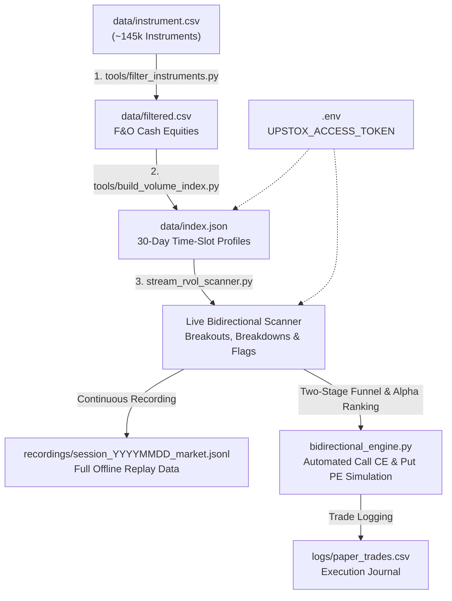
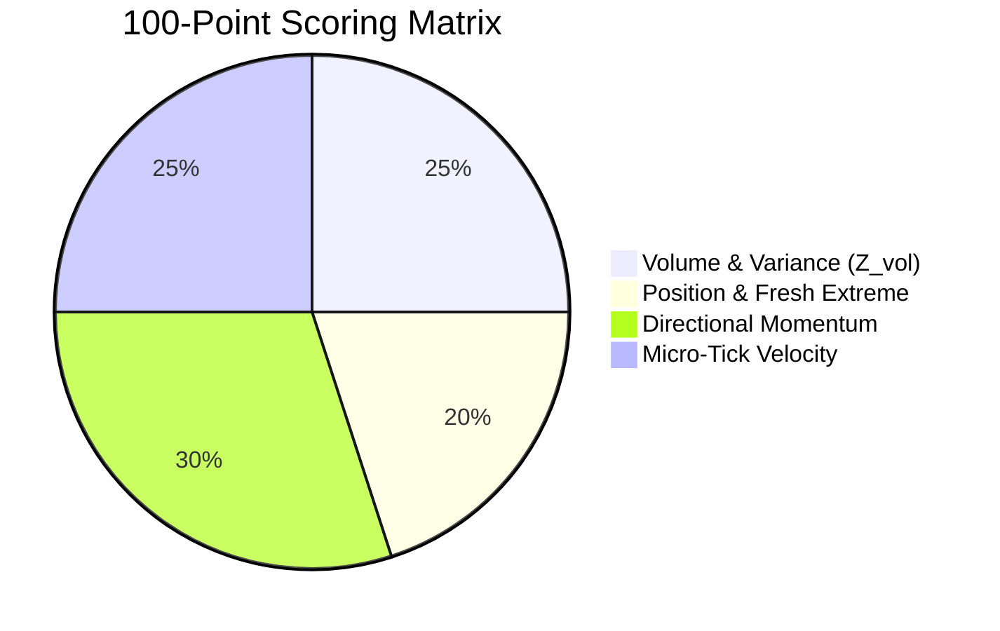
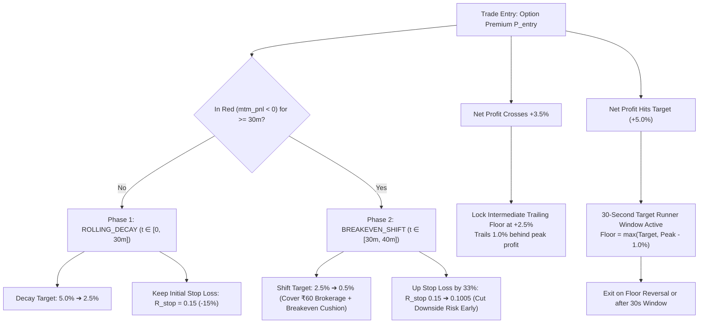

# Instruments Loader & Upstox RVOL Scanner

High-performance algorithmic toolkit for Indian market instruments (`instrument.csv` with ~145,000+ contracts across NSE, BSE, and MCX) and real-time **Relative Volume (RVOL > 2.0)** scanning, **Variance-based Surge Detection ($Z_{\text{vol}}$)**, **Bidirectional 100-Point Setup Scoring (0–100)**, **Two-Stage Cross-Sectional Alpha Ranking**, and automated **Flag Option Forward-Trading** using the **Upstox API v2/v3**.

For complete system architecture, data pipelines, and developer guidelines, refer to [PROJECT_ARCHITECTURE_SUMMARY.md](file:///Users/yorha/Documents/Trading%20Stuff/PROJECT_ARCHITECTURE_SUMMARY.md). For detailed mathematical derivations of all pillars and indicators, refer to [SETUP_SCORING_SUMMARY.md](file:///Users/yorha/Documents/Trading%20Stuff/SETUP_SCORING_SUMMARY.md).

---

## Workspace Directory Structure

The repository is organized into dedicated directories for clean data management, modular execution, and persistent logging:

```
Trading Stuff/
├── runner.py                           # Central Operational Orchestrator (prepare, start, status, test, replay)
├── config/                             # Externalized System & Strategy Configurations
│   ├── system.json                     # IPC settings, buffering, logging parameters
│   ├── instruments.json                # Universe definitions, dynamic option rules
│   ├── strategies.json                 # Momentum scoring weights, 16 simulation tracks, risk limits
│   └── execution.json                  # Sandbox, paper, sim, and live execution settings
├── execution/                          # Standardized Execution Layer (BaseExecutionAdapter)
│   ├── base.py                         # Abstract Execution Adapter interface
│   ├── sandbox/upstox_sandbox.py       # Upstox Sandbox API v3 adapter with paper fallback
│   └── paper/paper_adapter.py          # Standalone offline paper trading & capital accounting
├── infrastructure/                     # Modular Broker Ingestion & Distribution Subsystem
│   ├── auth/upstox_auth.py             # Live and Sandbox tokens, HTTP GET/POST/PUT/DELETE
│   ├── instruments/                    # Master fetcher, F&O filter, subscription manifest
│   ├── volume/                         # 30-day historical RVOL index baseline builder
│   ├── market_data/                    # Event schemas, IPC publisher & subscriber clients
│   └── recorder/                       # Lossless raw tick & option depth recording engine
├── strategies/                         # Strategy Packages
│   ├── base.py                         # Abstract BaseStrategy interface
│   └── momentum/                       # Modular Bidirectional Momentum Strategy Package
│       ├── indicators.py               # Pure-Python RSI (14), MACD, and Classical Floor S/R
│       ├── patterns.py                 # Flag tracker & Volume Inflation Gate for Bull Flags
│       ├── scoring.py                  # Dual Scoring Engine (Relative S_rel + Absolute S_abs)
│       ├── scanner.py                  # Rolling volume tracker, variance surge, and Nifty 50
│       ├── option_selector.py          # Strike resolver (ATM/ITM/OTM/LOW_PREM) & spread guard
│       ├── risk.py                     # Risk engine, trailing SL ratchet, decay, timeouts
│       ├── portfolio.py                # 16-Track Matrix Engine & DYNAMIC_TRIO ensemble allocator
│       ├── dashboard.py                # 148-column ANSI terminal dashboard renderer
│       └── strategy.py                 # Strategy coordinator implementing BaseStrategy
├── legacy/                             # Preserved Monolith & Historical Codebase (Self-Contained)
│   ├── stream_rvol_scanner.py          # Original monolithic scanner
│   ├── bidirectional_engine.py         # Original monolithic engine
│   ├── live_forward_tester.py          # Original paper trading runner
│   ├── tools/                          # Original standalone utility scripts
│   └── tests/test_breakout_features.py # 37 core breakout regression tests
├── data/                               # Market masters, filtered subsets & volume index
│   ├── instrument.csv                  # Upstox master CSV (~145k contracts)
│   ├── filtered.csv                    # Filtered F&O cash equities (~213 stocks)
│   ├── index.json                      # 30-day historical time-slot volume index
│   └── subscription_manifest.json      # Multi-stream underlying + options manifest
├── logs/                               # Debug logs & trade execution journals
│   ├── paper_trades.csv                # Execution journal (sandbox & paper trades)
│   └── debug.log                       # API request/response dump (when debug active)
├── recordings/                         # Continuous streaming market snapshots & events
│   └── session_YYYYMMDD_market.jsonl   # Full session snapshots for offline backtest & replay
├── replay/                             # Deterministic Replay Engine
│   └── replay_engine.py                # Feeds recorded ticks to IPC bus for historical replay
├── tests/                              # Automated Test Suites (58 tests passing)
│   ├── execution/                      # Sandbox v3 and Paper adapter tests
│   ├── infrastructure/                 # IPC, premarket, and recorder tests
│   └── strategies/                     # Modular momentum, scoring, and volume gate tests
├── runner.py                           # Central Operational Orchestrator (prepare, start, status, test, replay)
├── PROJECT_ARCHITECTURE_SUMMARY.md     # In-depth architectural specification & developer guide
├── SETUP_SCORING_SUMMARY.md            # Complete mathematical reference of 100-pt scoring model
├── .env.example                        # Template credentials file (Live & Sandbox tokens)
└── .env                                # Active Upstox API credentials
```

*(Root symlinks are maintained for `instrument.csv`, `filtered.csv`, and `index.json` to ensure 100% backward compatibility).*

---

## Algorithmic Pipeline Overview



---

## Step 1: Export Filtered Instruments

Use `tools/filter_instruments.py` to filter target instruments and export them to `data/filtered.csv`. Each record includes Upstox-compatible `upstox_instrument_key`s (e.g. `NSE_FO|66509`, `NSE_EQ|INE...`, `NSE_INDEX|Nifty 50`).

```bash
# Export all F&O stocks mapped directly to their underlying CASH equities:
python3 tools/filter_instruments.py --fno-stocks -o data/filtered.csv

# Export near-month Futures for all F&O stocks:
python3 tools/filter_instruments.py --fno-stocks --target-segment FUT -o data/fno_futures.csv
```

---

## Step 2: Configure `.env` & Build 30-Day Historical Volume Index

### 1. Add your Upstox Access Token
Open `.env` and set your token:
```ini
UPSTOX_ACCESS_TOKEN=your_real_access_token_here
```

### 2. Run the Historical Volume Indexer
`tools/build_volume_index.py` fetches 30 days of historical candles from Upstox API v3 and calculates:
- Overall 30-day average volume per candle (1m and 5m benchmarks).
- **Time-of-day volume profile** (average volume for 09:15, 09:16, ..., 15:29) to avoid open/close volume skew.
- Expected cumulative volume curve up to each minute of the day.

```bash
# Build 1-minute volume index (default interval: 1 minute):
python3 tools/build_volume_index.py --input data/filtered.csv --target-segment CASH --output data/index.json

# Check summary of an existing index:
python3 tools/build_volume_index.py --summary --output data/index.json
```

---

## Step 3: Stream Feeds, Variance Surge & Setup Scoring Dashboard

`stream_rvol_scanner.py` subscribes to real-time feeds from Upstox, evaluates rolling volume variance, and scores bidirectional setups in real time.

### 1. Rebalanced 100-Point Setup Matrix



1. **Volume & Variance Surge ($25\text{ pts}$)**:
   - **Baseline RVOL ($15\text{ pts}$)**: $RVOL_{5m} \ge 3.0\times$ (15 pts), $\ge 2.0\times$ (12 pts), $\ge 1.5\text{x}$ (9 pts), $\ge 1.2\times$ (6 pts).
   - **Early-Window Confidence Damping**: Scales projected volume for $T < 60\text{s}$ to prevent 10-second bursts from creating false $30\times$ spikes.
   - **Variance Surge $Z_{\text{vol}}$ ($10\text{ pts}$)**: Measures standard deviations above the rolling 60-minute mean ($Z_{\text{vol}} = (RVOL_{5m} - \mu_{60m}) / \sigma_{60m}$) at a strict 30s cadence.
   - **Inactivity Penalty ($-15\text{ pts}$)**: Docks points if volume pace collapses after an opening surge.

2. **Range Position & Extreme Freshness ($20\text{ pts}$)**:
   - **Base Proximity ($10\text{ pts}$)**: Proximity to Day's High ($Range \ge 95\%$) or Day's Low ($Range \le 5\%$).
   - **Extreme Freshness ($10\text{ pts}$)**: Fresh print $\le 3\text{m}$ (10 pts), $\le 5\text{m}$ (7 pts), $\le 10\text{m}$ (4 pts). Stagnant highs inactive $> 15\text{m}$ receive $0\text{ pts}$.

3. **Two-Tier Directional Momentum ($30\text{ pts}$)**:
   - **Directional Gating**: Strictly direction-aligned ($\Delta P_{\text{day}} < 0 \implies \text{Bull Mom} = 0$).
   - **Macro Day % Change ($10\text{ pts}$)**: $\ge 4.0\%$ (10 pts), $\ge 2.0\%$ (8 pts), $\ge 1.0\%$ (5 pts).
   - **Rolling 5-Minute Impulse $\Delta P_{5m}$ ($20\text{ pts}$)**: $\ge 1.0\%$ (20 pts), $\ge 0.6\%$ (15 pts), $\ge 0.3\%$ (10 pts).
   - **Counter-Trend Penalty**: Docks $-5$ to $-10\text{ pts}$ if 5m impulse fights the daily trend.

4. **Day-Relative Micro-Tick Velocity ($25\text{ pts}$)**:
   - **Candle Color ($5\text{ pts}$)**: Green candle for Bull, Red candle for Bear.
   - **5-Tick Range-Relative Thrust ($10\text{ pts}$)**: Scaled by total day span ($\Delta P_5 / \text{DaySpan}$).
   - **3-Tick Consecutive Acceleration ($10\text{ pts}$)**: Requires strict advancement. Identical flat ticks (`100, 100, 100`) receive 0 acceleration points.

5. **Technical Confluence & Regime Shields**:
   - **Intra-5m Volume Acceleration ($A_{\text{vol}}$)**: $+5\text{ pts}$ if $A_{\text{vol}} \ge 1.25$; $-8\text{ pts}$ if $A_{\text{vol}} < 0.80$.
   - **Sideways False Breakout Trap Shield (`⚠️ DRY HIGH` / `⚠️ DRY LOW`)**: Clamps score $< 60$ if price drifts to extreme without volume acceleration.
   - **Support & Resistance Clearance**: $+5\text{ pts}$ if headroom $\ge 0.8\%$; $-12\text{ pts}$ if buying directly into resistance ceiling ($A_{\text{vol}} < 1.0$).
   - **RSI (14) & MACD Confluence**: Healthy momentum (+3 pts), overbought/oversold exhaustion (-5 / -6 pts), MACD expansion (+2 / -4 pts).
   - **Option Spread Penalty**: Docks $-15\text{ pts}$ if spread $> 3.0\%$.

---

### 2. Actionable Stage Badges

| Badge | Direction | Setup Score | Range Location | Context & Technical Interpretation |
| :--- | :---: | :---: | :---: | :--- |
| `💥 BULL BREAK` | **BULL** | $\ge 80$ | Upper Range ($\ge 70\%$) | **Early Flag Breakout**: Pierces flag ceiling with volume inflation *before* macro HOD. |
| `💥 BEAR BREAK` | **BEAR** | $\ge 80$ | Lower Range ($\le 30\%$) | **Early Flag Breakdown**: Pierces flag floor with volume inflation *before* macro LOD. |
| `🚀 BREAKOUT` | **BULL** | $\ge 75$ | Top $\ge 90\%$ (HOD) | Confirmed institutional breakout printing fresh Day's High. |
| `🩸 BREAKDOWN` | **BEAR** | $\ge 75$ | Bottom $\le 10\%$ (LOD) | Heavy institutional distribution cracking fresh Day's Low. |
| `⚡ FORMING` | **BULL** | $\ge 55$ | Range $\ge 75\%$ | Persistent buying pressure building toward Day's High. |
| `⚡ CRACKING` | **BEAR** | $\ge 55$ | Range $\le 25\%$ | Persistent selling pressure pushing toward Day's Low. |
| `🌀 BULL FLAG` | **BULL** | $\ge 55$ | Coiling at HOD $\ge 85\%$ | **Pre-Breakout Squeeze**: Low volume pause after impulse (No entry while coiling). |
| `🚩 BEAR FLAG` | **BEAR** | $\ge 55$ | Pausing at LOD $\le 15\%$ | **Pre-Breakdown Pause**: Low volume pause after impulse (No entry while coiling). |
| `⚠️ DRY EXTREM` | **BULL/BEAR** | $< 60$ | At Extremes | **False Breakout Shield**: Micro-tick drift without volume acceleration (No alerts). |

---

### 3. UI Features: Fresh Alerts Countdown & 1-Lot ATM Requirement

1. **Table 1: 🚨 FRESH BREAKOUT ALERTS (< 8s Window)**:
   - Appears immediately upon breakout with live countdown: `⏳ 7.4s left`, `⏳ 5.1s left`.
   - **Natural Downgrade**: After 8.0s, cleanly downgrades to Table 2 (Confirmed Breakouts) and remains visible until invalidated.
2. **1-Lot ATM Option Cash Requirement Column**:
   - Displays exact capital needed to trade 1 lot of the closest ATM contract: `₹14.5k (₹29.0)`.
   - Shows `Cash Only` for non-F&O equities.

---

## Step 4: Live Automated Option Forward-Trading

Simulates real-time execution directly on **Call Options (CE) for Bull Setups** and **Put Options (PE) for Bear Setups**, backed by cross-sectional relative alpha ranking and dynamic risk management.

### 1. Two-Stage Funnel & Cross-Sectional Alpha Ranking
Eliminates sequential loop greed by ranking all simultaneously qualified candidates ($\text{Score} \ge 75$) by Composite Relative Alpha:
$$S_{\alpha} = \text{Score} + 15 \times (A_{\text{vol}} - 1.0) + \min(10.0, \text{Clearance}_{\text{SR}} \times 2.0) + \text{Confluence}_{\text{RSI/MACD}}$$
Capital is dynamically awarded to the highest-conviction setup first.

### 2. Dynamic Scalp Exit Engine



- **Phase 1: Rolling Target Decay ($t \in [0, 30]\text{ mins}$)**: Target decays linearly from $+5.0\%$ to $+2.5\%$ to lock in quick scalps or accept modest gains as time elapses.
- **Phase 2: Stagnant Red Breakeven Shift ($t \in [30, 40]\text{ mins}$)**: If held $\ge 30\text{ mins}$ in the red, target shifts from $+2.5\%$ to $+0.5\%$ (exiting at breakeven on the first bounce) while the stop loss is tightened by $33\%$ (cutting downside risk from $-15.0\%$ to $-10.05\%$).
- **Intermediate Trailing Profit Floor**: Crossing $+3.5\%$ Net P&L locks an initial floor at $+2.5\%$, trailing $1.0\%$ behind peak profit.
- **Target Runner 30-Second Window**: Hitting target starts a 30-second window with rolling floor $\max(\text{Target}, \text{Peak} - 1.0\%)$, letting winners run while locking profits on reversal.

### 3. Delta-Aligned Underlying Invalidation Stop Loss (Bear & Bull)
- **Calibrated Buffer**: Guarantees a minimum $0.80\%$ structural breathing room (capped at $1.50\%$) matching option delta sensitivity ($\Delta \approx 0.50$, $\Omega \approx 15\text{--}25$).
  - **BEAR PE**: $\text{SL}_{\text{underlying}} = \min(S \times 1.015, \max(\text{Flag High}, S \times 1.008))$
  - **BULL CE**: $\text{SL}_{\text{underlying}} = \max(S \times 0.985, \min(\text{Flag Low}, S \times 0.992))$
- Eliminates the previous 0.15% micro-choke bug that stopped out Bear trades within 60 seconds on normal tick noise.

---

## Execution Commands

### Integrated Mode (Scanner + Paper Trading)
```bash
# 1. Integrated scanner + paper trading (ATM, ITM, OTM, LOW_PREM, TRAIL_SL, FIXED_TGT, COMBO simulated simultaneously):
python3 stream_rvol_scanner.py --index data/index.json --paper-trade --capital 100000

# 2. Expand full multi-column active positions table (compact summary by default):
python3 stream_rvol_scanner.py --index data/index.json --paper-trade --capital 100000 --show-positions

# 3. Bull-only scanner + Call option paper trading:
python3 stream_rvol_scanner.py --index data/index.json --bull-only --paper-trade --capital 100000

# 4. Bear-only scanner + Put option paper trading:
python3 stream_rvol_scanner.py --index data/index.json --bear-only --paper-trade --capital 100000

# 5. Filter only high-conviction setups (Default: Score >= 67):
python3 stream_rvol_scanner.py --index data/index.json --min-score 67
```

### Dedicated Standalone Forward-Tester
```bash
# 1. Trade both Bull Flags (CE) and Bear Flags (PE) side-by-side with ₹100,000 capital:
python3 live_forward_tester.py --index data/index.json --direction both --capital 100000

# 2. Enforce strict 2.0% max option spread:
python3 live_forward_tester.py --index data/index.json --max-spread 2.0
```

All paper trades are logged in real time to [`logs/paper_trades.csv`](file:///Users/yorha/Documents/Trading%20Stuff/logs/paper_trades.csv). Full market tick snapshots are recorded to `recordings/session_YYYYMMDD_market.jsonl`.

---

## Verification & Unit Testing

The repository includes a comprehensive 26-test automated verification suite covering scoring math, decay rules, trailing floors, alpha ranking, and Bear mechanics:

```bash
python3 scratch/test_breakout_features.py
```

Expected output:
```text
✅ ALL 26 BREAKOUT & SCORING SUITE TESTS PASSED PERFECTLY!
```

---

## Core File Index

| File | Purpose |
| :--- | :--- |
| [PROJECT_ARCHITECTURE_SUMMARY.md](file:///Users/yorha/Documents/Trading%20Stuff/PROJECT_ARCHITECTURE_SUMMARY.md) | **Complete Architectural Specification**: Data pipelines, state machines, math formulas, and developer instructions. |
| [SETUP_SCORING_SUMMARY.md](file:///Users/yorha/Documents/Trading%20Stuff/SETUP_SCORING_SUMMARY.md) | **Scoring & Risk Math Reference**: 100-point matrix, pillar breakdowns, exit mechanics, and Bear calibration. |
| [stream_rvol_scanner.py](file:///Users/yorha/Documents/Trading%20Stuff/stream_rvol_scanner.py) | **Main Scanner & Dashboard**: Live feeds, feature extraction, setup scoring, fresh alert lifecycle, and ANSI UI. |
| [bidirectional_engine.py](file:///Users/yorha/Documents/Trading%20Stuff/bidirectional_engine.py) | **Core Engine**: `FlagPatternTracker`, `OptionStrikeResolver`, `FlagPaperPortfolio`, technical indicators, and risk management. |
| [live_forward_tester.py](file:///Users/yorha/Documents/Trading%20Stuff/live_forward_tester.py) | **Forward-Tester**: Standalone terminal forward paper-trading runner with live MTM dashboard & CSV journal. |
| [tools/filter_instruments.py](file:///Users/yorha/Documents/Trading%20Stuff/tools/filter_instruments.py) | **Instrument Master**: Fast CSV loader, filter, option chain matrix, underlyings explorer, and exporter. |
| [tools/build_volume_index.py](file:///Users/yorha/Documents/Trading%20Stuff/tools/build_volume_index.py) | **Profile Builder**: Fetches 30-day candles via Upstox v3 and builds historical volume profiles. |
| [upstox_common.py](file:///Users/yorha/Documents/Trading%20Stuff/upstox_common.py) | Shared utilities: zero-dependency `.env` loader, HTTP client with 429 backoff, file path resolution. |
| [logs/paper_trades.csv](file:///Users/yorha/Documents/Trading%20Stuff/logs/paper_trades.csv) | Real-time CSV journal recording all paper trades, strikes, entries, exits, P&L, and reasons. |
| [scratch/test_breakout_features.py](file:///Users/yorha/Documents/Trading%20Stuff/scratch/test_breakout_features.py) | Automated test suite (26 unit tests covering all system mechanics). |
