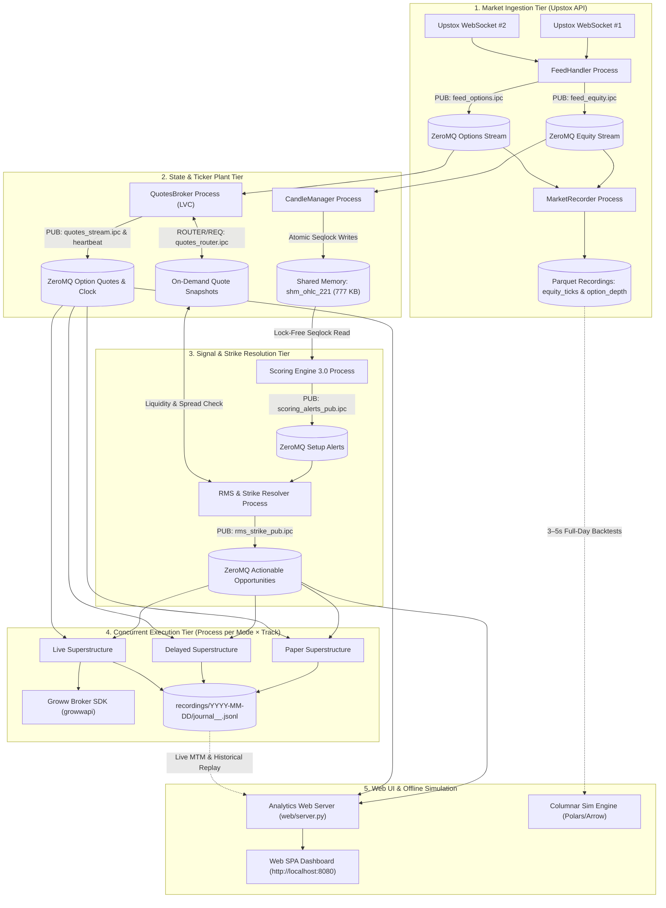

# Algorithmic Trading Platform (NSE Equity & F&O Options)

An event-driven, multi-process algorithmic trading system for Indian equity derivatives (NSE Futures & Options). It ingests real-time tick data from **Upstox**, aggregates 5-minute OHLCV candles in memory, detects institutional momentum breakouts on underlying equities, selects liquid option contracts, and executes concurrent **Paper**, **Delayed Paper**, and **Live (Groww)** trading strategies—alongside a fast historical backtester and a browser-based Web UI.

---

## 1. Key Concepts (At a Glance)

If you are new to this repository, four core abstractions organize the system:

1. **Multi-Process ZeroMQ Pipeline**: Instead of one monolithic script, market ingestion, candle building, quote caching, strategy scanning, risk/strike filtering, and trade execution run as separate OS processes communicating over ZeroMQ IPC sockets (`/tmp/*.ipc`) serialized with MessagePack.
2. **Execution Modes (`paper`, `paper_delayed`, `live`)**:
   - **`paper`**: Instant simulated fills at the option's prevailing best Ask price when a signal arrives.
   - **`paper_delayed`**: Simulates real-world execution latency (configurable delay window) and fills against the option quote cached just prior to target fill time—testing slippage sensitivity under realistic delays.
   - **`live`**: Routes actual orders to the **Groww** broker SDK (`growwapi`), attaches resting stop-loss orders, and reconciles positions.
3. **Execution Tracks & Composite Tracks (`common/tracks/`)**: A *track* defines how a position is sized, entered (option moneyness like `ATM`, `ITM1`, `ITM2`, `OTM1`, `OTM2`), trailed, and exited (stop-loss, target, stagnation timeout). A *composite track* groups multiple exit profiles under one shared capital pool. Each track × mode runs in its own isolated worker process.
4. **Superstructures (`execution/superstructures/`)**: The mode-specific runtime harness (`PaperSuperstructure`, `DelayedSuperstructure`, `LiveSuperstructure`) that subscribes to filtered opportunities and option quotes, drives track state machines, checks risk limits, and writes event journals (`journal_<mode>_<track>.jsonl`).

---

## 2. System Architecture

The platform separates noisy options market data from lightweight equity candle processing so strategy evaluation stays in the microsecond range while execution processes always have live option bid/ask depth.



### How Data Flows End-to-End

1. **Feed Splitting (`FeedHandler`)**: ~215 F&O underlying stocks + Nifty 50 run across two sharded Upstox WebSocket connections (respecting Upstox's per-connection subscription cap). Equity ticks go to `feed_equity.ipc`; 5-level option depth goes to `feed_options.ipc`. Contracts held in open positions are guarded by `ProtectedPositionRegistry` (`logs/active_positions.json`) so dynamic strike shifting never unsubscribes an active trade.
2. **In-Memory 5-Minute Candles (`CandleManager`)**: Aggregates equity ticks into 75 five-minute bars per symbol inside `shm_ohlc_221` (221 symbols × 75 bars × 48 bytes ≈ 777 KB, synchronized via per-symbol seqlocks), computing incremental Wilder ATR(14) and extrapolated intraday relative volume (`rVOL`).
3. **Price-Action Detection (`ScoringEngine3`)**: Scans `shm_ohlc_221` for two rule-based momentum patterns without lagging indicators or 0–100 composite scores:
   - **Flag Breakout / Breakdown**: 1–3 bar high-volume pole followed by a 2–5 bar tight contraction holding within 50% retracement, breaking an OLS trendline with volume rate-of-change thrust and strong close location (`CLV >= 0.75`).
   - **Pure 3-Candle Impulse**: Directional thrust breaking the 3-bar high/low with real-body expansion and strong `CLV`, guarded against firing inside an active flag contraction.
4. **Liquidity & Spread Gating (`RMSService`)**: Resolves candidate strikes (`ATM`, `ITM1`, `ITM2`, `OTM1`, `OTM2`) matching the direction (`CE` for Bull, `PE` for Bear), checks `QuotesBroker` depth snapshots, and rejects strikes with missing quotes or excessive bid-ask spreads. **Zero synthetic quotes**: if live option depth is unavailable, setups are skipped cleanly rather than filled at LTP.
5. **Backtesting (`ColumnarSimEngine`)**: Replays recorded `equity_ticks.parquet` and `option_depth.parquet` using Polars/Arrow `asof_join` and binary-search depth matching to simulate an entire trading session across all tracks in seconds.

---

## 3. Repository Layout

```text
Trading Stuff/
├── runner.py                  # Unified CLI orchestrator (prepare, core, start, web, sim, stop, test)
├── config/                    # System, instruments, execution, strategy configs & track profiles
│   └── tracks/                # Track preset profiles (default.json, v1.json, v2.json)
├── core/                      # Core infrastructure & data services
│   ├── auth/                  # Upstox & Groww OAuth / TOTP session helpers
│   ├── candles/               # CandleManager, SHM layout (48B candle dtype), Wilder ATR & rVOL
│   ├── common/                # IPC MessagePack schemas, IST time utilities, symbol normalization
│   ├── config/                # Typed config loader & market schedule helpers
│   ├── feed/                  # Dual-WS Upstox FeedHandler, protobuf decoder, position registry, replay
│   ├── instruments/           # Instrument master sync, F&O filtering, subscription manifest builder
│   ├── quotes/                # QuotesBroker Last Value Cache, XPUB stream, ROUTER snapshot server
│   ├── recorder/              # Dual-stream Parquet recorder (equity_ticks & option_depth)
│   ├── rms/                   # Strike resolution, spread/liquidity gates, opportunity broadcaster
│   └── volume/                # Historical 1-minute baseline volume indexer
├── strategies/
│   └── momentum/              # ScoringEngine3 spin-loop detector & OpportunityPool deduplicator
├── common/
│   ├── interfaces.py          # Abstract ExecutionContext, OrderRequest/Result, TradeState contracts
│   ├── tracks/                # BaseTrack, CompositeTrack, and v1/v2 exit-profile track classes
│   └── utils/                 # Structured logger, clock utilities, CPU affinity helpers
├── execution/
│   └── superstructures/       # BaseSuperstructure (IPC + --continue recovery), Paper, Delayed, Live (Groww)
├── simulation/                # Monolithic Polars/Arrow columnar session simulator
├── web/                       # aiohttp web server, WS live MTM streamer, historical/alert/sim services, SPA
├── ui/                        # Legacy terminal dashboard (replaced by web/)
├── tests/                     # Automated unittest suites across core, common, execution, simulation, web
├── data/                      # Daily instrument masters, filtered F&O universe, manifests (generated)
├── recordings/                # Session Parquet market data & JSONL execution journals (YYYY-MM-DD/)
├── logs/                      # Service logs, PID registry (pids.json), active_positions.json
├── SYSTEM_AUDIT_2_0.md        # Active codebase audit & prioritized fix queue
└── docs/archive/              # Legacy 1.0 specs, historical brainstorms, and superseded audits
```

---

## 4. Setup & Prerequisites

1. **Python Environment**: Python 3.9+ with dependencies installed in `.venv`:
   ```bash
   python3 -m venv .venv
   source .venv/bin/activate
   pip install -r requirements.txt
   ```
2. **Credentials (`.env`)**: Copy `.env.example` to `.env` and populate API keys/secrets for Upstox market data (and Groww API credentials if running `live` mode).

---

## 5. Operational Workflow (`runner.py`)

`runner.py` automatically re-executes using `.venv/bin/python` if invoked with system Python.

```bash
# 1. Pre-Market Preparation (~08:45 IST)
# Downloads NSE instrument master, filters ~215 F&O equities, builds 1m volume index & WS manifest
python3 runner.py prepare

# 2. Launch Core Data Tier (~09:05 IST)
# Starts FeedHandler (--feed), CandleManager (--candlemanager), QuotesBroker (--quotesbroker), and Recorder (--record)
python3 runner.py core --feed --candlemanager --quotesbroker --record

# 3. Launch Strategy & Execution Processes (~09:15 IST)
# Launches ScoringEngine3, RMSService, and one execution process per (mode × track)
python3 runner.py start --mode paper,paper_delayed

# Resume mid-day after a restart, recovering open positions & capital from today's journals:
python3 runner.py start --mode paper,paper_delayed --continue

# 4. Launch Web Analytics & Simulation UI (http://localhost:8080)
python3 runner.py web --port 8080

# 5. Run Offline Columnar Backtest (3-5 seconds per full session)
python3 runner.py sim --date 2026-11-19 --track v2 --mode paper,paper_delayed

# 6. Check Process Health, SHM Counter & Protected Contracts
python3 runner.py status

# 7. Run Automated Test Suite (offline / safe against running IPC sockets)
python3 runner.py test

# 8. Stop All Running Background Services & Clean Up IPC/SHM
python3 runner.py stop

# 9. Post-Market Compression (compresses recordings/{YYYYMMDD}/ to .tar.gz)
python3 runner.py post-market --date 20261125
```

---

## 6. Further Documentation

| Document | Scope |
|---|---|
| [`ARCHITECTURE_SPEC_2_0.md`](file:///Users/yorha/Documents/Trading%20Stuff/ARCHITECTURE_SPEC_2_0.md) | System-level ADRs, IPC topology, Shared Memory design, and execution guarantees |
| [`LOW_LEVEL_DESIGN_2_0.md`](file:///Users/yorha/Documents/Trading%20Stuff/LOW_LEVEL_DESIGN_2_0.md) | Struct definitions, MessagePack schemas, interfaces, and module contracts |
| [`SCORING_ENGINE_3_0.md`](file:///Users/yorha/Documents/Trading%20Stuff/SCORING_ENGINE_3_0.md) | Mathematical specification for Flag Breakout and Pure Impulse archetypes |
| [`EXECUTION_TRACKS.md`](file:///Users/yorha/Documents/Trading%20Stuff/EXECUTION_TRACKS.md) | Reference for v1, v2, and composite execution track rules and strike selections |
| [`WEB_VIEW_FLOW.md`](file:///Users/yorha/Documents/Trading%20Stuff/WEB_VIEW_FLOW.md) | Web UI tabs, REST/WebSocket APIs, and multiprocessing simulation flow |
| [`SYSTEM_AUDIT_2_0.md`](file:///Users/yorha/Documents/Trading%20Stuff/SYSTEM_AUDIT_2_0.md) | Current system audit, open bugs, and prioritized fix roadmap |
| [`IMPROVEMENTS.md`](file:///Users/yorha/Documents/Trading%20Stuff/IMPROVEMENTS.md) | Future roadmap: structural refactors, scoring ideas, live Groww hardening, and new strategies |
