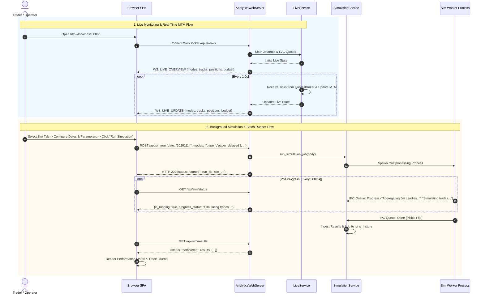

# Web View Flow & Architecture Specification

> **Document Type**: System Architecture & User Flow Specification  
> **Component**: Antigravity Analytics & Simulation Web UI (`web/`)  
> **Command Entry Point**: `python3 runner.py web [--host 0.0.0.0] [--port 8080] [--record-dir recordings]`  
> **Status**: Production Specification  
> **Related Architecture**: [`ARCHITECTURE_SPEC_2_0.md`](file:///Users/yorha/Documents/Trading%20Stuff/ARCHITECTURE_SPEC_2_0.md), [`LOW_LEVEL_DESIGN_2_0.md`](file:///Users/yorha/Documents/Trading%20Stuff/LOW_LEVEL_DESIGN_2_0.md)

---

## 1. Executive Summary & Purpose

The **Antigravity Analytics & Simulation Web UI** is a modern, responsive browser-based application engineered to provide institutional-grade observability, real-time telemetry, historical trade inspection, and deterministic columnar backtesting.

It directly succeeds and retires the legacy terminal ANSI/Rich dashboard (`runner.py dashboard`), eliminating terminal rendering bottlenecks and offering:
1. **Real-Time Live Telemetry & MTM Streaming**: Sub-second Mark-to-Market (MTM), open positions tracking, and dynamic cash balance calculation over WebSockets.
2. **Multi-Session Historical Analytics**: Full drill-down into past trading days with track-wise performance matrices and interactive trade charts.
3. **High-Speed Columnar Simulation & Batch Runner**: In-process and multi-process backtesting using Apache Arrow / Polars memory-mapped datasets, featuring single-run and batch execution queues with zero UI freezing.
4. **Live Setup Alerts & SHM Candlestick Charts**: Sub-microsecond candle visualization directly attached to the 777 KB POSIX Shared Memory (`shm_ohlc_221`) with breakout trigger markers.

---

## 2. High-Level Architecture Topology

```mermaid
flowchart TD
    subgraph Browser ["Client Tier (Modern Web Browser)"]
        UI["Single Page Application (SPA)<br/>index.html / app.js"]
        UI_Live["Live Tab: Real-Time MTM & Positions"]
        UI_Hist["Historical Tab: Past Sessions & Journals"]
        UI_Sim["Simulation Tab: Single & Batch Runner"]
        UI_Alerts["Alerts Tab: SHM Candlesticks & Triggers"]
        UI_Standalone["Standalone Results Tab<br/>sim_results.html"]
        
        UI --> UI_Live & UI_Hist & UI_Sim & UI_Alerts & UI_Standalone
    end

    subgraph WebServer ["Web Application Tier (aiohttp Asynchronous Server)"]
        Server["AnalyticsWebServer (web/server.py:8080)"]
        
        WS_Endpoint["/api/live/ws (WebSocket Hub)"]
        REST_Live["/api/live/* (REST Handlers)"]
        REST_Hist["/api/historical/* (REST Handlers)"]
        REST_Sim["/api/sim/* (REST Handlers)"]
        REST_Chart["/api/chart/candles (REST Handlers)"]
        REST_Alerts["/api/alerts/* (REST Handlers)"]
        
        Server --> WS_Endpoint & REST_Live & REST_Hist & REST_Sim & REST_Chart & REST_Alerts
    end

    subgraph ServiceLayer ["Backend Service Infrastructure"]
        LiveSvc["LiveService (web/live_service.py)"]
        HistSvc["HistoricalService (web/historical_service.py)"]
        SimSvc["SimulationService (web/simulation_service.py)"]
        CandleSvc["CandleService (web/candle_service.py)"]
        AlertSvc["AlertService (web/alert_service.py)"]
        
        Server --> LiveSvc & HistSvc & SimSvc & CandleSvc & AlertSvc
    end

    subgraph WorkerTier ["Heavy Compute & Process Isolation"]
        WorkerProc["Worker Process (_simulation_worker_process)<br/>Independent GIL & Memory Space"]
        SimSvc -->|multiprocessing.Process| WorkerProc
        WorkerProc --> PolarsEngine["ColumnarSimEngine (Polars/Arrow)"]
    end

    subgraph StorageAndIPC ["Platform State & Storage Tier"]
        ZMQ_Opt["ZeroMQ: feed_options.ipc / quotes_stream.ipc"]
        SHM[("POSIX Shared Memory: shm_ohlc_221 (777 KB)")]
        DiskJournals[("Trade Journals:<br/>recordings/YYYYMMDD/journal_*.jsonl")]
        DiskParquet[("Lossless Parquet Ticks:<br/>recordings/YYYYMMDD/*.parquet")]
        AlertsLog[("Alerts Log:<br/>logs/alerts_*.jsonl")]
        
        LiveSvc <-->|ZeroMQ SUB| ZMQ_Opt
        LiveSvc <-->|Fast mtime Polling| DiskJournals
        HistSvc <-->|Scan & Parse| DiskJournals
        AlertSvc <-->|Direct Read (< 2 us)| SHM
        AlertSvc <-->|Read| AlertsLog
        CandleSvc <-->|Scan & Aggregate| DiskParquet
        PolarsEngine <-->|Memory Map| DiskParquet
    end

    WS_Endpoint <-->|Bi-directional 1s Heartbeat & Updates| UI_Live
    REST_Live <--> UI_Live
    REST_Hist <--> UI_Hist
    REST_Sim <--> UI_Sim
    REST_Chart <--> UI_Hist & UI_Sim
    REST_Alerts <--> UI_Alerts
```

---

## 3. Core Backend Services & Responsibilities

### 3.1 `AnalyticsWebServer` (`web/server.py`)
- **Framework**: `aiohttp.web` asynchronous HTTP and WebSocket server.
- **Port & Host**: Binds to `0.0.0.0:8080` (configurable via `--host` and `--port`).
- **Session Identification**: Emits a unique `server_boot_id` (12-char hex UUID) on boot. Allows frontend clients to detect server restarts and cleanly reset client-side polling loops or queues.
- **Graceful Lifecycle Management**:
  - Registers `atexit.register(self.teardown)` and catches `SIGINT` / `SIGTERM`.
  - Terminates running worker processes, clears temp files, flushes state, closes active WebSockets, and releases sockets.

---

### 3.2 `LiveService` (`web/live_service.py`)
Responsible for continuous real-time telemetry, MTM computation, and streaming active trade state to the UI.

1. **ZeroMQ Ticker Plant Subscription**:
   - Spawns an asynchronous background task (`_listen_options_stream`).
   - Automatically detects and connects to active IPC sockets: `ipc:///tmp/feed_options.ipc` and `ipc:///tmp/quotes_stream.ipc`.
   - Maintains an in-memory **Latest Value Cache (LVC)**: `token -> {bid, ask, ltp, ts}`.
2. **Active Trade State & Cash Tracking**:
   - Parses active mode trade journals (`paper`, `paper_delayed`, `live`) with file modification time (`mtime`) checks to avoid redundant disk I/O.
   - Computes live MTM per open position:
     $$\text{Current Price} = \begin{cases} \text{LVC.Bid} & \text{if BUY trade (long position)} \\ \text{LVC.Ask} & \text{if SELL trade (short position)} \end{cases}$$
     $$\text{MTM INR} = (\text{Current Price} - \text{Entry Price}) \times \text{Quantity}$$
     $$\text{P\&L \%} = \frac{\text{Current Price} - \text{Entry Price}}{\text{Entry Price}} \times 100$$
3. **Strict Available Budget Calculation**:
   - Reflects the true cash available to the track by deducting committed capital:
     $$\text{Current Budget} = \max\left(0.0, \text{Start Capital} + \text{Net Realized P\&L} - \text{Open Committed Capital}\right)$$
   - Prevents over-allocation and maintains exact parity with underlying track execution state machines.

---

### 3.3 `SimulationService` (`web/simulation_service.py`)
Responsible for managing backtest parameter configurations, caching heavy datasets, orchestrating single/batch runs, and delivering trade analytics.

1. **Process-Level Isolation & GIL Bypass**:
   - Simulations run inside an independent OS process (`multiprocessing.Process` invoking `_simulation_worker_process`).
   - Completely avoids Python Global Interpreter Lock (GIL) thrashing, guaranteeing that the web server event loop, WebSocket telemetry, and chart rendering remain fully responsive.
2. **Lossless Parquet Dataset Caching**:
   - Caches parsed Polars DataFrames (`cached_equity_df`, `cached_options_df`) for the selected date.
   - Re-running simulations with modified parameters on the same date executes in **$< 1\text{ second}$** by skipping disk reads.
3. **Batch Mode Queue Orchestration**:
   - Supports queuing multiple simulation dates or parameter configurations.
   - Jobs execute sequentially via process queues.
   - Results are retained across job boundaries in `runs_history`. The queue is cleared **only when explicitly requested by the user** or during server teardown.
4. **Standalone Clean Results Viewer**:
   - Serves `/sim/results` (`web/static/sim_results.html`) allowing operators to pop out full-screen performance reports, cumulative P&L curves, drawdown charts, and granular trade journals in separate browser tabs.

---

### 3.4 `AlertService` (`web/alert_service.py`) & `CandleService` (`web/candle_service.py`)
1. **Sub-Microsecond Shared Memory Attachment**:
   - `AlertService` maps the active stock symbol to its row index in `data/filtered.csv`.
   - Attaches directly to `shm_ohlc_221` (POSIX Shared Memory segment owned by `CandleManager`).
   - Reads the latest completed and forming 5-minute candles in $< 2\ \mu\text{s}$ with zero disk overhead.
2. **Trigger Point Overlay**:
   - Injects the exact breakout alert trigger timestamp and price dot onto the candlestick series for visual verification of technical setups (Flag Breakout vs. Pure Impulse).
3. **Local Cache Defense**:
   - Caches aggregated candle bars in memory (`(date, symbol) -> List[Candle]`) to eliminate redundant Parquet scans when switching between alert items.

---

### 3.5 `HistoricalService` (`web/historical_service.py`)
- Scans `recordings/` and `logs/` to catalog all historical sessions.
- Automatically determines whether a session has Parquet tick data (`has_parquet`) and executed trade journals (`has_journals`).
- Parses and indexes historical journals per execution mode and track, caching aggregated summaries for instant tab switching.

---

## 4. End-to-End User Flows & UI Views



---

## 5. Web UI Functional Views

### 5.1 Tab 1: Live Dashboard
- **Top Summary Cards**:
  - `Active Positions`: Total count of currently open contracts across all active modes.
  - `Total Realized P&L`: Sum of closed trade returns for the current session.
  - `Active MTM`: Dynamic unrealized profit/loss computed against real-time QuotesBroker depth.
  - `Available Cash`: Net unencumbered capital available for new trade allocations.
- **Mode Selector**: Allows switching between `Paper`, `Paper-Delayed`, and `Live Broker` matrices.
- **Track Performance Matrix**: Displays track-level metrics:
  - Track Name, Trade Count, Win Rate %, Realized P&L, Active MTM, Net P&L, Available Budget.
- **Live Open Positions Table**:
  - Displays Symbol, Contract Key, Direction (CE/PE), Entry Price, Live Quote (Ask/Bid), Qty, P&L %, MTM INR, Trailing Stop-Loss, and Target.

---

### 5.2 Tab 2: Historical Analysis
- **Session Date Selector**: Dropdown showing all recorded historical sessions with indicators for parquet ticks and trade journals.
- **Session Performance Summary**:
  - Total Trades, Overall Win %, Gross P&L, Brokerage & Taxes, Net P&L, Max Drawdown.
- **Track-wise Breakdown**: Granular view of how individual tracks (ATM, ITM, Trailing SL, Composite) performed on that specific date.
- **Closed Trades Journal**:
  - Detailed trade log showing Entry Time, Exit Time, Duration, Entry Price, Exit Price, Exit Reason (`TARGET`, `STOP_LOSS`, `STAGNATION`, `EOD`), and Net P&L.
  - Clicking any trade opens an interactive Candlestick Chart Modal displaying the underlying equity price action with entry and exit marker annotations.

---

### 5.3 Tab 3: Simulations & Batch Runner
- **Interactive Configuration Panel**:
  - Target Date / Date Range.
  - Trading Hours (`start_time`, `end_time`, `entry_freeze_time`, `eod_squareoff_time`).
  - Modes to simulate (`paper`, `paper_delayed`).
  - Active Tracks selection (`ALL`, `DYNAMIC_TRIO`, `ATM`, `ITM`, etc.).
  - Capital per track, Minimum Score, Minimum Pole %, Brokerage per order.
- **Batch Mode Support**:
  - Run across a list of dates or multiple track combinations sequentially.
  - Queue persists across job completions, allowing the user to review each run's results without data being wiped out.
  - Manual "Clear Queue" button resets all session runs and temporary files.
- **Pop-Out Results Viewer**:
  - Clicking "Open in New Tab" opens `/sim/results?run_id=<id>` for distraction-free analysis and report export.

---

### 5.4 Tab 4: Live Setup Alerts
- **Top Actionable Alerts Cards**:
  - Highlights the 5 latest institutional breakout opportunities detected by Scoring Engine 3.0.
  - Displays Symbol, Archetype Badge (`FLAG_BREAKOUT` / `PURE_IMPULSE`), Direction, Spot Trigger Price, rVOL multiple, CLV, and Time Elapsed.
- **Intraday Alerts Table**:
  - Chronological, searchable log of all breakout signals emitted during the trading session.
- **Candlestick Chart Engine**:
  - Renders 5-minute OHLCV candles directly from Shared Memory (`shm_ohlc_221`) for live alerts, or from recorded Parquet files for past alerts.
  - Overlays a distinct vertical marker and price dot at the exact trigger bar and price level.

---

## 6. Comprehensive API Reference

### 6.1 REST Endpoints

| Method | Endpoint | Query / Body Parameters | Description |
| :--- | :--- | :--- | :--- |
| `GET` | `/` | None | Serves main SPA HTML application (`index.html`). |
| `GET` | `/sim/results` | `run_id` (optional) | Serves standalone simulation results page (`sim_results.html`). |
| `GET` | `/api/status` | None | Returns server health, boot ID, IST time, feed status, and active sim status. |
| `GET` | `/api/live/overview` | None | Returns aggregated live telemetry across all active modes and tracks. |
| `GET` | `/api/live/track/{mode}/{track}` | None | Returns granular trade log and statistics for a specific live track. |
| `GET` | `/api/historical/dates` | None | Returns list of all available historical dates with parquet and journal flags. |
| `GET` | `/api/historical/overview` | `date` (YYYY-MM-DD) | Returns overview metrics and track matrix for a historical session. |
| `GET` | `/api/historical/track/{mode}/{track}` | `date` (YYYY-MM-DD) | Returns closed trades log for a specific track on a historical date. |
| `GET` | `/api/sim/config` | None | Returns default simulation parameter configuration schema. |
| `GET` | `/api/sim/status` | None | Returns worker process execution state, progress string, and boot ID. |
| `POST`| `/api/sim/run` | JSON body with sim params | Launches a single or batch simulation in the background worker process. |
| `GET` | `/api/sim/results` | None | Returns latest simulation run results or running progress status. |
| `GET` | `/api/sim/runs` | None | Returns history list of completed simulation runs in current server session. |
| `GET` | `/api/sim/run/{run_id}` | None | Returns full trade journal and performance matrix for a specific run ID. |
| `POST`| `/api/sim/clear` | None | Clears all simulation history, temporary pickle files, and cached datasets. |
| `GET` | `/api/chart/candles` | `date`, `token`, `symbol`, `is_option`, `interval` | Aggregates and returns OHLCV candles from Parquet recordings. |
| `GET` | `/api/alerts` | `date` (optional) | Returns setup alerts list (top 5 actionable + chronological log). |
| `GET` | `/api/alerts/candles` | `symbol`, `date`, `trigger_price`, `trigger_ts` | Returns 5m candles attached to SHM or Parquet with trigger overlay. |

---

### 6.2 WebSocket Streaming Protocol (`/api/live/ws`)

The WebSocket endpoint provides bi-directional communication between the web frontend and `LiveService`:

#### Client-to-Server Messages
- **Heartbeat Ping**:
  ```json
  {"action": "PING"}
  ```
- **Track Detail Request**:
  ```json
  {"action": "GET_TRACK", "mode": "paper_delayed", "track": "fast_momentum"}
  ```

#### Server-to-Client Messages
- **Heartbeat Pong**:
  ```json
  {"type": "PONG"}
  ```
- **Initial Connection Payload (`LIVE_OVERVIEW`)**:
  Emitted immediately upon client connection with complete current state.
- **Periodic Live Broadcast (`LIVE_UPDATE`)**:
  Emitted once every 1.0 second containing updated MTM, quotes, open positions, and budgets:
  ```json
  {
    "type": "LIVE_UPDATE",
    "payload": {
      "date": "2026-11-22",
      "modes": {
        "paper_delayed": {
          "total_trades": 14,
          "win_rate": 64.29,
          "realized_pnl": 12450.0,
          "active_mtm": 3120.0,
          "net_pnl": 15570.0,
          "start_budget": 100000.0,
          "current_budget": 87450.0,
          "open_positions": [
            {
              "symbol": "RELIANCE",
              "instrument_token": "NSE_FO:RELIANCE26NOV2500CE",
              "direction": "CE",
              "entry_price": 42.50,
              "current_quote": 46.20,
              "quantity": 250,
              "pnl_pct": 8.71,
              "mtm_inr": 925.0,
              "target": 51.00,
              "stop_loss": 38.25
            }
          ]
        }
      }
    }
  }
  ```

---

## 7. Operational Guidelines

### 7.1 Starting the Web Server
Launch the server using the central orchestrator:
```bash
python3 runner.py web --port 8080
```
To bind to a specific IP or custom recording folder:
```bash
python3 runner.py web --host 127.0.0.1 --port 9000 --record-dir /path/to/recordings
```

### 7.2 Safe Teardown & Process Hygiene
- When `Ctrl+C` is pressed in the terminal or a `SIGTERM` signal is received:
  1. The server calls `AnalyticsWebServer.teardown()`.
  2. The simulation service actively terminates any running worker child process (`self._current_process.terminate()`).
  3. Temporary result pickle files in `/tmp` are unlinked.
  4. ZeroMQ contexts and background tasks are gracefully closed.
  5. The server cleanly exits without hanging or leaving zombie processes.
