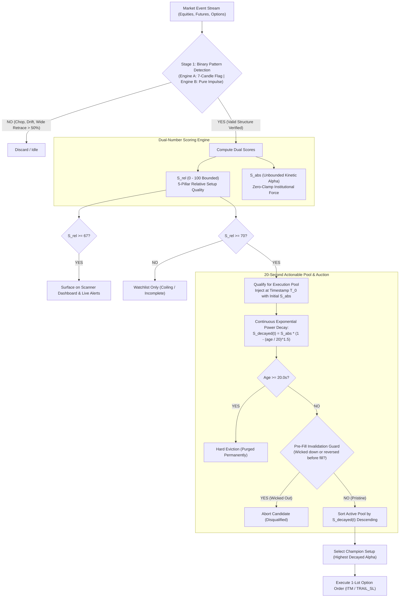
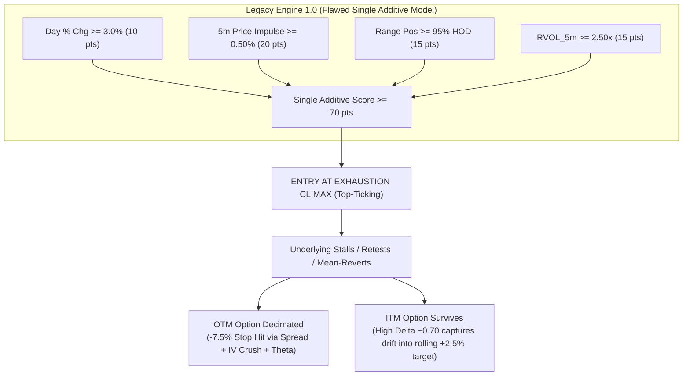

# Scoring Engine 2.0: Dual-Number Classification, Unclamped Kinetic Alpha & Exhaustion Defense Architecture

## Executive Summary & Core Philosophy

**Scoring Engine 2.0** completely eliminates the failure modes of legacy additive scoring by establishing a mathematically rigorous **Dual-Number System** decoupled across two independent stages:

1. **Stage 1: Relative Gatekeeper ($S_{\text{rel}} \in [0, 100]$)**:
   A bounded, normalized multi-pillar metric designed exclusively for **structural qualification and human screening** (e.g. Watchlist $\ge 67$, Trade Execution Qualification $\ge 70$). It determines: *"Does this instrument possess the structural prerequisites of a genuine momentum setup?"*
2. **Stage 2: Unbounded Kinetic Alpha ($S_{\text{abs}} \in [0, \infty)$)**:
   A purely proportional, convex energy metric with **strictly zero `min()` ceilings**. It is designed exclusively for **micro-auction ranking** across concurrent opportunities. It determines: *"Between 3 setups qualifying right now, which one has the highest institutional horsepower and clear runway ahead?"*
3. **Continuous Exponential Decay & 20-Second Hard Eviction**:
   A real-time temporal decay engine applied tick-by-tick to $S_{\text{abs}}$, ensuring that execution freshness is mathematically balanced against raw setup strength, completely preventing the strategy from entering stale or exhausted setups.



---

## Part 1: Forensic Post-Mortem of Legacy Engine 1.0

### 1.1 Root Causes of Legacy Failure

In Legacy Engine 1.0, setup detection, scoring, and ranking were conflated into a single additive number that used artificial clamping:



#### Flaw 1: The "Top-Ticking" Exhaustion Climax Paradox
To achieve a high score ($\ge 75–85$) in Legacy Engine 1.0, a stock had to max out all pillars simultaneously: $+3.5\%$ day change, $+1.2\%$ 5-minute candle surge, $3.0\times$ RVOL, and print at the absolute HOD ($100\%$ range position). In financial markets, when all five factors align simultaneously, the candle is almost always in its **exhaustion / retail FOMO phase**. The algorithm was structurally programmed to buy the very top of expansion candles.

#### Flaw 2: The Distance-Driven Climax Illusion
In Engine 1.0, **a higher score meant the price had traveled further**. An 85 score meant the price was extended by $2–3\%$ above its consolidation base. Entering at 85 meant entering at the end of the move, right before mean reversion.

#### Flaw 3: Information Destruction via `min()` Clamping
Extensive use of `min()` functions (`min(40.0, ...)`, `min(20.0, ...)`, `min(100.0, ...)`) flattened institutional outliers. A monster $12\times$ institutional sweep received the exact same score as a pedestrian $2.5\times$ volume burst. When two stocks broke out, the strategy could not distinguish between an institutional runaway train and a routine retail bounce.

#### Flaw 4: Why ITM Won and OTM Bled in Engine 1.0
* **OTM options** rely purely on gamma acceleration. When bought at the top of an expansion candle:
  1. The 3–5% bid-ask spread is paid immediately at Ask.
  2. Implied Volatility (IV) collapses as the candle momentum halts (IV crush).
  3. A tiny $0.3\%$ underlying pullback causes the OTM premium to drop $-10\%$, triggering the stop loss.
* **ITM options** have high intrinsic value, tight spreads ($0.8\%$), low theta drag, and high delta ($\Delta \approx 0.70$). When the stock stalled or drifted $+0.3\%$, ITM captured enough rupee move to hit rolling decayed targets or break even.
* **Verdict**: ITM's performance was an artifact of its ability to survive bad entry prices as an equity proxy, not proof that Engine 1.0 was timing breakouts effectively.

---

## Part 2: Number 1 — $S_{\text{rel}}$ (The Relative Quality Gatekeeper)

$S_{\text{rel}} \in [0, 100]$ is a bounded, multi-factor percentile metric calculated in [`strategies/momentum/scoring.py`](file:///Users/yorha/Documents/Trading%20Stuff/strategies/momentum/scoring.py#L133-L340).

### 2.1 The 5 Balanced Pillars

$$S_{\text{rel}} = P_1 + P_2 + P_3 + P_4 + P_5 + \text{Bonus} + \text{Regime Boost}$$

```
┌──────────────────────────────────────────────┬────────────┬────────────────────────────────────────────────────────┐
│ Pillar                                       │ Max Weight │ Core Mathematical Input                                │
├──────────────────────────────────────────────┼────────────┼────────────────────────────────────────────────────────┤
│ P1: Volume & Participation                   │   25.0     │ RVOL_5m (15 pts) + Pace (6 pts) + Z-Vol (4 pts)        │
│ P2: Price Consolidation & Base Tightness     │   20.0     │ Coiling Span % (12 pts) + Coiling Flag Bonus (8 pts)   │
│ P3: Directional Momentum                     │   30.0     │ Day % Change (10 pts) + 5m Candle Impulse % (20 pts)   │
│ P4: Position & Freshness                     │   15.0     │ Range Position % (Closeness to HOD/LOD)                │
│ P5: Micro-Tick Velocity & Thrust             │   10.0     │ 3-Tick Sweep Delta relative to Day Span                │
│ Pattern Bonuses / Clamps                     │  +/- 15.0  │ +15 for 💥 Breakout, -15 dock for Fluff / Low Vol      │
│ Macro Nifty Regime Boost                     │  +/- 10.0  │ +5 Boost / -15 Suppression based on Nifty 50 Trend     │
├──────────────────────────────────────────────┼────────────┼────────────────────────────────────────────────────────┤
│ Total Bounded Score (S_rel)                  │  100.0     │ Clamped strictly to [0.0, 100.0]                       │
└──────────────────────────────────────────────┴────────────┴────────────────────────────────────────────────────────┘
```

### 2.2 Mathematical Specifications of Each Pillar

#### Pillar 1: Volume & Participation ($P_1 \le 25.0$)
Measures abnormal institutional volume over rolling 5-minute windows and execution pace:
$$P_{1,\text{rvol}} = \min\left(15.0,\; \frac{\text{RVOL}_{5m} - 0.60}{2.50 - 0.60} \times 15.0\right)$$
$$P_{1,\text{pace}} = \min\left(6.0,\; \frac{\text{Pace} - 0.80}{2.00 - 0.80} \times 6.0\right)$$
$$P_{1,z} = \min\left(4.0,\; \frac{Z_{\text{vol}} - 0.20}{2.00 - 0.20} \times 4.0\right)$$
$$P_1 = \min(25.0,\; P_{1,\text{rvol}} + P_{1,\text{pace}} + P_{1,z})$$

#### Pillar 2: Price Consolidation & Tightness ($P_2 \le 20.0$)
Awards points for energy accumulation inside a tight base before the breakout:
$$\text{Coiling Span}_{\%} = \frac{\text{High}_{\text{day}} - \text{Low}_{\text{day}}}{\text{LTP}} \times 100$$
$$P_{2,\text{span}} = \max\left(0.0,\; \left(1.0 - \frac{\text{Coiling Span}_{\%}}{2.5\%}\right) \times 12.0\right)$$
$$P_2 = \min\left(20.0,\; P_{2,\text{span}} + (8.0 \text{ if flag coiling else } 0.0)\right)$$

#### Pillar 3: Directional Momentum ($P_3 \le 30.0$)
Couples macro day displacement with acute 5-minute candle velocity:
$$T_{\text{day}} = \min\left(10.0,\; \frac{|\Delta_{\text{day}}\%|}{3.0\%} \times 10.0\right)$$
$$T_{5m} = \min\left(20.0,\; \frac{|\Delta_{5m}\%|}{0.50\%} \times 20.0\right)$$
$$P_3 = \min(30.0,\; T_{\text{day}} + T_{5m})$$
*(Requires directional alignment: if Day $\%$ is green but 5m impulse is red, $P_3 = 0.0$).*

#### Pillar 4: Position & Freshness ($P_4 \le 15.0$)
Measures proximity to the extreme of the day:
$$\text{Range Pos}_{\text{bull}} = \frac{\text{LTP} - \text{Low}}{\text{High} - \text{Low}} \times 100 \implies P_{4,\text{bull}} = \min\left(15.0,\; \frac{\text{Range Pos}}{100.0} \times 15.0\right)$$
$$\text{Range Pos}_{\text{bear}} = \frac{\text{High} - \text{LTP}}{\text{High} - \text{Low}} \times 100 \implies P_{4,\text{bear}} = \min\left(15.0,\; \frac{100.0 - \text{Range Pos}}{100.0} \times 15.0\right)$$

#### Pillar 5: Micro-Tick Thrust & Sweep Velocity ($P_5 \le 10.0$)
Normalized relative to the day's span ($t_3 - t_1$ across the last 3 raw trades):
$$P_5 = \min\left(10.0,\; \frac{|\Delta_{\text{ticks}}|}{0.15 \times \text{Day Span}} \times 10.0\right)$$

---

## Part 3: The Deep Mathematical Rationale of the "70" Threshold

Why is **70** the perfect execution threshold? Why not **67**? Why not **85**?

```
 0                    40                   67          70                   85          100
 ├────────────────────┼────────────────────┼───────────┼────────────────────┼────────────┤
 │    DEAD / NOISE    │  PASSIVE CONTEXT   │  COILING  │  KINETIC IGNITION  │ EXHAUSTION │
 │    (Mean Revert)   │  (Accumulation)    │ (Watchlist│  (THE SWEET SPOT)  │  (Climax)  │
 │                    │                    │   Only)   │  ⚡ BUY HERE ⚡     │ ⚠️ Top Tick│
```

### 3.1 The Passive Context Ceiling ($\le 40$ Points)
Look at the maximum points achievable from purely passive conditions:
* Day Change $+3.0\%$ (Passive Trend): $10.0\text{ pts}$
* Range Position at $95\%$ HOD (Passive Level): $14.2\text{ pts}$
* Nifty 50 Pro-Bull Boost: $5.0\text{ pts}$
* Base Tightness: $10.0\text{ pts}$
* **Maximum Possible Passive Context Score**: $\approx \mathbf{39.2\text{ pts}}$.

**Mathematical Consequence**:
A stock can be up $+4.0\%$ on the day, trading near HOD, on a green Nifty day—and it will **never cross 45 points** while drifting passively. To cross 70, a stock **must produce at least 30+ points of active kinetic breakout energy** ($2\times$ volume rate surge + 5m expansion candle + micro-tick sweep).

### 3.2 Why Not 67? (The Anticipation & Coiling Trap)
At **60 to 67 points**, a stock looks enticing on a chart, but it is **still coiling inside its base**:
* Stock is up $+2.2\%$ on the day ($7\text{ pts}$).
* Trading at $88\%$ of day range ($13\text{ pts}$).
* Nifty is pro-bull ($+5\text{ pts}$).
* Flag coiling pattern active ($+8\text{ pts}$).
* Moderate volume ($12\text{ pts}$).
* **Total = 62 – 67 points.**

**The Fatal Flaw of Buying at 67**:
* The price has **not yet crossed the breakout level**.
* It is still bouncing beneath overhead resistance. It can coil for another 20 minutes (burning option theta) or roll over into a false breakdown.
* **Role of 67**: This is why **67 is our Watchlist / Monitor Threshold**. It alerts the operator (`⚡ FORMING` / `🌀 BULL FLAG`), surfaces the stock on the screen, and starts countdown timers—but leaves capital safely in cash.

### 3.3 Why Not 85? (The Retail Climax & Top-Ticking Trap)
To score $\ge 85$ naturally across the 5 pillars without an unclamped volume surge:
* The stock must be up $+3.5\%+$ ($10/10$).
* The 5-minute candle must have surged $+1.5\%$ ($20/20$).
* 5m RVOL must be $> 2.5\times$ ($25/25$).
* Range position must be at $100\%$ absolute HOD ($15/15$).
* Micro-tick sweep maxed out ($10/10$).

**The Fatal Flaw of Buying at 85**:
* By the time all five pillars hit their absolute ceiling, **the institutional thrust is already completed**.
* You are buying the tail end of the candle where institutions sell to retail FOMO buyers.
* The very next tick brings an inside bar, a retest, and Implied Volatility (IV) collapse.
* On an option, an entry at 85 results in an immediate $-10\%$ to $-15\%$ drawdown.

### 3.4 Why 70 is the "Kinetic Ignition" Sweet Spot
1. **Zero Fake Drift**: Passive context caps at 40. A score of 70 mathematically guarantees an active volume burst and level breakout.
2. **Freshness (< 0.25% Extension)**: At 70, the price has *just* crossed the resistance regression line or HOD. The candle is young.
3. **Full Expansion Runway**: Entering at 70 allows the remaining $70\%$ of the candle's expansion to happen **while you are already holding the option**. On an ITM contract ($\Delta \approx 0.70$), this immediate expansion surges the premium into $+8\%$ to $+16\%$, triggering the $+2.5\%$ breakeven stop ratchet before any pullback can occur.

---

## Part 4: Number 2 — $S_{\text{abs}}$ (The Unbounded Kinetic Alpha Auctioneer)

Once $S_{\text{rel}} \ge 70$ validates that a setup is legitimate, $S_{\text{rel}}$ steps aside. The strategy **never** allocates capital or selects candidates based on $S_{\text{rel}}$.

Instead, **$S_{\text{abs}}$ takes over**. In [`strategies/momentum/scoring.py`](file:///Users/yorha/Documents/Trading%20Stuff/strategies/momentum/scoring.py#L34-L131), $S_{\text{abs}}$ is computed with **strictly zero `min()` ceilings**:

$$S_{\text{abs}} = S_{\text{vol\_burst}} + S_{\text{rvol\_base}} + S_{\text{clearance}} + S_{\text{proximity}} + S_{\text{retrace}} + S_{\text{spread}} + S_{\text{regime}}$$

```
┌──────────────────────────────────────┬─────────────────────────────────────────────────────────────────────────────────┐
│ Component                            │ Mathematical Formula & Rationale                                                │
├──────────────────────────────────────┼─────────────────────────────────────────────────────────────────────────────────┤
│ S_vol_burst (Flag Breakout)          │ 15.0 * (Rate_break / Rate_coiling)                                             │
│                                      │ A 2x burst gives 30 pts; a monster 8x institutional sweep gives 120 pts.        │
│ S_vol_burst (Pure Breakout)          │ 12.0 * RVOL_5m                                                                  │
│ S_rvol_base                          │ 5.0 * RVOL_day + 3.0 * Z_vol (Cumulative institutional accumulation)             │
│ S_clearance (Runway to Resistance)   │ Clearance_% * 8.0 (Awards points linearly for overhead "blue sky" runway)       │
│ S_proximity (Freshness Reward)       │ max(0.0, 25.0 - (Extension_% * 20.0)) (Collapses to 0 if extended > 1.25%)      │
│ S_retrace (Base Tightness)           │ (1.0 - (Retrace / (0.50 * Pole_Height))) * 25.0 (Awards shallow 10-15% flags)   │
│ S_spread (Liquidity Penalty)         │ -(Option_Spread_% * 10.0) (Docks points for wide bid-ask spreads)               │
│ S_regime (Macro Bias)                │ +10.0 (trend-aligned) / -25.0 (counter-trend)                                  │
└──────────────────────────────────────┴─────────────────────────────────────────────────────────────────────────────────┘
```

### 4.1 Why High Scores in Engine 2.0 Do NOT Mean Late Entries

In Engine 1.0, a high score meant the price had traveled further. **In Engine 2.0, a high score measures institutional force at the exact same price location:**

Consider two candidates breaking out of identical flags at the exact same price ($0.1\%$ above resistance):
* **Candidate A**: Breaks with $2.1\times$ volume rate burst $\implies S_{\text{abs}} = \mathbf{76.0}$.
* **Candidate B**: Breaks at the exact same level, but with an $8.5\times$ institutional block sweep $\implies S_{\text{abs}} = \mathbf{148.0}$.

Both are at the **exact same price location ($0.1\%$ extension)**. Candidate B is not "late"; it simply has **$4\times$ the institutional buying pressure behind it**. Candidate B rightfully wins the auction and explodes into immediate follow-through.

---

## Part 5: The 5-Layer Anti-Exhaustion & Anti-Top-Ticking Defense Matrix

How does Engine 2.0 mathematically guarantee that it never enters an exhausted or extended move?

```
Breakout Resistance Level ─────────────────────────────●─────────────────────────
                                                       │
 1. SPATIAL GUARD:   Extension > 1.25%? ─────────────> │ Proximity drops to 0 pts (Score penalized)
 2. MORPHOLOGICAL:   Upper Wick > 15%? ──────────────> │ Weak Break Dock (-15 pts, Ceiling 60)
 3. TEMPORAL GUARD:  Age > 15s? ─────────────────────> │ Decayed 65% (Evicted at 20s)
 4. PRE-FILL GUARD:  Wicked prior to execution? ─────> │ Abort order before broker fill
 5. SPREAD GUARD:    Option Spread > 3.0%? ──────────> │ Reject illiquid contract (No instant SL trigger)
```

### Layer 1: Spatial Proximity Penalty ($S_{\text{proximity}}$)
As price extends past the breakout level, proximity points evaporate rapidly:
$$S_{\text{proximity}} = \max\left(0.0,\; 25.0 - (\text{Extension}_{\%} \times 20.0)\right)$$
* $\text{Extension} = 0.10\% \implies S_{\text{proximity}} = \mathbf{23.0\text{ pts}}$ (Fresh Ignition).
* $\text{Extension} = 0.50\% \implies S_{\text{proximity}} = \mathbf{15.0\text{ pts}}$.
* $\text{Extension} = 1.00\% \implies S_{\text{proximity}} = \mathbf{5.0\text{ pts}}$.
* $\text{Extension} \ge 1.25\% \implies S_{\text{proximity}} = \mathbf{0.0\text{ pts}}$ (Extended / Exhausted).
A stock that has already run cannot win the auction because its score is heavily penalized.

### Layer 2: Morphological Wick Rejection Guard
In [`strategies/momentum/patterns.py`](file:///Users/yorha/Documents/Trading%20Stuff/strategies/momentum/patterns.py#L558-L563), the breakout candle must maintain:
1. Directional body ratio $\ge 70\%$.
2. Upper rejection wick $\le 10–15\%$:
   $$\text{Upper Wick Ratio} = \frac{\text{High} - \text{LTP}}{\text{High} - \text{Low}} \le 0.15$$
If a stock surges to a new high but pulls back, leaving an upper shadow $> 15\%$, it indicates **sellers absorbing bids**. The setup is classified as `👀 WEAK BREAK / NO VOL` and its score is hard-capped at **60.0**, making it impossible to trigger trade execution.

### Layer 3: Temporal 20-Second Exponential Decay & Hard Eviction
Every qualified candidate in the Actionable Pool undergoes real-time power decay from detection timestamp $T_0$:

$$S_{\text{decayed}}(t) = S_{\text{abs}} \times \max\left(0.0,\; 1.0 - \left(\frac{t - T_0}{20.0}\right)^{1.5}\right)$$

```
 Decay Curve of S_abs over 20-Second Kinetic Lifespan:
 100% ────● (t = 0s: Fresh trigger, maximum kinetic force)
  87%      ╲
  65%       ╲
  35%        ● (t = 15s: 65% energy expended, high slippage risk)
   0% ────────● (t = 20s: HARD EVICTION - setup permanently purged)
```

* **At $t = 5.0\text{s}$**: Retains $87.5\%$ of score.
* **At $t = 10.0\text{s}$**: Retains $64.6\%$ of score.
* **At $t = 15.0\text{s}$**: Retains only $35.0\%$ of score.
* **At $t \ge 20.0\text{s}$**: $S = 0.0 \implies$ **Hard Eviction** (permanently purged from memory).

**Why This Balances Freshness vs. Absolute Quality**:
* **Candidate A**: Initial monster score $S_0 = 120.0$, triggered $14.0\text{s}$ ago $\implies S_{\text{decayed}} = 120.0 \times 0.414 = \mathbf{49.7}$.
* **Candidate B**: Solid score $S_0 = 85.0$, triggered $2.0\text{s}$ ago $\implies S_{\text{decayed}} = 85.0 \times 0.968 = \mathbf{82.3}$.
* **Result**: **Candidate B is executed**. Even though Candidate A had higher initial volume, its entry window has closed. Candidate B's fresh kinetic burst takes priority.

### Layer 4: Pre-Execution Invalidation Guard
Before `_execute_candidate` submits the order to the broker, it executes `is_setup_valid()`. If a micro-tick reversal wicked the candle down during the milliseconds the candidate sat in the pool, the trade is aborted immediately.

### Layer 5: Hard Option Spread Liquidity Gate (`check_spread_allowed`)
In [`strategies/momentum/risk.py`](file:///Users/yorha/Documents/Trading%20Stuff/strategies/momentum/risk.py#L182-L215), before any position can be opened in [`strategies/momentum/portfolio.py`](file:///Users/yorha/Documents/Trading%20Stuff/strategies/momentum/portfolio.py#L967-L976), the engine verifies the contract's real-time order book spread:

$$\text{Spread}_{\%} = \frac{\text{Ask} - \text{Bid}}{\text{Ask}} \times 100$$

A contract is **strictly rejected** before entry if:
1. $\text{Bid} \le 0$ or $\text{Ask} \le 0$ (unquoted market liquidation liquidity).
2. $\text{Bid} > \text{Ask}$ (crossed/inverted book).
3. $\text{Spread}_{\%} > 3.0\%$ (max allowed spread threshold from `config/strategies.json`).
4. $\text{Spread}_{\%} \ge \text{Option SL}_{\%} \times 0.50$ (spread must never consume $\ge 50\%$ of the stop loss buffer).

*Why this prevents the "BOSCHLTD Instant Death" bug*:
In BOSCHLTD, $\text{Ask} = ₹1,129.55$, $\text{Bid} = ₹1,043.80 \implies \text{Spread} = \mathbf{7.59\%}$. Since $7.59\% > 3.0\%$, the contract is eliminated upfront, preventing the engine from buying an option that immediately stops out on fill.

---

## Part 6: Why Clamping Would Destroy the System's Edge

The user asked: *"Should we clamp like, is it a good idea?"*

**Definitively, NO. Clamping (`min(100, S)`) is catastrophic for algorithmic execution.**

### 1. Information Destruction
Suppose two stocks qualify simultaneously at 09:45:00 IST:
* **Stock A**: A routine small-cap flag break with $2.2\times$ volume.
* **Stock B (`RELIANCE`)**: An institutional block-sweep breakout with $12\times$ RVOL and 5% clearance.

If you clamp scores to 100:
$$\text{Score}(A) = 100.0, \quad \text{Score}(B) = 100.0$$
**You have blinded the algorithm.** The strategy cannot tell which stock is backed by institutional conviction. If capital is constrained to 1 lot, the algorithm has to pick randomly based on whichever stock appeared first in the dictionary iteration!

### 2. Preserving Convex Tail Alpha
With unclamped scoring:
$$\text{Score}(A) = 78.0, \quad \text{Score}(B) = 165.0$$
The auction decisively routes capital into `RELIANCE`.

Because **proximity penalizes extension** and **time decay purges candidates after 20 seconds**, unclamped scores *cannot* chase extended moves. Clamping only serves to penalize excellence.

---

## Part 7: Time-of-Day Multi-Tier Gating Matrix

Market dynamics shift across the trading day. Engine 2.0 enforces a multi-tier gating matrix in [`strategies/momentum/patterns.py`](file:///Users/yorha/Documents/Trading%20Stuff/strategies/momentum/patterns.py#L31-L79):

| Market Phase | IST Time Window | Aggressiveness | $RVOL_{5m}$ Threshold | Flag Burst Mult | Max Wick Ratio | Min Body Ratio | Max Flag Retrace | Min Coiling Candles | Min S/R Clearance |
| :--- | :---: | :---: | :---: | :---: | :---: | :---: | :---: | :---: | :---: |
| **OPENING** | 09:15 – 10:00 | 100% (Peak) | $\ge 2.0\times$ | $\ge 2.0\times$ | $\le 25\%$ | $\ge 65\%$ | $\le 50\%$ | $\ge 1$ candle | $\ge 0.20\%$ |
| **MORNING** | 10:00 – 11:00 | 75% | $\ge 2.5\times$ | $\ge 2.3\times$ | $\le 15\%$ | $\ge 70\%$ | $\le 40\%$ | $\ge 2$ candles | $\ge 0.35\%$ |
| **MIDDAY** | 11:00 – 13:30 | **FROZEN** | Entry Freeze | Entry Freeze | Entry Freeze | Entry Freeze | Entry Freeze | Entry Freeze | Entry Freeze |
| **AFTERNOON**| 13:30 – 15:00 | 50% | $\ge 2.5\times$ | $\ge 2.5\times$ | $\le 15\%$ | $\ge 70\%$ | $\le 40\%$ | $\ge 2$ candles | $\ge 0.35\%$ |
| **LATE** | 15:00 – 15:15 | 50% | $\ge 2.5\times$ | $\ge 2.5\times$ | $\le 15\%$ | $\ge 70\%$ | $\le 40\%$ | $\ge 2$ candles | $\ge 0.35\%$ |

* **Midday Lull Freeze (11:00 – 13:30 IST)**: New entries are completely frozen. The market enters a low-volume chop zone where breakouts frequently trap. Existing open positions are managed by trailing SL exits, but zero new risk is deployed.
* **5m RVOL Gating**: After 10:00, gating relies **strictly on $RVOL_{5m}$** rather than $RVOL_{\text{day}}$, preventing setups from riding on morning memory.

---

## Part 8: Dynamic Trio Macro-Regime Allocation & Strict Isolation

In [`strategies/momentum/portfolio.py`](file:///Users/yorha/Documents/Trading%20Stuff/strategies/momentum/portfolio.py#L560-L580), Dynamic Trio allocates capital based on Nifty 50 macro trend:

### 8.1 Regime Mapping
* **PRO_BULL Regime ($\text{Nifty} \ge +0.35\%$)**:
  $$\text{Allocation: } \big[\text{TRAIL\_SL\_ITM } (50\%), \text{ TRAIL\_SL\_ATM } (30\%), \text{ ITM } (20\%)\big]$$
  Prioritizes high-delta ITM options to overcome fixed ₹60 brokerage on sharp upward moves.
* **PRO_BEAR Regime ($\text{Nifty} \le -0.35\%$)**:
  $$\text{Allocation: } \big[\text{TRAIL\_SL\_ITM } (50\%), \text{ ITM } (30\%), \text{ TRAIL\_SL\_ATM } (20\%)\big]$$
  Provides high intrinsic delta and downside acceleration for put options.
* **NEUTRAL Regime ($-0.35\% < \text{Nifty} < +0.35\%$)**:
  Evaluates candidate tracks using a blended composite score over the rolling lookback window.

### 8.2 Strict Champion Trade Isolation
```python
matching = [
    t for t in opened_trades
    if (t.strategy_track in self.dynamic_trio_champions or
        t.strategy_track.replace(FIXED_CAP_SUFFIX, "") in self.dynamic_trio_champions)
]
if matching:
    # Mirror trade for Dynamic Trio...
else:
    # If none of the active champions triggered, sit in cash!
    champ_trade = None
```
Dynamic Trio **never** mirrors arbitrary non-champion trades. If the designated champions did not fire, Dynamic Trio sits safely in cash.

---

## Part 9: Trailing Stop-Loss Retracement Convergence ("Meet in the Middle")

In [`strategies/momentum/risk.py`](file:///Users/yorha/Documents/Trading%20Stuff/strategies/momentum/risk.py#L259-L268):
Once a trade clears the trailing breakeven trigger ($+2.5\%$), as the price pulls back from its peak, the stop-loss boundary dynamically advances toward the retreating price with convergence factor $\beta = 0.50$:

$$\text{pullback} = \max(0.0,\; \text{peak\_price} - \text{current\_price})$$
$$\text{converged\_sl} = \text{effective\_sl} + (\beta \times \text{pullback})$$

```python
if pullback > 0 and max_gain_pct >= self.trail_breakeven_trigger_pct:
    converged_sl = effective_sl + (self.trail_convergence_ratio * pullback)
    if converged_sl > effective_sl:
        effective_sl = converged_sl
        position["current_sl"] = effective_sl
    if current_option_price <= converged_sl:
        return True, f"TRAILING_STOP_LOSS (Peak ₹{peak_price:.2f} -> Converged @ ₹{converged_sl:.2f} hit)"
```

### Broker Order Management & Groww 25-Modification Limit
* Groww strictly caps order modifications at **25 per order**.
* The retracement convergence calculation is performed locally on live quotes.
* When the stop ratchets, `update_stop_loss` modifies the resting SL order trigger price on Groww.
* **Proactive Cancel & Replace**: At 25 modifications, `LiveExecutionAdapter` automatically cancels the resting order and submits a fresh SL order, resetting `modification_count = 0`.
* **Reactive Safety Net**: If Groww rejects a modification with an error containing `"modification limit exceeded"`, the adapter catches it and executes an emergency cancel & replace.

---

## Part 10: Combined Allocation Tracks: Separate Pools vs. Shared Pools

### 10.1 Track Taxonomy
The engine supports two parallel variations of composite allocation tracks:

1. **Base Composite Tracks (Separate Isolated Pools)**:
   - Each constituent sub-track operates strictly within its isolated partition:
     $$\text{Sub-Track Cash} = \frac{\text{Starting Capital}}{N}$$
   - A sub-track cannot borrow idle capital from sibling sub-tracks.
   - Tracks: `COMBINED_ITM`, `COMBINED_ATM`, `COMBINED_OTM`, `COMBINED_FIXED_TARGET`, `COMBINED_TRAILING_SL`.

2. **Shared Pool Composite Tracks (Unified Full Pool)**:
   - All constituent sub-tracks draw directly from the shared combined account cash pool (`acct.cash`).
   - If one strategy track triggers multiple high-conviction trades, it can utilize available cash dynamically without being artificially capped by isolated $1/N$ partitions.
   - On trade exit, realized capital and original cost are replenished directly into `acct.cash`.
   - Tracks:
     - **`COMBINED_STAR` (Star Performer)**: Merges the top two winning portfolios (`COMBINED_TRAILING_SL` + `COMBINED_ITM`) into a unified 5-track powerhouse: `["TRAIL_SL_ITM", "TRAIL_SL_ATM", "TRAIL_SL_OTM", "ITM", "FIXED_TGT_ITM"]` (overlapping `TRAIL_SL_ITM` is de-duplicated).
     - `COMBINED_ITM_SHARED` (Aliases: `SHARED_ITM`, `SHARED_COMBINED_ITM`)
     - `COMBINED_ATM_SHARED` (Aliases: `SHARED_ATM`, `SHARED_COMBINED_ATM`)
     - `COMBINED_OTM_SHARED` (Aliases: `SHARED_OTM`, `SHARED_COMBINED_OTM`)
     - `COMBINED_FIXED_TARGET_SHARED` (Aliases: `SHARED_FIXED_TARGET`, `SHARED_COMBINED_FIXED_TARGET`)
     - `COMBINED_TRAILING_SL_SHARED` (Aliases: `SHARED_TRAILING_SL`, `SHARED_COMBINED_TRAILING_SL`)

### 10.2 Fixed Capital Deactivation from Execution
- **Rationale**: Backtests and live simulations showed minimal return variation between fixed capital non-compounding variants and compounding tracks while doubling the table display rows.
- **Implementation**: Fixed capital tracks (`*_FIXED_CAP`) have been removed from active execution, default `--track ALL`, default simulation configs, and live startup loops.
- **Code Integrity**: All underlying fixed-capital classes, non-compounding capital capping logic, Dynamic Trio blend weights, and `[FX]` display formatters remain 100% intact in the codebase. Fixed-capital tracks can be explicitly simulated at any time via `--track FIXED_CAP` or `--track <TRACK>_FIXED_CAP`.

### 10.3 Recursive Next-ITM Strike Diversification
When multiple sub-tracks within any combined portfolio (separate or shared) trigger simultaneously on the same stock, or when the primary contract is already held in open positions:
1. `used_contract_keys` is initialized with all active contracts held in `acct.open_positions` for that symbol.
2. If sub-track 1 selects `2026-11-23_49500.0_PE` (ITM1), that contract key is marked as used.
3. If sub-track 2 also attempts to trade ITM1, the engine initiates a **recursive search loop**:
   $$\text{ITM1} \longrightarrow \text{ITM2} \longrightarrow \text{ITM3} \dots$$
4. In each recursion, `OptionSelector.resolve_next_itm_strike()` selects the next strike (lower strike for CE, higher strike for PE) and validates:
   * **Collision Free**: Contract key not already open or pending.
   * **Quoted & Fresh**: Real market Ask/Bid quotes exist and are not stale.
   * **Spread Gate Compliant**: Bid $> 0$, Bid $\le$ Ask, Spread $\le 3.0\%$, and Spread $< 0.50 \times \text{SL}_{\%}$.
5. If valid, the diversified strike is assigned to the sub-track. If no liquid deeper ITM strike exists, the order is safely rejected without broker duplicate order errors.

---

## Part 11: Live Startup Recording Backfill & Two-Phase Simulation

### 11.1 Mid-Day Live Startup (`backfill_from_recordings`)
When launching mid-session (`python3 runner.py start --start-time 10:30`):
1. **Phase 1 (Warm-Up, Ticks $< 10:30$)**: Ingested with `is_warming_up = True`. Rebuilds rolling RVOL, 1m candle windows, ATR, pattern flags, and quotes cache without placing trades.
2. **Phase 2 (Simulation, Ticks $\ge 10:30$)**: Ingested with `is_warming_up = False`. Re-executes the strategy's candidate auction and in-memory portfolio entries and trailing stops up to current time.
3. **Broker Protection**: During backfill, `self.is_backfilling = True` strictly bypasses sending orders, exits, or SL modifications to Groww.
4. **Reconciliation**: Post-backfill, `reconcile_broker_positions()` synchronizes real positions directly from Groww.

### 11.2 Two-Phase Simulation Stream
In historical simulations (`runner.py sim --start-time 10:00 --end-time 12:00`):
* Streams from `09:15` with `is_warming_up = True` to populate ATR and flag poles.
* At `10:00`, switches `is_warming_up = False`, allowing pristine, uncorrupted trade simulation.
* Constituent sub-tracks are compact by default; pass `--expand-tracks` to expand sub-tracks in the terminal performance matrix.
