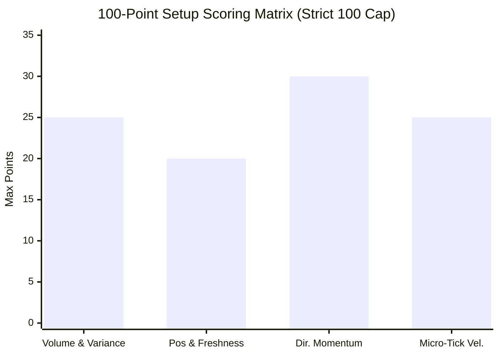
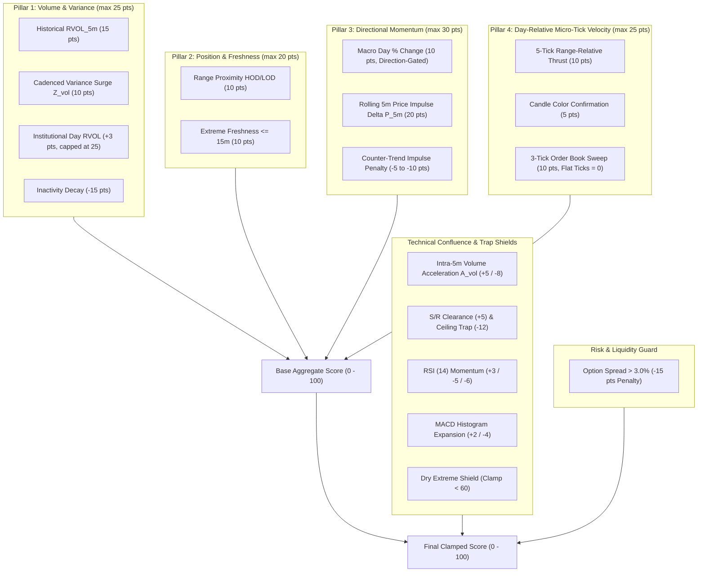
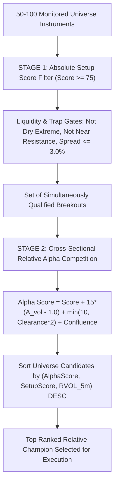
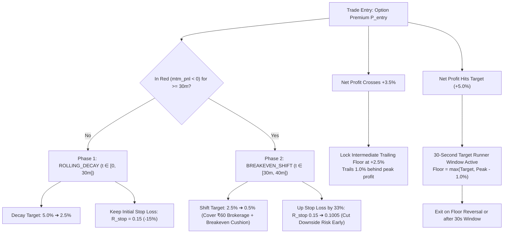

# Real-Time Bidirectional Setup Scoring Engine (0 – 100 Points)

## Executive Summary

The Upstox Live RVOL Scanner implements a **quantified, multi-factor scoring model (0–100 points)** designed to detect institutional intraday expansion (Long Breakouts and Short Breakdowns) while filtering out false breakouts, morning outlier skews, stagnant dead highs, and illiquid traps.

Rather than relying on isolated indicators, the engine synthesizes four orthogonal market dimensions:
1. **Volume & Variance Surge ($Z_{\text{vol}}$)**: Measures volume expansion relative to both historical time-of-day baselines and the rolling 60-minute variance regime, with early-window confidence damping and cadenced sampling.
2. **Range Position & Extreme Freshness**: Balances proximity to Day's High/Low against how recently that extreme was printed (penalizing stagnant highs inactive for $>15\text{ mins}$).
3. **Two-Tier Directional Momentum**: Enforces directional consistency between macro daily trend and micro 5-minute price impulse ($\Delta P_{5m}$), penalizing counter-trend contradictions.
4. **Order Flow & Day-Relative Micro-Tick Velocity**: Validates immediate tick acceleration and order book sweeps scaled relative to the day's total range (filtering out sub-penny noise and eliminating flat-tick inactivity).

---

## 1. 100-Point Pillar Architecture

---

## 2. Mathematical Breakdown of Pillars

### Pillar 1: Volume & Variance Surge ($S_{\text{vol}} \le 25\text{ pts}$)

Evaluates whether volume is genuine institutional buying/selling versus low-liquidity drift, with early-candle damping and cadenced baseline observation:

1. **Base RVOL vs Historical Baseline ($15\text{ pts}$)**:
   Calculated over a rolling 300-second sliding window against the 30-day historical time-slot profile:
   $$RVOL_{5m} = \frac{\text{Projected 5-Minute Volume}}{\text{Historical 5-Minute Slot Average}}$$

   > [!IMPORTANT]
   > **Zero-Assumption Baseline Guard (`has_baseline`)**:
   > The engine strictly verifies that valid historical candle data exists in `data/index.json` (`has_volume_data == True`, `total_candles > 0`, `daily_avg_volume > 0`). If historical data was not obtained, the engine **never** assumes dummy fallbacks (such as 1,000 5m volume or 10,000 daily volume). Instead, `has_baseline = False`, immediately locking $RVOL_{5m} = 0.0$, $RVOL_{\text{cum}} = 0.0$, and awarding $0.0\text{ pts}$ for Pillar 1. This completely eradicates artificial 50x RVOL false alerts caused by dividing real volume by tiny assumed baselines.

   > [!TIP]
   > **Early-Window Confidence Damping ($T_{\text{elapsed}} < 60\text{s}$)**:
   > A stock that trades heavily in the first 15 seconds can look artificially spectacular if extrapolated $20\times$ across 300 seconds. If projected volume exceeds the slot expected baseline early in the window, confidence damping scales the excess:
   > $$\text{conf} = \max(0.20, T_{\text{elapsed}} / 60.0)$$
   > $$\text{Projected Volume} = \text{Expected Volume} + (\text{Raw Extrapolated} - \text{Expected}) \times \text{conf}$$
   > This prevents early 10-second bursts from creating false $30\times$ volume spikes.

   - $RVOL_{5m} < 0.6\times \implies \mathbf{0.0\text{ pts}}$
   - $0.6\times \le RVOL_{5m} < 1.0\times \implies \mathbf{1.0 + \frac{RVOL_{5m} - 0.6}{0.4} \times 3.0\text{ pts}}$ ($1.0 \to 4.0\text{ pts}$)
   - $1.0\times \le RVOL_{5m} < 1.8\times \implies \mathbf{4.0 + \frac{RVOL_{5m} - 1.0}{0.8} \times 6.0\text{ pts}}$ ($4.0 \to 10.0\text{ pts}$)
   - $1.8\times \le RVOL_{5m} \le 3.0\times \implies \mathbf{10.0 + \frac{RVOL_{5m} - 1.8}{1.2} \times 5.0\text{ pts}}$ ($10.0 \to 15.0\text{ pts}$)
   - $RVOL_{5m} > 3.0\times \implies \mathbf{15.0\text{ pts}}$

2. **Variance Surge Metric $Z_{\text{vol}}$ ($10\text{ pts}$, Continuous)**:
   Measures standard deviations above the rolling 60-minute volume regime:
   $$Z_{\text{vol}} = \frac{RVOL_{5m} - \mu_{60m}}{\max(0.35, \sigma_{60m})}$$
   - **Sampling Cadence**: Samples are recorded at a strict $\ge 30$-second cadence (avoiding duplicate polling pollution).
   - **Continuous Interpolation**: Scaled continuously from $Z_{\text{vol}} = 0.2\sigma$ to $2.0\sigma$:
     $$Z_{\text{pts}} = \min\left(10.0, \max\left(0.0, \frac{Z_{\text{vol}} - 0.2}{1.8} \times 10.0\right)\right)$$
   - **Early Session Fallback**: Before 8 samples are collected, if $Z_{\text{vol}} == 0.0$ and $RVOL_{5m} \ge 1.2$, a smooth fallback is awarded: $\min(8.0, \max(2.0, (RVOL_{5m} - 1.0) \times 4.0))$.

3. **Session Confirmation & Penalties (Capped at 25)**:
   - Institutional Day Confirmation: $+3\text{ pts}$ if all-day $RVOL_{\text{cum}} \ge 1.5\times$ (operates within the 25-point pillar cap).
   - **Inactivity Penalty ($-15\text{ pts}$)**: If volume pace collapses ($\text{Pace Ratio} \le 0.45\times$) after an initial morning burst.
   - Clamped strictly: $S_{\text{vol}} = \max(0, \min(25, S_{\text{vol}}))$.

---

### Pillar 2: Range Position & Extreme Freshness ($S_{\text{pos}} \le 20\text{ pts}$, Continuous)

Solves the classic false-positive problem where a stock is technically at its Day's High, but hasn't moved in 45 minutes and has zero continuation momentum.

$$\text{Range Position} = \frac{\text{LTP} - \text{Low}}{\text{High} - \text{Low}} \in [0.0, 1.0]$$

1. **Base Proximity ($10\text{ pts}$, Continuous)**:
   - **Bullish (at HOD)**: Scales linearly from 50% to 98% of the day's span:
     $$\text{Base}_{\text{pos}} = \min\left(10.0, \max\left(0.0, \frac{\text{Range} - 0.50}{0.48} \times 10.0\right)\right)$$
   - **Bearish (at LOD)**: Scales linearly from 50% down to 2% of the day's span:
     $$\text{Base}_{\text{pos}} = \min\left(10.0, \max\left(0.0, \frac{0.50 - \text{Range}}{0.48} \times 10.0\right)\right)$$

2. **Extreme Freshness ($10\text{ pts}$, Continuous Decay)**:
   Measures elapsed time ($T_{\text{elapsed}}$ in seconds) since the last fresh HOD or LOD was printed:
   - $T_{\text{elapsed}} \le 120\text{s}$ ($\le 2\text{ mins}$) $\implies \mathbf{10.0\text{ pts}}$ (fresh breakout print)
   - $120\text{s} < T_{\text{elapsed}} \le 900\text{s}$ ($2\text{m} \to 15\text{m}$) $\implies \mathbf{10.0 \times \left(1.0 - \frac{T_{\text{elapsed}} - 120}{780}\right)\text{ pts}}$
   - $T_{\text{elapsed}} > 900\text{s}$ ($> 15\text{ mins}$) $\implies \mathbf{0.0\text{ fresh pts}}$

---

### Pillar 3: Directional Momentum ($S_{\text{mom}} \le 30\text{ pts}$, Continuous)

Enforces strict directional consistency: a stock falling 2% never receives bullish momentum points.

1. **Directional Gating Rule**:
   - **Bullish Setup**: Requires $\Delta P_{\text{day}} > 0$. If $\Delta P_{\text{day}} < 0$, $S_{\text{mom}} = 0$.
   - **Bearish Setup**: Requires $\Delta P_{\text{day}} < 0$. If $\Delta P_{\text{day}} > 0$, $S_{\text{mom}} = 0$.

2. **Tier 1: Macro Day % Change ($10\text{ pts}$, Continuous)**:
   Calibrated for Indian equity market reality, reaching full 10 points at $+3.0\%$ move (previously required an unrealistic $+4.0\%$):
   $$\text{Macro}_{\text{mom}} = \min\left(10.0, \max\left(0.0, \frac{|\Delta P_{\text{day}}|}{3.0} \times 10.0\right)\right)$$

3. **Tier 2: Rolling 5-Minute Price Impulse $\Delta P_{5m}$ ($20\text{ pts}$, Continuous)**:
   Calibrated so a $+0.50\%$ intraday expansion candle achieves full 20 impulse points (previously required $+1.0\%$):
   $$\text{Impulse}_{\text{mom}} = \min\left(20.0, \max\left(0.0, \frac{|\Delta P_{5m}|}{0.50} \times 20.0\right)\right)$$
   *(Note: If $\Delta P_{5m}$ is not explicitly provided, it is auto-inferred from the recent micro-price history window).*

4. **Counter-Trend Impulse Penalty**:
   If a stock is up on the day but actively dumping in the last 5 minutes:
   - $\Delta P_{5m} \le -0.6\% \implies \mathbf{-10\text{ pts}}$ penalty
   - $\Delta P_{5m} \le -0.3\% \implies \mathbf{-5\text{ pts}}$ penalty
   Similarly, if a short breakdown candidate is bouncing aggressively ($\Delta P_{5m} \ge +0.3\%$), it docks $5-10\text{ pts}$.

---

### Pillar 4: Day-Relative Micro-Tick Velocity & Order Flow ($S_{\text{tick}} \le 25\text{ pts}$, Continuous)

Tick velocity is evaluated **not just by whether ticks are moving, but whether they are moving meaningfully relative to the day's activity**. Flat ticks and duplicate polling snapshots receive zero acceleration points.

$$\text{Effective Day Span} = \max(\text{High} - \text{Low}, \text{LTP} \times 0.005)$$

1. **Candle Color Confirmation ($5\text{ pts}$)**:
   - Bullish: $\text{LTP} \ge \text{Open}$ (Green Candle) $\implies \mathbf{5\text{ pts}}$
   - Bearish: $\text{LTP} \le \text{Open}$ (Red Candle) $\implies \mathbf{5\text{ pts}}$

2. **5-Tick Directional Thrust Relative to Day Span ($10\text{ pts}$, Continuous)**:
   $$\text{Thrust Ratio}_5 = \frac{|\text{Tick}_t - \text{Tick}_{t-4}|}{\text{Effective Day Span}}$$
   - $\text{Thrust Ratio}_5 \ge 0.03$ ($3.0\%$ of day range) $\implies \mathbf{10.0\text{ pts}}$
   - Continuous scaling: $1.0 + \frac{\text{Thrust Ratio}_5}{0.03} \times 9.0\text{ pts}$

3. **3-Tick Consecutive Acceleration & Sweep ($10\text{ pts}$, Continuous)**:
   - **Strict Progression Requirement**: Requires at least one strict price step ($\text{Tick}_t > \text{Tick}_{t-1} \ge \text{Tick}_{t-2}$ or $\text{Tick}_t \ge \text{Tick}_{t-1} > \text{Tick}_{t-2}$).
   - **Flat Ticks Bug Fix**: If all three ticks are identical ($\text{Tick}_t == \text{Tick}_{t-1} == \text{Tick}_{t-2}$), **$0\text{ acceleration pts}$ are awarded**!
   - Continuous scaling: $\min\left(10.0, \max\left(2.0, 2.0 + \frac{\text{Accel Ratio}_3}{0.02} \times 8.0\right)\right)$ when advancing.

---

## 3. Flag Setup Context: Preceding Pole Requirement

> [!IMPORTANT]
> A stock that has low volume and is idling near its highs is often simply **dormant**, not a pre-breakout squeeze. A genuine Bull Flag or Bear Flag **must be preceded by a sharp directional impulse (Pole)** followed by tight consolidation without retracement.

### Preceding Pole Tracking
The tracker monitors a 30-minute rolling memory window ($1800\text{ seconds}$):
- **Bull Pole**: Registered when the stock exhibits rapid upward momentum ($\Delta P_{5m} \ge +0.8\%$ or $RVOL_{5m} \ge 1.4\times$ with $\Delta P_{5m} \ge +0.35\%$) while trading in the upper range ($\text{Range Pos} \ge 0.70$).
- **Bear Pole**: Registered when the stock drops sharply ($\Delta P_{5m} \le -0.8\%$ or $RVOL_{5m} \ge 1.4\times$ with $\Delta P_{5m} \le -0.35\%$) while trading in the lower range ($\text{Range Pos} \le 0.30$).

### Flag Coiling Gating
- `🌀 BULL FLAG`: Requires $RVOL_{5m} < 0.75\times$, $\text{Range Pos} \ge 0.75$, and **$\text{has\_bull\_pole} == \text{True}$**.
- `🚩 BEAR FLAG`: Requires $RVOL_{5m} < 0.75\times$, $\text{Range Pos} \le 0.25$, and **$\text{has\_bear\_pole} == \text{True}$**.
- If a stock sits at highs with dead volume but has no preceding pole, it is classified as `🧊 DORMANT` or `NORMAL`, preventing false squeeze alerts.

---

## 4. Stage Classification & Actionable Badges

| Badge | Direction | Setup Score | Range Pos | Context & Volume Gate | Technical Interpretation |
| :--- | :---: | :---: | :---: | :---: | :--- |
| `💥 BULL BREAK` | **BULL** | $\ge 80$ | $\ge 70\%$ | Preceding Pole + Pierces Flag Ceil + Vol | **Early Flag Breakout**: Triggers *before* macro HOD when candle breaks consolidation with confirmed volume. |
| `💥 BEAR BREAK` | **BEAR** | $\ge 80$ | $\le 30\%$ | Preceding Pole + Pierces Flag Floor + Vol | **Early Flag Breakdown**: Triggers *before* macro LOD when candle breaks consolidation with confirmed volume. |
| `👀 WEAK BREAK` | **BULL** | $\le 60$ | $\ge 70\%$ | Flag pierce on dry volume or missing baseline | **Low-Volume Fluff**: Breaks flag boundary without volume expansion or baseline (Docked -15 pts, Entry Blocked). |
| `👀 WEAK CRACK` | **BEAR** | $\le 60$ | $\le 30\%$ | Flag pierce on dry volume or missing baseline | **Low-Volume Drift**: Drops below flag boundary without volume acceleration or baseline (Docked -15 pts, Entry Blocked). |
| `🚀 BREAKOUT` | **BULL** | $\ge 75$ | $\ge 90\%$ (HOD) | $RVOL_{5m} \ge 1.5\text{x}$, HOD $\le 10\text{m}$, $A_{\text{vol}} \ge 0.8$ | Confirmed institutional breakout printing fresh highs. |
| `🩸 BREAKDOWN` | **BEAR** | $\ge 75$ | $\le 10\%$ (LOD) | $RVOL_{5m} \ge 1.5\text{x}$, LOD $\le 10\text{m}$, $A_{\text{vol}} \ge 0.8$ | Heavy institutional distribution cracking fresh lows. |
| `⚡ FORMING` | **BULL** | $\ge 55$ | $\ge 75\%$ | $RVOL_{5m} \ge 1.2\text{x}$ | Continuous buying pressure toward HOD. |
| `⚡ CRACKING` | **BEAR** | $\ge 55$ | $\le 25\%$ | $RVOL_{5m} \ge 1.2\text{x}$ | Persistent selling pressure toward LOD. |
| `🌀 BULL FLAG` | **BULL** | $\ge 55$ | $\ge 85\%$ | Bull Pole + $RVOL_{5m} < 0.70\text{x}$ (Dry Vol) | **Pre-Breakout Squeeze**: Low-volume coil at highs following impulse (No entry while coiling). |
| `🚩 BEAR FLAG` | **BEAR** | $\ge 55$ | $\le 15\%$ | Bear Pole + $RVOL_{5m} < 0.70\text{x}$ (Dry Vol) | **Pre-Breakdown Pause**: Low-volume pause at lows following impulse (No entry while coiling). |
| `⚠️ DRY EXTREM` | **BULL/BEAR** | $< 60$ | $\ge 85\%$ / $\le 15\%$ | High/Low printed with $A_{\text{vol}} < 0.80$ | **False Breakout Shield**: Micro-tick drift without volume inflation (No alerts, no entries). |
| `👀 WATCH` | **ANY** | $\ge 40$ | Any | Active volume or momentum | Developing interest; not yet actionable. |
| `── NORMAL` | **NEUTRAL** | $< 40$ | Any | Normal trading pace | Baseline trading; deprioritized. |

---

## 5. Two-Stage Funnel & Cross-Sectional Relative Alpha Ranking

### The Problem With Sequential Greed
Previously, the scanner evaluated tickers sequentially alphabetically (`for key in instrument_keys:`). If stock #1 crossed threshold, it got entered immediately, exhausting trade capital before the loop even looked at stock #45 (which may have had $3\times$ higher volume acceleration, clean S/R clearance, and massive trend thrust).

### The Solution: Two-Stage Funnel
1. **Stage 1 (Absolute Setup Filter)**: Score acts as a **qualifying filter** ($\ge 75\text{ pts}$), rejecting weak or unformed setups.
2. **Stage 2 (Cross-Sectional Relative Alpha Competition)**: All simultaneously qualified setups are evaluated against each other across the entire universe and ranked by **Composite Relative Alpha**:
   $$\text{AlphaScore} = \text{SetupScore} + \Delta_{\text{vol}} + \Delta_{\text{clearance}} + \text{Confluence}_{\text{RSI/MACD}}$$
   where:
   - **Clamped Volume Acceleration Bonus/Penalty**:
     $$\Delta_{\text{vol}} = \max\left(-10.0, \min\left(15.0, 15.0 \times (A_{\text{vol}} - 1.0)\right)\right)$$
     (Strictly bounded to $[-10, +15]\text{ pts}$, preventing single-tick aberrations from overwhelming price structure).
   - **S/R Clearance Headroom Bonus**:
     $$\Delta_{\text{clearance}} = \min\left(10.0, \max\left(0.0, \text{Clearance}_{\%} \times 2.0\right)\right)$$
     ($\text{Clearance}_{\%}$ is measured in percentage points away from resistance/support, e.g. $2.5\% \implies +5.0\text{ pts}$, capped at $+10\text{ pts}$).
   - **Indicator Confluence**: Up to $+7.0\text{ pts}$ (RSI $+4.0$, MACD Histogram $+3.0$).
3. **Pre-Execution Setup Validity Guard**:
   Before capital is committed, the engine checks fresh underlying market quotes. If an equity breakout wicks back $>0.3\%$ inside its flag consolidation while awaiting the option quote, the trigger is automatically cancelled (`CANCELLED: Breakout wicked back inside flag before fill`), preventing fills on failed breakouts.
4. The portfolio enters the **top-ranked champion first**, completely eliminating the sequential greed bias! Every trade execution logs its granular alpha breakdown: `Alpha: 91.0 (Base: 85, Vol: +3.0, SR: +3.0, Conf: +0.0)`.

---

## 6. Technical Indicators & Market Regime Shields

### 6.1 Intra-5m Volume Acceleration ($A_{\text{vol}}$) & Sideways Market Shield
A major flaw in sideways markets is that price can easily drift to a new high on 5-paise sub-penny ticks without institutional volume.
To prevent this, the engine calculates real-time **Intra-5m Volume Acceleration**:
$$A_{\text{vol}} = \frac{RVOL_{1m}}{\max(0.25, RVOL_{5m})}$$
- **Volume Acceleration Bonus**: $+5\text{ pts}$ if $A_{\text{vol}} \ge 1.25$ (aggressive real-time volume inflation entering the candle).
- **Deceleration Penalty**: $-8\text{ pts}$ if $A_{\text{vol}} < 0.80$ (price drifting on drying volume).
- **Dry Extreme Shield (`⚠️ DRY HIGH` / `⚠️ DRY LOW`)**:
  If $\text{Range Pos} \ge 0.85$ and $A_{\text{vol}} < 0.80$ (or $RVOL_{1m} < 0.85$):
  - Clamps setup score strictly below trigger threshold ($\le 58\text{ pts}$).
  - Stages ticker as `⚠️ DRY HIGH` or `⚠️ DRY LOW`.
  - Strictly prevents early or confirmed breakout triggers.

### 6.2 Support & Resistance Clearance & Ceiling Trap Penalty (High Weight)
Buying at $\text{Range Pos} = 0.88$ in a sideways market is buying into the resistance ceiling of a channel.
The engine calculates daily Floor Pivot Points ($P, R_1, R_2, S_1, S_2$) and checks immediate headroom:
- **Ample Headroom Bonus**: $+5\text{ pts}$ if clearance to next resistance $\ge 0.8\%$.
- **Resistance Trap Penalty**: $\mathbf{-12\text{ pts}}$ if current price is within $0.15\%$ of resistance ceiling ($R_1, R_2$, or Prior HOD) with sluggish volume ($A_{\text{vol}} < 1.0$).

### 6.3 RSI & MACD Trend Confluence (Lower Weight)
- **RSI (14-period)**:
  - Healthy momentum: $+3\text{ pts}$ if $55.0 \le \text{RSI} \le 72.0$ (Bull) or $28.0 \le \text{RSI} \le 45.0$ (Bear).
  - Overbought exhaustion: $-5\text{ pts}$ if $\text{RSI} > 78.0$ (Bull) or $\text{RSI} < 22.0$ (Bear).
  - Counter-trend regime: $-6\text{ pts}$ if $\text{RSI} < 45.0$ (Bull) or $\text{RSI} > 55.0$ (Bear).
- **MACD (12, 26, 9)**:
  - Histogram Expansion: $+2\text{ pts}$ if histogram is expanding in trend direction.
  - Histogram Contraction / Divergence: $-4\text{ pts}$ if histogram is contracting or fighting direction.

---

## 7. 8-Second Fresh Breakout Category & 1-Lot ATM Option Cash Requirement

### 7.1 8-Second Fresh Alerts Table with Live Countdown
When a stock triggers a breakout or breakdown:
- Appears immediately in **Table 1: 🚨 FRESH BREAKOUT ALERTS (< 8s WINDOW — ACT INSTANTLY!)**.
- Displays a live dynamic countdown: `⏳ 7.4s left`, `⏳ 5.1s left`, etc.
- **Natural Downgrade Rule**: After 8.0 seconds have elapsed, the alert naturally downgrades to **Table 2: 🎯 CONFIRMED BREAKOUTS & BREAKDOWNS** and remains visible until invalidated (never disappears).

### 7.2 1-Lot ATM Option Cash Requirement Column
- Displays the exact capital required to execute 1 standard lot of the closest At-The-Money (ATM) contract:
  $$\text{1-Lot Cost} = \text{Option Premium} \times \text{Lot Size}$$
- Rendered concisely in the table: `₹14.5k (₹29.0)` (Cost: ₹14,500, Premium: ₹29.0).
- If the stock does not have an active F&O derivative contract, the column cleanly displays `Cash Only`.

---

## 8. Dynamic Scalp Exit Mechanics & Trailing Floor Engine

### 8.1 Mathematical Decay Mechanics

#### Phase 1: Rolling Target Decay ($t \in [0, 30]\text{ mins}$)
$$\text{progress}_{\text{decay}} = \min\left(1.0, \frac{T_{\text{holding}}}{30.0}\right)$$
$$\text{Target}_{\text{pct}}(t) = 5.0\% - (5.0\% - 2.5\%) \times \text{progress}_{\text{decay}}$$
- **At $t = 0\text{m}$**: Target = $+5.00\%$
- **At $t = 15\text{m}$**: Target = $+3.75\%$
- **At $t = 30\text{m}$**: Target = $+2.50\%$

#### Phase 2: Stagnant Red Breakeven Shift ($t \in [30, 40]\text{ mins}$)
If held $\ge 30\text{ mins}$ and net MTM is negative:
$$\text{progress}_{\text{shift}} = \min\left(1.0, \frac{T_{\text{holding}} - 30.0}{10.0}\right)$$
$$\text{Target}_{\text{pct}}(t) = 2.5\% - (2.5\% - 0.5\%) \times \text{progress}_{\text{shift}}$$
$$\text{Current } R_{\text{stop}}(t) = 0.15 \times (1.0 - 0.33 \times \text{progress}_{\text{shift}})$$
- **At $t = 35\text{m}$**: Target = $+1.50\%$, $R_{\text{stop}} = 0.1252$ ($-12.5\%$)
- **At $t = 40\text{m}$**: Target = $+0.50\%$, $R_{\text{stop}} = 0.1005$ ($-10.05\%$)

### 8.2 Intermediate Trailing Profit Floor
When Net P&L crosses $+3.5\%$, trailing floor activates:
$$\text{Floor}_{\text{pct}} = \max\left(2.5\%, \text{PeakNetPct} - 1.0\%\right)$$
- Crosses $+3.5\% \implies$ locks $+2.5\%$ floor.
- Advances to $+4.5\% \implies$ floor rolls to $+3.5\%$.
- Reversal drops to floor $\implies$ closes with `PROFIT_TRAIL_FLOOR`.

### 8.4 Stagnation Timeout (Capital Recycling at 50m)
If a position enters `BREAKEVEN_SHIFT` (in the red for $\ge 30\text{ mins}$) and remains unresolved through minute 50 without hitting the $+0.5\%$ target bounce or the tightened $-10.05\%$ stop loss:
- Closes the position automatically at market: `STAGNATION_TIMEOUT (Unresolved after 50m - Capital Recycled)`.
- Prevents stagnant sideways equity positions from trapping scalping margin until 15:20 EOD.

---

## 9. Bear Flag & Breakdown Calibration (Root Cause Analysis & Fix)

### 9.1 Diagnostic Audit: Why Bear Flags Had a ~0% Win Rate
A forensic audit of `logs/paper_trades.csv` revealed a severe performance divergence: Bull Flag setups achieved a 51.1% win rate, while Bear Flag setups had 0 constant wins (1 win, 1 tie, 9 losses out of 11 trades, totaling -₹5,605.75).

Three interconnected bugs were identified:

1. **Flawed 0.15% Underlying Stop Loss Formula**:
   - `sim.r_stop = 0.15` (15% option premium stop loss).
   - In `bidirectional_engine.py`, the underlying invalidation stop loss was computed as:
     `sl_underlying = round(max(flag_high, underlying_ltp * (1.0 + (sim.r_stop / 100.0))), 2)`
   - Dividing `0.15 / 100.0` produced `0.0015 = 0.15%` (15 basis points on spot price).
   - Whenever a flag coiled tightly (e.g. 1–2 ticks above breakdown), `sl_underlying` was set to just **0.15% to 0.20% above entry**!
   - In Indian equities, ordinary bid-ask tick variance is 0.15%–0.30% per minute.
   - Every single Bear trade (BRITANNIA, NHPC, ICICIGI, BLUESTARCO, SUNPHARMA, NHPC) was stopped out in 18 to 90 seconds on normal tick noise (`STOP_LOSS (Underlying Invalidation)`), while the Put option was down only -0.9% to -3.0% (far away from the -15% option stop loss).

2. **Asymmetric Boundary Anchoring in `FlagPatternTracker`**:
   - When a Bear Flag pole was detected (`range_pos <= 0.15`), `flag_high` and `flag_low` were initialized to `ltp` (the very low of the drop).
   - During tight coiling at the bottom, `flag_high` was only 1–2 paise above entry, creating a zero-height flag ($0.01\%$) with no room for a normal technical breakdown retest.

3. **False Support Floor Trap Gating (`is_near_support`)**:
   - `compute_support_resistance_levels` included `low_price` (the Day's Low!) in the `supports` list below LTP.
   - When a stock approached LOD to break down, the Day's Low was within 0.35%, triggering `is_near_support = True`.
   - `FlagPatternTracker` strictly required `not is_near_support` to trigger `is_breakdown`.
   - As a result, ~90% of valid breakdowns at the low of the day were disqualified, leaving only 11 Bear trades all day compared to 139 Bull trades.

### 9.2 Mathematical Corrections & Structural Invalidation

1. **Delta-Aligned Underlying Invalidation Stop Loss (Never Inside the Flag)**:
   For an option buyer, the primary financial risk ceiling is the Option Premium Stop Loss ($-15\%$, tightening to $-10.05\%$).
   The underlying invalidation stop loss is a purely structural technical failsafe:
   $$\Delta S_{\text{buffer}} = \max\left(0.80\%, \frac{\text{Flag Height}}{S}\right)$$
   - **For BEAR**:
     $$\text{SL}_{\text{underlying}} = \max\left(\text{Flag High}, S \times (1 + \Delta S_{\text{buffer}})\right)$$
   - **For BULL**:
     $$\text{SL}_{\text{underlying}} = \min\left(\text{Flag Low}, S \times (1 - \Delta S_{\text{buffer}})\right)$$
   *Critical Design Principle*: The stop loss is **NEVER** capped inside the flag consolidation (which would guarantee a false noise stopout on wider flags). 

2. **Flag Width Quality Gate**:
   If the flag consolidation is excessively wide ($\frac{\text{Flag Height}}{S} > 2.5\%$), the risk-reward ratio is unfavorable for tight option scalping. The trade is gated upfront (`SKIPPED: Flag consolidation too wide (>2.5% max limit)`) before capital is committed.

3. **Structural Boundary Anchoring in `FlagPatternTracker`**:
   - On `POLE_DETECTED` for BEAR, `flag_high` is initialized to at least $S + \max(\text{DaySpan} \times 0.20, S \times 0.008)$, anchoring to the swing high of the pole impulse.
   - Upon trigger, `effective_flag_high` and `effective_flag_height` guarantee at least $0.80\%$ structural flag height.

4. **Support Clearance & Momentum Punch-Through**:
   - In `compute_support_resistance_levels`, if $S \le \text{LOD} \times 1.0005$, the Day's Low is recognized as breached; the scanner looks to S1/S2 as the next target support.
   - In `FlagPatternTracker`, being near S/R only blocks entry if volume acceleration is weak (`vol_accel < 1.0`). Confirmed breakouts and breakdowns with expanding volume ($A_{\text{vol}} \ge 1.0$) punch through support cleanly without gating.

---

## 10. Summary of Automated Test Suite (35 Tests)

All features, edge cases, bug fixes, and new simulation tracks are verified by running `python3 scratch/test_breakout_features.py`:
- **Tests 1–6**: Breakout and flag detection, 1-lot requirements, 8s fresh alerts countdown.
- **Tests 7–10**: Flat-tick filtering, normalized tick thrust, directional momentum alignment, 100-point pillar ceilings.
- **Tests 11–15**: Z-score baseline stability, preceding pole memory (1,800s), dry extreme shields, S/R clearance, RSI/MACD confluence.
- **Tests 16–17**: Two-stage funnel, cross-sectional relative alpha ranking, channel forming rejection.
- **Tests 18–20**: Rolling target decay (5% -> 2.5%), stagnant red breakeven shift (2.5% -> 0.5%), 33% stop loss tightening.
- **Tests 21–23**: Intermediate trailing profit floor (+3.5% -> +2.5%), target runner 30s reversal floor & window complete.
- **Tests 24–26**: Bear flag underlying stop loss buffer (>= 0.8%), surviving 0.18% tick noise, LOD breakdown not blocked by LOD support.
- **Test 27**: Flag boundary invalidation across distances (0.4%, 0.8%, 1.2%, 1.8%, 2.5%, 3.0% gate) — SL never placed inside flag.
- **Test 28**: Clamped volume acceleration in relative alpha (bounded to [-10.0, +15.0] points).
- **Test 29**: Pre-execution setup validity guard (cancels trades if underlying wicks back prior to option fill).
- **Test 30**: Stagnation timeout exit (recycles capital at 50m).
- **Test 31**: Lower premium option bias (`LOW_PREM` evaluates OTM $\to$ ATM $\to$ ITM, picking lowest premium meeting spread $\le 3\%$).
- **Test 32**: Tick-by-tick trailing stop loss ratchet (`TRAIL_SL` ratchets point-for-point with peak premium).
- **Test 33**: Dual target $\min(\text{pct}, ₹750)$ exit (`FIXED_TGT` without runner or floor delays).
- **Test 34**: Combo simulation integration (`COMBO` initializes all 3 strategies together).
- **Test 35**: Low-volume damping & table viewing threshold (docks 15 pts, clamps $\le 60$ if both RVOLs $< 0.85$, filtered by default 67 threshold).

| Test # | Test Function | Description |
| :---: | :--- | :--- |
| **1** | `test_early_flag_breakout_and_scoring` | Detects `💥 BULL BREAKOUT` and awards score $\ge 80$. |
| **2** | `test_flag_engine_no_coiling_entry` | Prevents premature entry during coiling (`🌀 BULL FLAG`); fires on early break. |
| **3** | `test_option_requirement_column` | Computes 1-lot cash requirement (`₹8.9k (₹35.5)`) and handles `Cash Only`. |
| **4** | `test_8_second_fresh_breakout_lifecycle` | Live countdown (`⏳ 5.0s left`) and automatic downgrade to Confirmed table. |
| **5** | `test_dashboard_rendering` | Full 148-character ANSI dashboard table formatting and section rendering. |
| **6** | `test_downgrade_to_confirmed_never_disappears` | Confirmed alerts persist after the 8-second countdown finishes. |
| **7** | `test_flat_ticks_receive_zero_acceleration` | Identical ticks (`100, 100, 100`) receive 0 acceleration points. |
| **8** | `test_meaningful_tick_thrust_scaled_to_day_range` | Micro-tick noise (+0.05) docks points; large sweep (+1.00) receives 25 pts. |
| **9** | `test_directional_momentum_explicit_alignment` | Falling stock receives 0 bull momentum points; penalizes counter-trend impulses. |
| **10** | `test_100_point_ceiling_and_pillar_caps` | Total score strictly clamped to 100 max across all pillars. |
| **11** | `test_early_window_damping_and_z_score_baseline` | Damps opening 15s extrapolated bursts; cadenced 30s sampling. |
| **12** | `test_dead_stock_without_pole_fails_flag_detection` | Stock idling at highs without preceding pole becomes `⚠️ DRY HIGH` / `NORMAL`. |
| **13** | `test_intra_5m_volume_accel_and_dry_extreme_shield` | Clamps score $< 60$ on dry extreme; triggers when $A_{\text{vol}} \ge 1.25$. |
| **14** | `test_support_resistance_levels_and_ceiling_penalty` | Resistance wall within 0.15% docks 12 pts; clearance $\ge 0.8\%$ gets +5 pts. |
| **15** | `test_rsi_and_macd_confluence` | Evaluates RSI momentum/exhaustion and MACD histogram expansion. |
| **16** | `test_relative_cross_sectional_ranking_and_two_stage_funnel` | Quality filter ($\ge 75$) + relative alpha ranking enters champion over inferior candidate. |
| **17** | `test_rejection_of_premature_channel_entries` | Rejects premature entries on developmental channel states (`FORMING`/`CRACKING`). |
| **18** | `test_rolling_target_decay_5_to_2_5` | Decays target linearly from $+5.0\%$ to $+2.5\%$ over 30 minutes. |
| **19** | `test_stagnant_red_breakeven_shift_and_sl_upped_33` | Shifts target to $+0.5\%$ and ups SL by 33% when stagnant in red $\ge 30\text{ mins}$. |
| **20** | `test_breakeven_bounce_and_tightened_sl_exits` | Exits on first bounce to breakeven or cuts loss on tightened dynamic SL. |
| **21** | `test_intermediate_trailing_profit_floor` | Crosses $+3.5\% \implies$ locks $+2.5\%$ base floor, trailing 1.0% behind peak. |
| **22** | `test_target_runner_reversal_floor` | Target hit $\implies$ 30s runner window with rolling reversal floor $\max(\text{TGT}, \text{Peak} - 1.0\%)$. |
| **23** | `test_target_runner_30s_window_complete` | Stays above floor for 30s $\implies$ locks extended profit. |
| **24** | `test_bear_flag_underlying_stop_loss_breathing_room` | Bear underlying SL is calibrated $\ge 0.80\%$ above entry (no 0.15% micro-choke). |
| **25** | `test_bear_position_survives_normal_tick_noise` | Bear trade survives $+0.18\%$ tick noise flickers and stays active. |
| **26** | `test_bear_breakdown_not_blocked_by_support_at_lod` | Breakdown at LOD is not blocked by LOD itself and triggers cleanly with volume. |
| **27** | `test_flag_boundary_invalidation_across_multiple_distances` | Structural invalidation verified across 0.4%, 0.8%, 1.2%, 1.8%, 2.5%, 3.0% gate. |
| **28** | `test_clamped_volume_acceleration_in_relative_alpha` | Volume acceleration clamped to $[-10.0, +15.0]\text{ pts}$ in alpha ranking. |
| **29** | `test_pre_execution_setup_validity_wick_reversal` | Cancels trade before order fill if price wicks back inside flag. |
| **30** | `test_stagnation_timeout_capital_recycling` | Unresolved trades exit after 50 minutes to recycle available capital. |
| **31** | `test_lower_premium_option_bias` | `LOW_PREM` simulation selects lowest liquid premium option across OTM/ATM/ITM. |
| **32** | `test_tick_by_tick_trailing_stop_loss` | `TRAIL_SL` ratchets stop loss point-for-point with peak premium tick-by-tick. |
| **33** | `test_fixed_or_percentage_dual_target_no_floors` | `FIXED_TGT` caps target at $\min(\text{pct}, ₹750)$ and exits cleanly without floors. |
| **34** | `test_combo_simulation_integration` | `COMBO` executes lower premium bias + tick trailing SL + dual target simultaneously. |
| **35** | `test_low_volume_damping_and_viewing_threshold` | Docks 15 pts and clamps $\le 60$ if both RVOLs $< 0.85$, filtered by default 67 view. |
| **36** | `test_active_positions_toggle_view` | Verifies `--show-positions` toggle flag between compact 1-line summary and expanded table. |
| **37** | `test_strike_simulation_performance_matrix_all_strategies` | Verifies all simulation strategies rendered in performance matrix table and end-of-session report. |
| **38** | `test_bull_flag_volume_inflation_gate` | Strictly rejects fluff/low-volume bull flag breakouts; requires expanding volume. |
| **39** | `test_dual_scoring_and_unbounded_absolute_score` | Evaluates bounded relative score $[0, 100]$ alongside uncapped absolute alpha score $S_{\text{abs}}$. |
| **40** | `test_nifty_market_regime_bias` | Aligns strategy with Nifty 50 regime; penalizes/suppresses counter-trend trades. |
| **41** | `test_multi_track_and_dynamic_trio_ensemble` | Verifies 16 simulation tracks and dynamic 3-way ensemble allocator seeded from 7-day trade history. |

---

## 11. Continuous Scoring 2.0 & Strategy Enhancements

### 11.1 Volume Inflation Gate & Session Segmentation
To eliminate false positive "fluff" breakouts occurring on dry volume while preserving high-expectancy opening momentum, the pattern and volume engine implements **Session-Bifurcated Gating**:

1. **Early Market Session (09:15 – 10:00 IST — Opening 45 Minutes)**:
   - Preserves proven agile breakout behavior where morning volume moves fast and profitably.
   - Requires dynamic volume expansion OR acceleration:
     $$RVOL_{5m} \ge 1.20\times \quad \text{OR} \quad A_{\text{vol}} \ge 1.05\times$$
   - Single coiling cycle ($\ge 1$) permits immediate breakout on flag boundary penetration without requiring 2+ coiling loops.
   - Day span threshold lowered to $\text{min\_span} = \text{LTP} \times 0.001$ (0.1%), preventing day-span filters from blocking legitimate opening candles.
2. **Midday / Afternoon Session (Post-10:00 IST — Anti-Chop Guard)**:
   - Strictly suppresses midday drift, low-volume false breaks, and chop:
     $$RVOL_{5m} \ge 1.35\times \quad \text{AND} \quad A_{\text{vol}} \ge 1.15\times \quad \text{AND} \quad \text{Pace} \ge 1.05\times$$
   - **Pole Extreme Confirmation**: Price must penetrate or test the pole extreme ($\ge 99.5\%$ of bull pole or $\le 100.5\%$ of bear pole).
   - Requires $\ge 2$ full coiling cycles.
   - Setups lacking confirmed volume expansion or baseline data are classified as `👀 WEAK BREAK / NO VOL`, docked by $-15\text{ pts}$, and clamped $\le 60$ (strictly blocking trade entry).

### 11.2 Dual Scoring Architecture: Relative Screen + Unbounded Absolute Score
1. **Relative Setup Score ($S_{\text{rel}} \in [0, 100]$)**:
   - Evaluated continuously across the 5 structural pillars for universe screening and dashboard visibility (`min_score = 67`).
   - Normalizes indicators into a bounded $[0, 100]$ interval for consistent stage classification (`💥 BREAKOUT`, `🚀 BREAKOUT`, `🌀 FLAG`).
2. **Unbounded Absolute Score ($S_{\text{abs}}$)**:
   - Evaluated to capture high-tail alpha anomalies that are otherwise suppressed or flattened by the 100-point ceiling:
     $$S_{\text{abs}} = S_{\text{rel}} + \text{Bonus}_{\text{RVOL}} + \text{Bonus}_{\text{Accel}} + \text{Bonus}_{\text{Thrust}} + \text{Bonus}_{Z_{\text{vol}}} + \text{Bonus}_{\text{Clearance}} + \text{Bonus}_{\text{Regime}}$$
   - **Component Breakdown**:
     - $\text{Bonus}_{\text{RVOL}} = \max(0, (RVOL_{5m} - 2.0) \times 10.0)$ (Rewards massive institutional volume bursts uncapped, only when `has_baseline == True`).
     - $\text{Bonus}_{\text{Accel}} = \max(0, (A_{\text{vol}} - 1.5) \times 12.0)$ (Rewards runaway intra-5m volume acceleration).
     - $\text{Bonus}_{\text{Thrust}} = \max(0, (\text{Thrust}_{\text{vel}} - 0.50) \times 15.0)$ (Rewards aggressive multi-tick sweeps).
     - $\text{Bonus}_{Z_{\text{vol}}} = \max(0, (Z_{\text{vol}} - 2.0) \times 8.0)$ (Rewards statistical outlier surges beyond 2 standard deviations).
     - $\text{Bonus}_{\text{Clearance}} = \min(10.0, \text{Clearance}_{\text{pct}} \times 2.0)$ (Rewards blue-sky clearance above S/R levels).
     - $\text{Bonus}_{\text{Regime}} = +10.0$ (if aligned with Nifty 50 trend) or $-25.0$ (if counter-trend).
   - **Cross-Sectional Execution Priority**:
     When multiple stocks trigger breakouts simultaneously at $S_{\text{rel}} = 100$, relative ranking cannot distinguish between an ordinary $2.1\times$ RVOL breakout and a monster $6.5\times$ RVOL volume explosion with explosive tick thrust. $S_{\text{abs}}$ separates them (e.g. Stock A gets $105.0$ while Stock B gets $158.0$), prioritizing the highest conviction setup.
   - **Dashboard Display**: Both `REL SCORE` and `ABS SCORE` are prominently rendered in the live ANSI dashboard table side-by-side.

### 11.3 Macro Nifty Market Regime Bias
The engine monitors `NSE_INDEX|Nifty 50` in real time:
- **Pro-Bull Regime ($\Delta P_{\text{NIFTY}} \ge +0.25\%$)**:
  - Bull setups receive a $+10\text{ pt}$ regime bonus.
  - Bear setups receive a $-25\text{ pt}$ penalty, are capped at $\le 65$, and are suppressed if Nifty $> +0.60\%$.
- **Pro-Bear Regime ($\Delta P_{\text{NIFTY}} \le -0.25\%$)**:
  - Bear setups receive a $+10\text{ pt}$ regime bonus.
  - Bull setups receive a $-25\text{ pt}$ penalty, are capped at $\le 65$, and are suppressed if Nifty $< -0.60\%$.

### 11.4 33 Simulation Tracks & DYNAMIC_TRIO 50% ROI-Weighted Allocator
- **33 Isolated Simulation Tracks**:
  - Baseline Compounding (4): `ATM`, `ITM`, `OTM`, `LOW_PREM`
  - Trailing SL Ratchets Compounding (4): `TRAIL_SL_ATM`, `TRAIL_SL_ITM`, `TRAIL_SL_OTM`, `TRAIL_SL_LOW_PREM`
  - Fixed Target Scalps Compounding (4): `FIXED_TGT_ATM`, `FIXED_TGT_ITM`, `FIXED_TGT_OTM`, `FIXED_TGT_LOW_PREM`
  - Combo Variations Compounding (4): `COMBO_ATM`, `COMBO_ITM`, `COMBO_OTM`, `COMBO_LOW_PREM`
  - Baseline Fixed Cap (4): `ATM_FIXED_CAP`, `ITM_FIXED_CAP`, `OTM_FIXED_CAP`, `LOW_PREM_FIXED_CAP`
  - Trailing SL Fixed Cap (4): `TRAIL_SL_ATM_FIXED_CAP`, `TRAIL_SL_ITM_FIXED_CAP`, `TRAIL_SL_OTM_FIXED_CAP`, `TRAIL_SL_LOW_PREM_FIXED_CAP`
  - Fixed Target Fixed Cap (4): `FIXED_TGT_ATM_FIXED_CAP`, `FIXED_TGT_ITM_FIXED_CAP`, `FIXED_TGT_OTM_FIXED_CAP`, `FIXED_TGT_LOW_PREM_FIXED_CAP`
  - Combo Fixed Cap (4): `COMBO_ATM_FIXED_CAP`, `COMBO_ITM_FIXED_CAP`, `COMBO_OTM_FIXED_CAP`, `COMBO_LOW_PREM_FIXED_CAP`
  - Dynamic Ensemble (1): `DYNAMIC_TRIO`
- **Strike-Specific Contract Resolution**: Each track resolves its own dedicated option contract, market premium, and lot sizing (e.g. ITM trades deep delta options, LOW_PREM trades lowest liquid premium ₹15–₹30).
- **DYNAMIC_TRIO Ensemble Allocator & ROI-Weighted Selection**:
  - Divides capital into 3 equal tranches ($1/3$ each).
  - **ROI & Drawdown Integration**: Instead of relying solely on nominal win rate (which can mask strategies that win small but suffer catastrophic drawdowns), candidate track scoring is weighted 50% by Net Realized ROI (subtracting current mark-to-market floating losses) alongside win rate and expectancy:
    $$\text{Track Score} = 0.50 \times \text{Net ROI} + 0.50 \times \text{WinRate}$$
  - **Day Start**: Seeds capital into the 3 most successful strategy tracks based on the last 7 days of historical trade logs.
  - **Intraday Adaptation**: Continuously tracks today's live P&L and win rate, dynamically rotating capital into the top 3 champions as the session progresses.

### 11.5 Multi-Mode Execution Architecture & Independent Sandbox Mode
- **Independent Sandbox Mode**: Operates against Upstox API v3 (`https://api-sandbox.upstox.com/v3/order/...`) with zero paper fallback. Orders failing the sandbox API are marked `REJECTED`.
- **Dedicated Paper Trade Mode**: 100% offline spread simulation with capital gating and journal logging to `logs/paper_trades.csv`.
- **Dedicated Delayed Mode**: 700ms - 2.5s simulated network delay, slippage modeling, and independent position ledger logging to `logs/paper_delayed_trades.csv`.
- **Multi-Execution Coordinator (`MultiExecutionManager`)**: Enables running Paper, Delayed, Sandbox, and Live simultaneously (`--mode paper,paper_delayed` or `--mode all`), with separate journals (`logs/{paper,paper_delayed,sandbox,live}_trades.csv`) and dedicated comparative dashboard views (`--view modes`).

### 11.6 Zero-Assumption Data Architecture & Dedicated Failure Logging
To eliminate unexpected calculation artifacts and false 50x RVOL alerts:
- **Strict 30-Day Volume Baseline**: Baseline volume index uses a genuine 30-day lookback (`--volume-days 30`).
- **Eradication of Fabricated Defaults**: In `infrastructure/volume/volume_index.py`, empty or failed candle responses return `has_volume_data = False`, `total_candles = 0`, and `0.0` for all average volumes (eliminating the legacy dummy fallback of 10,000 daily volume and 500 5m volume).
- **Dedicated Failure Log (`logs/volume_index_failures.log`)**: Any instrument for which historical candles cannot be obtained from the broker API is explicitly logged with timestamp, trading symbol, instrument token, and HTTP/broker failure reason.
- **Baseline Validation Guard (`has_baseline`)**: `RollingVolumeTracker.update()` verifies `has_baseline` before computing RVOL. When historical data is absent, $RVOL_{5m} = 0.0$, $RVOL_{\text{cum}} = 0.0$, and $\text{Pace} = 0.0$. Setup scoring awards 0 volume points and strictly blocks breakout stage confirmation when baseline is missing.

### 11.7 Universal Execution Freeze Controls
- **Default Mode Blanket**: `runner.py freeze` and `runner.py unfreeze` default to `--mode all`.
- **Complete Mode Coverage**: Creates disk flag files across all layers: `logs/.freeze_all`, `logs/.freeze_live`, `logs/.freeze_paper`, `logs/.freeze_paper_delayed`, and `logs/.freeze_sim`.
- **Simulation Track Gating**: `MultiTrackPortfolio` and `MultiExecutionManager` inspect `.freeze_all`, `.freeze_sim`, and `.freeze_{mode}` on every single tick, immediately blocking all 33 simulation tracks from entering new trades while preserving trailing SL exits and target executions.

### 11.8 Fully Declarative Configurables & Simulation Test Configs
- **Zero Hardcoded Magic Numbers**: All strategy weights, volume thresholds, flag pattern lookbacks, risk parameters, and execution rules are extracted into declarative JSON configurations (`config/strategies.json` and `config/execution.json`).
- **Dynamic Config Injection**: `MomentumStrategyRunner`, `calculate_setup_score`, and `MultiTrackPortfolio` accept file paths or in-memory config dictionaries, dynamically tuning setup scoring, pattern detection, risk controls, and allocator weighting.
- **Dedicated Test & Simulation Configurations**:
  - `config/strategies_test.json`: Calibrated for rapid offline testing (lower score thresholds, tighter rolling lookback).
  - `config/execution_test.json`: Configured with `enforce_market_hours: false`, rapid sub-25ms latency for delayed testing, and test trade journals.
- **CLI Configuration Flags**: `runner.py strat`, `runner.py start`, and `runner.py replay` expose `--config` (or `--strategy-config`) and `--execution-config` to run alternative strategies or backtest configurations without modifying source code.

