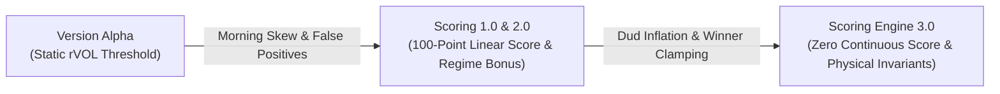
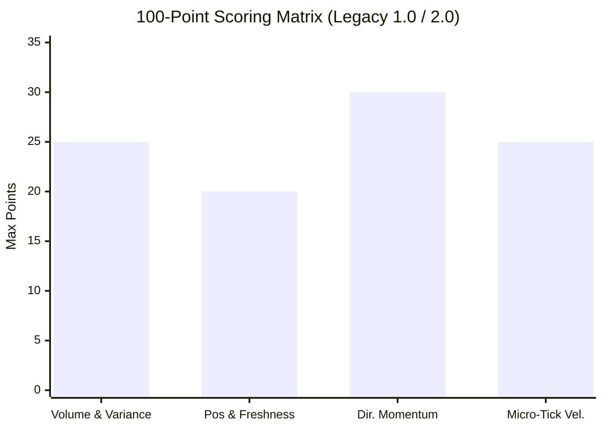
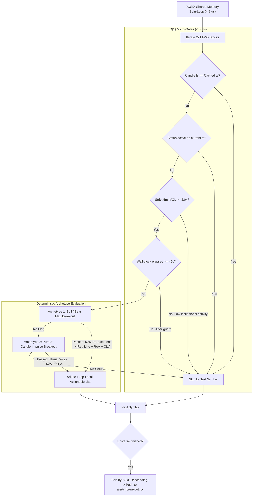

# Scoring Evolution: From Static Thresholds to Qualitative Momentum 3.0

> **Document Type**: Quantitative Alpha & Signal Evolution Record  
> **Status**: Active Living History Document  
> **Current Active Spec**: [`SCORING_ENGINE_3_0.md`](file:///Users/yorha/Documents/Trading%20Stuff/docs/sys/SCORING_ENGINE_3_0.md)  
> **Architecture Spec**: [`ARCHITECTURE_SPEC_2_0.md`](file:///Users/yorha/Documents/Trading%20Stuff/docs/sys/ARCHITECTURE_SPEC_2_0.md)  
> **Low-Level Design**: [`LOW_LEVEL_DESIGN_2_0.md`](file:///Users/yorha/Documents/Trading%20Stuff/docs/sys/LOW_LEVEL_DESIGN_2_0.md)  
> **Archived Specs**: [`docs/archive/`](file:///Users/yorha/Documents/Trading%20Stuff/docs/archive)  

---

## 1. Executive Summary & Philosophy

The methodology for detecting explosive institutional breakouts has evolved through three distinct paradigms:

| Dimension | Version Alpha | Scoring 1.0 & 2.0 | Scoring Engine 3.0 (Current) |
| :--- | :--- | :--- | :--- |
| **Philosophy** | Single indicator threshold | Continuous arithmetic sum ($0–100$) | Strict physical price action invariants |
| **Market Regime** | Ignored | Nifty 50 modifier ($+10$ / $-25$) | Decoupled (Intrinsic stock volume & alpha) |
| **Scoring Formula** | $\text{Vol} > \text{Threshold}$ | $\sum w_i f_i + \text{Regime}$ | Binary Invariant Validation ($\text{True} / \text{False}$) |
| **rVOL Metric** | Day cumulative ratio | Rolling 60-minute window | Strict current 5m candle with 1m linear extrapolation |
| **Pattern Models** | None | Ad-hoc threshold flags | Flag Contraction + Pure 3-Candle Impulse |
| **Reversal Guard** | None | None | 50% Pole Retracement Guard (Evaluated First) |
| **Wick Guard** | None | None | Close Location Value ($\text{CLV} \ge 0.75$) |
| **Range Filter** | None | None | Directional Thrust $\ge 2.0\times \max(\overline{\text{Thrust}}_3, 0.35\text{ATR})$ |
| **Evaluation Time**| 50–200 ms | 15–40 ms (Pandas loops) | $< 2\ \mu\text{s}$ per stock (NumPy SHM spin) |

---

## 2. Version Alpha: The Static rVOL Threshold

### 2.1 The Concept
Alpha relied on an elementary volume filter:
$$\text{rVOL} = \frac{\text{Current Cumulative Volume}}{\text{Average Daily Volume}} > 2.0$$

### 2.2 Why Alpha Failed:
1. **The Morning Outlier Skew**: Between 09:15 and 09:30 AM, opening market crosses and overnight order matching naturally produce high volume. Nearly every stock triggered $\text{rVOL} > 2.0$, generating an avalanche of false alerts.
2. **Midday Stagnation**: By 12:30 PM, the denominator (full-day volume) diluted intraday volume spikes, causing the system to miss afternoon breakouts.
3. **Zero Price Action Confirmation**: The scanner triggered on high-volume dojis, flat consolidation days, and large institutional block trades executing inside narrow bid-ask ranges.

---

## 3. Scoring 1.0 & 2.0: The 100-Point Linear Combination Trap

### 3.1 The 100-Point Pillar Architecture
To address Alpha's shortcomings, Scoring 1.0 and 2.0 constructed a multi-factor quantitative model aggregating four orthogonal pillars into a normalized 0–100 score:

- **Pillar 1 (Volume & Variance - 25 pts)**: Historical 5m rVOL (15 pts), cadenced variance surge $Z_{\text{vol}}$ (10 pts), inactivity decay (-15 pts).
- **Pillar 2 (Position & Freshness - 20 pts)**: Proximity to HOD/LOD (10 pts), extreme printed within $\le 15\text{ mins}$ (10 pts).
- **Pillar 3 (Directional Momentum - 30 pts)**: Daily % change (10 pts), 5m impulse $\Delta P_{5m}$ (20 pts), counter-trend penalty (-10 pts).
- **Pillar 4 (Micro-Tick Velocity - 25 pts)**: 5-tick thrust (10 pts), candle color (5 pts), 3-tick book sweep (10 pts).
- **Macro Nifty 50 Regime Modifier**:
  $$\text{Final Score} = \text{Score}_{\text{Pillars}} + \text{Regime\_Bonus} \quad (+10\text{ on trend, } -25\text{ on counter-trend})$$

### 3.2 Why the 100-Point System Fell Apart (The Fatal Flaws):

1. **The Optimization Trap**:
   - A threshold of 70 triggered 20 trades on a choppy Tuesday (mostly losers); 80 sat completely idle on a rotational Thursday, missing huge winners. The system was caught in endless curve-fitting cycles.
2. **Artificial Dud Inflation**:
   - A sluggish stock drifting with no institutional interest accumulated 65 points from small tick wiggles and proximity to HOD. Because Nifty was up $+0.8\%$, it received a $+10$ point regime bonus, crossing the 75-point entry gate and executing a dud trade.
3. **Counter-Trend Winner Clamping**:
   - An explosive, independent stock with massive volume ($\text{rVOL} = 5.2\times$) breaking out on company-specific news achieved 90 points. But because Nifty was down $-0.5\%$, the system slapped it with a $-25$ point penalty, clamping it to 65 points and completely missing the biggest runner of the day.
4. **The Aspect Ratio Degree Slope Trap**:
   - Scoring 2.0 evaluated flag breakouts by measuring the regression line angle in degrees ($\theta \le 45^\circ$).
   - Because rupee prices vary wildly across Indian stocks, angle in degrees is distorted: a ₹49,000 stock (MRF/BOSCHLTD) moving ₹50 produced an $89^\circ$ slope, while a ₹150 stock (Tata Motors) moving ₹0.50 produced a $5^\circ$ slope.
5. **Dead-Lull Micro-Range Traps**:
   - Breakout logic triggered when current price broke the 3-candle high with volume. During sleepy midday lulls where candles were only 10 paise wide, a tiny 15-paise tick with minor volume triggered a "breakout" alert.
6. **Wick Rejection Blindness (Shooting Stars)**:
   - Stocks that surged past resistance intra-bar but were immediately slammed back down by aggressive sellers left long upper wicks (shooting stars). The linear score awarded full points for the intra-bar high, buying directly into tops.

---

## 4. Scoring Engine 3.0: Zero Continuous Score & Pure Invariants

Scoring Engine 3.0 completely discards linear scores and market regime filters in favor of **strict physical price action and volume invariants**.

### 4.1 Key Mathematical Invariants in 3.0:

1. **Abolition of the Continuous Score**:
   - A trade either meets the strict physical definition of an institutional impulse or flag breakout, or it does not. Zero subjective weights.
2. **Decoupling from Broad Market Regime**:
   - High relative volume ($\text{rVOL} \ge 2.0\times$) proves that institutional capital is active in that specific stock. The stock has uncoupled from Nifty, and trades are evaluated strictly on stock-intrinsic momentum.
3. **Strict Current Candle rVOL with Minute-Boundary Linear Extrapolation**:
   - Pre-indexed 1-minute historical median baseline ($221 \times 375$).
   - Exact minute edges ($60\text{s}, 120\text{s}, 180\text{s}, 240\text{s}, 300\text{s}$) evaluate accumulated bar volume directly.
   - Intra-minute ticks linearly extrapolate current minute volume to the upcoming minute edge ($\Delta v \times \frac{60}{\tau}$). Zero rolling lag.
4. **50% Retracement Invariant (Evaluated First)**:
   - For Archetype 1 (Flag Breakout), price must hold the upper half of the pole:
     $$\text{Retracement Depth} = \frac{\text{Pole High} - \text{Contraction Low}}{\text{Pole High} - \text{Pole Low}} \le \mathbf{0.50}$$
   - If price pulls back deeper than $50\%$, it is rejected immediately as a structural reversal before fitting regression lines.
5. **Directional Thrust with Dead-Lull Floor**:
   - For Archetype 2 (Pure Impulse), directional expansion from open is enforced:
     $$\text{Thrust} = \text{High} - \text{Open} \ge \mathbf{2.0 \times \max\left(\overline{\text{Thrust}}_3, \; 0.35\times\text{ATR}\right)}$$
   - Eliminates false breakouts on micro-range 10-paise candles.
6. **Close Location Value (CLV - Anti-Wick Guard)**:
   $$\text{CLV} = \frac{\text{Current Price} - \text{Current Low}}{\text{Current High} - \text{Current Low}} \ge \mathbf{0.75}$$
   - Guarantees that buyers are in complete control and price is trading in the top 25% of the bar, eliminating shooting stars.
7. **Loop-Local rVOL Priority Dispatching**:
   - Candidates triggering on the same bar are sorted by **`rvol` descending**. The stock experiencing the largest institutional volume surge is allocated margin first.

---

## 5. Scoring Version Registry & Triggers

| Scoring Version | Release Date | Architecture | Outcome |
| :--- | :--- | :--- | :--- |
| **Alpha** | Oct 2026 | Static volume threshold | Flooded with morning outliers and false chop |
| **1.0 & 2.0** | Nov 2026 | 100-Point 4-pillar sum + Nifty regime | Curve-fitting trap, dud inflation, counter-trend clamping |
| **3.0** | Nov 2026 | Zero continuous score, physical invariants, 50% retracement | **Current Active Production** |

### What Would Trigger Scoring Engine 4.0?
Scoring Engine 3.0 provides robust, deterministic detection of flag continuations and pure impulse breakouts. Scoring Engine 4.0 will only be considered if:
- **Order Flow Imbalance Integration**: Incorporating live Level-2 / Level-3 order book micro-imbalances (C++ Depth delta / cumulative volume delta) directly from high-frequency exchange feeds.
- **Multi-Day Structural Anchoring**: Adding composite Volume Profile Value Area (VAH / VAL) and anchored VWAP breakouts from prior day distributions.

