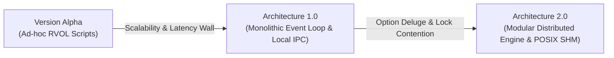
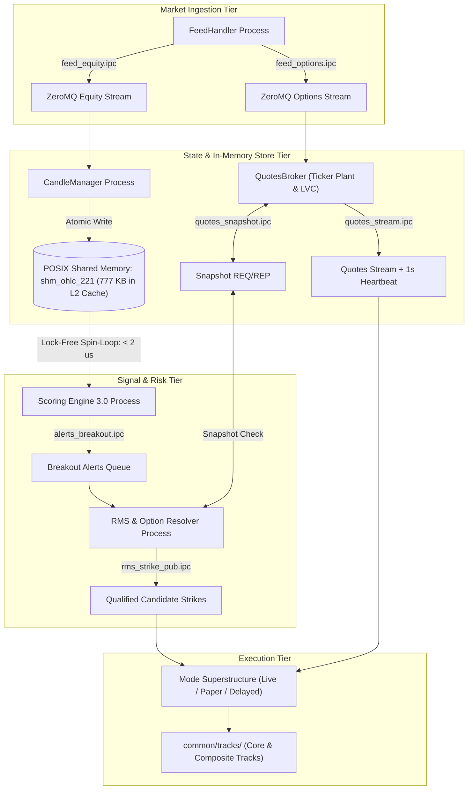

# Architecture Evolution: From Alpha Scripts to Distributed Engine 2.0

> **Document Type**: Architecture Historical Record & Engineering Rationales  
> **Status**: Active Living History Document  
> **Current Active Spec**: [`ARCHITECTURE_SPEC_2_0.md`](file:///Users/yorha/Documents/Trading%20Stuff/docs/sys/ARCHITECTURE_SPEC_2_0.md)  
> **Low-Level Design**: [`LOW_LEVEL_DESIGN_2_0.md`](file:///Users/yorha/Documents/Trading%20Stuff/docs/sys/LOW_LEVEL_DESIGN_2_0.md)  
> **Archived Specs**: [`docs/archive/`](file:///Users/yorha/Documents/Trading%20Stuff/docs/archive)  

---

## 1. Executive Summary & Timeline

The trading engine has undergone two foundational architectural rewrites driven by market microstructure realities, CPU cache constraints, and low-latency execution requirements:



| Dimension | Version Alpha | Architecture 1.0 | Architecture 2.0 (Current) |
| :--- | :--- | :--- | :--- |
| **Topology** | Single Python scripts | Monolithic event loop with IPC threads | Distributed multi-process with ZeroMQ IPC |
| **Market Data** | Polled REST / WebSockets | Combined feed (Equity + Options together) | Segregated feeds (`feed_equity` vs `feed_options`) |
| **Candle State** | Ad-hoc in-memory dicts | In-memory rolling Pandas / circular lists | Fixed 777 KB POSIX Shared Memory in L2 cache |
| **Derivatives Depth** | Ad-hoc broker queries | Gigabytes of circular depth history | Ticker Plant / Last Value Cache ($< 200\text{ KB}$) |
| **Delayed Execution**| Manual / None | OS Thread Timers (`threading.Timer`) | Stream-Driven Prevailing Cached Quote Fills |
| **Simulation** | N/A | Sequential CSV replay (15–25 mins/day) | Columnar Polars/Arrow ASOF join (3–5s/day) |
| **Track Design** | Hardcoded logic | Hardcoded 33-track matrix in `strategy.py` | Decoupled Strategy / Core & Composite Tracks / Modes |
| **Observability** | CLI print logs | ANSI/Rich terminal dashboard | Modern Browser SPA Web UI & WebSocket Server (`runner.py web`) |

---

## 2. Version Alpha: The Prototype Scripts

### 2.1 Anatomy of Alpha
The initial prototype consisted of independent Python scripts that connected to broker APIs (Upstox / Shoonya) to scan for volume expansion:
- Fetched 1-minute and 5-minute candles via periodic REST polling or raw WebSocket callbacks.
- Calculated a rudimentary Relative Volume ratio: $\text{rVOL} = \text{Volume} / \text{AverageVolume}$.
- Printed alerts to console and placed naive market orders.

### 2.2 Why Alpha Fell Short:
1. **API Rate Limiting & Polling Latency**: REST polling introduced 500ms to 2-second delays. Breakouts in fast-moving F&O stocks were discovered after the move had already completed.
2. **Missing Ticks & Unsynchronized State**: WebSocket dropouts caused corrupted bar aggregation. Without a persistent state store, restarting a script wiped out intraday high/low tracking.
3. **Execution Blindness**: Orders were fired without verifying bid-ask spread or order book depth, causing massive slippage on illiquid option strikes.
4. **Zero Scalability**: Monitoring more than 20–30 stocks caused script crashes due to unmanaged socket buffers and unhandled network exceptions.

---

## 3. Architecture 1.0: Monolithic Event Loop & Local IPC

### 3.1 Design Intent
Architecture 1.0 introduced an enterprise-style structure managed by a central orchestrator (`runner.py`):
- A dedicated **Market Data Feeder** streamed ticks from the broker WebSocket into a local IPC socket queue (`infrastructure/market_data/publisher.py`).
- A **Market Recorder** wrote raw ticks to disk (`market_events.jsonl`, `option_depth.jsonl`).
- A central **Strategy Process** (`strategies/momentum/strategy.py`) subscribed to the IPC socket, aggregated 3m and 5m candles, ran a 100-point setup scoring matrix, selected options (ATM, ITM, OTM), and managed an internal 33-track portfolio matrix.
- An **Execution Adapter** layer supported Live, Paper, and Paper Delayed modes.

### 3.2 Why Architecture 1.0 Fell Apart:

```
┌────────────────────────────────────────────────────────────────────────┐
│                        THE ARCHITECTURE 1.0 BOTTLENECK                 │
│                                                                        │
│   2,000 Equity Ticks/s ──┐                                             │
│                          ├──► [ Single Thread Event Loop ] ──► CHOKE!  │
│  30,000 Option Ticks/s ──┘     • JSON Deserialization                  │
│                                • 33-Track Matrix Locks                 │
│                                • Threading.Timer Jitter                │
│                                • GC Heap Pauses                        │
└────────────────────────────────────────────────────────────────────────┘
```

1. **The Option Tick Deluge (90%+ Waste)**:
   - In NSE F&O, 221 underlying stocks generate ~2,000 ticks/sec. However, their active options chain generates **over 30,000 ticks/sec**.
   - In Arch 1.0, all 32,000 ticks flooded into `strategy.py` across the same socket. The strategy thread spent 90% of its CPU time deserializing option ticks it did not need, causing massive Head-of-Line blocking.
2. **Delayed Fill Divergence & Threading Collapse**:
   - `PaperDelayedAdapter` attempted to simulate delayed fills using `threading.Timer(delay, fill_callback)` and `time.sleep(0.15)`.
   - Under heavy market activity, hundreds of concurrent timer threads spawned, creating severe lock contention (`threading.Lock()`), thread context switching overhead, and thread starvation.
   - Fills occurred at future waking ticks rather than prevailing prices, inflating slippage and corrupting backtest parity.
3. **Memory Thrashing & Garbage Collection Pauses**:
   - Continuous creation of temporary dictionaries, Pandas DataFrame slices (`candles[-20:]`), and string formatting triggered frequent Python Garbage Collection (GC) stop-the-world pauses (15–50 ms), causing dropped ticks during violent market breakouts.
4. **Monolithic Tight Coupling**:
   - Strategy logic, option strike resolution, risk gating, and position tracking were locked in a single 2,000-line monolith. Adding a new trading track or testing a new rule required modifying the entire engine.
5. **Slow Sequential Simulation**:
   - Replaying a single day took 15 to 25 minutes because it sequentially pumped JSON lines through the monolithic event loop.

---

## 4. Architecture 2.0: Modular Distributed Low-Latency Engine

Architecture 2.0 (the current production architecture) completely dismantles the monolith into a distributed, message-driven system connected by **POSIX Shared Memory** and **ZeroMQ IPC**.



### 4.1 Key Architectural Breakthroughs in 2.0:

1. **Domain Decoupling (Equity vs. Derivatives)**:
   - Equity ticks (~2,000/s) are separated from option ticks (~30,000/s) at ingestion.
   - The Candle Manager and Scoring Engine subscribe **exclusively to equity ticks**. Over 90% of feed volume is eliminated from strategy analysis.
2. **777 KB Pre-Allocated POSIX Shared Memory (`shm_ohlc_221`)**:
   - Fixed pre-allocation for all 221 F&O stocks across 75 five-minute bars per day:
     $$221\text{ stocks} \times 75\text{ bars} \times 48\text{ bytes} = \mathbf{795,600\text{ bytes} \approx 777\text{ KB}}$$
   - Fits entirely inside the CPU's **L2 cache** (1–2 MB on modern cores; 4–16 MB on Apple Silicon). Zero DRAM thrashing, zero deserialization overhead. Read by strategy processes in $< 2\ \mu\text{s}$.
3. **Quotes Broker (Ticker Plant) with Last Value Cache (LVC)**:
   - Replaces gigabytes of circular depth history with a lightweight in-memory cache ($< 200\text{ KB}$ RAM).
   - Provides on-demand spread validation via `REQ/REP` snapshots to RMS, and streams active strikes + a 1-second `HEARTBEAT` pulse to superstructures over `XPUB/XSUB`.
4. **Stream-Driven Delayed Fills & Prevailing Cached Quote Semantics**:
   - Zero `threading.Timer`, zero locks, zero sleep loops.
   - Delayed superstructure queues order with $T_{\text{target}} = T_{\text{trigger}} + \Delta t$, subscribes to the quote, and caches updates.
   - On the first tick/heartbeat with timestamp $\ge T_{\text{target}}$, the order fills immediately at the **prevailing cached quote established before $T_{\text{target}}$**, exactly modeling physical exchange matching.
5. **Columnar In-Process Simulation Engine**:
   - Avoids running multi-process IPC in backtesting.
   - Memory-maps option quote recordings into a columnar Polars/Arrow table (~1s at startup).
   - Runs equity bars through business logic and evaluates fills via instantaneous binary search (`asof_join`).
   - **Full trading day across 221 stocks executes in 3–5 seconds** (100,000+ ticks/sec) with 100% mathematical parity to live execution.
6. **Decoupled Strategy / Tracks / Modes OOP Hierarchy**:
   - Strategies define alpha detection (e.g. Momentum 3.0).
   - Tracks define pure trading vehicles and state machines (ATM, ITM, Trailing SL, Composite).
   - Modes (Live, Paper, Delayed) provide the execution environment and order interfaces.
7. **Modern Analytics & Simulation Web UI (`web/server.py`)**:
   - Full browser Single-Page Application (SPA) with sub-second WebSocket MTM telemetry, open position tracking, and historical performance breakdowns.
   - Heavy simulations run in isolated OS worker processes (`multiprocessing.Process`), completely freeing the Python GIL so charts and server responses remain 100% fluid.
   - Direct connection to POSIX Shared Memory (`shm_ohlc_221`) renders real-time 5-minute candles with exact breakout trigger points.
8. **Multi-Track Reference Isolation & State Recovery (`--continue`)**:
   - QuotesBroker tracks unique per-process client IDs (`f"{mode}_{track}_{pid}"`), preventing cross-track unsubscription collision.
   - `ProtectedPositionRegistry` prevents open option contracts from being unsubscribed until trade exit.
   - Mid-day recovery via `--continue` reconstitutes open positions, resubscribes QuotesBroker, and seeds snapshot quotes.
   - Market Recorder guarantees lossless tick durability with `atexit`, `try ... finally`, and flush-before-teardown.

---

## 5. Architectural Version Registry & Triggers

| Architecture Version | Release Date | Key Characteristics | Status |
| :--- | :--- | :--- | :--- |
| **Alpha** | Oct 2026 | Ad-hoc REST/WS scripts, static rVOL threshold | Deprecated / Replaced |
| **1.0** | Nov 2026 | Monolith event loop, 100-pt scoring, IPC queues, thread timers | Archived in `docs/archive/` |
| **2.0** | Nov 2026 | Modular distributed, POSIX SHM (777 KB), Quotes Broker, Zero Continuous Score | **Current Active Production** |

### What Would Trigger Architecture 3.0?
Architecture 2.0 comfortably handles current requirements (sub-10 microsecond evaluation, 221 stocks, 3–5s simulation). Architecture 3.0 will only be commissioned if:
- **Tick-to-Trade Latency Target Drops $< 1\ \mu\text{s}$**: Requiring migration of the critical path from Python to C++ / Rust using DPDK or Solarflare Onload kernel-bypass.
- **Direct Exchange Colocation (FPGA / FIX)**: Requiring direct multicast feeds (ITCH/FAST) bypassing broker WebSocket gateways.

