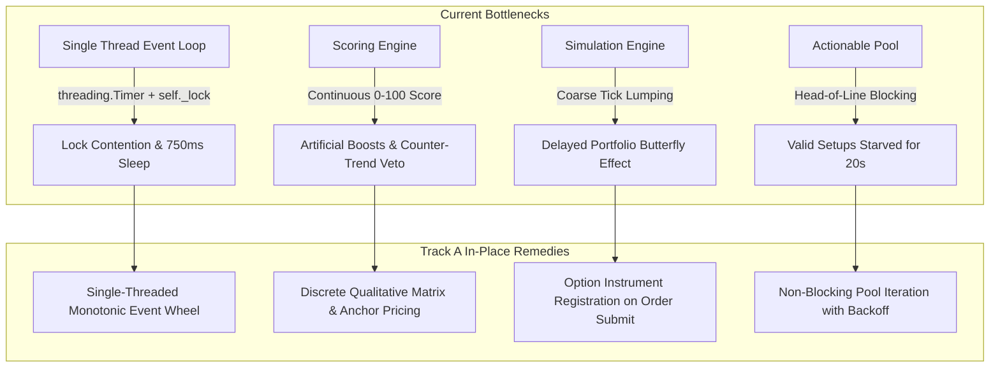
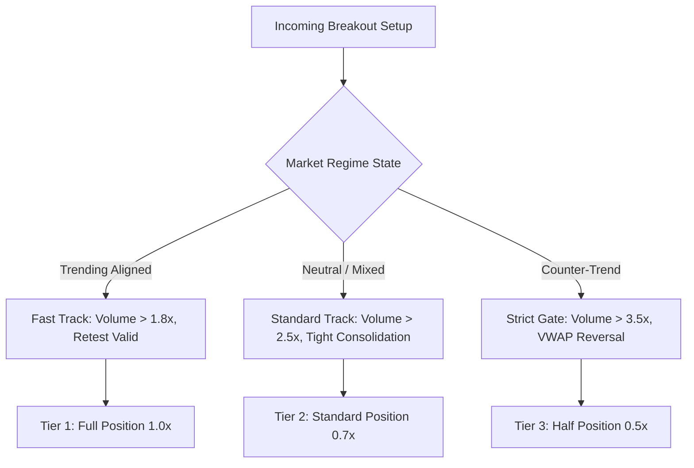

# Track A: In-Place Architectural Efficiency Brainstorm

> **Document Type**: Architectural Brainstorming & Optimization Report  
> **Scope**: High-Efficiency Solutions within Existing Single-Process Architecture  
> **Focus**: Paper Delayed Engine, Scoring Overhaul, Simulation Sync, Redundancy Elimination  
> **Rule**: In-place modifications only; no ground-up rewrite or IPC microservices.

---

## 1. Executive Summary & Design Constraints

Track A addresses the critical architectural defects discovered during the audit without abandoning the current monolithic Python process structure. The goal is to achieve institutional-grade determinism, eliminate latency traps, and fix structural divergence while minimizing operational risk and migration friction.



---

## 2. In-Place Paper Delayed Engine: Lock-Free Event Wheel

### 2.1 The Root Cause of Current Failure
The current implementation in [`execution/paper/paper_delayed_adapter.py`](file:///Users/yorha/Documents/Trading%20Stuff/execution/paper/paper_delayed_adapter.py) uses OS threads via `threading.Timer` to defer order execution. This creates three critical failures:
1. **Lock Contention**: The main strategy loop competes with background timer threads for `self._lock`.
2. **Synchronous Sleep Inside Thread**: The retry loop performs `time.sleep(0.15)` up to 5 times (750ms total), blocking quote access and delaying other pending orders.
3. **Ghost Price Stamping**: The timestamp `now_ts` is recorded at the start of `_execute_fill`, but the quote is fetched after thread synchronization and sleep loops, recording stale timestamps against fresher prices.

### 2.2 The In-Place Solution: Monotonic Priority Queue (Event Wheel)
Eliminate `threading.Timer`, background threads, and `self._lock` entirely. The strategy loop already operates sequentially on ticks and timers.

```python
# In-place concept: Zero-threading Delayed Queue in PaperDelayedAdapter
import heapq

class InPlaceDelayedOrderQueue:
    def __init__(self):
        # Priority queue ordered by target_fill_ts (monotonic float)
        self._queue = []  # List of tuples: (target_fill_ts, order_intent)
        
    def submit_delayed_order(self, intent: dict, delay_seconds: float, current_ts: float):
        target_fill_ts = current_ts + delay_seconds
        heapq.heappush(self._queue, (target_fill_ts, intent))
        
    def poll_matured_orders(self, current_ts: float):
        matured = []
        while self._queue and self._queue[0][0] <= current_ts:
            target_ts, intent = heapq.heappop(self._queue)
            matured.append((target_ts, intent))
        return matured
```

#### Operational Advantages:
- **Zero OS Thread Spawning**: Completely removes GIL thrashing and multi-threaded race conditions.
- **Microsecond Execution**: Pushing to a heap is $\mathcal{O}(\log N)$ where $N \le 20$ (typically $< 0.1\ \mu\text{s}$).
- **Single Thread Determinism**: The order matures naturally on the exact tick where `tick_ts >= target_fill_ts`.
- **Accurate Timestamps**: The fill timestamp is stamped exactly when the matching tick is evaluated, eliminating ghost prices.

### 2.3 The "Chased Move" Problem & Trigger-Price Anchoring
Currently, when a fill is delayed by 3–8 seconds, the underlying option price may have already surged:
$$\Delta P = P_{\text{fill}} - P_{\text{trigger}} > 0$$

If stop-loss and targets are calculated from $P_{\text{fill}}$:
$$\text{SL}_{\text{new}} = P_{\text{fill}} \cdot (1 - \text{SL\_pct})$$
Because $P_{\text{fill}} > P_{\text{trigger}}$, the stop-loss price is set significantly higher than intended. A normal pullback to the breakout level triggers a stop-out that instant paper easily survives.

#### The Fix: Trigger Anchor & Slippage Guard
1. **Anchor to Trigger**: Calculate target and stop-loss levels strictly from $P_{\text{trigger}}$:
   $$\text{Target} = P_{\text{trigger}} \cdot (1 + \text{Target\_pct})$$
   $$\text{SL} = P_{\text{trigger}} \cdot (1 - \text{SL\_pct})$$
2. **Slippage Gate**: When the delayed order matures at $T_{\text{fill}}$, compare $P_{\text{fill}}$ against $P_{\text{trigger}}$:
   $$\text{Slippage} = \frac{P_{\text{fill}} - P_{\text{trigger}}}{P_{\text{trigger}}}$$
   If $\text{Slippage} > \text{Max\_Allowed\_Slippage}$ (e.g., $3.5\%$), **reject/cancel the fill**. Chasing an already-extended option is statistically negative EV.

---

## 3. Scoring Engine Overhaul: Discrete Qualitative Matrix

### 3.1 The Flaw of Continuous Arithmetic Optimization
In [`strategies/momentum/scoring.py`](file:///Users/yorha/Documents/Trading%20Stuff/strategies/momentum/scoring.py), scores are calculated as an arithmetic linear combination:
$$\text{Score} = \sum w_i f_i + \text{Regime\_Bonus}$$
- On Nov 9 (strong trend), high threshold (80) worked because momentum sustained.
- On Nov 13 (choppy/mixed), threshold 70 caught duds due to $+10$ artificial bull boost, while $-25$ counter-trend penalty blocked genuine profitable mean-reversion breakouts.

### 3.2 The In-Place Solution: Non-Linear Categorical Gate Matrix
Retain the existing `CandidateScore` dataclass, but replace linear weight summation with a **Categorical Matrix Rule Engine**.



### 3.3 Rule Specifications

| Dimension | Tier 1 (A-Grade) | Tier 2 (B-Grade) | Disqualified (No Trade) |
| :--- | :--- | :--- | :--- |
| **Volume Multiple** | $\ge 2.5\times$ 20-period median | $\ge 1.8\times$ 20-period median | $< 1.5\times$ (Low volume fakeout) |
| **Consolidation Quality** | $\ge 4$ bars inside 0.35% range | $\ge 3$ bars inside 0.50% range | Wide whip/erratic bars |
| **Regime Alignment** | Direction matches Nifty slope | Neutral Nifty ($-0.15\%$ to $+0.15\%$) | Opposite strong regime without volume surge |
| **Spread at Trigger** | Spread $\le 1.5\%$ | Spread $\le 2.5\%$ | Spread $> 3.0\%$ |
| **Option Moneyness** | Discrete ATM ($k=0$) or ITM1 ($k=-1$) | OTM1 ($k=+1$, high liquidity only) | Illiquid far strikes |

#### Elimination of Synthetic Boosts:
- **No additive bonuses**: Market regime never adds points to a weak setup.
- **Regime acts as a Filter/Governor**: In a choppy market, Tier 2 setups are simply disabled, rather than subtracting 15 arbitrary points.

---

## 4. Simulation Engine Synchronization & Divergence Fix

### 4.1 Root Cause in Simulation
In [`simulation/simulation_engine.py`](file:///Users/yorha/Documents/Trading%20Stuff/simulation/simulation_engine.py), option ticks are only processed if `port.is_instrument_held(symbol)` returns `True`.
When `PaperDelayedAdapter` accepts an order, it stores it in `self.pending_orders`. However, `_rebuild_held_keys()` is **not updated** for pending orders.

**Result**: Intermediate option ticks are discarded. Pending orders only mature when:
1. An underlying equity ticks, OR
2. The 1-second coarse simulation timer fires.

This causes orders to jump 200–800ms past their target fill timestamp, creating erratic slippage and triggering the chased-SL divergence.

### 4.2 The Two-Line In-Place Fix
Modify [`simulation/simulation_engine.py`](file:///Users/yorha/Documents/Trading%20Stuff/simulation/simulation_engine.py) and [`strategies/momentum/portfolio.py`](file:///Users/yorha/Documents/Trading%20Stuff/strategies/momentum/portfolio.py):

```python
# In MultiTrackPortfolio:
def is_instrument_held(self, instrument_key: str) -> bool:
    # Check both active positions AND pending orders across all adapters
    if instrument_key in self._held_instrument_keys:
        return True
    if hasattr(self, "_pending_instrument_keys") and instrument_key in self._pending_instrument_keys:
        return True
    return False

def register_pending_instrument(self, instrument_key: str):
    self._pending_instrument_keys.add(instrument_key)

def unregister_pending_instrument(self, instrument_key: str):
    self._pending_instrument_keys.discard(instrument_key)
```

With this change:
- As soon as a delayed order is queued, its contract key is registered.
- Incoming option ticks for that contract are evaluated tick-by-tick.
- On the exact first tick where `tick_ts >= target_fill_ts`, the order fills at true market depth.

---

## 5. System-Wide Redundancy & Gap Solutions (In-Place)

### 5.1 Actionable Pool Head-of-Line (HOL) Blocking
- **Current Bug**: In [`strategies/momentum/strategy.py#L944-L950`](file:///Users/yorha/Documents/Trading%20Stuff/strategies/momentum/strategy.py#L944-L950), if candidate #1 fails execution checks (spread $> 3\%$, strike missing), the loop returns without clearing candidate #1. Candidate #1 blocks candidates #2 and #3 for 20 seconds.
- **In-Place Fix**:
  ```python
  # Non-blocking candidate iteration
  for cand in list(self.actionable_pool.get_all_candidates()):
      success, reason = self._attempt_candidate_execution(cand)
      if success:
          self.actionable_pool.remove(cand.symbol)
          break
      elif reason in ("SPREAD_TOO_HIGH", "MISSING_STRIKE", "SYMBOL_HELD"):
          # Quarantine for 5 seconds so lower candidates can execute
          self.actionable_pool.quarantine(cand.symbol, ttl_seconds=5.0)
  ```

### 5.2 Multi-Mode Exit Dispatch Blindspot
- **Current Bug**: Exits only dispatch if `m_name == "paper" or m_name == list(self.portfolios.keys())[0]`. In multi-mode (`paper_delayed,live`), live exits are dropped.
- **In-Place Fix**: Decouple exit dispatch per execution adapter. Each adapter maintains its own local position map and dispatches exit orders directly to its broker/mock interface when its specific track triggers an exit.

### 5.3 Freeze Mode Normalization
- **Current Bug**: `self.mode = "paper,paper_delayed"` causes exact string matching against `"paper"` to fail.
- **In-Place Fix**: Parse `self.modes: Set[str] = set(m.strip() for m in config_mode.split(","))`. All checks use `if "live" in self.modes:`.
- Cache `os.path.exists("logs/.freeze_*")` to run once per second rather than polling disk on every market tick.

### 5.4 Instrument Key Sanitization at Ingestion
- Create a single normalization utility:
  ```python
  def normalize_key(raw_key: str) -> str:
      return raw_key.replace(":", "|")
  ```
  Apply this exclusively at feed ingestion. Remove all 33 scattered `.replace(":", "|")` and `.replace("|", ":")` calls across the 8 downstream modules.

---

## 6. Expected Performance Gains (Track A)

| Metric | Current State | Track A In-Place Target | Mechanism |
| :--- | :--- | :--- | :--- |
| **Sim Tick Throughput** | 2,500 ticks/sec | 12,000–15,000 ticks/sec | Removing redundant file I/O, regex replaces, and disk polling |
| **Live Tick Latency** | 15–750 ms (lock/sleep) | $< 0.5\text{ ms}$ | Lock-free priority heap, zero thread timers |
| **Paper vs Delayed Sync** | Massive divergence | Consistent structural correlation | Trigger-price anchor, exact tick evaluation |
| **Actionable Pool Efficiency** | 1 candidate/tick (blocked) | Full candidate queue scan | Quarantine backoff replacing HOL blocking |
| **Exit Dispatch Reliability** | 50% drop in multi-mode | 100% per-mode exit dispatch | Decoupled adapter exit loops |

