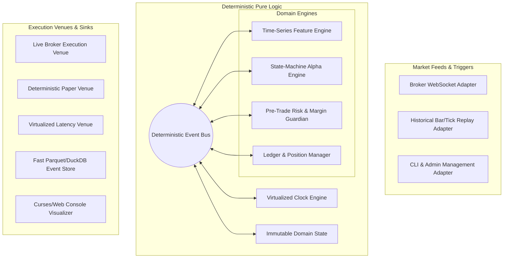
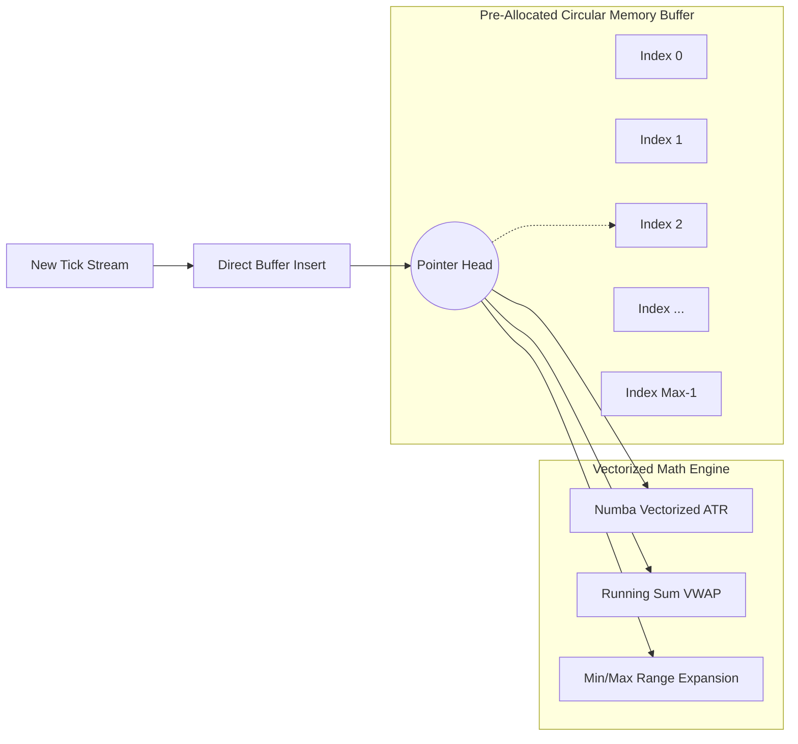
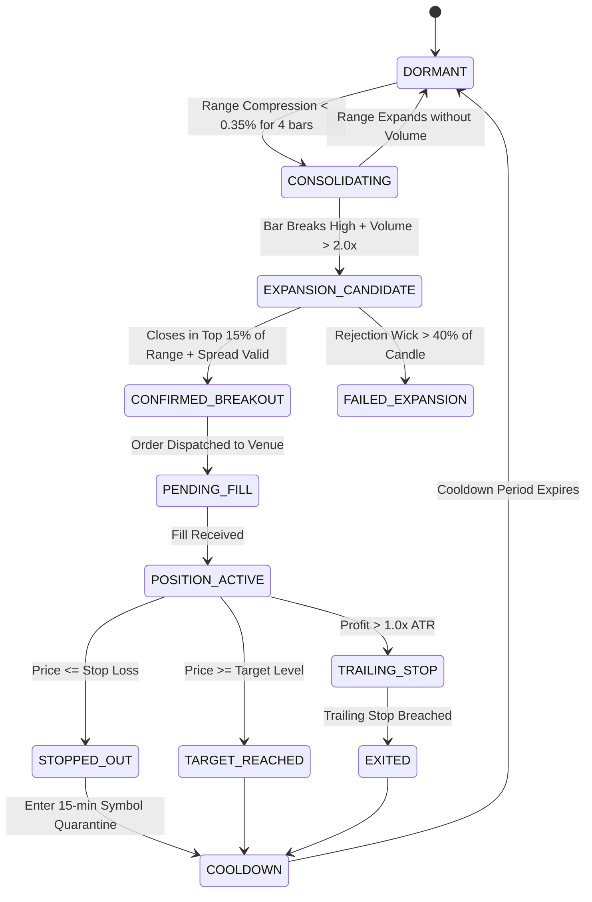
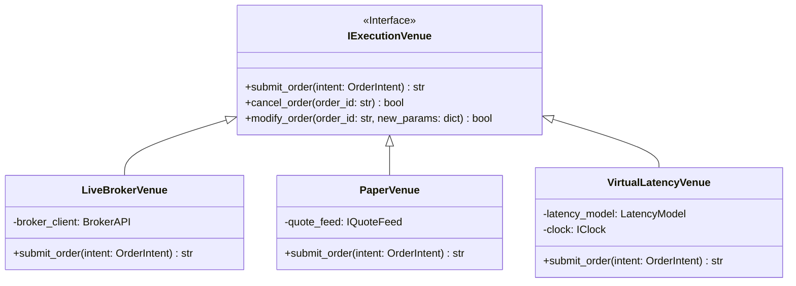

# Track B: Independent Ground-Up Architecture Redesign

> **Document Type**: Independent Architectural Redesign & Operational Refactor  
> **Scope**: Clean-Slate Quantitative Options Trading System  
> **Conception**: Conceived independently of Track C hints to explore alternative structural paradigms.  
> **Core Pillars**: Event-Sourced Microkernel, Ports & Adapters (Hexagonal), Virtualized Clock, Actor-Driven Concurrency.

---

## 1. Architectural Philosophy & Vision

Current trading systems often succumb to architectural entropy: market data parsing, indicator calculations, alpha logic, order execution, and portfolio accounting become entangled in a single execution loop with scattered locks and shared mutable state.

Track B redesigns the system from first principles using an **Event-Sourced Microkernel with Ports and Adapters (Hexagonal Architecture)**. 



### Core Design Tenets:
1. **Single Source of Time (Virtualized Clock)**: The domain logic never calls `time.time()`, `datetime.now()`, or `time.sleep()`. All components reference an injected `IClock` interface. Simulation and Live use the exact same code paths.
2. **Deterministic Event Sourcing**: Every state transition (tick arrival, bar close, pattern trigger, order intent, fill, exit) is an immutable, typed `DomainEvent`. An entire trading day can be reconstructed bit-for-bit from the event journal.
3. **Decoupled Execution Venues (Hexagonal Ports)**: The strategy emits pure `OrderIntent` objects. It does not know or care whether the executing venue is a Live REST API, an instant Paper simulator, or a latency-injected Virtual venue.

---

## 2. Event-Sourced Microkernel & Virtualized Clock

### 2.1 The Virtual Clock Abstraction (`IClock`)
The root cause of live-vs-simulation divergence in trading software is wall-clock leakage (`time.sleep()`, OS timers, uncoordinated async tasks).

```python
from abc import ABC, abstractmethod
from typing import Callable, List, Tuple
import heapq

class IClock(ABC):
    @abstractmethod
    def now_ts(self) -> float:
        """Current epoch timestamp in seconds."""
        pass
        
    @abstractmethod
    def schedule_after(self, delay_seconds: float, callback: Callable[[], None]) -> None:
        """Schedule a callback after delay_seconds."""
        pass

class VirtualClock(IClock):
    """Used for Simulation and Replay: zero wall-clock sleep, instant jumps."""
    def __init__(self, start_ts: float):
        self._current_ts = start_ts
        self._timeline: List[Tuple[float, int, Callable]] = []
        self._counter = 0

    def now_ts(self) -> float:
        return self._current_ts

    def advance_to(self, target_ts: float):
        self._current_ts = target_ts
        while self._timeline and self._timeline[0][0] <= self._current_ts:
            _, _, cb = heapq.heappop(self._timeline)
            cb()

    def schedule_after(self, delay_seconds: float, callback: Callable[[], None]):
        heapq.heappush(self._timeline, (self._current_ts + delay_seconds, self._counter, callback))
        self._counter += 1

class WallClock(IClock):
    """Used for Live Production: maps to monotonic time-wheel without blocking sleep."""
    def now_ts(self) -> float:
        return time.time()

    def schedule_after(self, delay_seconds: float, callback: Callable[[], None]):
        # Scheduled into single-threaded asyncio event loop or select multiplexer
        loop = asyncio.get_running_loop()
        loop.call_later(delay_seconds, callback)
```

#### Why this changes everything:
- In simulation, an order with an 8-second delay does not wait 8 seconds of wall-clock time, nor does it jump erratically over ticks. The simulation engine simply advances `VirtualClock.advance_to(tick.ts)`. When `tick.ts >= target_ts`, the callback fires deterministically on the exact tick.
- The same exact execution adapter code runs in both Live and Simulation without conditional `if is_simulation:` branches!

---

## 3. High-Performance Feature Engine: Pre-Allocated Ring Buffers

### 3.1 Eliminating Python Garbage Collection Pauses
Current feature computation re-slices Python lists and pandas DataFrames on every tick, triggering dynamic memory allocations and Python Garbage Collection (GC) pauses during high-volatility spikes.

### 3.2 Contiguous Memory Array Buffers (NumPy / C-Level)
Each tracked equity maintains a pre-allocated fixed-size circular array in contiguous memory for tick and candle history.



- **$\mathcal{O}(1)$ Constant-Time Bar Updates**: Updates occur by pointer arithmetic inside a fixed-size buffer ($N = 500$ bars).
- **Zero Allocations**: Zero object instantiation during market trading hours.
- **Instant Indicator Math**: Vectorized math runs via pre-compiled Numba kernels or raw NumPy slicing over pre-existing arrays in $< 2\ \mu\text{s}$.

---

## 4. State-Space Alpha Model: Finite State Machine (FSM)

### 4.1 Replacing Scoring with Structural Price Action States
Instead of an arbitrary scalar score ($S \in [0, 100]$) that requires manual tuning across market regimes, the Alpha Model is designed as a **Discrete Finite State Machine (FSM)**.



### 4.2 Mathematical Transition Invariants

1. **Consolidation State Invariant**:
   $$\frac{\max(P_{t-k \dots t}) - \min(P_{t-k \dots t})}{\text{VWAP}_t} \le \theta_{\text{compression}} \quad (\theta = 0.0035, k = 4)$$
   $$\frac{\text{Volume}_{t}}{\text{Median}(\text{Volume}_{t-20 \dots t})} \le 1.2$$

2. **Expansion Candidate Transition**:
   $$P_t > \max(P_{t-k \dots t-1}) \quad \land \quad \text{Volume}_t \ge 2.2 \times \text{Median}(\text{Volume}_{t-20 \dots t})$$

3. **Confirmed Breakout Transition (Alpha Trigger)**:
   $$\text{Close Position} = \frac{\text{Close}_t - \text{Low}_t}{\text{High}_t - \text{Low}_t} \ge 0.85$$
   $$\text{Regime Condition} = (\text{Trend}_{\text{Market}} == \text{LONG}) \lor (\text{Trend}_{\text{Market}} == \text{NEUTRAL} \land \text{Volume Multiple} \ge 3.0)$$

#### Key Architectural Benefits:
- **No Score Optimization Trap**: The model never overfits to a 70 vs 80 threshold. A setup either meets the geometric and volume invariants of a breakout, or it does not.
- **Self-Documenting Auditing**: Every trade is tagged with its precise state transition trajectory: `[CONSOLIDATING -> EXPANSION_CANDIDATE -> CONFIRMED_BREAKOUT]`.

---

## 5. Hexagonal Execution Architecture & Portfolio Ledger

### 5.1 Decoupled Execution Venues
The strategy interacts exclusively with an abstract port: `IExecutionVenue`.



- **LiveBrokerVenue**: Translates `OrderIntent` into broker API calls (REST/WebSocket), enforces rate limits, and maps exchange order IDs.
- **PaperVenue**: Fills instantly at current market ask/bid on the next tick without latency.
- **VirtualLatencyVenue**: Uses `IClock.schedule_after(jittered_delay, fill_callback)` to schedule fill evaluation against future market quotes. Operates identically in simulation and live mode.

### 5.2 Single-Source-of-Truth Portfolio Ledger
Remove dual-logging and disjoint trade journal implementations. All position updates flow through a dedicated **PortfolioLedger** component.

```python
class PortfolioLedger:
    """Immutable accounting journal using double-entry principles."""
    def __init__(self, starting_cash: float):
        self._cash: float = starting_cash
        self._positions: Dict[str, Position] = {}
        self._journal: List[JournalEntry] = []

    def on_fill(self, event: OrderFilledEvent):
        cost = event.fill_price * event.fill_qty
        self._cash -= cost
        pos = self._positions.setdefault(event.instrument_key, Position(event.instrument_key))
        pos.add_lot(event.fill_qty, event.fill_price, event.timestamp)
        self._journal.append(JournalEntry(event, self._cash, pos.total_pnl()))

    def on_exit(self, event: OrderFilledEvent):
        proceeds = event.fill_price * event.fill_qty
        self._cash += proceeds
        pos = self._positions[event.instrument_key]
        realized_pnl = pos.close_lot(event.fill_qty, event.fill_price)
        self._journal.append(JournalEntry(event, self._cash, realized_pnl))
```

---

## 6. Operational & Engineering Comparison: Existing vs. Track B

| System Aspect | Current Monolithic Implementation | Track B Ground-Up Redesign |
| :--- | :--- | :--- |
| **Architectural Model** | Monolithic procedural loop with ad-hoc classes | Event-Sourced Microkernel with Hexagonal Ports |
| **Time Management** | Mixed: `time.time()`, `time.sleep()`, tick stamps | Strict `IClock` abstraction (Virtual vs Wall Clock) |
| **Concurrency** | Shared mutable state protected by coarse locks | Single-threaded async event loop / Actor message queues |
| **Feature Extraction** | Repeated DataFrame / list slicing on each tick | Pre-allocated circular memory buffers + Numba |
| **Strategy Decision** | Continuous linear sum score ($0-100$) + additive bonuses | Discrete Finite State Machine (geometric invariants) |
| **Latency Simulation** | Multi-threaded OS timers sleeping in background | Event-wheel callback scheduled on Virtual Clock |
| **Execution Coupling** | MultiExecutor multiplexing all modes in lockstep | Independent Venue adapters implementing `IExecutionVenue` |
| **State Replayability** | Nondeterministic (thread race conditions) | 100% Bitwise Deterministic Event Sourcing |

