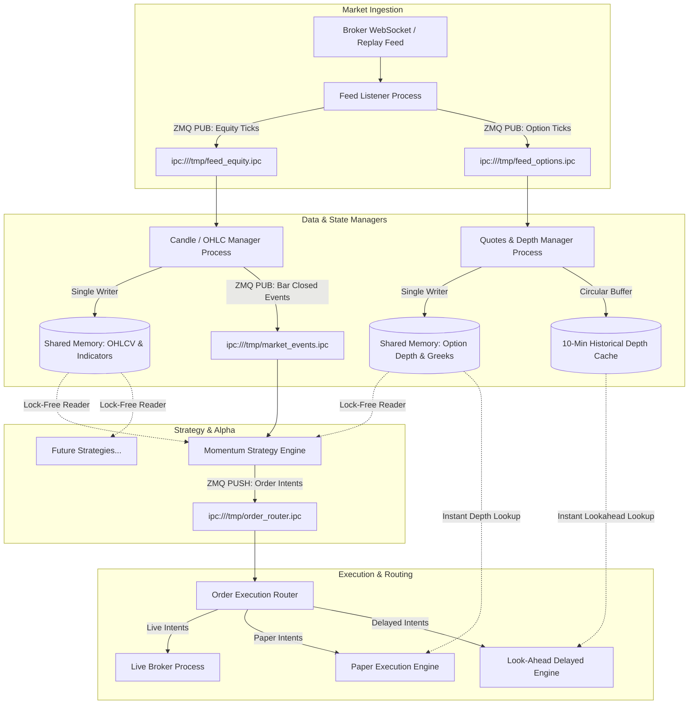
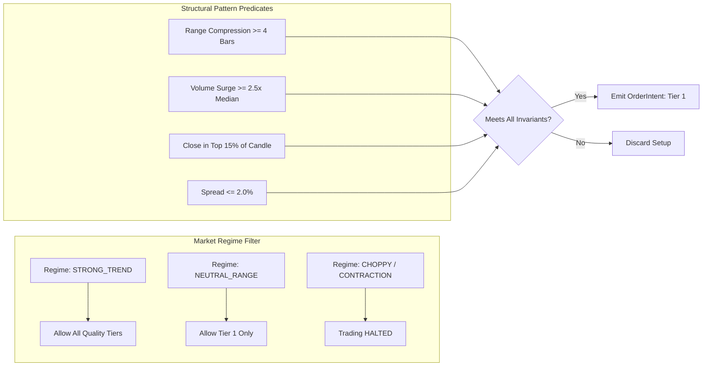
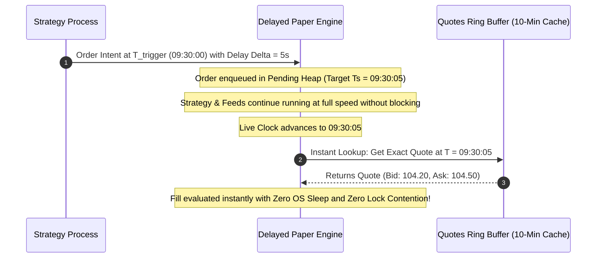
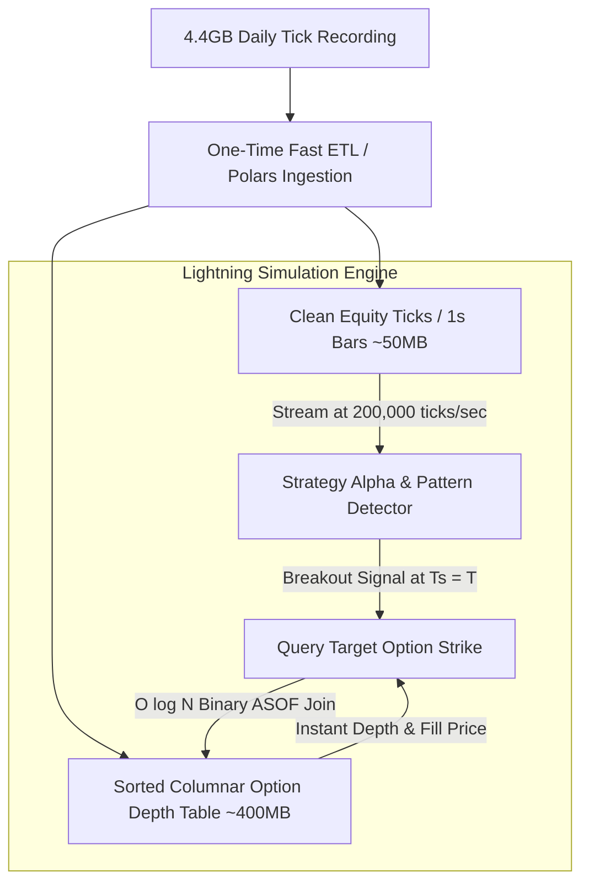
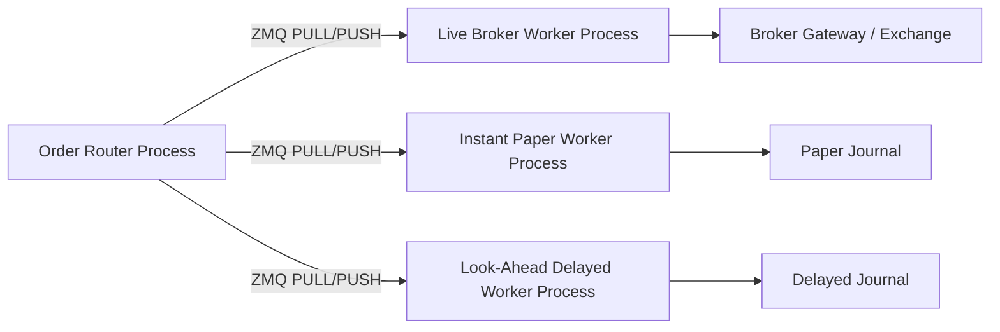

# Track C: Distributed Event-Driven Architecture Redesign

> **Document Type**: Comprehensive Architectural Blueprint & Refactor Specification  
> **Source**: User-Directed Synthesis & Modern Quantitative Trading Stack  
> **Core Concepts**: Multi-Process Topology, ZeroMQ IPC, Shared Memory (Lock-Free Reader/Writer), Separate Quotes/OHLC Managers, No-Score Qualitative Matrix, Look-Ahead Delayed Fills, Columnar Indexed Sim Engine.

---

## 1. System Topology & Process Decomposition

Instead of a monolithic Python process burdened by the Global Interpreter Lock (GIL), thread contention, and synchronous multi-adapter execution, the system is decomposed into specialized, decoupled OS processes communicating over high-speed IPC (ZeroMQ) and POSIX Shared Memory.



### Architectural Principles:
1. **Separation of Concerns**: Ingestion, candle construction, quote caching, strategy evaluation, and order execution run in separate OS processes with dedicated CPU affinities.
2. **Strict Reader/Writer Demarcation**: Data managers are the **Single Writers** to their respective shared memory segments. Strategy and execution workers are strictly **Concurrent Readers**. No locking!
3. **Bandwidth Partitioning**: 90% of feed traffic (option quotes) is isolated to `QuotesMgr`. The strategy engine never consumes or parses raw option ticks.

---

## 2. Shared Memory Architecture & Data Managers

### 2.1 The Candle / OHLC Manager
The Candle Manager subscribes exclusively to `ipc:///tmp/feed_equity.ipc`.
- Aggregates equity ticks into multi-resolution bars: 1-sec, 1-min, 3-min, 5-min.
- Computes running VWAP, ATR(14), Volume Multiples, and Donchian channels using pre-compiled NumPy/Numba kernels.
- Writes the current state of all tracked equities into a POSIX Shared Memory segment (`multiprocessing.shared_memory` or PyArrow Plasma).

```python
# Conceptual Shared Memory Struct for Multi-Timeframe Equity State
import numpy as np
from multiprocessing import shared_memory

EQUITY_DTYPE = np.dtype([
    ('symbol', 'S16'),
    ('timestamp', 'f8'),
    ('ltp', 'f4'),
    ('vwap_1m', 'f4'),
    ('atr_14', 'f4'),
    ('volume_multiple', 'f4'),
    ('consolidation_bars', 'i4'),
    ('range_compression_pct', 'f4'),
    ('regime_state', 'i2'), # 1=BULL, -1=BEAR, 0=CHOP
])
```

- **Zero-Copy Readers**: Strategies open the shared memory block via `mmap` / NumPy buffer. Reading the state of 20 tracked stocks takes **$< 1\ \mu\text{s}$** without deserialization overhead.
- **Bar Close Pulse**: When a 1-minute or 5-minute bar completes, the manager publishes a 16-byte message over `ipc:///tmp/market_events.ipc` (`[EVENT: BAR_CLOSE, SYMBOL: RELIANCE, TF: 1M]`).

### 2.2 The Quotes & Depth Manager
The Quotes Manager subscribes to `ipc:///tmp/feed_options.ipc`.
- Maintains the latest 5-depth bid/ask, LTP, spread, and implied volatility for all active option contracts.
- Stores the active strike state in a memory-mapped hash map: `(strike_id) -> Struct(bid, ask, ltp, spread, ts)`.
- Maintains a **Rolling Circular Ring Buffer** of the last 10 minutes of quote snapshots in RAM, indexed by timestamp for instant lookahead retrieval.

---

## 3. Qualitative Setup Matrix: "No-Score" Decision Engine

### 3.1 Eliminating the Continuous Score ($0-100$)
Continuous scores create artificial boundary cliffs: a score of 69.9 is rejected while 70.1 executes, despite being statistically indistinguishable. Moreover, linear score summing allows a strong arbitrary bonus (+10 regime) to push a garbage breakout into execution.

### 3.2 The Discrete Qualitative Matrix
The Strategy Engine evaluates setups against a deterministic **Feature Matrix**:



### 3.3 Qualitative Setup Matrix Specification

| Parameter | Tier 1 (Pristine Momentum) | Tier 2 (Retest & Continuation) | Disqualified / Ineligible |
| :--- | :--- | :--- | :--- |
| **Market Regime** | Aligned (Nifty slope $> 0.15\%$ for calls) | Neutral ($-0.15\%$ to $+0.15\%$) | Choppy (ADX $< 18$) or Opposite Trend |
| **Consolidation** | $\ge 4$ bars within $\le 0.35\%$ band | Breakout pullback held above VWAP | Erratic / wide range whip |
| **Volume Multiple** | $\ge 2.5\times$ 20-period median | $\ge 1.8\times$ 20-period median | $< 1.5\times$ (Fakeout risk) |
| **Option Spread** | $\le 1.5\%$ of ask | $\le 2.5\%$ of ask | $> 3.0\%$ (Mathematical veto) |
| **Option Moneyness** | Discrete ATM ($k=0$) | Discrete ITM1 ($k=-1$) | Illiquid OTM strikes |
| **Capital Sizing** | Full Lot Allocation ($1.0\times$) | Conservative Allocation ($0.6\times$) | Zero Allocation |

---

## 4. The Live "Look-Ahead" Paper Delayed Engine

### 4.1 The Core Insight
In live trading, simulated delayed fills currently rely on OS timer threads and blocking quote retries.
**The New Approach**: Instead of sleeping or spawning threads, the Delayed Engine fills orders by reading from the Quotes Manager's **10-minute Rolling Depth Ring Buffer**.



#### Why This Completely Eliminates Divergence:
1. **Zero Thread Contention**: No `threading.Timer`, no `threading.Lock()`, no GIL freezing.
2. **Microsecond Fill Evaluation**: When current wall clock reaches $T_{\text{target}}$, the exact quote is queried directly from the shared depth cache.
3. **Trigger-Anchored Slippage Protection**:
   $$\text{Slippage} = \frac{P_{\text{depth}}(T_{\text{target}}) - P_{\text{trigger}}}{P_{\text{trigger}}}$$
   If slippage exceeds $3.5\%$, the order is rejected as a "Chased Move" rather than entering at the peak.

---

## 5. The Simulation Revolution: Columnar Indexed Depth

### 5.1 The Current 4.4GB Replay Bottleneck
The current replayer reads every raw tick sequentially from massive recording files. Because 90%+ of ticks are option contracts that the strategy does not hold, the engine spends 95% of its CPU time discarding option ticks, crawling at 2,500 ticks/sec.

### 5.2 Columnar Pre-Indexing with Polars / PyArrow
Separate the simulation data into two distinct structures:



### 5.3 Asynchronous On-Demand Depth Lookup
- The simulation engine replays **ONLY equity ticks**. Strategy pattern evaluation processes **100,000+ ticks/second**.
- When an order triggers at timestamp $T_{\text{signal}}$:
  - For **Instant Paper**: Query the Option Parquet/Arrow table for `(contract, timestamp == T_signal)` using `searchsorted` / `asof_join`.
  - For **Delayed Paper**: Query `(contract, timestamp == T_signal + delay_seconds)`.
- **Result**: An entire trading day's simulation completes in **3 to 5 seconds** instead of 15 to 20 minutes!
- Delayed paper and instant paper are evaluated against the identical, immutable depth table, eliminating all random tick-skipping discrepancies.

---

## 6. Execution Layer Refactor: Decoupled Multiprocess Workers

### 6.1 Demise of the MultiExecutor God Object
The current `MultiExecutor` wraps Paper, Paper Delayed, and Live into a single synchronous multiplexer. A freeze or delay in one mode impacts all modes.

### 6.2 Independent Execution Workers (ZeroMQ PUSH/PULL)
The `OrderRouter` receives orders from strategies and fans them out to independent processes:
- **`LiveBrokerWorker`**: Dedicated process with exclusive network connection to broker REST/WebSocket APIs. Runs with high OS priority. Completely isolated from testing/paper code.
- **`PaperWorker`**: Instant simulated fills against shared memory depth.
- **`DelayedPaperWorker`**: Evaluates delayed fills via the lookahead ring buffer.



---

## 7. Recommended External Technology Stack

| Capability | Recommended Library | Justification |
| :--- | :--- | :--- |
| **Inter-Process Messaging** | `pyzmq` (ZeroMQ) | High-throughput, low-latency ($< 10\ \mu\text{s}$), brokerless IPC socket communication. |
| **Fast Columnar Depth & Sim** | `polars` & `pyarrow` | Memory-mapped Arrow tables, zero-copy reads, instant multi-threaded `asof_join` for simulation. |
| **Shared Memory IPC** | `multiprocessing.shared_memory` | Native POSIX shared memory buffers; lock-free single-writer multi-reader architecture. |
| **Vectorized Technical Math** | `numba` & `numpy` | JIT-compiled C-speed execution for VWAP, ATR, and range compression calculations. |
| **Fast Serialization** | `msgpack` | Binary serialization $5\times$ faster than JSON with smaller payload footprint. |
| **Historical Analytics** | `duckdb` | Instant SQL queries directly over compressed Parquet quote files for post-trade analysis. |

---

## 8. Comparative Synthesis: Track C vs. Current Architecture

| Architectural Dimension | Current Architecture | Track C Redesign |
| :--- | :--- | :--- |
| **Process Model** | Monolithic single process | Distributed multi-process with ZeroMQ IPC |
| **Feed Handling** | Mixed equity and option ticks in single queue | Dedicated split sockets: `feed_equity` vs `feed_options` |
| **Memory Access** | Shared Python dicts guarded by `threading.Lock` | Lock-free POSIX Shared Memory (Single-Writer Multi-Reader) |
| **Strategy Ingestion** | Consumes raw ticks (10k/sec) | Consumes pre-aggregated candles & shared memory features |
| **Scoring Model** | Continuous $0-100$ linear score + arbitrary bonuses | Discrete Qualitative Setup Matrix (No continuous score) |
| **Delayed Execution** | `threading.Timer` + OS thread sleep (750ms contention) | Zero-sleep ring buffer lookahead cache |
| **Simulation Speed** | 2,500 ticks/sec (~20 mins/day) | 100,000+ ticks/sec (~5 seconds/day via Polars ASOF) |
| **Live Isolation** | Live execution blocked by paper/delayed locks | Live broker worker completely isolated in dedicated OS process |

