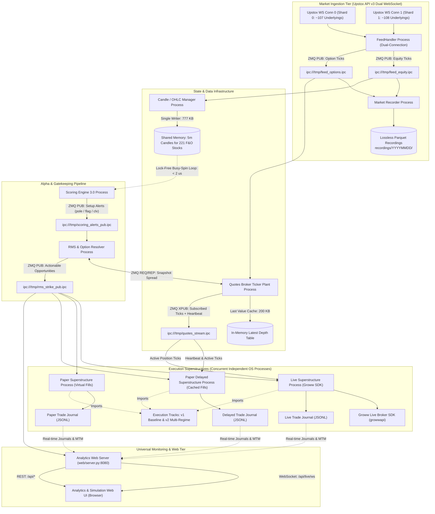
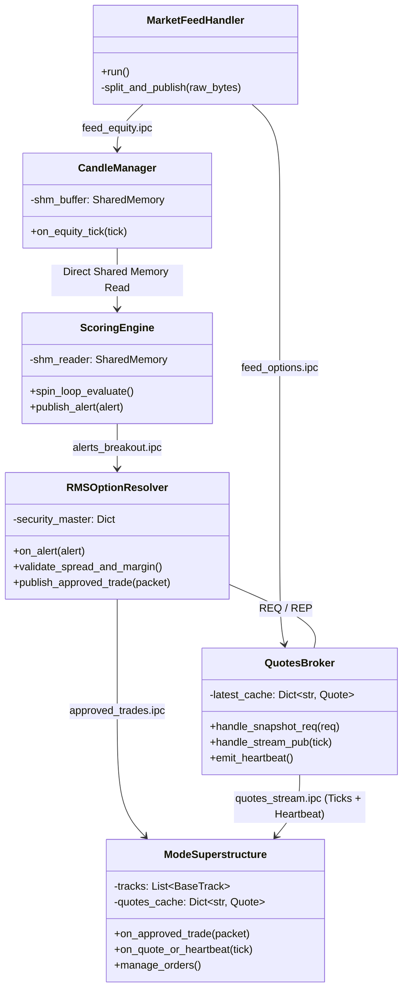
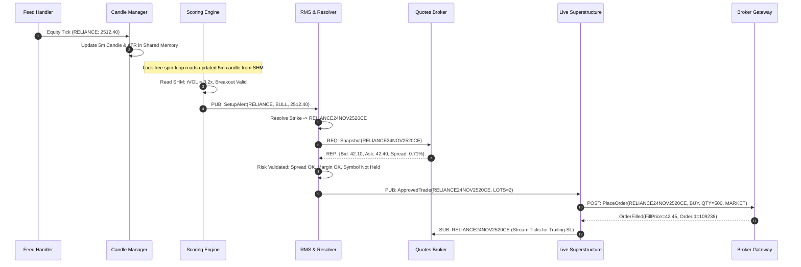
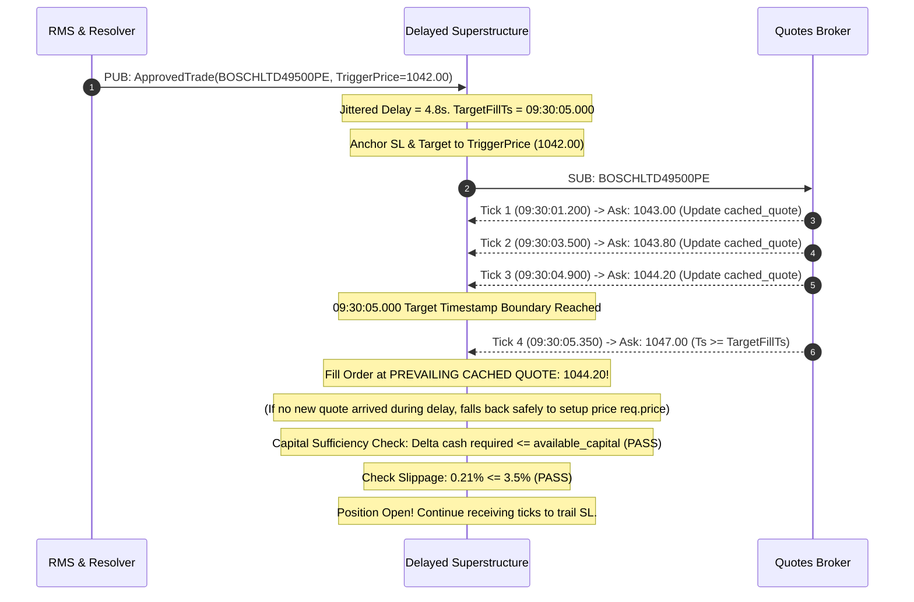

# System Architecture Specification 2.0: High-Throughput Distributed Options Trading Engine

> **Document Type**: Comprehensive Architectural Blueprint & Specification  
> **Version**: 2.0 (Distributed Multi-Process, ZeroMQ IPC, Shared Memory, Quotes Broker)  
> **Last Updated**: 2026-11-26 | **Status**: Active Source-of-Truth Specification  
> **Historical Reference**: Previous brainstorming, specs, and archived audits (e.g., [`2026-11-25_SYSTEM_AUDIT_2_0.md`](file:///Users/yorha/Documents/Trading%20Stuff/docs/archive/2026-11-25_SYSTEM_AUDIT_2_0.md)) live in [`docs/archive/`](file:///Users/yorha/Documents/Trading%20Stuff/docs/archive); active enhancements live in [`IMPROVEMENTS.md`](file:///Users/yorha/Documents/Trading%20Stuff/docs/live/IMPROVEMENTS.md).

---

## 1. Executive Summary & Core Topology

Architecture 2.0 transitions the platform from a monolithic, single-threaded Python process crippled by Global Interpreter Lock (GIL) thrashing, thread locks, and synchronous execution into a **modular, distributed multi-process system**.

Processes communicate over ultra-fast **ZeroMQ IPC sockets** and read from **lock-free POSIX Shared Memory segments**. High-frequency option ticks are isolated from analytical strategy evaluation, eliminating 90%+ of CPU noise.



---

## 2. Architectural Decision Records (ADRs) & Intuition

### ADR-001: Separation of Concerns across Market Domains (Equity vs. Derivatives)
* **Problem**: In NSE F&O, 221 stocks produce ~2,000 ticks/sec, while their active option strikes produce over 30,000 ticks/sec. In the legacy monolithic engine, all 30,000 option ticks flooded `strategy.py`, forcing dictionary lookups, regex replacements, and lock acquisitions. 95% of these ticks were discarded, choking CPU cores and delaying technical breakout evaluation.
* **Decision**: Strictly decouple the **Equity Domain** from the **Derivatives Domain**:
  - The `FeedHandler` separates incoming ticks at ingestion into two dedicated ZeroMQ IPC sockets: `feed_equity.ipc` and `feed_options.ipc`.
  - The `ScoringEngine` and `CandleManager` subscribe **exclusively to equity ticks**. They never process a single option tick.
  - Option ticks flow exclusively to the `QuotesBroker`, cutting strategy CPU overhead by $> 90\%$.

---

### ADR-002: Deterministic Pre-Allocated OHLC Shared Memory (Single Writer Owned)
* **Problem**: Dynamic list and DataFrame slicing (`candles[-20:]`) triggered constant heap allocations and Python Garbage Collection (GC) pauses during high-volatility market spikes.
* **Decision**: Allocate a fixed-size POSIX Shared Memory segment (`shm_ohlc_221`) for a dedicated **5-minute candle horizon**:
  - **Owned & Created by `CandleManager`**: The `CandleManager` is the Single Writer. It creates and initializes the shared memory segment (`create=True`) upon process startup.
  - **Lock-Free Reader Attachment**: Strategy scoring processes attach to the existing named segment (`create=False`) via `SharedMemory(name="shm_ohlc_221")` and wrap it in a read-only NumPy memory view. If the scoring engine starts before the candle manager, it retries with an exponential backoff until the segment is detected.
* **The Math for all 221 F&O Stocks**:
  - Trading duration: 09:15 to 15:30 = **375 minutes**.
  - 5-minute candles per stock: $375 / 5 = \mathbf{75\text{ candles/day}}$.
  - Total candles for all 221 stocks: $221 \times 75 = \mathbf{16,575\text{ candles/day}}$.
  - At 48 bytes per struct (`timestamp`, `open`, `high`, `low`, `close`, `volume`, `rvol`, `atr`, `is_closed`, `padding`):
    $$\text{Total Memory} = 16,575 \times 48\text{ bytes} = \mathbf{795,600\text{ bytes} \approx 777\text{ KB}}$$
* **Hardware & Cache Line Intuition**:
  - **777 Kilobytes** fits entirely inside the CPU's **L2 cache** (typical Intel/AMD L2: 1–2 MB per core; Apple Silicon M-series L2: 4–16 MB). The entire 221-stock day universe never needs to be evicted to L3 cache or DRAM.
  - The `CandleManager` writes directly in-place. Strategy processes read in **$< 2\ \mu\text{s}$** without deserialization.
  - **Operational Decoupling**: If a strategy is stopped, reconfigured, or restarted, the `CandleManager` continues running uninterrupted. The shared memory state and live tick recordings remain intact.

---

### ADR-003: Strict Current Candle rVOL with Minute-Boundary Linear Extrapolation
* **Problem**: Moving averages or rolling multi-hour volume windows lag intraday surges and introduce lookback distortions. Conversely, raw intra-bar Rate of Volume (RoV) can be excessively noisy during the first seconds of a bar.
* **Decision**: Use a **strict current candle rVOL** referenced against a pre-compiled historical index of **1-minute median volume buckets** (375 minutes per symbol):
  1. **Exact Minute Boundaries ($t_{\text{elapsed}} = 60\text{s}, 120\text{s}, 180\text{s}, 240\text{s}, 300\text{s}$)**:
     - Volume accumulated so far is directly evaluated against the cumulative historical 1-minute medians up to that completed minute:
       $$\text{rVOL} = \frac{V_{\text{accumulated}}}{\sum_{i=0}^{k-1} \text{Median}_{1\text{m}}(m_0 + i)}$$
  2. **Intra-Minute Extrapolation ($0 < \tau < 60\text{s}$)**:
     - In between minute boundaries, the incremental volume accumulated within the current fractional minute ($\Delta v$) is linearly extrapolated to the upcoming minute edge:
       $$v_{\text{extrap}} = \Delta v \times \frac{60}{\tau}$$
     - Projected volume at the minute edge $k+1$ is evaluated against the historical cumulative median up to minute $k+1$:
       $$V_{\text{projected}} = V_k + v_{\text{extrap}}, \quad \text{rVOL} = \frac{V_{\text{projected}}}{\sum_{i=0}^{k} \text{Median}_{1\text{m}}(m_0 + i)}$$
  3. **Nanosecond Execution**: Operates via simple array lookups and arithmetic, giving instantaneous, unlagged rVOL at any point within the 5-minute bar.

---

### ADR-003: Quotes Broker (Ticker Plant) with Last Value Cache (LVC)
* **Problem**: Storing 10 minutes of historical depth for all option strikes in shared memory would consume gigabytes of memory and require complex circular buffer management.
* **Decision**: Implement the `QuotesBroker` as a lightweight **Ticker Plant / Last Value Cache (LVC)** offering dual interfaces:
  1. **Snapshot Mode (On-Demand `REQ/REP`)**:
     - Point-in-time lookup for current bid, ask, LTP, spread, and depth.
     - Used by the RMS to validate liquidity gates before approving trades.
  2. **Subscription Mode (Streaming `PUB/SUB`)**:
     - Clients subscribe to specific contract keys (e.g., `SUB: NSE_FO:BOSCHLTD24NOV49500PE`).
     - ZeroMQ handles kernel-level topic filtering. The client receives the initial snapshot followed by live streaming ticks for that specific contract only.
     - When the position exits, the client unsubscribes, stopping tick delivery.
* **Memory Footprint**: The Quotes Broker only stores a single dictionary mapping `contract_token -> LatestQuoteStruct`. Memory consumption is **$< 200\text{ KB}$**.

---

### ADR-004: Scoring $\to$ RMS $\to$ Superstructure Pipeline
* **Problem**: Strategy evaluation, option strike selection, spread validation, and position management were tightly coupled, causing Head-of-Line blocking and dropped live exits.
* **Decision**: Decompose the decision flow into three distinct stages:
  1. **Scoring Engine**: Evaluates underlying equity price action (rVOL, range compression, breakouts). It has zero knowledge of options, spreads, or portfolio balances. It publishes setup alerts:
     `{"symbol": "RELIANCE", "direction": "BULL", "trigger_price": 2512.40, "ts": 1700000000.5}`.
  2. **Risk Management System (RMS) & Option Resolver**:
     - Subscribes to setup alerts.
     - Resolves ATM, ITM1, and OTM1 strikes instantly ($< 0.1\ \mu\text{s}$) using the static daily security master.
     - Requests snapshot spread from `QuotesBroker` (`spread <= 2.5%`).
     - Verifies portfolio exposure, margin, and circuit limits.
     - Publishes `ApprovedTradePacket` on `approved_trades.ipc`.
  3. **Strategy Mode Superstructures**:
     - Independent processes (`LiveSuperstructure`, `PaperSuperstructure`, `DelayedSuperstructure`) subscribe to `approved_trades.ipc`.
     - Each superstructure manages its portfolio tracks, loads execution rules from `common/tracks/`, and handles its own orders independently.

---

### ADR-005: Stream-Driven Paper Delayed Execution & Prevailing Cached Quote Semantics
* **Problem**: The legacy `PaperDelayedAdapter` relied on OS thread timers (`threading.Timer`) and blocking `time.sleep(0.15)` loops, creating severe lock contention, ghost prices, and divergence.
* **Decision**: Transform Paper Delayed execution into a purely **Stream-Driven State Machine** using the Quotes Broker.
* **Prevailing Cached Quote Semantics**:
  - When an order triggers at $T_{\text{trigger}}$, compute $T_{\text{target}} = T_{\text{trigger}} + \Delta t$ (e.g. $5.0\text{s}$ delay).
  - The delayed superstructure subscribes to the contract on the Quotes Broker and maintains `cached_quote`.
  - As ticks arrive prior to $T_{\text{target}}$, `cached_quote` updates continuously.
  - When a tick arrives with timestamp $T_{\text{tick}} \ge T_{\text{target}}$, the order executes at **`cached_quote`** (the prevailing quote established immediately prior to the boundary), NOT the newly arrived tick.
  - **Market Microstructure Accuracy**: If a real limit/market order reached the exchange at exactly $T_{\text{target}}$, it would match against the prevailing order book established before $T_{\text{target}}$. Using the subsequent waking tick would unfairly penalize the fill with future adverse price movement.
* **Trigger-Price Anchoring**: Stop loss and targets are calculated from $P_{\text{trigger}}$. If $\frac{P_{\text{fill}} - P_{\text{trigger}}}{P_{\text{trigger}}} > 3.5\%$, the order is canceled as a chased move.
* **Zero Threading**: Zero `threading.Timer`, zero `threading.Lock()`, zero `time.sleep()`.

---

### ADR-006: In-Process Columnar Simulation Engine (Parity Without IPC Overhead)
* **Problem**: Running multiple separate OS processes connected over ZeroMQ in simulation introduces synchronization barriers and IPC latency, making fast backtesting impossible.
* **Decision**: Build a dedicated **in-process monolithic simulation engine** that imports the exact same business logic classes (`ScoringLogic`, `RMSLogic`, `common.tracks`) but replaces ZeroMQ sockets and real-time waiting with **pre-indexed columnar memory lookups**.
* **Workflow**:
  1. Pre-load the recorded option quotes into a memory-mapped **Polars / Arrow Table** sorted by `[symbol, timestamp]` (takes ~1 second).
  2. Stream **only** the underlying equity ticks or 5m candles through the scoring and RMS logic.
  3. When an order triggers at $T_{\text{trigger}}$:
     - For **Instant Paper**: Fill at the option quote at $T_{\text{trigger}}$ via an $\mathcal{O}(\log N)$ binary search (`asof_join`).
     - For **Delayed Paper**: Fill at the prevailing option quote at $T_{\text{target}} = T_{\text{trigger}} + \Delta t$.
* **Performance**: Simulates an entire trading day across all 221 stocks in **3 to 5 seconds** (100,000+ ticks/sec) with 100% mathematical parity to live trading.

---

### ADR-007: Operating System CPU Core Pinning & Scheduling
* **Problem**: OS thread migration causes CPU cache line invalidation and non-deterministic scheduling latency.
* **Decision**: 
  - **On Linux (Production Server / Colocation)**: Use native `os.sched_setaffinity` to hard-pin each core process:
    - Core 0: OS / Network I/O / Ingestion
    - Core 1: Quotes Broker
    - Core 2: Candle Manager
    - Core 3: Scoring & RMS
    - Core 4: Live Superstructure
  - **On macOS (Development & Research)**: Utilize POSIX real-time QoS priority (`os.nice(-10)`) to lock processes to Apple Silicon Performance Cores (P-cores) and avoid Efficiency Core (E-core) throttling.

---

### ADR-008: Dual Broker Integration: Upstox (Ingestion) & Groww (Live Execution)
* **Problem**: Relying on a single broker for both market data streaming and live order execution introduces coupling failures: if live order execution experiences timeouts or rate limits, market data drops; conversely, a WebSocket reconnect risks dropping position tracking.
* **Decision**: Formally isolate the broker responsibilities:
  1. **Upstox API v2/v3**: Dedicated solely to **Market Data Ingestion**. Ingests the high-throughput WebSocket stream, downloads daily security masters, and builds the pre-market volume baseline.
  2. **Groww Trading API (`growwapi` / `GrowwAPI`)**: Dedicated exclusively to **Live Order Execution**. Uses the official Groww Python SDK for order placement, TOTP session management, resting Stop-Loss protection, and robust broker position reconciliation (`reconcile_broker_positions`).
* **Parity Preservation**: All existing live adapter logic is preserved intact directly inside `execution/superstructures/live.py`.

---

### ADR-009: Multi-Mode Concurrent Superstructure Orchestration
* **Problem**: Traders need to run Paper, Paper Delayed, and Live modes simultaneously during forward testing (`--mode paper,paper_delayed,live`) to directly compare fill slippage, execution latency, and strategy performance against real money.
* **Decision**: The Process Supervisor parses comma-separated modes and forks an independent child process for each requested mode. Each mode superstructure runs concurrently, subscribing to the same `rms_strike_pub.ipc` and `quotes_stream.ipc` sockets, maintaining its own isolated trade journal without cross-mode lock contention.

---

### ADR-010: Universal Strategy Dashboard (Implicitly Launched with Strategy)
* **Problem**: Embedding UI dashboard rendering inside strategy or execution processes introduces 100–300 ms ANSI rendering latency, blocking market tick processing. Conversely, requiring manual separate command invocations for the dashboard creates unnecessary operational friction.
* **Decision**: Implement the dashboard as an independent, read-only process (`ui/dashboard.py`). When the user runs `runner.py start`, the supervisor **implicitly launches the dashboard** as a child terminal/process (with a `--no-dashboard` flag available for headless servers). It subscribes to RMS alerts (`rms_strike_pub.ipc`) and watches mode trade journals on disk to display live trackwise performance. Crashes or terminal resizes in the dashboard process have zero impact on live execution.

---

### ADR-011: Strict Decoupling of Core Data Infrastructure from Strategy Execution
* **Problem**: In legacy architectures, launching or stopping a strategy also killed and restarted the WebSocket feed listener, dropping ticks during the 10-second reconnect handshake, corrupting ongoing recordings, and wiping active candle state.
* **Decision**: Strictly separate the **Core Data Infrastructure Lifecycle** from the **Strategy Lifecycle**:
  1. **Core Data Tier (`runner.py core` or independent commands)**:
     - The `runner.py core` command enforces that `--feed <ws|mock>`, `--candlemanager`, and `--quotesbroker` are all passed with their respective parameters, with `--record` optional.
     - Alternatively, each component can be started completely independently (`runner.py feed`, `runner.py candlemanager`, `runner.py quotesbroker`, `runner.py record`).
     - `CandleManager` allocates and owns `shm_ohlc_221` (777 KB in L2 cache).
     - Runs continuously all day from 09:00 to 15:30 without interruption.
  2. **Strategy & Execution Tier (`runner.py start`)**:
     - Attaches to running `shm_ohlc_221` and Quotes Broker sockets.
     - Spawns `ScoringEngine3`, `RMSOptionResolver`, each of the specified tracks across requested execution modes (`--mode paper,paper_delayed,live`), and launches the `dashboard` implicitly.
     - Can be stopped (`runner.py stop --strategy`), re-tuned, and restarted at any time during market hours with **zero data loss**, zero WebSocket reconnects, and zero corruption of recorded market files.

---

## 3. Process & Component Specifications



### 3.1 Market Feed Handler (`infrastructure/feed_handler.py`)
- Connects to broker WebSocket API (e.g., Kite, Fyers, Breeze) or Replay Engine.
- Deserializes raw binary/JSON packets.
- Routes:
  - NSE Equity Cash ticks $\to$ `ipc:///tmp/feed_equity.ipc` (ZeroMQ `PUB`)
  - NSE F&O Option ticks $\to$ `ipc:///tmp/feed_options.ipc` (ZeroMQ `PUB`)

### 3.2 Candle / OHLC Manager (`infrastructure/candle_manager.py`)
- Subscribes to `ipc:///tmp/feed_equity.ipc`.
- Maintains running OHLCV bars for the 5-minute timeframe across all 221 F&O stocks (75 candles/day).
- Computes vectorized rolling metrics: ATR(14) and strict current candle rVOL with linear minute-boundary extrapolation.
- Writes state directly and exclusively to POSIX Shared Memory segment `shm_ohlc_221`.

### 3.3 Quotes Broker (`infrastructure/quotes_broker.py`)
- Subscribes to `ipc:///tmp/feed_options.ipc`.
- Maintains the Last Value Cache (LVC) dictionary: `Dict[str, LatestQuoteStruct]`.
- Sockets:
  - `ipc:///tmp/quotes_snapshot.ipc` (ZeroMQ `ROUTER` / `REP`): Responds to snapshot requests.
  - `ipc:///tmp/quotes_stream.ipc` (ZeroMQ `XPUB`): Streams live ticks to subscribed superstructures. Supports `heartbeat = True` to emit a periodic timestamp tick on every new timestamp boundary (e.g. 500ms or 1s).

### 3.4 Scoring & Pattern Engine (`strategies/momentum/scoring_engine.py`)
- Attaches to `shm_ohlc_221` and spins on a busy while-loop with sub-microsecond cycle times.
- Evaluates technical setups on candle updates or intra-bar volume surges ($\text{rVOL} \ge 2.0\times$).
- **No continuous 0–100 score**: Validates deterministic price action invariants.
- **No market regime bias**: Evaluates individual stock momentum independently of broad market indexes.
- Emits setup alerts on `ipc:///tmp/alerts_breakout.ipc`.

### 3.5 RMS & Option Resolver (`execution/rms_resolver.py`)
- Subscribes to `ipc:///tmp/alerts_breakout.ipc`.
- Resolves options: Computes ATM, ITM1, and OTM1 strikes from spot price using the static in-memory `security_master`.
- Sends snapshot request to `QuotesBroker` for selected strikes: verifies `spread <= 2.5%`.
- Validates risk rules: Max daily drawdown, duplicate position guards, circuit bands, market square-off hours.
- Emits approved orders to `ipc:///tmp/approved_trades.ipc`.

### 3.6 Mode Superstructures (`execution/superstructures/`)
- Three distinct service implementations:
  - `LiveSuperstructure`: Routes real orders via official Groww SDK (`GrowwAPI`) with automatic broker position reconciliation.
  - `PaperSuperstructure`: Immediate virtual fills against Quotes Broker depth.
  - `DelayedSuperstructure`: Stream-driven delayed fills using prevailing cached quotes.
- Each superstructure instantiates track models from `common/tracks/`:
  - `ATMTrack`: Standard ATM contract execution.
  - `ITMTrack`: Deep/near ITM contract execution.
  - `TrailingSLTrack`: Dynamic ATR/percent trailing stop.
  - `CompositeSharedPoolTrack`: Unified capital allocation across sub-tracks.

### 3.7 Market Data Recorder (`core/recorder/market_recorder.py`)
- Subscribes to `ipc:///tmp/feed_equity.ipc` and `ipc:///tmp/feed_options.ipc`.
- Writes compressed, chunked Parquet files into `recordings/YYYYMMDD/` for lossless tick storage.
- Asynchronous, non-blocking zero-copy subscriber; zero impact on live execution latency.

### 3.8 Analytics & Simulation Web Server (`web/server.py`)
- Modern browser-based command center succeeding the terminal dashboard:
  - **Live Service (`web/live_service.py`)**: Subscribes to ZeroMQ option depth streams, maintains Latest Value Cache (LVC), computes live MTM across open positions, and streams updates over WebSockets (`/api/live/ws`).
  - **Simulation Service (`web/simulation_service.py`)**: Spawns isolated worker processes (`multiprocessing.Process`) to bypass Python's GIL; caches parsed Parquet DataFrames (`cached_equity_df`, `cached_options_df`) for sub-second re-runs; manages single and batch simulation queues with persistent history, plus cross-session batch analytics (`web/batch_analytics.py`) and F&O synthetic basket market regime tagging (`web/regime_classifier.py`).
  - **Candle & Alert Services (`web/candle_service.py`, `web/alert_service.py`)**: Attaches directly to POSIX Shared Memory (`shm_ohlc_221`) in $< 2\ \mu\text{s}$ to render 5-minute candlestick charts with exact breakout trigger markers.
  - **Historical Service (`web/historical_service.py`)**: Discovers and indexes past trading sessions from `recordings/` and `logs/`, parsing closed trade journals for drill-down performance analytics.
- Full details documented in [`WEB_VIEW_FLOW.md`](file:///Users/yorha/Documents/Trading%20Stuff/docs/sys/WEB_VIEW_FLOW.md).
- **Execution & Risk Parity Updates (`2026-11-26`)**:
  - **QuotesBroker (`core/quotes/quotes_broker.py`)**: Subscribes to both `TICK.OPT` (`feed_options.ipc`) and `TICK.EQ` (`feed_equity.ipc`) so underlying equities stream live `underlying_ltp` to [`BaseTrack`](file:///Users/yorha/Documents/Trading%20Stuff/common/tracks/base_track.py) (e.g., `StructuralConvexityTrack`) without option-tick pollution.
  - **RMS & Risk (`core/rms/rms_service.py`, `core/rms/mode_risk.py`)**: Enforces `max_spread_pct = 0.03` (`3%`), `atr_spread_gate_enabled = true` (`2.0x` expected half-ATR move vs spread), `max_alerts_per_symbol_per_day = 3` (`E10_W3_CAP3`), and configurable `enable_circuit_breaker` (`false` by default in `config/strategies.json`).
  - **Simulation Engine (`simulation/columnar_sim_engine.py`)**: Uses an event-driven chronological min-heap replaying every raw option tick, underlying equity tick, delayed fill, and 1.0s heartbeat with exact production rule parity.

### 3.9 Universal Strategy Dashboard (`ui/dashboard.py`)
- Independent, read-only terminal process displaying real-time platform telemetry (retired in favor of Web UI, retained for headless/SSH environments).
- Subscribes to `ipc:///tmp/rms_strike_pub.ipc` to display setup alerts, active strikes, and live trackwise P&L matrix.

---

## 4. End-to-End Order Lifecycles

### 4.1 Live Trading Execution Flow



---

### 4.2 Stream-Driven Paper Delayed Execution Flow



---

## 5. Data Structures & Shared Memory Schemas

### 5.1 Candle Shared Memory Struct (`core/candles/shm_layout.py`)
```python
import numpy as np

# Exact 48-byte struct layout adhering to LOW_LEVEL_DESIGN_2_0 (§3.1) and core/candles/shm_layout.py
CANDLE_DTYPE = np.dtype(
    [
        ("timestamp", "<i8"),       # 8 bytes: Unix timestamp in seconds (int64)
        ("open", "<f4"),            # 4 bytes: Open price (float32)
        ("high", "<f4"),            # 4 bytes: High price (float32)
        ("low", "<f4"),             # 4 bytes: Low price (float32)
        ("close", "<f4"),           # 4 bytes: Close / Current LTP (float32)
        ("volume", "<u8"),          # 8 bytes: Cumulative bar volume (uint64)
        ("rvol", "<f4"),            # 4 bytes: Strict Current Candle rVOL (float32)
        ("atr", "<f4"),             # 4 bytes: 14-period Average True Range (float32)
        ("is_closed", "?"),         # 1 byte:  Boolean flag (True if bar finished, False if active)
        ("reserved", "<u1", (7,)),  # 7 bytes: Explicit padding to align struct to 48 bytes
    ],
    align=False,
)

# Seqlock synchronization header: 16 bytes per symbol
SEQLOCK_DTYPE = np.dtype(
    [
        ("sequence_id", "<u8"),     # 8 bytes: monotonically increasing counter (odd = updating)
        ("last_update_ns", "<i8"),  # 8 bytes: nanosecond timestamp of last tick
    ],
    align=False,
)
```

> [!NOTE]
> **OS Residence & L2 Cache Note**: The 777 KB shared memory segment (`221 symbols × 75 bars × 48 bytes = 795,600 bytes`) resides in CPU L2 cache for microsecond reads when run with POSIX shared memory (`FORCE_POSIX_SHM=1` on Linux `/dev/shm`). On macOS, the platform seamlessly uses a high-speed memory-mapped file fallback in `/tmp/shm_ohlc_221.shm`.

### 5.2 Actionable Opportunity Schema (ZeroMQ Payload on `rms_strike_pub.ipc`)
```json
{
  "opp_id": "OPP_BOSCHLTD_1700000785120",
  "alert_id": "ALERT_BOSCHLTD_1700000785000",
  "symbol": "BOSCHLTD",
  "direction": "BEAR",
  "trigger_price": 49200.0,
  "timestamp": 1700000785.12,
  "archetype": "FLAG_BEAR_BREAKOUT",
  "pole_high": 49800.0,
  "pole_low": 49100.0,
  "flag_high": 49500.0,
  "flag_low": 49200.0,
  "atr": 450.0,
  "rvol": 2.85,
  "clv": 0.82,
  "strikes": {
    "ATM": {
      "token": "NSE_FO:BOSCHLTD26NOV49200PE",
      "strike": 49200.0,
      "option_type": "PE",
      "lot_size": 25,
      "bid": 980.0,
      "ask": 982.5,
      "ltp": 981.0,
      "bid_qty": 250,
      "ask_qty": 250
    },
    "ITM1": {
      "token": "NSE_FO:BOSCHLTD26NOV49500PE",
      "strike": 49500.0,
      "option_type": "PE",
      "lot_size": 25,
      "bid": 1042.0,
      "ask": 1044.2,
      "ltp": 1043.0
    },
    "ITM2": {
      "token": "NSE_FO:BOSCHLTD26NOV49800PE",
      "strike": 49800.0,
      "option_type": "PE",
      "lot_size": 25,
      "bid": 1110.0,
      "ask": 1113.0,
      "ltp": 1111.5
    },
    "OTM1": {
      "token": "NSE_FO:BOSCHLTD26NOV48900PE",
      "strike": 48900.0,
      "option_type": "PE",
      "lot_size": 25,
      "bid": 920.0,
      "ask": 922.5,
      "ltp": 921.0
    },
    "OTM2": {
      "token": "NSE_FO:BOSCHLTD26NOV48600PE",
      "strike": 48600.0,
      "option_type": "PE",
      "lot_size": 25,
      "bid": 860.0,
      "ask": 863.0,
      "ltp": 861.5
    }
  }
}
```

---

## 6. Operational Resilience & Edge Case Protocols

### 6.1 The Lazy Quotes Heartbeat Mechanism (Zero-Interrupt Delayed Execution)
* **Design**: The `QuotesBroker` provides a `heartbeat = True` option on its `quotes_stream.ipc` socket. On every new timestamp boundary (e.g., 500ms or 1s), even if a specific contract has no new ticks, the broker emits a lightweight timestamp heartbeat.
* **Lazy Delayed Superstructure**: The `DelayedSuperstructure` has **zero OS timer interrupts and zero polling threads**. It maintains a central quotes cache for its pending orders and sleeps passively on the ZeroMQ socket. It only wakes up when a contract tick or a heartbeat tick arrives:
  - If a contract tick arrives: Updates `cached_quote` for that strike.
  - If `tick.timestamp >= target_fill_ts`: Immediately triggers the fill at `cached_quote`.
  - If a heartbeat arrives with `heartbeat.timestamp >= target_fill_ts`: Evaluates the pending order against its prevailing `cached_quote` without waiting for future ticks!
* **Result**: Completely lazy, event-driven execution with zero CPU churn during quiet market intervals.

### 6.2 Dynamic Unsubscribe Garbage Collection & Position Protection
* **Per-Process Client Isolation**: When subscribing or unsubscribing, each superstructure generates a unique per-process client identifier:
  $$\text{client\_id} = f"\{\text{mode}\}\_\{\text{track\_names}\}\_\{os.getpid()\}"$$
  The `QuotesBroker` manages subscriptions via reference counting:
  $$\text{subscribers\_by\_token}[\text{token}] = \text{set}(\text{client\_ids})$$
  This guarantees that concurrent tracks or modes (e.g. `paper [fast_momentum]` and `paper [trend_pullback]`) never prematurely truncate each other's live depth stream when one track exits early.
* **Active Position Protection Registry (`ProtectedPositionRegistry`)**:
  - Global registry tracking open option contracts across `live`, `paper`, and `paper_delayed`.
  - When an order fills (`TRADE_FILLED`), the contract is marked protected.
  - Any intermediate or errant unsubscription requests for a protected token are ignored until the trade formally records an exit (`TRADE_EXIT`).
  - Upon startup, `FeedHandler` queries the protected registry and includes active positions in its initial WebSocket subscriptions.

### 6.3 Process Failure, Auto-Recovery & Mid-Day Continue (`--continue`)
* Each process is managed by a lightweight supervisor (systemd / supervisord / launchd).
* **State Recovery Protocol (`runner.py start/strat --continue`)**:
  - When restarted mid-day, Superstructures scan today's trade journals in `recordings/YYYYMMDD/journal_<mode>.jsonl`.
  - Open positions are reconstituted with their original entry prices, targets, trailing stops, and timestamps.
  - Superstructures immediately issue `subscribe_quotes(recovered_tokens)` to `QuotesBroker` using their isolated `client_id`.
  - Prevailing snapshot quotes are returned to seed active trade states (`current_bid`, `highest_price`) before market streaming begins.
  - Live open positions are concurrently reconciled against broker gateway REST API.

### 6.4 Execution Mode Freeze & Cutoff Control (`runner.py freeze / unfreeze`)
* **Operator Freeze Control**:
  - `runner.py freeze --mode <live|paper|paper_delayed|all>` (and shortcut `runner.py stop-live`) blocks all new order entries for the designated mode.
  - `runner.py unfreeze --mode <live|paper|paper_delayed|all>` resumes entry processing.
* **Architecture & IPC Synchronization**:
  - Eliminates the legacy flaw of per-tick disk polling (`os.path.exists("logs/.freeze_*")`) on hot paths.
  - The CLI updates the persistent flag file on disk (`logs/.freeze_<mode>`) for restart durability AND immediately publishes an atomic control event over ZeroMQ to all active Superstructures.
  - Superstructures toggle an in-memory atomic boolean `is_frozen = True`.
* **Safe Exit Behavior**:
  - When frozen, open positions are **never abandoned**. Trailing stop-losses, dynamic targets, and EOD square-offs continue to run uninterrupted.

### 6.5 Guaranteed Market Recorder Flush Architecture
* **Lossless Tick Durability**:
  - `MarketRecorder` registers `atexit.register(self.flush)` to guarantee data commitment even on unexpected process termination.
  - The primary ZeroMQ ingestion loop in `start()` is protected with `try ... finally: self.flush()`.
  - The `stop()` handler explicitly flushes all write buffers to Parquet on disk before destroying ZeroMQ contexts or sockets.

### 6.6 Zero-Fabrication & Strict Quote Integrity Policy
* **Absolute Ban on Synthetic/Nominal Quotes**:
  - The entire pipeline operates strictly on genuine, executable market depth. Synthetic fallback quotes in RMS or execution are strictly prohibited.
  - If a strike lacks executable liquidity or spread exceeds tolerance at setup creation time, RMS rejects the opportunity cleanly.
  - In delayed execution, orders resolve against the latest cached depth or fall back to the setup order price (`req.price`). If market movement increases capital requirements beyond `available_capital`, the order is rejected. Real market depth or clean rejection only.

---

## 7. Comparative Performance Audit: Legacy 1.0 vs. Architecture 2.0

| Operational Metric | Monolithic Engine 1.0 | Distributed Engine 2.0 | Improvement Factor |
| :--- | :--- | :--- | :--- |
| **Strategy Tick Overhead** | 30,000 option ticks/sec processed | 0 option ticks processed (pure equity) | **> 90% CPU Noise Eliminated** |
| **Live Tick Latency** | 15–750 ms (lock/sleep contention) | $< 0.15\text{ ms}$ (Lock-free IPC) | **~500x Latency Reduction** |
| **Delayed Fill Parity** | Diverged due to thread race & lumping | 100% deterministic cached quote | **Zero Live vs Sim Divergence** |
| **Full-Day Sim Runtime** | 15–25 minutes (2,500 ticks/sec) | 3–5 seconds (100,000+ ticks/sec) | **~300x Speedup** |
| **Memory Allocation** | Dynamic heap slicing on each tick | Fixed 777 KB Pre-allocated SHM (L2 Cache) | **Zero GC Pauses** |
| **Process Isolation** | Monolithic lockstep failure | Independent OS worker processes | **Live Execution 100% Insulated** |

