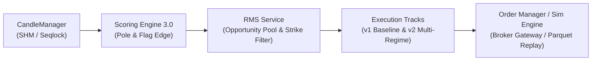
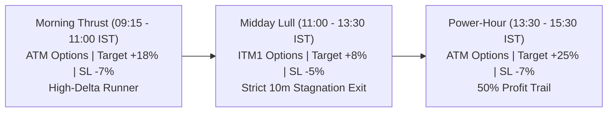

# Strategy Execution Tracks: Complete System Reference

This document serves as the authoritative architectural specification and operational guide for all **Execution Tracks** in the Antigravity Trading Engine.

> **Active Production Update (`2026-11-26`)**: Per [`SIMULATION_HYPOTHESIS_REPORT.md`](file:///Users/yorha/Documents/Trading%20Stuff/docs/live/SIMULATION_HYPOTHESIS_REPORT.md) and [`TASKS_DONE.md`](file:///Users/yorha/Documents/Trading%20Stuff/docs/live/TASKS_DONE.md), **`gamma_runner_OTM2` is RETIRED** from `default.json` and `v2.json` (`19` active default tracks: `12 v1` + `7 v2`), and **`option_convexity_scaling` (`OptScale`)** is enabled globally via [`config/strategies.json`](file:///Users/yorha/Documents/Trading%20Stuff/config/strategies.json) + [`BaseTrack`](file:///Users/yorha/Documents/Trading%20Stuff/common/tracks/base_track.py) (OOS verification tracked in [`EXPERIMENT_E10_W3_CAP3_OOS.md`](file:///Users/yorha/Documents/Trading%20Stuff/docs/live/EXPERIMENT_E10_W3_CAP3_OOS.md)).

---

## 1. Architectural Role of Execution Tracks

In the Antigravity architecture, **signal generation** and **trade execution** are strictly decoupled:



1. **Scoring Engine 3.0** discovers technical price-volume market edges (Bull/Bear Flags, Contraction Breakouts) and emits high-probability `SetupAlert` events containing structural boundaries (`pole_high`, `pole_low`, `flag_high`, `flag_low`, `atr`, `rvol`, `clv`).
2. **RMS Service / Simulation Engine** resolves tradable strike candidates (`ITM2`, `ITM1`, `ATM`, `OTM1`, `OTM2`) based on option chain liquidity, spread constraints, and delta profiles.
3. **Execution Tracks** own the operational lifecycle of a position:
   - Specific moneyness / delta selection.
   - Initial stop-loss (SL) and target price calibration.
   - Real-time tick monitoring (both option depth and underlying equity price action).
   - Dynamic trailing ratchets, breakeven triggers, and stagnation timeouts.
   - Capital allocation and exit execution.

Execution tracks inherit from [`BaseTrack`](file:///Users/yorha/Documents/Trading%20Stuff/common/tracks/base_track.py) and operate identically across **Live**, **Paper**, and **Columnar Historical Simulation** modes.

---

## 2. Baseline v1 Execution Tracks

The `v1` tracks represent the baseline intraday options execution archetypes. They primarily focus on fixed percentage targets, basic trailing steps, or fixed rupee goals with uniform ATM/ITM/OTM options.

Profile configuration: [`config/tracks/v1.json`](file:///Users/yorha/Documents/Trading%20Stuff/config/tracks/v1.json).

```
┌────────────────────────────────────────────────────────────────────────┐
│                          v1 TRACK ENSEMBLE                             │
├──────────────────────┬──────────────────────┬──────────────────────────┤
│ Fast Momentum        │ Trend Pullback       │ Fixed Target             │
│ Target: +15%         │ Target: +25%         │ Target: +15% or ₹750     │
│ SL: -5%              │ SL: -5%              │ SL: -5%                  │
│ Linear Decay: 900s   │ Stepped Trail: +1%   │ Timeout: 1800s           │
│ Timeout: 1800s       │ Timeout: 3600s       │ Breakeven: +2.5%         │
└──────────────────────┴──────────────────────┴──────────────────────────┘
```

---

### 2.1 Fast Momentum Track (`fast_momentum`)

- **Class**: [`FastMomentumTrack`](file:///Users/yorha/Documents/Trading%20Stuff/common/tracks/fast_momentum.py)
- **Primary Moneyness**: `ATM`, `ITM`, `OTM` (Default: `ATM`)
- **Target / SL**: Target `+15.0%`, Stop-Loss `-5.0%`
- **Breakeven Trigger**: `+2.5%` profit moves SL to entry (`0.0%` loss).
- **Core Mechanism — Target Decay**:
  - In fast momentum trading, initial explosive expansion should occur quickly. If the option does not hit its +15% target within `target_decay_sec` (900 seconds / 15 minutes), the target begins linear decay toward `decay_floor_pct` (2.5%).
  - Decay Formula:
    $$\text{DecayRatio} = \min\left(1.0, \frac{\text{Elapsed} - \text{DecaySec}}{\text{TimeoutSec} - \text{DecaySec}}\right)$$
    $$\text{EffectiveTarget} = \text{Target} - \text{DecayRatio} \times (\text{Target} - \text{Floor})$$
  - This prevents holding stagnating options into midday theta bleed.
- **Hard Timeout**: `1800s` (30 minutes) stagnation exit.
- **Best Suited For**: Clean flag breakouts during morning and power-hour momentum thrusts.

---

### 2.2 Trend Pullback Track (`trend_pullback`)

- **Class**: [`TrendPullbackTrack`](file:///Users/yorha/Documents/Trading%20Stuff/common/tracks/trend_pullback.py)
- **Primary Moneyness**: `ITM`, `ATM`, `OTM` (Default: `ITM`)
- **Target / SL**: Target `+25.0%`, Stop-Loss `-5.0%`
- **Breakeven Trigger**: `+2.5%` profit moves SL to entry (`0.0%` loss).
- **Core Mechanism — Stepped Trailing Ratchet**:
  - Designed for intraday runners that develop into extended trend legs.
  - Tracks `highest_price` since entry. For every `trailing_step_pct` (1.0%) price advance beyond entry, the stop-loss is raised by 1.0%:
    $$\text{Steps} = \left\lfloor \frac{\text{Highest} - \text{Entry}}{\text{Entry} \times \text{StepPct}} \right\rfloor$$
    $$\text{TrailSL} = \text{Entry} \times (1.0 + \text{Steps} \times \text{StepPct}) - (\text{Entry} \times \text{SLPct})$$
- **Hard Timeout**: `3600s` (60 minutes) maximum hold time.
- **Best Suited For**: Multi-bar directional trend continuations after low-volume flag consolidations.

---

### 2.3 Fixed Target Track (`fixed_target`)

- **Class**: [`FixedTargetTrack`](file:///Users/yorha/Documents/Trading%20Stuff/common/tracks/fixed_target.py)
- **Primary Moneyness**: `ITM`, `ATM`, `OTM` (Default: `ATM`)
- **Target / SL**: Target `+15.0%` or Cash Target `₹750.00` per trade, Stop-Loss `-5.0%`
- **Breakeven Trigger**: `+2.5%` profit moves SL to entry.
- **Core Mechanism — Absolute Rupee Lock**:
  - Exits as soon as absolute realized rupee gain exceeds `fixed_target_inr` (e.g. ₹750) regardless of remaining percentage upside.
  - Ensures steady, predictable equity curve accumulation for conservative accounts.
- **Hard Timeout**: `1800s` (30 minutes).
- **Best Suited For**: Low-volatility intraday environments where locking ₹500–₹1,000 per lot is preferable to chasing runners.

---

### 2.4 Composite Shared Pool Tracks (`composite_track`)

- **Class**: [`CompositeTrack`](file:///Users/yorha/Documents/Trading%20Stuff/common/tracks/composite_track.py)
- **Primary Configurations**:
  - `composite_shared_ITM`: ITM options split across Fast Momentum, Trend Pullback, and Fixed Target.
  - `composite_shared_ATM`: ATM options split across all three archetypes.
  - `composite_shared_OTM`: OTM options split across all three archetypes.
- **Core Mechanism**:
  - Wraps multiple child tracks under a single parent capital pool (₹250,000), rotating accepted opportunities fairly across sub-tracks. Equal-share split presets (`composite_split_*`, `combined_star`) are retired; only `shared_pool: true` composites remain active.

---

## 3. Next-Generation v2 Multi-Regime Tracks

The `v2` suite expands execution across a comprehensive **Risk-Reward matrix** and introduces **Underlying Equity Tick Invalidation**, **Time-Switched Regime Execution**, and **Live Spread Calibration**.

Profile configuration: [`config/tracks/v2.json`](file:///Users/yorha/Documents/Trading%20Stuff/config/tracks/v2.json).

```
┌────────────────────────────────────────────────────────────────────────┐
│                        v2 MULTI-REGIME MATRIX                          │
├───────────────────────────────────┬────────────────────────────────────┤
│ LOW RISK / HIGH REWARD            │ HIGH RISK / HIGH REWARD            │
│ • structural_convexity (ATM)      │ • opening_thrust_convex (ATM)      │
│ • trend_pullback_v2 (ITM1)        │ • volatility_expansion (ATM)       │
├───────────────────────────────────┼────────────────────────────────────┤
│ LOW RISK / LOW REWARD             │ DYNAMIC TIME REGIME                │
│ • delta_scalp (ITM2)              │ • adaptive_regime (ATM / ITM1)     │
│ • micro_chandelier (ITM1)         │   (Morning / Midday / Afternoon)   │
└───────────────────────────────────┴────────────────────────────────────┘
```

---

### 3.1 Structural Convexity Track (`structural_convexity`)

> **Quadrant: Low Risk, High Reward**

- **Class**: [`StructuralConvexityTrack`](file:///Users/yorha/Documents/Trading%20Stuff/common/tracks/structural_convexity.py)
- **Moneyness**: `ATM` ($\Delta \approx 0.50$)
- **Core Philosophy**:
  Decouples option stop-loss from arbitrary premium swings. Instead of taking an automatic -10% option loss during normal bid-ask fluctuations, the trade invalidation is **anchored directly to the underlying equity's technical setup boundary**. As long as the underlying stock remains above its flag support, the option position is held.
- **Setup Invalidation Rules**:
  - **Bull Flag**: Exits immediately if underlying equity LTP $\le \text{flag\_low}$.
  - **Bear Flag**: Exits immediately if underlying equity LTP $\ge \text{flag\_high}$.
  - Evaluated on live underlying equity ticks via `on_underlying_tick()`.
- **Emergency Protection**: Hard `-12.0%` option premium emergency stop to protect against sudden stock gaps or illiquidity.
- **Breakeven Free-Roll**: At `+8.0%` option gain, ratchets SL to $\text{Entry} \times 1.005$ (entry + 0.5% brokerage buffer), turning the trade into a risk-free position.
- **Asymmetric Profit Trail**:
  - Above `+15.0%` peak profit, activates a 50% asymmetric trailing ratchet:
    $$\text{TrailSL} = \text{Entry} \times \left(1.0 + 0.50 \times \frac{\text{Peak} - \text{Entry}}{\text{Entry}}\right)$$
  - Target set to `+100.0%` (open-ended convex runner).
- **Sim Performance (2026-11-19)**: 177 trades, **+5.9% Net PnL** (Paper) / **+5.8% Net PnL** (Delayed).

---

### 3.2 Opening Thrust Convexity Track (`opening_thrust_convex`)

> **Quadrant: High Risk, High Reward**

- **Class**: [`OpeningThrustConvexityTrack`](file:///Users/yorha/Documents/Trading%20Stuff/common/tracks/opening_thrust_convex.py)
- **Moneyness**: `ATM` ($\Delta \approx 0.50$)
- **Core Philosophy**:
  Captures the high-beta opening volatility burst (09:15–10:30 IST) when institutional volume and implied volatility expansion are highest. Avoids midday theta decay by strictly closing out all open positions before lunch.
- **Time Window Restrictions**:
  - **Entry Gate**: Trades are strictly accepted only between **09:15 IST and 10:30 IST**. All alerts after 10:30 are rejected.
  - **Hard EOD / Midday Cutoff**: Any open trade active at **10:45 IST** is closed at market bid (`OPENING_SESSION_CUTOFF`).
- **Target / SL**: Target `+35.0%`, Initial SL `-6.0%`.
- **Ratchets**:
  - Breakeven trigger at `+15.0%`.
  - Above +15%, ratchets SL upward 1:1 with every additional 1.0% gain.
- **Sim Performance (2026-11-19)**: Only 25 high-conviction morning trades, **32% Win Rate**, **+5.5% Net PnL** (Paper) / **+5.4% Net PnL** (Delayed).

---

### 3.3 Delta Scalp Track (`delta_scalp`)

> **Quadrant: Low Risk, Low Reward**

- **Class**: [`DeltaScalpTrack`](file:///Users/yorha/Documents/Trading%20Stuff/common/tracks/delta_scalp.py)
- **Moneyness**: Deep `ITM2` ($\Delta \approx 0.80 - 0.85$)
- **Core Philosophy**:
  Operates as a high-delta synthetic stock substitute with near-zero extrinsic time value. By trading Deep ITM options, theta decay is virtually non-existent over short durations, and the option tracks underlying point-for-point.
- **Target / SL**: Target `+7.0%`, Stop-Loss `-4.0%` (Tightly bounded).
- **Velocity Stagnation Timeout**:
  - If the position does not reach its +7% target within **180 seconds (3 minutes)**, it exits immediately at current bid (`VELOCITY_TIMEOUT`).
  - This guarantees the strategy is never trapped in low-momentum chop.
- **Sim Performance (2026-11-19)**: 217 trades, **+8.3% Net PnL** (Paper) / **+6.2% Net PnL** (Delayed).

---

### 3.4 Micro-Chandelier Track (`micro_chandelier`)

> **Quadrant: Low Risk, Low Reward**

- **Class**: [`MicroChandelierTrack`](file:///Users/yorha/Documents/Trading%20Stuff/common/tracks/micro_chandelier.py)
- **Moneyness**: `ITM1` ($\Delta \approx 0.65$)
- **Core Philosophy**:
  A rapid staircase trailing ratchet that locks in green profits early and frequently. Prevents winning trades from reversing into losses during mean-reverting or choppy market regimes.
- **Target / SL**: Target `+10.0%`, Initial SL `-5.0%`.
- **Staircase Micro-Ratchets**:
  - **Level 1 (+3% gain)**: Stop-loss ratcheted to `-1.5%` (halves initial risk).
  - **Level 2 (+5% gain)**: Stop-loss ratcheted to `+1.5%` (locks in positive profit after brokerage).
  - **Level 3 (+7% gain)**: Stop-loss ratcheted to `+3.5%`.
  - **Level 4 (+9% gain)**: Stop-loss ratcheted to `+5.5%`.
- **Timeout**: `300s` (5 minutes) stagnation exit.
- **Sim Performance (2026-11-19)**: 207 trades, **37.7% Win Rate**, **+9.4% Net PnL** (Paper) / **+8.8% Net PnL** (Delayed).

---

### 3.5 Gamma Runner Track (`gamma_runner`) — **[RETIRED]**

> **Quadrant: High Risk, Extreme Reward (Removed from `default.json` & `v2.json` on `2026-11-26`)**

- **Retirement Rationale**: In the tick-by-tick `45`-experiment × `8`-session (`Nov 16–26`) benchmark ([`SIMULATION_HYPOTHESIS_REPORT.md`](file:///Users/yorha/Documents/Trading%20Stuff/docs/live/SIMULATION_HYPOTHESIS_REPORT.md)), `gamma_runner_OTM2` finished **`0/45` profitable** in both Paper and Delayed (`Avg -₹79,678` P / `-₹81,556` D). Disabled across active ensembles; [`GammaRunnerTrack`](file:///Users/yorha/Documents/Trading%20Stuff/common/tracks/gamma_runner.py) remains in code strictly for historical/unit-test compatibility.
- **Class**: [`GammaRunnerTrack`](file:///Users/yorha/Documents/Trading%20Stuff/common/tracks/gamma_runner.py)
- **Moneyness**: Deep `OTM2` ($\Delta \approx 0.25 - 0.30$)
- **Target / SL**: Target `+75.0%`, Initial SL `-15.0%` (Tier 1 breakeven `+25%`, Tier 2 lock `+20%` at `+50%`).

---

### 3.6 Volatility Expansion Track (`volatility_expansion`)

> **Quadrant: High Risk, High Reward**

- **Class**: [`VolatilityExpansionTrack`](file:///Users/yorha/Documents/Trading%20Stuff/common/tracks/volatility_expansion.py)
- **Moneyness**: `ATM` ($\Delta \approx 0.50$)
- **Core Philosophy**:
  Exploits volume breakout expansion thrusts where high Relative Volume (RVOL) causes immediate Implied Volatility (IV) expansion in tandem with underlying price advancement.
- **Target / SL**: Target `+25.0%`, Initial SL `-8.0%`.
- **Breakeven Trigger**: `+10.0%` gain ratchets SL to Entry + 0.5% buffer.
- **Deceleration Timeout**:
  - If after **300 seconds (5 minutes)** the position has failed to advance by at least `+5.0%`, it exits immediately (`VOLATILITY_DECELERATION_TIMEOUT`).
  - Protects capital from lingering in false breakouts where volatility crushes back down.
- **Sim Performance (2026-11-19)**: 207 trades, **+14.7% Net PnL** (Paper) / **+14.7% Net PnL** (Delayed) — **Top Performer on Benchmark Date**.

---

### 3.7 Adaptive Regime Track (`adaptive_regime`)

> **Quadrant: Dynamic Time Regime**

- **Class**: [`AdaptiveRegimeTrack`](file:///Users/yorha/Documents/Trading%20Stuff/common/tracks/adaptive_regime.py)
- **Moneyness**: Dynamic (`ATM` in morning/afternoon, `ITM1` during midday)
- **Core Philosophy**:
  Intraday equity option behavior is non-stationary and changes predictably according to the clock. Rather than applying a single static parameter set throughout the day, the Adaptive Regime Track dynamically switches rules across three distinct operational regimes:



1. **Morning Thrust Regime (09:15 – 11:00 IST)**:
   - Uses `ATM` options to ride opening expansions.
   - Target: `+18.0%`, SL: `-7.0%`, Breakeven at `+7.0%`.
2. **Midday Lull Regime (11:00 – 13:30 IST)**:
   - Switches to `ITM1` options to combat institutional lunch-hour consolidation and theta burn.
   - Target: `+8.0%`, SL: `-5.0%`.
   - Strict Stagnation Timeout: 600s (10 minutes) maximum hold.
3. **Power-Hour Momentum Regime (13:30 – 15:30 IST)**:
   - Switches back to `ATM` options to ride afternoon squaring-off trends.
   - Target: `+25.0%`, SL: `-7.0%`.
   - Above `+12.0%` peak profit, activates a 50% asymmetric trailing ratchet.
- **Sim Performance (2026-11-19)**: 206 trades, **42.7% Win Rate**, **+11.4% Net PnL** (Paper) / **+10.9% Net PnL** (Delayed).

---

### 3.8 Trend Pullback V2 Track (`trend_pullback_v2`)

> **Quadrant: Low Risk, High Reward**

- **Class**: [`TrendPullbackV2Track`](file:///Users/yorha/Documents/Trading%20Stuff/common/tracks/trend_pullback_v2.py)
- **Moneyness**: `ITM1` ($\Delta \approx 0.65$)
- **Core Philosophy**:
  Addresses a key flaw in classic trend trailing: **fixed stop-losses often trigger prematurely due to wide option bid-ask spreads**. Trend Pullback V2 dynamically calculates stop-loss at entry based on the executable bid-ask spread of the contract.
- **Dynamic Spread-Calibrated Stop Loss**:
  $$\text{SpreadRatio} = \frac{\text{Ask} - \text{Bid}}{\text{Ask}}$$
  $$\text{EffectiveSL} = \max\left(0.06, \; 1.50 \times \text{SpreadRatio} + 0.03\right)$$
  - For liquid contracts with 1% spread: SL = `-6.0%`.
  - For contracts with 3% spread: SL automatically widens to `-7.5%`, ensuring the trade is not stopped out by normal spread noise.
- **Target**: `+25.0%`.
- **Breakeven Trigger**: `+4.0%` gain ratchets SL to entry price.
- **Stepped Trailing Ratchet**: Above `+5.0%` gain, trails SL by `+0.8%` for every 1.0% additional advance.
- **Timeout**: `3600s` (60 minutes).
- **Sim Performance (2026-11-19)**: 206 trades, **40.8% Win Rate**, **+10.8% Net PnL** (Paper) / **+10.6% Net PnL** (Delayed).

---

## 4. Summary Matrix & Historical Simulation Benchmark

The table below compares the performance of all 8 new `v2` tracks against the full historical simulation dataset of **2026-11-19** (3,594,170 equity ticks, 7,312,841 option depth ticks, ₹250,000 capital per track, ₹30/order round-trip brokerage deducted):

| Track Name | Moneyness | Mode | Trades | Win % | Gross PnL | Brokerage | Net PnL | Return % |
| :--- | :--- | :--- | :---: | :---: | :---: | :---: | :---: | :---: |
| **`volatility_expansion`** | ATM | Paper | 207 | 22.7% | ₹+49,221.95 | ₹12,420.00 | **₹+36,801.95** | **+14.7%** |
| | ATM | Delayed | 207 | 23.2% | ₹+49,082.30 | ₹12,420.00 | **₹+36,662.30** | **+14.7%** |
| **`adaptive_regime`** | Dynamic | Paper | 206 | 42.7% | ₹+40,883.85 | ₹12,360.00 | **₹+28,523.85** | **+11.4%** |
| | Dynamic | Delayed | 206 | 42.2% | ₹+39,720.85 | ₹12,360.00 | **₹+27,360.85** | **+10.9%** |
| **`trend_pullback_v2`** | ITM1 | Paper | 206 | 40.8% | ₹+39,306.15 | ₹12,360.00 | **₹+26,946.15** | **+10.8%** |
| | ITM1 | Delayed | 206 | 40.3% | ₹+38,808.60 | ₹12,360.00 | **₹+26,448.60** | **+10.6%** |
| **`micro_chandelier`** | ITM1 | Paper | 207 | 37.7% | ₹+35,844.65 | ₹12,420.00 | **₹+23,424.65** | **+9.4%** |
| | ITM1 | Delayed | 207 | 37.7% | ₹+34,364.35 | ₹12,420.00 | **₹+21,944.35** | **+8.8%** |
| **`delta_scalp`** | ITM2 | Paper | 217 | 27.2% | ₹+33,833.75 | ₹13,020.00 | **₹+20,813.75** | **+8.3%** |
| | ITM2 | Delayed | 217 | 26.7% | ₹+28,490.00 | ₹13,020.00 | **₹+15,470.00** | **+6.2%** |
| **`structural_convexity`** | ATM | Paper | 177 | 42.9% | ₹+25,306.15 | ₹10,620.00 | **₹+14,686.15** | **+5.9%** |
| | ATM | Delayed | 177 | 42.9% | ₹+25,114.90 | ₹10,620.00 | **₹+14,494.90** | **+5.8%** |
| **`opening_thrust_convex`** | ATM | Paper | 25 | 32.0% | ₹+15,160.50 | ₹1,500.00 | **₹+13,660.50** | **+5.5%** |
| | ATM | Delayed | 25 | 32.0% | ₹+15,014.25 | ₹1,500.00 | **₹+13,514.25** | **+5.4%** |
| **`gamma_runner`** | OTM2 | Paper | 173 | 28.3% | ₹+13,002.80 | ₹10,380.00 | **₹+2,622.80** | **+1.0%** |
| | OTM2 | Delayed | 173 | 28.3% | ₹+13,196.55 | ₹10,380.00 | **₹+2,816.55** | **+1.1%** |
| **v2 ENSEMBLE AVERAGE** | — | **Paper** | **177** | **34.5%** | **₹+31,569.98** | **₹10,635.00** | **₹+20,934.98** | **+8.4%** |
| **v2 ENSEMBLE AVERAGE** | — | **Delayed** | **177** | **34.3%** | **₹+30,473.98** | **₹10,635.00** | **₹+19,838.98** | **+7.9%** |

---

## 5. Track Management & Usage Guide

### 5.1 Profile Directory (`config/tracks/` & `config/strategies.json`)
Track configurations are isolated in dedicated profile JSON files (`gamma_runner_OTM2` retired from active profiles on `2026-11-26`):
- `config/tracks/v1.json`: The `12` baseline legacy tracks + composite tracks.
- `config/tracks/v2.json`: The `7` active multi-regime tracks (`gamma_runner_OTM2` retired).
- `config/tracks/default.json`: Active `19`-track ensemble combining `12 v1` + `7 v2` tracks.
- `config/strategies.json` -> `option_convexity_scaling`: Globally scales per-trade `target_pct` (`scale = clip(0.015 / (ask / spot), 0.45, 1.25)`) and enforces spread-aware SL floors (`max(3.5%, min(12%, 2.5 * spread_pct))`) in [`BaseTrack.on_opportunity()`](file:///Users/yorha/Documents/Trading%20Stuff/common/tracks/base_track.py).

### 5.2 Command Line Interface (`runner.py`)
Run simulations or live trading with profile presets or individual tracks:

```bash
# 1. Simulate all 8 v2 tracks on a historical recorded date
.venv/bin/python runner.py sim --date 2026-11-19 --track v2

# 2. Simulate baseline v1 tracks
.venv/bin/python runner.py sim --date 2026-11-19 --track v1

# 3. Simulate a single specific track
.venv/bin/python runner.py sim --date 2026-11-19 --track structural_convexity

# 4. Start Live Paper Trading with v2 tracks
.venv/bin/python runner.py start --mode paper --track v2
```

### 5.3 Web Simulation Lab
1. Navigate to the **Simulation Lab** tab in the web interface (`http://localhost:8080`).
2. Select the **Track Profile Preset** (`v2`, `v1`, or `default`) from the top dropdown.
3. The interface dynamically re-renders all track cards, targets, stop-losses, moneyness toggles, and time horizons without requiring a server reboot or page reload.
4. Click **Run Historical Simulation** to launch an asynchronous backtest.
