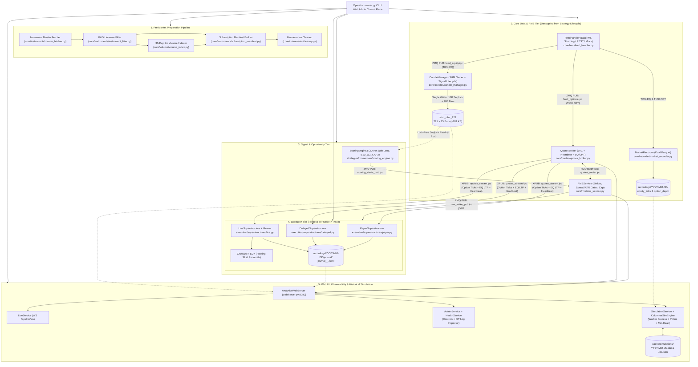

# High-Level Design (HLD) Specification 2.0: Modular Distributed Trading Engine

> **Document Type**: High-Level System Architecture & Operational Guide  
> **Version**: 2.1 (Distributed Multi-Process, POSIX/mmap SHM, ZeroMQ IPC, Core-Decoupled RMS, Web Control Plane & Sim Disk Cache)  
> **Last Updated**: 2026-11-28 | **Status**: Active Source-of-Truth Specification  
> **Companion Specs**: [`LOW_LEVEL_DESIGN_2_0.md`](file:///Users/yorha/Documents/Trading%20Stuff/docs/sys/LOW_LEVEL_DESIGN_2_0.md) | [`SCORING_ENGINE_3_0.md`](file:///Users/yorha/Documents/Trading%20Stuff/docs/sys/SCORING_ENGINE_3_0.md) | [`EXECUTION_TRACKS.md`](file:///Users/yorha/Documents/Trading%20Stuff/docs/sys/EXECUTION_TRACKS.md) | [`WEB_VIEW_FLOW.md`](file:///Users/yorha/Documents/Trading%20Stuff/docs/sys/WEB_VIEW_FLOW.md)  
> **Archived ADRs**: [`2026-11-28_ADR_SPEC_2_0.md`](file:///Users/yorha/Documents/Trading%20Stuff/docs/archive/2026-11-28_ADR_SPEC_2_0.md) | **Roadmap / Done**: [`IMPROVEMENTS.md`](file:///Users/yorha/Documents/Trading%20Stuff/docs/live/IMPROVEMENTS.md), [`TASKS_DONE.md`](file:///Users/yorha/Documents/Trading%20Stuff/docs/live/TASKS_DONE.md)

---

## Executive Overview

This platform is an event-driven, multi-process algorithmic trading system engineered for Indian NSE equities and F&O derivatives (`Upstox API v2/v3` for market ingestion and `Groww Trading SDK` for live execution), paired with a tick-accurate historical backtester and an institutional browser command center.

The architecture eliminates single-process GIL contention and option-tick flood by separating market data ingestion, 5-minute candle aggregation, option quote caching, breakout detection, strike/risk qualification, trade execution, and web telemetry into **independent OS processes** communicating over **MessagePack ZeroMQ IPC sockets** and **lock-free Seqlock Shared Memory (`shm_ohlc_221`)**.

---

## 1. High-Level System Architecture



---

## 2. Repository Structure & Runtime Artifacts

```text
Trading Stuff/
├── runner.py                             # Unified CLI entrypoint (prepare, core, start, web, sim, replay, status, stop, test)
├── config/
│   ├── system.json                       # IPC socket URLs, buffer sizes, SHM parameters, log thresholds
│   ├── instruments.json                  # Exchange filters, WS shard caps, manifest/filtered paths
│   ├── execution.json                    # paper, paper_delayed, sim, live (Groww) parameters & freeze times
│   ├── strategies.json                   # Scoring Engine 3.0 (E10_W3_CAP3), option_convexity_scaling, risk gates
│   └── tracks/
│       ├── default.json                  # Active 21-track ensemble (12 v1 + 9 v2 tracks)
│       ├── v1.json                       # 12 baseline tracks (9 base + 3 composite_shared_*)
│       └── v2.json                       # 9 active multi-regime v2 tracks (including 2 ratcheted tracks)
├── core/
│   ├── auth/                             # Upstox OAuth & Groww TOTP token generators
│   ├── candles/                          # CandleManager & SHM layout/lifecycle signaling (shm_layout.py)
│   ├── common/                           # ipc_schemas.py, logging_utils.py (IST), symbol_utils.py, time_utils.py
│   ├── config/                           # ConfigManager & trading calendar/schedule helpers
│   ├── feed/                             # Dual-WS FeedHandler, Upstox protobuf parser, ProtectedPositionRegistry, Replay
│   ├── instruments/                      # Instrument master sync, F&O filter, subscription manifest, cleanup
│   ├── ops/                              # Canonical operational helpers shared between runner.py & Web Admin
│   ├── quotes/                           # QuotesBroker (LVC, reference-counted XPUB streams, REQ/REP snapshots)
│   ├── recorder/                         # Lossless dual-stream Parquet MarketRecorder
│   ├── rms/                              # Decoupled RMSService (strike resolution, gates, daily alert cap) & ModeRiskManager
│   └── volume/                           # 30-day 1m baseline volume indexer
├── strategies/
│   └── momentum/                         # ScoringEngine3 (SHM spin-loop) & OpportunityPool
├── common/
│   ├── interfaces.py                     # ExecutionContext, OrderRequest/Result, TradeState (with origin_track/sub_track_rule)
│   └── tracks/                           # BaseTrack, CompositeTrack, v1/v2 tracks + VolatilityExpansionRatchet & AdaptiveRegimeRatchet
├── execution/
│   └── superstructures/                  # BaseSuperstructure (--continue recovery & quarantine), Paper, Delayed, Live
├── simulation/
│   └── columnar_sim_engine.py            # Event-driven chronological min-heap backtester (Polars + SHM + production parity)
├── web/
│   ├── server.py                         # aiohttp HTTP + WebSocket API server
│   ├── live_service.py                   # Live MTM streamer & journal aggregator
│   ├── historical_service.py             # Past-session journal reader & overview API
│   ├── alert_service.py                  # Live/historical setup alerts & SHM candle overlay
│   ├── candle_service.py                 # 5m OHLCV aggregation for UI modals
│   ├── simulation_service.py             # Multiprocess simulation orchestration & batch history
│   ├── sim_disk_cache.py                 # Per-(date, mode, track) fixed-slot binary disk cache & index
│   ├── batch_analytics.py                # Cross-session leaderboard, drawdown, Calmar & CSV/MD export
│   ├── regime_classifier.py              # Session market regime classifier & cache
│   ├── admin_service.py                  # Operational UI control plane & audit log
│   ├── health_service.py                 # Process/IPC/SHM liveness probes & IST log inspector
│   └── static/                           # Hamburger-collapsible sidebar SPA & charts
├── ui/                                   # Legacy curses dashboard (retired in favor of Web UI)
├── scripts/                              # Distributed process launcher (run_distributed.py) & experiment runners
├── data/
│   ├── index/                            # 30-day volume indices (index.json, index_YYYYMMDD.json)
│   └── manifest/                         # Generated WS/poll subscription manifests
├── logs/
│   ├── alerts/                           # Setup alerts archives (alerts_YYYY-MM-DD.jsonl)
│   ├── exec_logs/                        # Service logs (*.log in standardized IST format)
│   ├── trade_journals/                   # Execution CSV/JSONL archives
│   ├── pids.json                         # Live distributed process registry
│   └── active_positions.json             # ProtectedPositionRegistry persistence
├── recordings/YYYY-MM-DD/
│   ├── equity_ticks.parquet              # Lossless cash equity ticks
│   ├── option_depth.parquet              # Lossless 5-level option order book ticks
│   └── journal/                          # Session trade journals (journal_<mode>_<track>.jsonl + quarantined_legacy_trades.jsonl)
├── cache/simulations/                    # Per-date append-only fixed-slot binary caches (*.dat & *.idx.json)
├── docs/
│   ├── sys/                              # Source-of-truth HLD, LLD, Scoring 3.0, Execution Tracks, Web View Flow
│   ├── live/                             # TASKS_DONE.md, IMPROVEMENTS.md, benchmarks & empirical studies
│   └── archive/                          # ADRs, historical evolution docs & superseded audits
└── tests/                                # Automated unittest suites across 28 test files (171 tests)
```

---

## 3. Core Data Tier, IPC & Shared Memory

### 3.1 Dual-WebSocket Sharded Ingestion (`core/feed/`)
- **Hard Strike Cap Compliance**: Upstox v3 limits each WebSocket connection to 2,000 subscribed keys. `FeedHandler` runs **two parallel WebSocket connections**, deterministically sharding the ~215 NSE F&O equities (plus pinned `NIFTY` / `NIFTY 50` on Connection 0) via `zlib.crc32(symbol) % num_connections` alongside their dynamic ATM $\pm 3$ CE/PE chains.
- **Strict Stream Split**: Underlying cash equity ticks emit on `ipc:///tmp/feed_equity.ipc` (`TICK.EQ`); 5-level option book updates emit on `ipc:///tmp/feed_options.ipc` (`TICK.OPT`). Analytical candle/scoring components never process raw option noise.
- **Protected Position Guard**: [`ProtectedPositionRegistry`](file:///Users/yorha/Documents/Trading%20Stuff/core/feed/position_registry.py) tracks active contracts in `logs/active_positions.json` across `live`, `paper`, and `paper_delayed`, preventing dynamic ATM shifting from unsubscribing open trades.

### 3.2 Shared Memory Layout & Signal Lifecycle (`core/candles/`)
- **Deterministic Buffer**: `CandleManager` owns `shm_ohlc_221` across `221` F&O symbols × `75` five-minute bars/day (`09:15–15:30 IST`). Each symbol begins with a 16-byte `SEQLOCK_DTYPE` header followed by `75 × 48B` `CANDLE_DTYPE` structs (**`799,136` bytes total ≈ `780 KB`**, L2-cache resident on Linux with `FORCE_POSIX_SHM=1` under `/dev/shm`, and backed by mmap `/tmp/shm_ohlc_221.shm` via `MmapSharedMemoryAdapter` on macOS/sandboxes).
- **Lock-Free Reads**: `ScoringEngine3` and `AlertService` validate matching odd/even sequence counters before and after reading structs in under $2\ \mu\text{s}$.
- **Explicit Consumer Signaling**: `SHM_CONSUMER_ROLES` (`scoring_engine`, `web_server`) handle `SHM_SIGNAL_DETACH` (`SIGUSR1`) and `SHM_SIGNAL_REATTACH` (`SIGUSR2`). When `CandleManager` starts/restarts or stops, or when health checks clean an orphaned SHM while `CandleManager` is offline, live consumers cleanly release and reattach handles without interfering with `exec_*` processes (where `SIGUSR1`/`SIGUSR2` control freeze/unfreeze).

### 3.3 Ticker Plant & Core-Decoupled RMS (`core/quotes/`, `core/rms/`)
- **`QuotesBroker`**: Maintains an in-memory Last Value Cache (`LVC`), answers synchronous `REQ/REP` snapshots (`ipc:///tmp/quotes_router.ipc`), and streams ref-counted `QUOTE.*`, equity LTP updates, and 1.0s `HEARTBEAT` messages over `ipc:///tmp/quotes_stream.ipc`.
- **Decoupled `RMSService`**: Runs independently in the Core tier (`runner.py core --rms` or standalone `rmsservice`), resolves `ITM2..OTM2` contracts against live quotes, enforces `max_spread_pct = 0.03` (3%), ATR-vs-spread move guard (`atr_spread_gate_mult = 2.0`), zero synthetic quote fabrication, and daily alert cap (`max_alerts_per_symbol_per_day = 3`), publishing `ActionableOpportunity` packets on `OPP.<strategy_id>.<symbol>`.

---

## 4. Alpha Detection, Execution Tracks & Risk Governance

### 4.1 Scoring Engine 3.0 (`E10_W3_CAP3`)
- Full quantitative rules live in [`SCORING_ENGINE_3_0.md`](file:///Users/yorha/Documents/Trading%20Stuff/docs/sys/SCORING_ENGINE_3_0.md).
- Operates a 200 Hz lock-free spin-loop over `shm_ohlc_221` evaluating two binary price-action archetypes:
  1. **Structured Flag Breakout / Breakdown**: 1–3 bar impulsive pole + 2–5 bar tight consolidation (50% retracement invariant tested first, top-25% pole height zone buffer) breaking OLS resistance/support with $\text{RoV} \ge 2.0\times$ and $\text{CLV} \ge 0.75$.
  2. **Pure 3-Candle Impulse**: Directional breakout beyond the 3-bar extreme with $\ge 0.45\%$ 3-bar expansion, minimum 15s candle dwell time (`min_candle_elapsed_sec = 15.0`), $\text{rVOL} \ge 2.0\times$, and $\text{CLV} \ge 0.75$.
- Alerts are deduplicated and prioritized by `rVOL` descending inside `OpportunityPool` before hitting `RMSService`.

### 4.2 Execution Tracks, Composite Determinism & Convexity Scaling
- Full catalog lives in [`EXECUTION_TRACKS.md`](file:///Users/yorha/Documents/Trading%20Stuff/docs/sys/EXECUTION_TRACKS.md).
- **21 Active Default Tracks** (`config/tracks/default.json`):
  - **v1 (`12` tracks)**: `fast_momentum_{ITM,ATM,OTM}`, `trend_pullback_{ITM,ATM,OTM}`, `fixed_target_{ITM,ATM,OTM}`, and `composite_shared_{ITM,ATM,OTM}`.
  - **v2 (`9` tracks)**: `structural_convexity_ATM`, `opening_thrust_convex_ATM`, `delta_scalp_ITM2`, `micro_chandelier_ITM1`, `volatility_expansion_ATM`, `volatility_expansion_ratchet_ATM` (progressive stepped trail), `adaptive_regime_ATM`, `adaptive_regime_ratchet_ATM` (per-phase stepped trail), and `trend_pullback_v2_ITM1` (`gamma_runner_OTM2` retired from default presets).
- **Proportional Option Convexity Scaling**: On every entry, `BaseTrack` computes `convexity_scale = clip(reference_premium_pct / prem_pct, min_scale=0.45, max_scale=1.25)` and scales **not only targets and spread-floored stop-losses**, but also `breakeven_trigger_pct`, `trailing_step_pct`, tiered ratchets, `FastMomentum` decay slopes, and stagnation/velocity profit floors so pre-expiry and post-expiry sessions maintain consistent exit geometry.
- **Composite `origin_track` Determinism**: Every `TradeState` persists `origin_track` and `sub_track_rule` across journals (`recordings/<date>/journal/`). During `--continue` recovery, `CompositeTrack.add_recovered_trade()` strictly validates attribution and quarantines ambiguous legacy records into `quarantined_legacy_trades.jsonl`.
- **Mode Isolation & Live Groww Guardrails**: Every `(mode, track)` executes in its own child process (`execution/superstructures/`). Live execution uses `GrowwAPI` with resting broker SL orders, automatic replace-before-25 modifications, broker position reconciliation (`reconcile`), and universal disk + ZMQ freeze controls (`runner.py freeze / stop-live`).

---

## 5. Columnar Backtesting & Fixed-Slot Disk Cache

- **`ColumnarSimEngine` (`simulation/columnar_sim_engine.py`)**: Loads recorded Parquet streams once per worker job and runs an event-driven chronological min-heap interleaving every equity tick, option depth tick, delayed order fill, and 1.0s heartbeat with production scoring/RMS/track code parity.
- **Append-Only Fixed-Slot Cache (`web/sim_disk_cache.py`)**: Persists both `paper` and `paper_delayed` track outputs under `cache/simulations/<YYYY-MM-DD>.dat` + `<YYYY-MM-DD>.idx.json`, keyed by `(date, mode, track_name, track_config, mode_global_settings, data_fingerprint)` (`cache_schema = 2`).
- Each slot uses a fixed 256-byte binary header (`HEADER_STRUCT`, CRC32-verified) and fixed `262,144`-byte aligned frames so partial track subsets reuse unchanged tracks from disk, new tracks append cleanly to EOF, and Cold Runs (`cold_run_modes`) overwrite matching slots in-place without shifting neighbors.

---

## 6. Operational Plane, Structured IST Logging & Verification

- **CLI & Web Control Plane parity (`core/ops/operations.py`)**: Both `runner.py` and the Web UI **Admin Control Plane** share canonical operations for Pre-Market steps, selective Core launches, granular per-`(mode, track)` Strategy starts/stops, Groww TOTP auth refresh, Freeze/Unfreeze, REST-fallback toggle, Broker Reconciliation, and Post-Market archival/pruning.
- **IST Structured Logging & System Health**: [`core/common/logging_utils.py`](file:///Users/yorha/Documents/Trading%20Stuff/core/common/logging_utils.py) formats all daemon and web logs as `[YYYY-MM-DD HH:MM:SS.mmm IST] [LEVEL] [LOGGER] Message` under `logs/exec_logs/`. [`HealthService`](file:///Users/yorha/Documents/Trading%20Stuff/web/health_service.py) surfaces process/IPC/SHM liveness and triggers immediate **RED** banners on logged `ERROR`/`CRITICAL` entries.
- **Automated Verification**: `.venv/bin/python runner.py test` runs **`171` unit/integration tests** across **`28` test files** in `tests/` (`core`, `common`, `execution`, `strategies`, `simulation`, `ui`).
