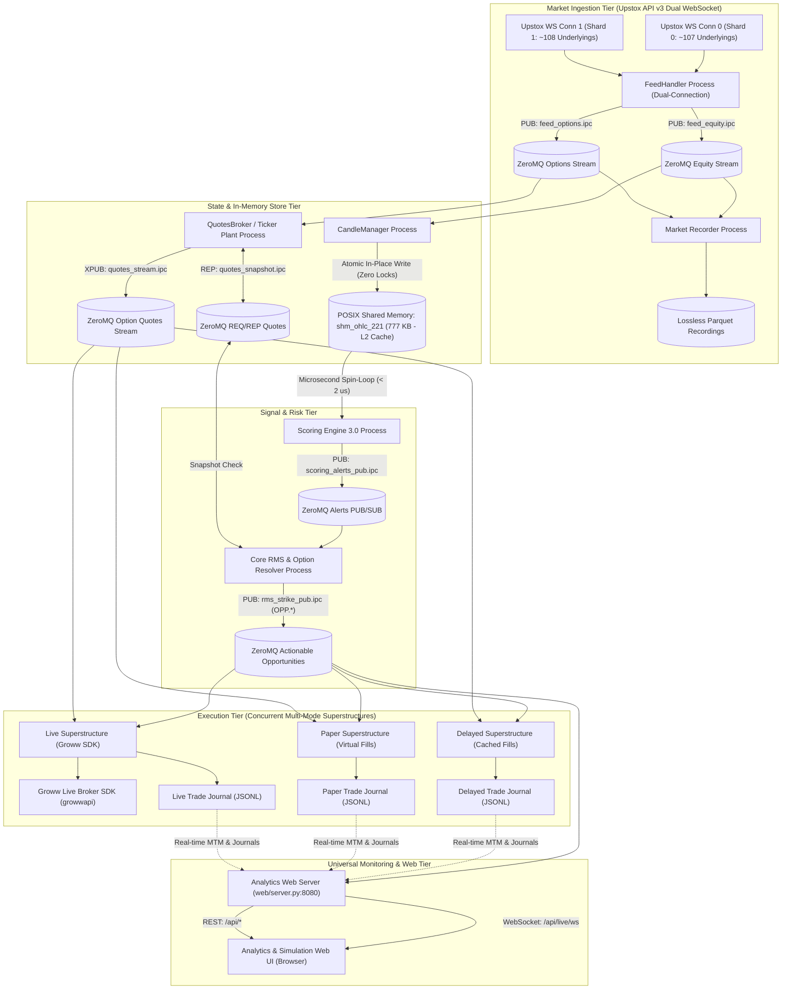
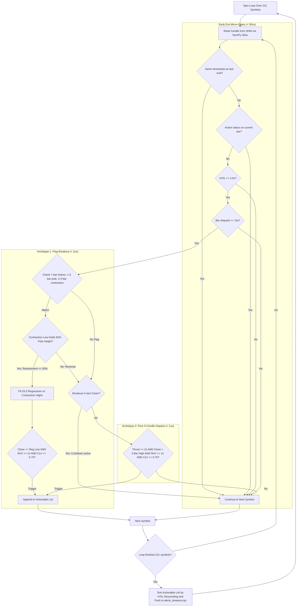
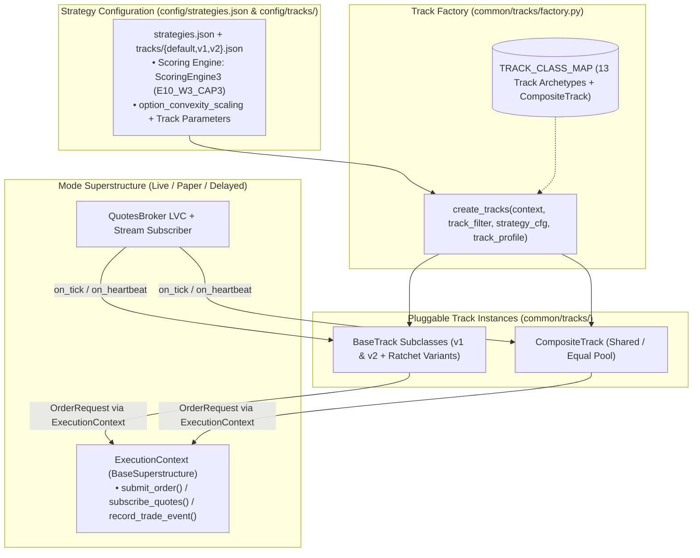

# Low-Level Design (LLD) Specification 2.0: Modular Distributed Trading Engine

> **Document Type**: Low-Level Engineering & Implementation Specification  
> **Version**: 2.1 (Distributed Multi-Process, Core-Decoupled RMS, Scoring Engine 3.0 & Sim Disk Cache)  
> **Status**: Active Implementation Specification  
> **Master HLD**: [`HIGH_LEVEL_DESIGN_2_0.md`](file:///Users/yorha/Documents/Trading%20Stuff/docs/sys/HIGH_LEVEL_DESIGN_2_0.md)  
> **Signal & Track Specs**: [`SCORING_ENGINE_3_0.md`](file:///Users/yorha/Documents/Trading%20Stuff/docs/sys/SCORING_ENGINE_3_0.md) | [`EXECUTION_TRACKS.md`](file:///Users/yorha/Documents/Trading%20Stuff/docs/sys/EXECUTION_TRACKS.md) | [`WEB_VIEW_FLOW.md`](file:///Users/yorha/Documents/Trading%20Stuff/docs/sys/WEB_VIEW_FLOW.md)  
> **Last Updated**: 2026-11-28 | **Archived ADRs / Audits**: [`2026-11-28_ADR_SPEC_2_0.md`](file:///Users/yorha/Documents/Trading%20Stuff/docs/archive/2026-11-28_ADR_SPEC_2_0.md), [`2026-11-25_SYSTEM_AUDIT_2_0.md`](file:///Users/yorha/Documents/Trading%20Stuff/docs/archive/2026-11-25_SYSTEM_AUDIT_2_0.md)

---

## 1. System Architecture & Component Topology

The system transitions from a single-threaded synchronous monolith into a distributed, multi-process, low-latency architecture connected by **POSIX Shared Memory** and **ZeroMQ Inter-Process Communication (IPC)**.



---

## 2. Directory Hierarchy & Codebase Layout

```
Trading Stuff/
├── core/
│   ├── auth/
│   │   ├── upstox_auth.py             # Upstox OAuth token lifecycle & REST rate-limit helpers
│   │   └── groww_auth.py              # Groww TOTP / access-token refresh helper
│   ├── common/
│   │   ├── ipc_schemas.py             # MessagePack wire dataclasses (Tick/Quote/Alert/Opportunity/Order)
│   │   ├── logging_utils.py           # Standardized IST logger ([YYYY-MM-DD HH:MM:SS.mmm IST] [LEVEL])
│   │   ├── symbol_utils.py            # Canonical instrument keys & strike parsing
│   │   └── time_utils.py              # IST timezone helpers & strict HH:MM time normalization
│   ├── config/
│   │   ├── config_loader.py           # Unified ConfigManager loading config/*.json & config/tracks/*.json
│   │   └── trading_schedule.py        # NSE/MCX session schedule helpers
│   ├── feed/
│   │   ├── event_schema.py            # Normalized feed event models
│   │   ├── feed_handler.py            # Dual-WS Upstox ingestion (TICK.EQ / TICK.OPT), REST & mock modes
│   │   ├── upstox_listener.py         # Upstox WS/REST feed transport & dynamic ATM windowing
│   │   ├── historical_replay.py       # Deterministic Parquet tick playback into IPC
│   │   └── position_registry.py       # ProtectedPositionRegistry persisted in logs/active_positions.json
│   ├── instruments/
│   │   ├── master_fetcher.py          # Upstox instrument CSV download & validation
│   │   ├── instrument_filter.py       # NSE/MCX F&O active universe filter (data/filtered.csv)
│   │   ├── subscription_manifest.py   # Sharded WS & poll manifest builder (data/manifest/)
│   │   └── cleanup.py                 # Stale CSV/log maintenance helper
│   ├── ops/
│   │   └── operations.py              # Shared operational routines (CLI + Web Admin control plane)
│   ├── recorder/
│   │   └── market_recorder.py         # Dual-stream Parquet MarketRecorder (equity_ticks & option_depth)
│   ├── candles/
│   │   ├── shm_layout.py              # CANDLE_DTYPE (48B), SEQLOCK_DTYPE (16B), MmapAdapter & SHM signals
│   │   └── candle_manager.py          # 5m OHLCV builder, Wilder ATR(14), linear-extrapolated rVOL
│   ├── quotes/
│   │   └── quotes_broker.py           # Ticker plant: LVC, ref-counted XPUB + EQ/OPT, REQ/REP snapshots
│   ├── rms/
│   │   ├── rms_service.py             # Core-decoupled RMS: strike grid, 3%/ATR spread gates, 3/sym/day cap
│   │   └── mode_risk.py               # Per-mode drawdown tracking & circuit-breaker guard
│   └── volume/
│       └── volume_index.py            # 30-day 1m median volume profiler -> data/index/index*.json
├── strategies/
│   └── momentum/
│       ├── scoring_engine.py          # 200Hz SHM spin-loop detector (Flag & Pure 3-Bar Impulse)
│       └── opportunity_pool.py        # Deduplication & rVOL priority ranking
├── execution/
│   └── superstructures/
│       ├── base_superstructure.py     # IPC subscriber, --continue recovery & legacy quarantine
│       ├── paper.py                   # Immediate Best-Ask paper superstructure
│       ├── delayed.py                 # Stream-driven delayed superstructure with prevailing quote fills
│       └── live.py                    # GrowwAPI SDK live superstructure (resting SL, 25-mod replace, reconcile)
├── web/
│   ├── server.py                      # AnalyticsWebServer (aiohttp HTTP + WS server)
│   ├── live_service.py                # LiveService (ZeroMQ LVC, real-time MTM, budget tracking)
│   ├── historical_service.py          # HistoricalService (session & journal parser under recordings/<date>/journal/)
│   ├── alert_service.py               # AlertService (SHM candle read + logs/alerts/ overlay)
│   ├── candle_service.py              # CandleService (5m OHLCV aggregation)
│   ├── simulation_service.py          # Multiprocess simulation & batch orchestrator
│   ├── sim_disk_cache.py              # Fixed-slot append-only binary disk cache (cache/simulations/*.dat/.idx.json)
│   ├── batch_analytics.py             # Cross-session leaderboard, drawdown, Calmar & CSV/MD exporters
│   ├── regime_classifier.py           # Session market regime classifier & cache
│   ├── admin_service.py               # Operational Web UI control plane (logs/admin_audit.jsonl)
│   ├── health_service.py              # Process/IPC/SHM liveness probes & IST log inspector
│   └── static/                        # Browser SPA (collapsible sidebar, Admin Ops, System Health, Sim Lab)
├── common/
│   ├── interfaces.py                  # ExecutionContext, OrderRequest/Result, TradeState (origin_track)
│   └── tracks/                        # BaseTrack (convexity_scale propagation), CompositeTrack, v1 & v2 tracks, factory.py
├── simulation/
│   └── columnar_sim_engine.py         # Event-driven chronological min-heap backtester (Polars + isolated SHM)
├── config/
│   ├── system.json, instruments.json, execution.json, strategies.json
│   └── tracks/                        # Presets: default.json (21), v1.json (12), v2.json (9)
├── data/, logs/, recordings/, cache/  # Runtime artifacts: index/, manifest/, alerts/, exec_logs/, journal/, simulations/
├── docs/                              # sys/ (HLD, LLD, Scoring, Tracks, Web), live/, archive/
├── runner.py                          # Unified CLI Orchestrator
└── scripts/                           # run_distributed.py process supervisor & experiment harnesses
```

---

## 3. Data Schemas & Binary Layouts

### 3.1 POSIX Shared Memory Layout (`shm_ohlc_221`)

The shared memory block is fixed-size and pre-allocated at startup. It holds candles for all 221 F&O stocks across a dedicated **5-minute timeframe (75 bars/day)**.

#### Exact NumPy Structured DType (`CANDLE_DTYPE`):
```python
import numpy as np

CANDLE_DTYPE = np.dtype([
    ('timestamp', '<i8'),   # 8 bytes: Unix timestamp in seconds (int64)
    ('open',      '<f4'),   # 4 bytes: Open price (float32)
    ('high',      '<f4'),   # 4 bytes: High price (float32)
    ('low',       '<f4'),   # 4 bytes: Low price (float32)
    ('close',     '<f4'),   # 4 bytes: Close / Current LTP (float32)
    ('volume',    '<u8'),   # 8 bytes: Cumulative bar volume (uint64)
    ('rvol',      '<f4'),   # 4 bytes: Strict Current Candle rVOL (float32)
    ('atr',       '<f4'),   # 4 bytes: 14-period Average True Range (float32)
    ('is_closed', '?'),       # 1 byte:  Boolean flag (True if bar finished, False if active)
    ('reserved', '<u1', (7,)) # 7 bytes: Explicit padding to align struct to 48 bytes
], align=False)

assert CANDLE_DTYPE.itemsize == 48, f"DType size must be 48 bytes, got {CANDLE_DTYPE.itemsize}"
```

#### Memory Sizing & Slicing:
$$\text{Candle Data} = 221 \times 75 \times 48 = 795,600\text{ bytes}, \quad \text{Headers} = 221 \times 16 = 3,536\text{ bytes}, \quad \text{Total SHM} = \mathbf{799,136\text{ bytes} \approx 780\text{ KB}}$$
- Fits inside L2 cache when run with POSIX shared memory (`FORCE_POSIX_SHM=1` under Linux `/dev/shm`); defaults cleanly to `/tmp/shm_ohlc_221.shm` via `MmapSharedMemoryAdapter` on macOS/sandboxes.
- **Signal-Driven Consumer Lifecycle**: [`core/candles/shm_layout.py`](file:///Users/yorha/Documents/Trading%20Stuff/core/candles/shm_layout.py) defines `SHM_SIGNAL_DETACH = SIGUSR1`, `SHM_SIGNAL_REATTACH = SIGUSR2`, and `SHM_CONSUMER_ROLES = {"scoring_engine", "web_server"}`. On `CandleManager` start/restart/stop (or health probe cleanup when `candle_manager` is offline), live SHM consumers detach and reattach safely without affecting `exec_*` processes.
- **Zero Cache Thrashing**: Data for all 221 symbols across the entire trading day resides directly within the CPU's fastest on-die cache.
- **Index Lookup Formula**:
  $$\text{Row Index} = \text{Symbol Index} \times 75 + \text{Bar Index}$$
  - Where `Bar Index` runs from $0 \dots 74$ ($09:15 \dots 15:30$ IST).
- **Seqlock Memory Synchronization Protocol (Lightweight Zero-Mutex Sync)**:
  To eliminate torn reads during in-place bar mutations without paying the steep cost of OS mutexes or semaphore context switches, `shm_layout.py` pre-allocates a 16-byte `SEQLOCK_DTYPE` header per symbol:
  ```python
  SEQLOCK_DTYPE = np.dtype([
      ("sequence_id", "<u8"),     # 8 bytes: sequence counter (odd = updating, even = stable)
      ("last_update_ns", "<i8"),  # 8 bytes: nanosecond timestamp of last tick
  ], align=False)
  ```
  - **Single Writer Protocol (`CandleManager`)**:
    1. Read current `seq = headers[idx]["sequence_id"]`.
    2. Mark write in-progress: `headers[idx]["sequence_id"] = seq + 1` (odd).
    3. Write candle values in-place (`close, high, low, volume, rvol, atr`).
    4. Mark write complete: `headers[idx]["sequence_id"] = seq + 2` (even).
  - **Lock-Free Reader Protocol (`ScoringEngine3`)**:
    1. Read `seq1 = headers[idx]["sequence_id"]`. If `seq1 & 1` (odd), writer is updating; spin/retry.
    2. Copy 48-byte candle data from Shared Memory into local register/stack.
    3. Read `seq2 = headers[idx]["sequence_id"]`.
    4. If `seq1 == seq2`, the read was atomic, consistent, and untorn.
    5. If `seq1 != seq2`, writer mutated data during copy; discard and retry (up to 10 iterations, typical retry count: 0).

#### Lifecycle & Process Ownership (Creator vs. Readers):
- **Why `prepare` Does NOT Allocate SHM**: If a short-lived CLI command like `prepare` creates a Python `SharedMemory` segment and terminates, Python's internal `resource_tracker` daemon automatically unlinks the memory from the OS.
- **`CandleManager` as Creator & Owner**:
  The `CandleManager` is the Single Writer and stays running throughout the trading session. It creates the segment on startup:
  ```python
  # In core/candles/candle_manager.py (Single Writer)
  from multiprocessing.shared_memory import SharedMemory
  
  try:
      self.shm = SharedMemory(name="shm_ohlc_221", create=True, size=795600)
  except FileExistsError:
      # Attach and clean legacy segment if orphaned from abnormal crash
      self.shm = SharedMemory(name="shm_ohlc_221", create=False)
      self.shm.unlink()
      self.shm = SharedMemory(name="shm_ohlc_221", create=True, size=795600)
      
  self.candles = np.ndarray((221, 75), dtype=CANDLE_DTYPE, buffer=self.shm.buf)
  self.candles[:] = 0  # Zero-initialize
  ```
- **`ScoringEngine3` as Lock-Free Reader**:
  The scoring engine attaches to the named segment without creating it (`create=False`):
  ```python
  # In strategies/momentum/scoring_engine.py (Lock-Free Reader)
  import time
  from multiprocessing.shared_memory import SharedMemory
  
  # Retry loop waiting for CandleManager to initialize SHM
  for _ in range(30):
      try:
          self.shm = SharedMemory(name="shm_ohlc_221", create=False)
          break
      except FileNotFoundError:
          time.sleep(0.5)
  else:
      raise RuntimeError("FATAL: CandleManager SHM 'shm_ohlc_221' not found. Is CandleManager running?")
      
  self.candles = np.ndarray((221, 75), dtype=CANDLE_DTYPE, buffer=self.shm.buf)
  ```
- **Strategy Restart Decoupling**: If strategy execution is stopped, updated, or restarted, `CandleManager` continues running uninterrupted. The shared memory segment remains intact, and the newly spawned scoring process attaches immediately without loss of intraday OHLCV history.

---

### 3.2 ZeroMQ Wire Protocols & Serialization

All inter-process messages utilize MessagePack (`msgpack`) for sub-microsecond binary serialization without JSON string parsing overhead.

#### A. Equity Feed (`feed_equity.ipc`)
- **Pattern**: ZeroMQ `PUB` / `SUB`
- **Topic**: `EQ.<token>` (e.g., `EQ.2885` for Reliance)
- **Payload (`msgpack`)**:
  ```python
  {
      "token": 2885,           # int: Instrument token
      "ltp": 2542.50,          # float: Last Traded Price
      "vol": 1254000,          # int: Cumulative day volume
      "ts": 1700000000         # int: Timestamp (seconds)
  }
  ```

#### B. Options Feed (`feed_options.ipc`)
- **Pattern**: ZeroMQ `PUB` / `SUB`
- **Topic**: `OPT.<token>`
- **Payload (`msgpack`)**:
  ```python
  {
      "token": 45120,          # int: Option instrument token
      "ltp": 85.50,            # float: Last Traded Price
      "bid": 85.40,            # float: Best Bid Price
      "ask": 85.55,            # float: Best Ask Price
      "bid_qty": 1800,         # int: Best Bid Quantity
      "ask_qty": 2250,         # int: Best Ask Quantity
      "oi": 450000,            # int: Open Interest
      "ts": 1700000000         # int: Timestamp (seconds)
  }
  ```

#### C. Scoring Alerts (`scoring_alerts_pub.ipc`)
- **Pattern**: ZeroMQ `PUB` (Scoring Engine) / `SUB` (RMS Service & Web Alerts)
- **Topic / Payload (`SetupAlert` Msgpack)**:
  ```python
  {
      "alert_id": "ALT_RELIANCE_1700000300",
      "symbol": "TATAMOTORS",
      "direction": "BULL",               # "BULL" or "BEAR"
      "archetype": "FLAG_BULL_BREAKOUT", # or "PURE_BULL_BREAKOUT", etc.
      "trigger_price": 685.20,
      "rvol": 3.42, "clv": 0.85, "atr": 4.2,
      "flag_high": 686.0, "flag_low": 682.5,
      "timestamp": 1700000300.5,
      "strategy_id": "momentum", "strategy_tags": {}
  }
  ```

#### D. Quotes Broker SNAPSHOT & STREAM
- **Snapshot & Dynamic Sub/Unsub (`quotes_router.ipc`)**:
  - **Pattern**: ZeroMQ `ROUTER` (QuotesBroker) / `DEALER` (Superstructures & RMS)
  - **Requests**:
    - `{"action": "GET_QUOTES", "tokens": ["NSE:45120"], "best_depth": true}` (Queries snapshot with 1-lot `best_depth=True` or full 5-level `best_depth=False`)
    - `{"action": "SUBSCRIBE", "tokens": ["NSE:45120"], "client_id": "paper"}` (Registers subscription with client identification)
    - `{"action": "UNSUBSCRIBE", "tokens": ["NSE:45120"], "client_id": "paper"}` (Decrements client subscription reference count)
  - **Multi-Client Reference Counting**:
    - `QuotesBroker` maintains `subscribers_by_token[token] = set(client_ids)` where `ref_count = len(subscribers_by_token[token])`.
    - Multiple concurrent superstructures (`paper`, `paper_delayed`, `live`) can hold open trades on the same strike concurrently.
    - When one mode exits and unsubs, `QuotesBroker` decrements that mode's subscription. Only when `ref_count == 0` (all holding superstructures have exited) does `QuotesBroker` stop broadcasting ticks for that contract.
  - **Response**:
    ```python
    {
        "status": "SUCCESS",
        "subscribed_tokens": ["NSE:45120"],
        "ref_counts": {"NSE:45120": 2},
        "quotes": {
            "NSE:45120": {"token": "NSE:45120", "ltp": 85.5, "bid": 85.4, "ask": 85.55, "bid_qty": 1800, "ask_qty": 2250, "timestamp": 1700000300}
        }
    }
    ```
- **Stream (`quotes_stream.ipc`)**:
  - **Pattern**: ZeroMQ `PUB` (QuotesBroker) / `SUB` (Superstructures)
  - **Topic**: `QUOTE.<token>` or `HEARTBEAT`
  - **Payload (`msgpack`)**:
    ```python
    {
        "token": "NSE:45120",
        "symbol": "TATAMOTORS",
        "ltp": 85.5,
        "bid": 85.4,
        "ask": 85.55,
        "bid_qty": 1800,
        "ask_qty": 2250,
        "timestamp": 1700000301
    }
    ```
  - **Heartbeat Payload**:
    ```python
    {
        "type": "HEARTBEAT",
        "timestamp": 1700000301,
        "active_quotes_count": 3500,
        "subscribed_count": 14,
        "ref_counts": {"NSE:45120": 2}
    }
    ```

#### E. RMS Resolved Candidate Strikes (`rms_strike_pub.ipc`)
- **Pattern**: ZeroMQ `PUB` (RMS) / `SUB` (Superstructures & Web Server)
- **Topic**: `OPP.<strategy_id>.<symbol>` (e.g. `OPP.momentum.TATAMOTORS`)
- **Payload (`ActionableOpportunity` Msgpack)**:
  Includes `opp_id`, `alert_id`, `symbol`, `direction`, `archetype`, `trigger_price`, `strikes` (`ITM2`, `ITM1`, `ATM`, `OTM1`, `OTM2`), `timestamp`, `flag_high`/`flag_low`, `pole_high`/`pole_low`, `atr`, `rvol`, `clv`, `strategy_id`, and `strategy_tags` ([`core/common/ipc_schemas.py`](file:///Users/yorha/Documents/Trading%20Stuff/core/common/ipc_schemas.py)).

---

## 4. Component Implementation Specifications

### 4.1 FeedHandler (`core/feed/feed_handler.py`)
- **Objective**: Multi-source market data ingestion engine (Upstox WebSocket v3 Protobuf, high-speed REST poller failover, and Mock engine) with strict separation of Cash Equities and Derivatives Options onto two physically distinct ZeroMQ IPC sockets:
  - `feed_equity_ipc` (`ipc:///tmp/feed_equity.ipc`): Broadcasts `TICK.EQ` (consumed exclusively by `CandleManager` and `MarketRecorder`).
  - `feed_options_ipc` (`ipc:///tmp/feed_options.ipc`): Broadcasts `TICK.OPT` (consumed exclusively by `QuotesBroker` and `MarketRecorder`).
- **Dual WebSocket Partitioning & Deterministic Sharding**:
  - Upstox API v3 enforces a hard limit of **2,000 keys per WebSocket connection**.
  - `FeedHandler` runs `num_connections=2` parallel WebSocket connections:
    - Symbols are partitioned using deterministic consistent hashing: `zlib.crc32(symbol.encode("utf-8")) % num_connections`.
    - `NIFTY` and `NIFTY 50` are pinned to Connection 0.
    - Result: Exactly 107 underlyings on Connection 0 and 108 on Connection 1. Total streamed keys across all 221 underlyings is **3,224 keys** (~1,612 per connection), staying well under the 1,800 configured limit and 2,000 Upstox ceiling.
- **Dynamic Strike Subscription & Capacity Management**:
  - `FeedHandler` maintains a dynamic **Popular Options Window**:
    - Evaluates ATM strike on underlying price updates: $K_{\text{atm}} = \arg\min_K |K - \text{LTP}|$.
    - Subscribes to ATM $\pm 3$ strikes (7 strikes total: 7 CE + 7 PE = 14 contracts per stock).
    - Hysteresis Retention Window: ATM $\pm 4$ strikes (prevents unneeded sub/unsub oscillations when price fluctuates around strike edges).
    - Capacity Ceiling (`max_stream_contracts` = 1,800 per connection): Auto-prunes unheld dynamic options when capacity is reached, and cleanly discards pruned keys across all symbol sets in `conn.active_options_by_symbol`.
- **Zero Synthetic Quotes / Price Integrity Invariant**:
  - For option contracts (`is_option_contract`), if market depth has no bids or asks, `FeedHandler` emits `bid = 0.0, ask = 0.0`. It NEVER defaults missing bids or asks to LTP or entry price.
- **Critical Active Position Protection Guard**:
  - Queries `ProtectedPositionRegistry.get_instance().get_protected_keys()`.
  - Any contract key associated with an open position in ANY execution mode (`live`, `paper`, `paper_delayed`, `sim`) or track is **unconditionally protected**:
    $$\text{keys\_to\_remove} = \text{keys\_to\_remove} - \text{protected\_keys}$$
    $$\text{keys\_to\_add} = \text{keys\_to\_add} \cup (\text{protected\_keys} \cap \text{all\_options\_for\_symbol})$$
  - Open positions are NEVER unsubscribed until the trade exits and position registry clears.
- **Resilience, Watchdog & Stale-Feed Telemetry**:
  - `websockets.connect(...)` configures protocol keepalive (`ws_ping_interval_sec = 20.0`, `ws_ping_timeout_sec = 10.0`) from `config/system.json` (`system.feed`) and wraps `ws.recv()` in `asyncio.wait_for(..., timeout=...)` using market-hours-aware watchdogs (`30.0s` during active `TradingSchedule` hours, `120.0s` off-hours).
  - Authorization (`_fetch_authorized_ws_url`) runs via `asyncio.to_thread` inside `_ws_connection_worker()` retry backoff so transient boot/network glitches do not fatally abort `FeedHandler` (and cleanly fail over to `_run_poll_stream()` if `allow_rest_fallback` is enabled).
  - On every connect/reconnect, `_sync_protected_keys_for_connection()` refreshes `ProtectedPositionRegistry` and prioritizes protected options + underlyings before slicing to `max_contracts`.
  - Unbuffered `FlushingStreamHandler` + `FlushingRotatingFileHandler` emit structured IST `WARN`/`ERROR` timeout logs directly to `logs/exec_logs/feed_handler.log`, while `get_feed_health()` persists `logs/feed_status.json` for `HealthService` visibility.
- **Depth Preservation**:
  - Full 5-level market depth arrays (`bids: [[p, q, o], ...]`, `asks: [[p, q, o], ...]`) are extracted from Protobuf `MarketLevel` and serialized in `OptionDepthTickEvent` for archival and simulation parity.

```python
class FeedHandler:
    def __init__(self, feed_equity_ipc="ipc:///tmp/feed_equity.ipc", feed_options_ipc="ipc:///tmp/feed_options.ipc"):
        self.ctx = zmq.Context()
        self.pub_eq = self.ctx.socket(zmq.PUB)
        self.pub_eq.bind(feed_equity_ipc)
        self.pub_opt = self.ctx.socket(zmq.PUB)
        self.pub_opt.bind(feed_options_ipc)
        self.position_registry = ProtectedPositionRegistry.get_instance()

    def publish_tick(self, token: str, symbol: str, ltp: float, bid: float = 0.0, ask: float = 0.0,
                     bid_qty: int = 0, ask_qty: int = 0, exchange_ts: float = 0.0, received_ts: float = 0.0,
                     bids: list = None, asks: list = None):
        canonical_token = normalize_instrument_token(token)
        is_opt = is_option_contract(canonical_token)
        event = TickEvent(
            token=canonical_token, symbol=symbol, ltp=ltp, bid=bid, ask=ask,
            bid_qty=bid_qty, ask_qty=ask_qty, exchange_timestamp=exchange_ts,
            received_timestamp=received_ts, bids=bids or [], asks=asks or []
        )
        payload = pack_message(event)
        if is_opt:
            self.pub_opt.send_multipart([b"TICK.OPT", payload])
        else:
            self.pub_eq.send_multipart([b"TICK.EQ", payload])
            if self.enable_dynamic_options:
                self.evaluate_dynamic_options(canonical_token, ltp)
```

---

### 4.2 CandleManager (`core/candles/candle_manager.py`)
- **Objective**: Aggregates 5-minute candles (75 bars/day) in RAM, computes incremental ATR(14) and strict current candle rVOL with linear minute-boundary extrapolation, and commits atomic rows into `shm_ohlc_221`.
- **Key Modules**:
  - Baseline Profile Matrix: Holds pre-calculated **30-day** median volume (`data/index/index.json`) for each of the 375 one-minute buckets of the day across all 221 F&O universe slots (shape: `[221, 375]`).
  - `IncrementalATR`: Running 14-period Wilder ATR:
    $$\text{ATR}_t = \frac{\text{ATR}_{t-1} \times 13 + \text{TR}_t}{14}$$
  - **Strict Current Candle rVOL with Minute-Boundary Linear Extrapolation**:
    Evaluates institutional volume surge strictly on the active 5-minute candle without lagging rolling windows:

```python
class VolumeProfileTable:
    """
    Evaluates strict current candle rVOL with linear extrapolation to minute boundaries.
    """
    def __init__(self, median_1m_matrix: np.ndarray, symbol_to_idx: dict[str, int]):
        # shape: (221, 375) representing 375 minutes of the NSE trading day
        self.baseline = median_1m_matrix
        self.symbol_to_idx = symbol_to_idx
        
    def calculate_strict_rvol(self, symbol: str, bar_idx: int, elapsed_sec: float, 
                              cum_bar_vol: int, vol_at_last_min_edge: int) -> float:
        sym_idx = self.symbol_to_idx[symbol]
        m0 = bar_idx * 5            # Starting minute of day for this 5m bar (0..370)
        k = int(elapsed_sec // 60)  # Completed minutes in this bar (0..4)
        tau = elapsed_sec % 60.0    # Seconds into current fractional minute
        
        # 1. Exact Minute Edge Boundary (e.g. at 60s, 120s, 180s, 240s, 300s)
        if tau == 0.0 and k > 0:
            expected_vol = np.sum(self.baseline[sym_idx, m0 : m0 + k])
            return float(cum_bar_vol / max(1.0, expected_vol))
            
        # 2. Intra-Minute Linear Extrapolation (between minute boundaries)
        intra_min_vol = cum_bar_vol - vol_at_last_min_edge
        if tau > 0:
            extrapolated_min_vol = intra_min_vol * (60.0 / tau)
        else:
            extrapolated_min_vol = float(intra_min_vol)
            
        projected_vol = vol_at_last_min_edge + extrapolated_min_vol
        expected_up_to_next_edge = np.sum(self.baseline[sym_idx, m0 : m0 + k + 1])
        return float(projected_vol / max(1.0, expected_up_to_next_edge))
```

  - **Shared Memory Writer**:
    Maintains active bar in local RAM; on tick update, writes `close`, `high`, `low`, `volume`, `rvol`, and `atr` directly to the active row of the symbol in `shm_ohlc_221`. On bar boundary close (every 300 seconds), marks `is_closed = True`, advances bar index, resets `vol_at_last_min_edge`, and initializes new bar.

---

### 4.3 QuotesBroker / Ticker Plant (`core/quotes/quotes_broker.py`)
- **Objective**: Act as an in-memory Last Value Cache (LVC) and subscription broker for derivatives quotes.
- **State**:
  - `quotes_cache`: Flat array / dict storing `{token: (ltp, bid, ask, bid_qty, ask_qty, ts)}`. Memory footprint $< 200\text{ KB}$ for all traded strikes.
- **Dual Interfaces**:
  1. **REQ/REP Snapshot Server** (`ipc:///tmp/quotes_snapshot.ipc`): Serves instantaneous quotes to RMS during alert qualification.
  2. **XPUB/XSUB Subscription Proxy** (`ipc:///tmp/quotes_stream.ipc`): Forwards live ticks for subscribed strikes to Superstructures.
- **Heartbeat Emitter**: Emits a `HEARTBEAT` message with current timestamp every time a new timestamp second is observed, waking up lazy delayed execution engines.

```python
class QuotesBroker:
    def __init__(self, feed_opt_url="ipc:///tmp/feed_options.ipc",
                 snap_url="ipc:///tmp/quotes_snapshot.ipc",
                 stream_url="ipc:///tmp/quotes_stream.ipc"):
        self.ctx = zmq.Context()
        self.opt_sub = self.ctx.socket(zmq.SUB)
        self.opt_sub.connect(feed_opt_url)
        self.opt_sub.setsockopt(zmq.SUBSCRIBE, b"OPT.")
        
        self.snap_rep = self.ctx.socket(zmq.REP)
        self.snap_rep.bind(snap_url)
        
        self.stream_xpub = self.ctx.socket(zmq.XPUB)
        self.stream_xpub.bind(stream_url)
        
        self.cache = {}
        self.last_heartbeat_sec = 0

    def step(self):
        # Poll opt_sub, snap_rep with zmq.Poller
        # If tick: update cache, forward to stream_xpub if topic subscribed
        # If snap_rep: return latest quotes for requested tokens
        # Check second boundary: emit HEARTBEAT if advanced
        ...
```

---

### 4.4 Scoring Engine 3.0 (`strategies/momentum/scoring_engine.py`)
- **Objective**: Sub-microsecond spin-loop scanning `shm_ohlc_221` for all 221 symbols, applying early exits, evaluating Flag Breakouts (50% retracement guard) and Pure 3-Candle Impulses, and pushing sorted actionable candidates to RMS.



#### Detailed Archetype 1 Implementation (50% Retracement Evaluated First):
```python
def check_flag_breakout(shm_reader, symbol: str, current_candle) -> Optional[dict]:
    # Lookback 7 closed bars: 1-3 pole bars + 2-4 contraction bars
    hist = shm_reader.get_history(symbol, count=8)
    if len(hist) < 8:
        return None
    bars = hist[-8:-1] # 7 closed bars
    
    for pole_len in (1, 2, 3):
        pole = bars[:pole_len]
        contraction = bars[pole_len:]
        if len(contraction) < 2:
            continue
            
        pole_vol = sum(b['volume'] for b in pole) / len(pole)
        contr_vol = sum(b['volume'] for b in contraction) / len(contraction)
        if pole_vol <= contr_vol:
            continue
            
        pole_low = min(b['low'] for b in pole)
        pole_high = max(b['high'] for b in pole)
        pole_height = pole_high - pole_low
        if pole_height <= 0.01:
            continue
            
        # --- Bull Flag ---
        contr_low = min(b['low'] for b in contraction)
        retracement = (pole_high - contr_low) / pole_height
        
        # Invariant: 50% Retracement Check FIRST
        if retracement <= 0.50:
            xs = np.arange(len(contraction))
            ys = np.array([b['high'] for b in contraction])
            m, c_val = np.polyfit(xs, ys, 1)
            proj_target = m * len(contraction) + c_val
            
            avg_contr_rov = sum(b['volume'] / 300.0 for b in contraction) / len(contraction)
            curr_rov = current_candle['volume'] / max(1.0, (time.time() - current_candle['timestamp']))
            clv = (current_candle['close'] - current_candle['low']) / max(0.01, (current_candle['high'] - current_candle['low']))
            
            if (current_candle['close'] >= proj_target and 
                curr_rov >= 2.0 * avg_contr_rov and 
                clv >= 0.75):
                return {
                    "symbol": symbol,
                    "archetype": "FLAG_BULL_BREAKOUT",
                    "direction": "BULL",
                    "rvol": float(current_candle['rvol']),
                    "trigger_price": float(current_candle['close']),
                    "trigger_ts": time.time()
                }
                
        # --- Bear Flag ---
        contr_high = max(b['high'] for b in contraction)
        bear_retrace = (contr_high - pole_low) / pole_height
        if bear_retrace <= 0.50:
            xs = np.arange(len(contraction))
            ys = np.array([b['low'] for b in contraction])
            m, c_val = np.polyfit(xs, ys, 1)
            proj_target = m * len(contraction) + c_val
            
            avg_contr_rov = sum(b['volume'] / 300.0 for b in contraction) / len(contraction)
            curr_rov = current_candle['volume'] / max(1.0, (time.time() - current_candle['timestamp']))
            clv_bear = (current_candle['high'] - current_candle['close']) / max(0.01, (current_candle['high'] - current_candle['low']))
            
            if (current_candle['close'] <= proj_target and 
                curr_rov >= 2.0 * avg_contr_rov and 
                clv_bear >= 0.75):
                return {
                    "symbol": symbol,
                    "archetype": "FLAG_BEAR_BREAKDOWN",
                    "direction": "BEAR",
                    "rvol": float(current_candle['rvol']),
                    "trigger_price": float(current_candle['close']),
                    "trigger_ts": time.time()
                }
    return None
```

---

### 4.5 RMS & Option Resolver (`core/rms/rms_service.py`)
- **Objective**: Decoupled Core-tier service subscribing to `scoring_alerts_pub.ipc`, resolving `ITM2`/`ITM1`/`ATM`/`OTM1`/`OTM2` option contracts, enforcing spread/ATR/daily-cap gates against `QuotesBroker`, and publishing qualified `ActionableOpportunity` packets on `OPP.<strategy_id>.<symbol>`.
- **Workflow**:
  1. Subscribes to `scoring_alerts_pub.ipc` (`SetupAlert`) and enforces `max_alerts_per_symbol_per_day = 3` (`E10_W3_CAP3`).
  2. Resolves strikes (`ITM2`, `ITM1`, `ATM`, `OTM1`, `OTM2`) using `data/manifest/subscription_manifest.json` and configured strike intervals (`get_strike_step`).
  3. Queries `QuotesBroker` snapshot (`GET_QUOTES` over `ipc:///tmp/quotes_router.ipc`) via MessagePack.
  4. **Spread & ATR-Move Gating (`passes_spread_gate`, `passes_atr_spread_gate`)**:
     - Rejects strikes missing valid `bid > 0` / `ask > 0` (zero synthetic quote fallback).
     - Enforces $\text{Spread\%} = \frac{\text{Ask} - \text{Bid}}{\text{Ask}} \le 3.0\%$ (`max_spread_pct = 0.03`).
     - Enforces ATR-to-spread edge check (`atr_spread_gate_mult = 2.0`): rejects contracts whose ask-bid rupees exceed expected half-ATR move tolerance.
  5. **Publishing**: Broadcasts validated `ActionableOpportunity` to `ipc:///tmp/rms_strike_pub.ipc` (`OPP.<strategy_id>.<symbol>`).

---

### 4.6 Strategy Configuration & Dynamic Track Architecture

To support multiple independent strategies and pluggable execution tracks without hardcoded coupling, the system utilizes a **Strategy-Track-Mode Inversion of Control (IoC)** design driven by [`common/tracks/factory.py`](file:///Users/yorha/Documents/Trading%20Stuff/common/tracks/factory.py).



#### A. Actual Track Hierarchy, Convexity Scaling & Composite Attribution
Every executable track inherits from [`BaseTrack`](file:///Users/yorha/Documents/Trading%20Stuff/common/tracks/base_track.py) (capital accounting via `allocated_capital + realized_pnl - committed_capital`, strict Ask-based target/SL anchoring, and exit rules returning a reason string in `evaluate_exit_rules(trade, ltp, bid, ask, ts)`). [`CompositeTrack`](file:///Users/yorha/Documents/Trading%20Stuff/common/tracks/composite_track.py) wraps constituent `BaseTrack` sub-tracks with optional shared-pool capital gating (`shared_pool=True|False`), enforces strict `origin_track` matching on `--continue` recovery, and quarantines ambiguous legacy records into `quarantined_legacy_trades.jsonl`.

When `option_convexity_scaling.enabled` is active in [`config/strategies.json`](file:///Users/yorha/Documents/Trading%20Stuff/config/strategies.json), `BaseTrack.on_opportunity()` records `convexity_scale` and scaled `target_pct`, `sl_pct`, and `breakeven_trigger_pct` into `TradeState.metadata`; subclasses query `self._scaled_pct(trade, pct)` so breakevens, trailing steps, tiered ratchets, decay slopes, and timeout profit floors scale uniformly across pre-expiry and post-expiry contracts.

#### B. JSON Profile Schema (`config/tracks/default.json`, `v1.json`, `v2.json` + `config/strategies.json`)
Track presets live in JSON under `config/tracks/` (`21` active tracks in `default`: `12 v1` + `9 v2` including `volatility_expansion_ratchet` and `adaptive_regime_ratchet`; global scoring `E10_W3_CAP3` and `option_convexity_scaling` live in [`config/strategies.json`](file:///Users/yorha/Documents/Trading%20Stuff/config/strategies.json)). See [`EXECUTION_TRACKS.md`](file:///Users/yorha/Documents/Trading%20Stuff/docs/sys/EXECUTION_TRACKS.md) for all parameters.

#### C. Mode Superstructure Responsibilities
The Mode Superstructure is strictly the **Execution Host**:
1. Connects to `rms_strike_pub.ipc` and `quotes_stream.ipc`.
2. Maintains `quotes_cache = {token: LatestQuote}`.
3. Implements `ExecutionContext` for order routing.
4. Fans out alerts to its track list: `[t.on_alert(alert, self) for t in tracks]`.
5. Fans out quote ticks to active tracks: `[t.on_tick(token, q, self) for t in active_tracks]`.

- **`LiveSuperstructure`**: Order placement calls live broker API; checks order status asynchronously.
- **`PaperSuperstructure`**: Order placement fills immediately against `quotes_cache.ask` in local paper journal.
- **`DelayedSuperstructure`**: Order placement queues order with $T_{\text{target}} = T_{\text{trigger}} + \Delta t$; on tick/heartbeat $\ge T_{\text{target}}$:
  - Resolves fill price from latest cached quote `quotes_client.get_quote()`, or falls back safely to original setup order price `req.price`.
  - Performs **Capital Sufficiency Gate**: If market moved against buyer during delay, calculates `capital_delta = (fill_price - req.price) * qty`. If `capital_delta > 0` and `available_capital < capital_delta`, rejects order cleanly (`status="REJECTED"`).
  - Checks slippage guard ($3.5\%$) and fills trade, updating committed capital.
- **`Per-Process Quotes Client ID Isolation`**: Every superstructure uses `client_id = f"{self.mode}_{'_'.join(sorted(self.track_names))}_{os.getpid()}"` when registering or unsubscribing from `QuotesBroker`, preventing multi-track unsubscription collisions.
- **`Active Position Protection Registry`**: `ProtectedPositionRegistry` protects open position tokens across all modes from unsubscription until explicit `TRADE_EXIT`.
- **`State Recovery Protocol (--continue)`**: On startup with `--continue`, superstructures scan today's trade journals, reconstruct active open positions, resubscribe to QuotesBroker, and seed snapshot prices.

---

### 4.7 Columnar Simulation Engine & Fixed-Slot Disk Cache (`simulation/columnar_sim_engine.py`, `web/sim_disk_cache.py`)

- **Objective**: Tick-by-tick chronological simulation engine reproducing exact live `CandleManager`, `ScoringEngine3`, `RMSService`, and `common/tracks/` behavior in a single process without ZMQ IPC overhead.
- **Mechanism**:
  - Ingests `recordings/YYYY-MM-DD/{equity_ticks,option_depth}.parquet` via Polars once per worker run (`SimulationService._ensure_cache()`), indexing options per token with `np.searchsorted`.
  - Runs an event-driven min-heap interleaving every equity tick, active option depth tick, delayed order fill (`paper_delayed`), and 1.0s heartbeat across all requested modes and tracks.
  - Persists results per `(date, mode, track_name, track_config, mode_global_settings, data_fingerprint)` (`cache_schema = 2`) under `cache/simulations/<YYYY-MM-DD>.dat` (256-byte `HEADER_STRUCT` + CRC32 + 256 KiB fixed `zlib` frames) and `<YYYY-MM-DD>.idx.json` so subset track runs hit disk and Cold Runs overwrite slots in place.

---

### 4.8 Market Data Recorder (`core/recorder/market_recorder.py`)

- **Objective**: Lossless streaming recorder subscribing to `feed_equity.ipc` (`TICK.EQ`) and `feed_options.ipc` (`TICK.OPT`) and writing dual Parquet streams (`recordings/YYYY-MM-DD/equity_ticks.parquet` and `option_depth.parquet`) via Polars without blocking execution.
- **Guaranteed Flush Invariants**: Registers `atexit.register(self.flush)`, wraps the ingestion loop in `try ... finally: self.flush()`, and explicitly flushes inside `stop()` before closing ZeroMQ sockets.

---

### 4.9 Modern Analytics & Simulation Web UI (`web/`)

- **Objective**: Browser observability, operational control plane, and columnar backtesting center. Full APIs & flows live in [`WEB_VIEW_FLOW.md`](file:///Users/yorha/Documents/Trading%20Stuff/docs/sys/WEB_VIEW_FLOW.md).
- **Backend Services**:
  - `AnalyticsWebServer` (`web/server.py`): `aiohttp` server attaching `logs/exec_logs/web_server.log` across `WEB_SERVER`, `SIMULATION_SERVICE`, and `SIM_DISK_CACHE`, and handling `SIGUSR1`/`SIGUSR2` SHM detach/reattach signals gracefully.
  - `LiveService` & `HistoricalService`: Real-time LVC/MTM WebSocket streaming (`/api/live/ws`) and historical parsing under `recordings/<date>/journal/`.
  - `SimulationService` & `SimDiskCache`: Multiprocess isolated simulation execution, subset/partial cache reuse, `BatchAnalytics` & `RegimeClassifier`.
  - `AdminService` & `HealthService`: Web Admin UI delegating to `core/ops/operations.py`, process/IPC/SHM liveness gating (`shm_ohlc_221` active iff `candle_manager` alive), and IST log inspection with RED error banners.

---

### 4.4 Track-Specific Exit Rules, Ask-Based Pricing & Ingestion Safeguards

To prevent any regression against the verified baseline code while maintaining clean separation of concerns, risk controls are architected into two distinct tiers:
1. **Universal Portfolio Controls** (reside in Superstructures and RMS): Daily loss limits (`kill_switch_loss_pct`), max lots per trade, exchange EOD square-offs, and instance locks.
2. **Track-Specific Trade Exit & Ratchet Rules** (implemented strictly inside individual track classes in `common/tracks/`):
   - **Target Decay Over Time**: If an open position does not hit its primary profit target within `target_decay_minutes` (default: 15 min), the active profit target decays linearly down to `target_decay_floor_pct` (default: 2.5%) to prevent open gains from evaporating.
   - **Stagnation Timeout**: If a position has not hit its target or stopped out after `stagnation_timeout_minutes` (default: 30 min), it is automatically closed at market to free margin.
   - **Breakeven SL Trigger**: When unrealized return reaches `trail_breakeven_trigger_pct` (default: 2.5%), the stop-loss order is immediately ratcheted to the entry execution price.
   - **Stepped Trailing SL**: For every incremental gain of `step_size_pct` (default: 2.5%), the trailing stop-loss is advanced by `step_sl_pct` (default: 2.5%).
   - **Fixed Target Track (`FIXED_TGT_*`)**: Books profits immediately upon hitting a fixed rupee threshold `fixed_target_inr` (default: ₹750) with an independent `fixed_target_timeout_minutes` (default: 10 min).
   - **Exchange 25-Modification Limit**: On Groww / Indian exchanges, an order can be modified at most 25 times (`broker_max_order_modifications: 25`). Upon reaching 25 modifications, the Live Superstructure cancels the resting SL order and places a fresh resting SL order.
   - **Symbol Settlement Quarantine**: Upon closing a position on a symbol, that symbol is placed in a cooldown quarantine for `settlement_quarantine_sec` (default: 10 sec) to allow exchange clearing and broker reconciliation before re-entry.
   - **Midday Lull Freeze**: If `midday_freeze_enabled: true`, new trade entries are automatically blocked between `11:00` and `13:30` IST to avoid low-volume lunchtime chop, while active positions continue trailing exits.

3. **Strict Ask-Based Target & SL Computations**:
   - Entry execution price for BUY option orders is anchored strictly to the **latest Ask** from the Quotes Broker depth cache:
     $$\text{Entry Price} = \text{Quote.Ask}$$
   - Target price and initial stop-loss boundaries are computed strictly from the **Entry Ask**, never from stale or non-executable LTP:
     $$\text{Target Price} = \text{Entry Ask} \times (1.0 + \text{Target \%})$$
     $$\text{Stop-Loss Price} = \text{Entry Ask} \times (1.0 - \text{SL \%})$$
   - In delayed execution, stop-loss and profit target prices are anchored to the **prevailing Ask at trigger time**, eliminating chased stop-outs caused by filling after a quick pop.
   - For short/SELL exits, fill evaluation compares against prevailing **Bid** depth.

4. **Market Data Streaming Guards**:
   - **Active Position Protection Guard**: An option contract is **strictly retained in the live feed subscription** as long as an open position is held in ANY active mode (`Paper`, `Delayed`, or `Live`). It is never pruned or unsubscribed during active trade lifecycle.
   - **Dynamic Option Subscription**: When an underlying stock moves, the feed dynamically subscribes to newly near-the-money strikes within the Upstox 5,000 instrument cap.
   - **Upstox Protobuf Protocol**: Preserves native `MarketDataFeed.proto` binary parsing for low serialization overhead.

---

### 4.5 Universal Strategy Dashboard (`ui/dashboard.py`)

- **Objective**: Strategy-agnostic terminal dashboard providing real-time telemetry, incoming alerts with archetype flags, elapsed time counters, available strike grids, and **mode-separated multi-track performance matrices**.
- **Process Decoupling**: Runs as a detached process (`python3 runner.py dashboard`). If the operator closes, resizes, or restarts the dashboard, the background trading engines experience zero disruption.

```
┌────────────────────────────────────────────────────────────────────────────────────────────────────────┐
│ TRADING ENGINE 2.0 LIVE TELEMETRY | UNIVERSE: 221 F&O | MODES: [PAPER, DELAYED, LIVE] | TIME: 10:15:32  │
├────────────────────────────────────────────────────────────────────────────────────────────────────────┤
│ 🚨 ACTIVE BREAKOUT ALERTS (from Scoring Engine 3.0 via RMS)                                            │
│ Symbol     | Direction | Archetype Flag       | Spot Price | rVOL  | Created  | Elapsed | Available Strikes │
│ TATAMOTORS | BULL      | FLAG_BULL_BREAKOUT   | 685.20     | 3.42x | 10:14:30 | 01m 02s | CE: 680, 685, 690 │
│ BOSCHLTD   | BEAR      | PURE_BEAR_BREAKDOWN  | 49210.00   | 2.81x | 10:15:05 | 00m 27s | PE: 49500, 49000  │
├────────────────────────────────────────────────────────────────────────────────────────────────────────┤
│ 📄 [PAPER EXECUTION MATRIX]                                                                            │
│ Track Name       | Active Pos | Realized Trades | Win Rate | Realized P&L | Unrealized MTM | Max Drawdown   │
│ FastMomentum     | 1 (ATM CE) | 4               | 75.0%    | +₹ 8,110.00  | +₹ 450.00      | -₹ 1,200.00    │
│ TrendPullback    | 1 (ITM1 CE)| 2               | 100.0%   | +₹11,400.00  | +₹ 920.00      | -₹   650.00    │
│ DynamicTrio      | 2 (ATM/ITM)| 6               | 83.3%    | +₹19,510.00  | +₹1,370.00     | -₹ 1,850.00    │
├────────────────────────────────────────────────────────────────────────────────────────────────────────┤
│ ⏱️ [PAPER-DELAYED EXECUTION MATRIX]                                                                    │
│ Track Name       | Active Pos | Realized Trades | Win Rate | Realized P&L | Unrealized MTM | Slippage vs Paper│
│ FastMomentum     | 1 (ATM CE) | 4               | 75.0%    | +₹ 7,950.00  | +₹ 420.00      | -1.97% (-₹160) │
│ TrendPullback    | 1 (ITM1 CE)| 2               | 100.0%   | +₹11,180.00  | +₹ 890.00      | -1.93% (-₹220) │
│ DynamicTrio      | 2 (ATM/ITM)| 6               | 83.3%    | +₹19,130.00  | +₹1,310.00     | -1.95% (-₹380) │
├────────────────────────────────────────────────────────────────────────────────────────────────────────┤
│ 🔴 [LIVE BROKER MATRIX (Groww)]                                                                         │
│ Track Name       | Active Pos | Realized Trades | Win Rate | Realized P&L | Broker Order Status | Margin   │
│ FastMomentum     | 1 (ATM CE) | 4               | 75.0%    | +₹ 7,920.00  | Resting SL Active   | ₹48,500  │
│ DynamicTrio      | 2 (ATM/ITM)| 6               | 83.3%    | +₹19,050.00  | Resting SL Active   | ₹95,200  │
└────────────────────────────────────────────────────────────────────────────────────────────────────────┘
```

#### Dashboard Component Breakdown:
1. **Alerts & Strikes Stream Viewer**:
   - Subscribes to `ipc:///tmp/rms_strike_pub.ipc`.
   - Displays incoming breakout alerts with the exact quantitative archetype detected (`FLAG_BULL_BREAKOUT`, `PURE_BULL_BREAKOUT`).
   - **Time Created & Time Elapsed Tabs**: Displays the wall-clock trigger time and a live dynamic elapsed-time counter ($T_{\text{now}} - T_{\text{trigger}}$) with visual color gradation (Green $< 30\text{s}$, Yellow $< 60\text{s}$, Dim $> 120\text{s}$).
   - **Available Strikes Grid**: Lists the resolved ITM, ATM, and OTM strike tokens, bid/ask prices, and current spreads verified by RMS.
2. **Strategy Trade Journal Watcher**:
   - Watches `recordings/<session_date>/journal_<mode>.jsonl` across all active modes (`paper`, `delayed`, `live`).
   - Aggregates position status, realized P&L, unrealized P&L, win rate, and realized slippage against $P_{\text{trigger}}$.
   - Refreshes at 2 Hz without touching IPC sockets or trading shared memory.

---

## 5. System Runner, Process Supervisor & Operational Lifecycle

### 5.1 Central Operational Runner (`runner.py`) & Shared Ops (`core/ops/operations.py`)

Both CLI (`runner.py`) and Web Admin (`web/admin_service.py`) delegate operational primitives to [`core/ops/operations.py`](file:///Users/yorha/Documents/Trading%20Stuff/core/ops/operations.py), ensuring identical validation, auditability, and process registry state (`logs/pids.json`):

1. **`prepare [--reset] [--date YYYYMMDD] [--volume-days 30]`**: Downloads `data/instrument.csv`, filters active F&O equities to `data/filtered.csv`, builds 30-day 1m baseline volume profiles in `data/index/index*.json`, generates sharded WS/poll manifest in `data/manifest/subscription_manifest*.json`, and prunes stale CSVs without touching SHM.
2. **`core --feed ws|mock --candlemanager --quotesbroker --rms [--record]`**: Launches Core Data Tier (`FeedHandler`, `CandleManager` owning `shm_ohlc_221` + signal lifecycle, `QuotesBroker`, decoupled `RMSService`, and optional `MarketRecorder`). Individual daemons can also be started via `feed`, `candlemanager`, `quotesbroker`, `rmsservice`, and `record`.
3. **`start --mode paper,paper_delayed,live [--track ...] [--continue] [--confirm-live] [--no-rms]`**: Detects active Core `RMSService` via `is_core_rms_running()`, launches `ScoringEngine3` + one isolated superstructure process per `(mode, track)`, and supports `--continue` recovery from `recordings/<date>/journal/`.
4. **`web [--host 0.0.0.0] [--port 8080]`**: Launches `AnalyticsWebServer` (Live WS, Historical Explorer, Simulation Lab + Fixed-Slot Disk Cache, Live Alerts, Admin Control Plane, System Health + IST Log Inspector).
5. **`sim --date YYYY-MM-DD --track <default|v1|v2|name> --mode paper,paper_delayed`**: Runs offline `ColumnarSimEngine` against recorded Parquet files.
6. **`replay --date YYYY-MM-DD [--speed 1.0]`**: Replays Parquet streams onto live ZeroMQ sockets.
7. **`status` / `stop [--core | --strategy | --all]`**: Inspects `logs/pids.json` + SHM liveness (gating `shm_ohlc_221` strictly on live `candle_manager` PID and clearing/signaling orphaned segments) and terminates requested tiers cleanly.
8. **`freeze` / `unfreeze` / `stop-live` / `rest-fallback` / `reconcile` / `post-market` / `report` / `test`**: Manages disk+signal execution freezes (`logs/.freeze_*` + `SIGUSR1`/`SIGUSR2` on `exec_*`), REST fallback toggling (`logs/.allow_rest_fallback`), Groww broker position reconciliation, `.tar.gz` session archival, EOD journal reports, and `.venv/bin/python runner.py test` (`171` tests across `28` suites).

### 5.2 Distributed Process Supervisor (`scripts/run_distributed.py`) & Health Probes

- Tracks every child process in `logs/pids.json` with role (`feed_handler`, `candle_manager`, `quotes_broker`, `rms_service`, `market_recorder`, `scoring_engine`, `web_server`, `exec_<mode>_<track>`), tier (`CORE`, `STRATEGY`, `EXEC`, `SYSTEM`), PID, start time, and `logs/exec_logs/<role>.log`.
- **Consumer Signal Isolation**: SHM lifecycle notifications (`SHM_SIGNAL_DETACH`/`SHM_SIGNAL_REATTACH`) target `SHM_CONSUMER_ROLES` (`scoring_engine`, `web_server`) exclusively; execution mode freezes (`SIGUSR1`/`SIGUSR2`) target `exec_*` roles exclusively.
- **Health Monitoring (`web/health_service.py`)**: Scans `logs/pids.json`, ZMQ IPC socket presence, SHM `candle_manager`-gated header counters, and `logs/exec_logs/*.log` IST levels, flagging UI status **RED** whenever `ERROR`/`CRITICAL` entries are logged.

### 5.3 Scheduling Priorities
Processes initialize standardized IST logging (`core/common/logging_utils.py`) and can pin CPU affinity on Linux (`os.sched_setaffinity`) or high-priority QoS on macOS (`os.nice`) for performance cores.

---

## 6. Self-Audit Bug Reconciliation Matrix

This Low-Level Design natively eradicates the architectural vulnerabilities identified in [`2026-11-15_SELF_AUDIT.md`](file:///Users/yorha/Documents/Trading%20Stuff/docs/archive/2026-11-15_SELF_AUDIT.md):

| Bug ID | Severity | Root Cause in Legacy Code | Architectural Resolution in LLD 2.0 |
| :--- | :--- | :--- | :--- |
| **CRIT-001** | Critical | Typo `Tuple` import in `trading_system.py` | Legacy file replaced; new modules use standard Python 3.10+ native tuple hints `tuple[int, ...]` with full mypy validation. |
| **CRIT-002** | Critical | Silent `except: pass` in `run_trading_system.py` | Replaced by Process Supervisor; crashes trigger structured logging and graceful system shutdown. |
| **CRIT-003** | Critical | Unjoined daemon threads hanging shutdown | Replaced by single-threaded event loops and ZeroMQ sockets; zero unmanaged background threads. |
| **CRIT-004** | Critical | Dual instance file lock missing | Supervisor acquires an exclusive `fcntl.flock` on `/tmp/trading_engine.lock` before spawning. |
| **CRIT-005** | Critical | Orphaned processes on termination | Supervisor uses `os.setsid` and sends `SIGTERM` to process group `os.killpg`. |
| **CRIT-006** | Critical | Hardcoded 23:30 MCX trading hours for NSE | Market hours isolated in `config/settings.yaml` (09:15 to 15:30 IST for NSE cash and options). |
| **HIGH-007** | High | Replay timestamp leaping past pending orders | Virtual clock driven strictly by feed timestamps; QuotesBroker heartbeat pulses every second without skipping. |
| **HIGH-008** | High | `max_qty` clipping causing unhedged orders | RMS pre-validates lot size multipliers and NSE freeze quantities prior to strike publication. |
| **HIGH-009** | High | Zero-score dud inflation from Nifty regime | Continuous score abolished; setups evaluated exclusively on stock-intrinsic momentum and rVOL. |
| **MED-010** | Medium | Aspect ratio degree slope trap on high-value stocks | Removed degree slope; replaced by strict 50% retracement invariant evaluated before regression. |

---

## 7. Testing Architecture, Suite Organization & Verification Strategy

To guarantee zero regressions and complete architectural integrity, the system implements a standardized testing matrix where every new component, schema, and edge-case rule has a dedicated test suite under `tests/`:

### 7.1 Verified Test Suites Directory Structure (`28` Files, `171` Tests via `runner.py test`)

```text
tests/
├── common/      # test_config_loader, test_ipc_schemas, test_new_tracks, test_symbol_utils, test_tracks
├── core/        # test_candle_manager, test_historical_replay, test_listener, test_market_recorder,
│                # test_position_registry, test_premarket, test_quotes_broker, test_rms_service,
│                # test_shm_layout, test_shm_lifecycle, test_time_utils
├── execution/   # test_groww_live, test_live_reconciliation, test_superstructures_2_0
├── strategies/  # test_opportunity_pool, test_scoring_engine_3_0
├── simulation/  # test_columnar_sim_engine
├── ui/          # test_admin_health_and_determinism, test_batch_analytics, test_dashboard, test_sim_disk_cache, test_web
└── test_audit_fixes.py
```

---

## 8. Implementation Status & Verification

Architecture 2.1, Scoring Engine 3.0 (`E10_W3_CAP3`), Core-Decoupled RMS, composite `origin_track` recovery/quarantine, proportional option convexity scaling, 21 active default tracks (including `volatility_expansion_ratchet` and `adaptive_regime_ratchet`), Signal-driven SHM lifecycle, IST logging, Admin/Health Web UI panels, and fixed-slot `SimDiskCache` are all implemented and verified (`171/171` passing tests). Ongoing enhancements and live-execution hardening live in [`IMPROVEMENTS.md`](file:///Users/yorha/Documents/Trading%20Stuff/docs/live/IMPROVEMENTS.md).


