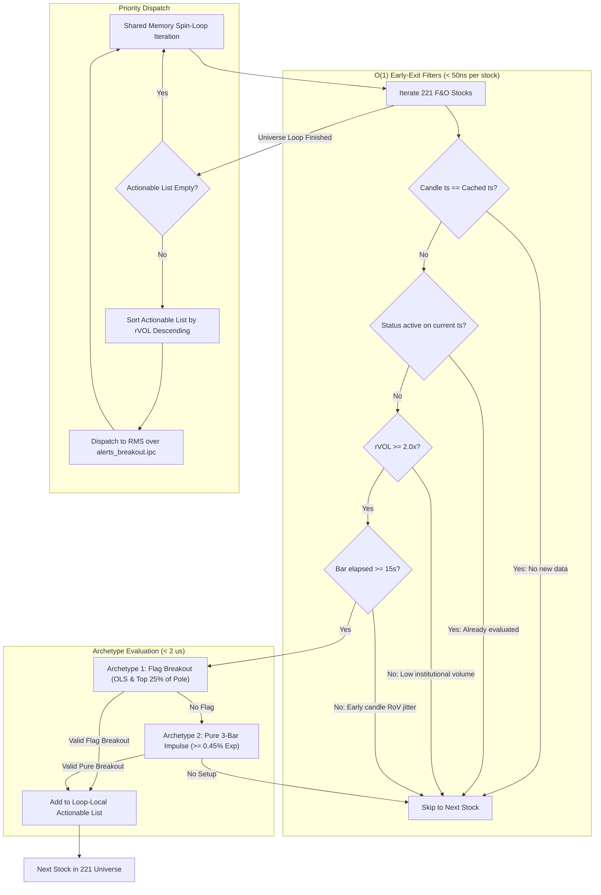
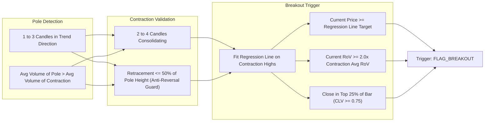
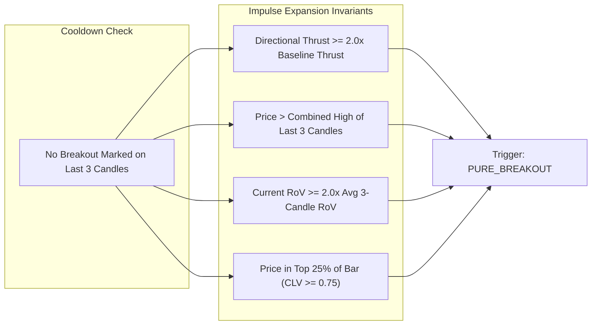

# Scoring Engine 3.0: Qualitative Price Action & Momentum Specification

> **Document Type**: Strategy & Quantitative Signal Engine Specification  
> **Version**: 3.1 (`E10_W3_CAP3` Calibration: 15s Elapsed, Flag Top-25%, Pure 3-Bar `0.45%`, RMS 3/Sym/Day Cap)  
> **Status**: Production Source of Truth  
> **Related Architecture**: [`HIGH_LEVEL_DESIGN_2_0.md`](file:///Users/yorha/Documents/Trading%20Stuff/docs/sys/HIGH_LEVEL_DESIGN_2_0.md) | [`LOW_LEVEL_DESIGN_2_0.md`](file:///Users/yorha/Documents/Trading%20Stuff/docs/sys/LOW_LEVEL_DESIGN_2_0.md)  
> **Legacy Archive**: Archived ADRs ([`2026-11-28_ADR_SPEC_2_0.md`](file:///Users/yorha/Documents/Trading%20Stuff/docs/archive/2026-11-28_ADR_SPEC_2_0.md)) and legacy scoring docs live in [`docs/archive/`](file:///Users/yorha/Documents/Trading%20Stuff/docs/archive).

---

## 1. Executive Philosophy: Demise of the 0–100 Score

Scoring Engine 1.0 and 2.0 relied on an arithmetic linear combination:
$$\text{Score} = \sum w_i f_i + \text{Regime\_Bonus}$$

### Why Linear Scores Failed:
1. **The Optimization Trap**: A threshold of 70 worked on one day and lost on another; 80 caught winners on trending days but sat completely idle on rotational days.
2. **Artificial Dud Inflation**: A weak, drifting chart received $+10$ points simply because Nifty was green, pushing a low-volume dud into execution.
3. **Counter-Trend Clamping**: An explosive, high-rVOL short squeeze received $-25$ points because Nifty was red, clamping it below the entry threshold and missing the biggest winner of the day.

### The 3.0 Core Principles:
- **No Continuous Score**: A setup is either structurally valid according to physical price invariants, or it is not.
- **No Market Regime Dependency**: High relative volume ($\text{rVOL} \ge 2.0\times$) indicates the stock has uncoupled from the index. We trade stock-intrinsic momentum regardless of Nifty's direction.
- **Sub-Microsecond Shared Memory Spin-Loop**: Spins directly on POSIX Shared Memory (`shm_ohlc_221`) with $\mathcal{O}(1)$ early-exit skips.

---

## 2. High-Level Engine Pipeline



---

## 3. Early-Exit Filters ($\mathcal{O}(1)$ Micro-Gates)

Before performing any pattern or regression math, each stock must pass four instantaneous checks:

1. **Timestamp Freshness Gate**:
   `if candle.timestamp == meta.last_evaluated_ts: continue`
   - Skips evaluation if no new candle data has been written to Shared Memory.
2. **Current Candle Status Gate**:
   `if meta.status is not None and meta.status_candle_ts == candle.timestamp: continue`
   - Skips stocks that have already triggered a status on the current bar.
3. **Relative Volume (rVOL) Institutional Gate**:
   `if candle.rvol < 2.0: continue`
   - Guarantees that only stocks exhibiting **abnormal institutional volume ($\ge 2.0\times$ 20-day median)** on the current 5-minute candle are ever analyzed.
   - 210+ stocks are eliminated at this gate in $< 20\text{ nanoseconds}$.
4. **Early-Candle Jitter Guard (`min_candle_elapsed_sec = 15.0`)**:
   `if (now_ts - candle.timestamp) < 15.0: continue`
   - Empirically tuned (`H4a`: 15s vs 30s) in `config/strategies.json` under `scoring_engine_3_0.min_candle_elapsed_sec` to block 0–14s RoV spike false positives without sacrificing early momentum entries.
5. **Flag Top-25% Pole Buffer (`flag_pole_buffer_pct = 0.25`)**:
   - Bull Flag breakouts must satisfy `close >= max(OLS_proj, pole_high - 0.25 * pole_height)` (mirrored for Bear Flags at `min(OLS_proj, pole_low + 0.25 * pole_height)`), preventing deep-contraction fakeouts where steep downward OLS slopes project below mid-pole.
6. **Pure 3-Bar Cumulative Expansion (`pure_3bar_expansion_pct = 0.0045`)**:
   - Pure breakouts/breakdowns must demonstrate at least `0.45%` net 3-bar price displacement (`(close - prev3_low) / prev3_low >= 0.0045` for BULL; `(prev3_high - close) / prev3_high >= 0.0045` for BEAR), suppressing choppy range/expiry noise.
7. **Downstream RMS Gate & Daily Cap (`max_alerts_per_symbol_per_day = 3`, `atr_spread_gate_enabled = true`)**:
   - [`RMSService`](file:///Users/yorha/Documents/Trading%20Stuff/core/rms/rms_service.py) rejects illiquid strikes exceeding `3%` spread or failing the `2.0x` ATR/Spread expected-move check (`passes_atr_spread_gate`), and enforces `<= 3` accepted opportunities per symbol per day (illiquid rejections do not consume quota).

---

### 3.1 Strict Current Candle rVOL Specification

The engine does not use lagging rolling windows or cumulative day volume. It computes **strict current candle rVOL** for the active 5-minute candle, referenced against a pre-indexed 1-minute historical median volume table:
- **Historical Baseline**: A 2D array of shape `(221, 375)` storing the 30-day median volume for each 1-minute bucket of the trading day ($09:15 \dots 15:30$).
- For any 5-minute candle starting at minute $m_0 \in [0, 5, 10, \dots, 370]$ and elapsed time $t_{\text{elapsed}} \in [0, 300]$ seconds:
  - Let $k = \lfloor t_{\text{elapsed}} / 60 \rfloor$ be completed minutes ($0 \le k \le 4$).
  - Let $\tau = t_{\text{elapsed}} \pmod{60}$ be elapsed seconds into the current minute.

#### A. Exact Minute Boundaries ($\tau = 0, k > 0$):
At minute marks (60s, 120s, 180s, 240s, 300s), actual volume accumulated $V_k$ is known with 100% accuracy:
$$\text{rVOL} = \frac{V_k}{\sum_{i=0}^{k-1} \text{Median}_{1\text{m}}(m_0 + i)}$$

#### B. Intra-Minute Linear Extrapolation ($0 < \tau < 60$):
In the middle of a minute, the incremental volume accumulated so far in the active minute ($\Delta v = V_{\text{cur}} - V_k$) is linearly extrapolated to the upcoming minute edge:
$$v_{\text{extrap}} = \Delta v \times \frac{60}{\tau}$$
The projected total volume at minute boundary $k+1$ is evaluated against the historical expected baseline up to minute $k+1$:
$$V_{\text{projected}} = V_k + v_{\text{extrap}}$$
$$\text{rVOL} = \frac{V_{\text{projected}}}{\sum_{i=0}^{k} \text{Median}_{1\text{m}}(m_0 + i)}$$

This yields an unlagged, responsive, and mathematically sound rVOL at every microsecond of the 5-minute candle while preserving exact consistency with the 1-minute historical index.

---

## 4. Archetype 1: Bull / Bear Flag (Contraction Breakout)

This archetype captures **Trend Continuation**: an impulsive directional thrust (pole) followed by orderly volatility contraction (flag), terminating in a volume-backed breakout.



### 4.1 Mathematical Rules & Invariants

#### A. Pole & Contraction Identification (Lookback = 7 Candles):
- **Pole**: 1, 2, or 3 consecutive candles in the breakout direction with high volume.
- **Contraction**: Subsequent 2 to 4 candles of tighter range and receding volume.
- **Volume Ratio Rule**:
  $$\overline{\text{Volume}}_{\text{Pole}} > \overline{\text{Volume}}_{\text{Contraction}}$$

#### B. 50% Retracement Invariant (Evaluated First as Anti-Reversal Guard):
Before any regression math is performed, verify that the consolidation is holding the upper half of the impulse:
- **Bull Flag Retracement**:
  $$\text{Retracement Depth} = \frac{\text{Pole High} - \text{Contraction Low}}{\text{Pole High} - \text{Pole Low}} \le \mathbf{0.50}$$
  *(Contraction low must not violate the 50% midpoint of the pole).*
- **Bear Flag Retracement**:
  $$\text{Retracement Depth} = \frac{\text{Contraction High} - \text{Pole Low}}{\text{Pole High} - \text{Pole Low}} \le \mathbf{0.50}$$
  *(Contraction high must not violate the 50% midpoint of the bear pole).*

**Early Exit**: If price pulls back deeper than $50\%$ of the pole, it is classified as a structural reversal or trend failure, not a consolidation. Reject immediately—do not compute regression lines.

#### C. Linear Regression Breakout Target:
Once the contraction passes the 50% retracement invariant, fit an ordinary least squares regression across the highs of the contraction candles (or lows for bear flags):
$$y = m \cdot x + c$$
- **Price Target**: Current candle price breaks above the projected regression line:
  $$P_{\text{current}} \ge m \cdot x_{\text{current}} + c$$
*(For bear flags: $P_{\text{current}} \le m \cdot x_{\text{current}} + c$ across contraction lows).*

#### D. Execution Trigger Conditions:
- **Volume Expansion**:
  $$\text{RoV}_{\text{current}} \ge \mathbf{2.0 \times \overline{\text{RoV}}_{\text{Contraction}}}$$
- **Close Location Value (CLV - Wick Trap Guard)**:
  $$\text{CLV} = \frac{\text{Current Price} - \text{Current Low}}{\text{Current High} - \text{Current Low}} \ge \mathbf{0.75}$$
  *(Ensures price is trading in the top 25% of the bar, proving buyers are in control and not leaving an upper rejection wick).*

---

## 5. Archetype 2: Pure 3-Candle Impulse Breakout / Breakdown

This archetype captures **Momentum Initiation**: a sudden, violent expansion out of a multi-candle base without a prior flag pattern.



### 5.1 Mathematical Rules & Invariants

#### A. 3-Candle Cooldown:
`if meta.has_breakout_in_last_n_candles(n=3): continue`
- Prevents re-triggering repeatedly on candles 2, 3, and 4 of the same continuous momentum leg.

#### B. Directional Thrust Invariant:
Define **Thrust** as the aggressive directional movement from the candle's open:
- **Bull Thrust**: $\text{Thrust}_t = \text{High}_t - \text{Open}_t$
- **Bear Thrust**: $\text{Thrust}_t = \text{Open}_t - \text{Low}_t$

Compute the 3-candle average thrust with a **Dead-Lull Floor**:
$$\overline{\text{Thrust}}_3 = \frac{1}{3} \sum_{i=1}^3 \text{Thrust}_{t-i}$$
$$\text{Baseline Thrust} = \max\left(\overline{\text{Thrust}}_3, \; \mathbf{0.35 \times \text{ATR}(14)}\right)$$

The current candle must demonstrate **at least twice the directional thrust** of the local baseline:
$$\text{Thrust}_{\text{current}} \ge \mathbf{2.0 \times \text{Baseline Thrust}}$$

#### C. Structural Level Break:
$$\text{Current Price} > \mathbf{\max\left(\text{High}_{t-1}, \text{High}_{t-2}, \text{High}_{t-3}\right)}$$
*(For bear breakdowns: $\text{Current Price} < \min\left(\text{Low}_{t-1}, \text{Low}_{t-2}, \text{Low}_{t-3}\right)$)*

#### D. Rate of Volume (RoV) Surge:
$$\text{RoV}_{\text{current}} \ge \mathbf{2.0 \times \overline{\text{RoV}}_{3\text{-candle}}}$$

#### E. Close Location Value (Anti-Wick Guard):
$$\text{CLV} = \frac{\text{Current Price} - \text{Current Low}}{\text{Current High} - \text{Current Low}} \ge \mathbf{0.75}$$
- Rejects Inverted Hammers / Shooting Stars that crossed resistance intra-bar but got slammed back down.

---

## 6. Loop-Local Actionable List, Schema & Priority Dispatch

At the end of each spin-loop through the 221 F&O stocks:
1. All triggered candidates are collected in a local list: `actionable_candidates`.
2. The list is sorted by **`rvol` descending**:
   ```python
   actionable_candidates.sort(key=lambda x: x["rvol"], reverse=True)
   ```
3. Each [`SetupAlert`](file:///Users/yorha/Documents/Trading%20Stuff/core/common/ipc_schemas.py) carries `strategy_id` (default `"momentum"`) and `strategy_tags`, dispatched over ZeroMQ `ipc:///tmp/scoring_alerts_pub.ipc` to the decoupled Core [`RMSService`](file:///Users/yorha/Documents/Trading%20Stuff/core/rms/rms_service.py), which republishes validated `ActionableOpportunity` messages on topic `OPP.<strategy_id>.<symbol>`.
4. **Midday Freeze Configuration**: `config/strategies.json` exposes `strategies.momentum.midday_freeze` (`enabled`, `start`, `end`) for configurable lunch-hour signal suppression benchmarks; option target/SL sizing calibration (`option_convexity_scaling`) is handled downstream in the execution tracks layer ([`EXECUTION_TRACKS.md`](file:///Users/yorha/Documents/Trading%20Stuff/docs/sys/EXECUTION_TRACKS.md)).

### Why Priority Sorting by rVOL Matters:
If 3 stocks break out on the exact same 5-minute candle, the stock experiencing the most violent relative volume explosion ($\text{rVOL} = 4.8\times$) is processed and allocated margin by the RMS **first**, before lower-volume setups ($\text{rVOL} = 2.1\times$).

---

## 7. Python Implementation Reference

```python
"""
Scoring Engine 3.0: High-Performance Spin-Loop Implementation
"""
import time
import numpy as np

class ScoringEngine3:
    def __init__(self, shm_reader, alerts_socket, fno_universe):
        self.shm_reader = shm_reader
        self.alerts_socket = alerts_socket
        self.universe = fno_universe
        self.meta = {sym: SymbolMetadata() for sym in fno_universe}

    def run_spin_loop(self):
        while True:
            actionable = []
            now_ts = time.time()
            
            for symbol in self.universe:
                candle = self.shm_reader.get_candle(symbol)
                m = self.meta[symbol]
                
                # --- Early Exit Filters (< 50ns) ---
                if candle.timestamp == m.last_evaluated_ts:
                    continue
                if m.status is not None and m.status_candle_ts == candle.timestamp:
                    continue
                if candle.rvol < 2.0:
                    continue
                if (now_ts - candle.timestamp) < 45.0:
                    continue
                    
                # --- Archetype 1: Bull / Bear Flag ---
                flag_res = self._check_flag_breakout(symbol, candle)
                if flag_res is not None:
                    actionable.append(flag_res)
                    m.status = flag_res["archetype"]
                    m.status_candle_ts = candle.timestamp
                    m.last_evaluated_ts = candle.timestamp
                    m.record_breakout_history(candle.timestamp)
                    continue
                    
                # --- Archetype 2: Pure 3-Candle Impulse ---
                if m.has_breakout_in_last_n_candles(3):
                    m.last_evaluated_ts = candle.timestamp
                    continue
                    
                pure_res = self._check_pure_breakout(symbol, candle)
                if pure_res is not None:
                    actionable.append(pure_res)
                    m.status = pure_res["archetype"]
                    m.status_candle_ts = candle.timestamp
                    m.last_evaluated_ts = candle.timestamp
                    m.record_breakout_history(candle.timestamp)

            # --- Priority Dispatch ---
            if actionable:
                actionable.sort(key=lambda x: x["rvol"], reverse=True)
                for alert in actionable:
                    self.alerts_socket.send_json(alert)
                    
            time.sleep(0.005) # 5ms yield to prevent 100% single-thread core burnout

    def _check_flag_breakout(self, symbol, c):
        hist = self.shm_reader.get_history(symbol, count=8)
        if len(hist) < 8:
            return None
        candles = hist[-8:-1] # 7 closed candles
        
        for pole_len in (1, 2, 3):
            pole = candles[:pole_len]
            contraction = candles[pole_len:]
            if len(contraction) < 2:
                continue
                
            pole_vol = sum(b.volume for b in pole) / len(pole)
            contr_vol = sum(b.volume for b in contraction) / len(contraction)
            if pole_vol <= contr_vol:
                continue
                
            pole_low = min(b.low for b in pole)
            pole_high = max(b.high for b in pole)
            pole_height = pole_high - pole_low
            if pole_height <= 0.01:
                continue
                
            # --- Bull Flag ---
            contr_low = min(b.low for b in contraction)
            retracement = (pole_high - contr_low) / pole_height
            if retracement <= 0.50:  # 50% Retracement Check first!
                xs = np.arange(len(contraction))
                ys = np.array([b.high for b in contraction])
                m, c_val = np.polyfit(xs, ys, 1)
                proj_trigger = m * len(contraction) + c_val
                
                avg_contr_rov = sum(b.volume / 300.0 for b in contraction) / len(contraction)
                curr_rov = c.volume / max(1.0, (time.time() - c.timestamp))
                clv = (c.close - c.low) / max(0.01, (c.high - c.low))
                
                if (c.close >= proj_trigger and 
                    curr_rov >= 2.0 * avg_contr_rov and 
                    clv >= 0.75):
                    return {
                        "symbol": symbol,
                        "archetype": "FLAG_BULL_BREAKOUT",
                        "direction": "BULL",
                        "rvol": c.rvol,
                        "trigger_price": c.close,
                        "trigger_ts": time.time()
                    }
                    
            # --- Bear Flag ---
            contr_high = max(b.high for b in contraction)
            bear_retracement = (contr_high - pole_low) / pole_height
            if bear_retracement <= 0.50:  # 50% Retracement Check first!
                xs = np.arange(len(contraction))
                ys = np.array([b.low for b in contraction])
                m, c_val = np.polyfit(xs, ys, 1)
                proj_trigger = m * len(contraction) + c_val
                
                avg_contr_rov = sum(b.volume / 300.0 for b in contraction) / len(contraction)
                curr_rov = c.volume / max(1.0, (time.time() - c.timestamp))
                clv_bear = (c.high - c.close) / max(0.01, (c.high - c.low))
                
                if (c.close <= proj_trigger and 
                    curr_rov >= 2.0 * avg_contr_rov and 
                    clv_bear >= 0.75):
                    return {
                        "symbol": symbol,
                        "archetype": "FLAG_BEAR_BREAKDOWN",
                        "direction": "BEAR",
                        "rvol": c.rvol,
                        "trigger_price": c.close,
                        "trigger_ts": time.time()
                    }
        return None

    def _check_pure_breakout(self, symbol, c):
        hist = self.shm_reader.get_history(symbol, count=4)
        if len(hist) < 4:
            return None
        prev = hist[-4:-1] # Last 3 closed candles
        
        # Bull Impulse
        combined_high = max(b.high for b in prev)
        avg_thrust = sum(b.high - b.open for b in prev) / 3.0
        baseline_thrust = max(avg_thrust, 0.35 * c.atr)
        curr_thrust = c.high - c.open
        avg_rov = sum(b.volume / 300.0 for b in prev) / 3.0
        curr_rov = c.volume / max(1.0, (time.time() - c.timestamp))
        clv = (c.close - c.low) / max(0.01, (c.high - c.low))
        
        if (c.close > combined_high and 
            curr_thrust >= 2.0 * baseline_thrust and 
            curr_rov >= 2.0 * avg_rov and 
            clv >= 0.75):
            return {
                "symbol": symbol,
                "archetype": "PURE_BULL_BREAKOUT",
                "direction": "BULL",
                "rvol": c.rvol,
                "trigger_price": c.close,
                "trigger_ts": time.time()
            }
            
        # Bear Impulse
        combined_low = min(b.low for b in prev)
        avg_bear_thrust = sum(b.open - b.low for b in prev) / 3.0
        baseline_bear_thrust = max(avg_bear_thrust, 0.35 * c.atr)
        curr_bear_thrust = c.open - c.low
        clv_bear = (c.high - c.close) / max(0.01, (c.high - c.low))
        
        if (c.close < combined_low and 
            curr_bear_thrust >= 2.0 * baseline_bear_thrust and 
            curr_rov >= 2.0 * avg_rov and 
            clv_bear >= 0.75):
            return {
                "symbol": symbol,
                "archetype": "PURE_BEAR_BREAKDOWN",
                "direction": "BEAR",
                "rvol": c.rvol,
                "trigger_price": c.close,
                "trigger_ts": time.time()
            }
            
        return None
```

---

## 8. Summary Comparison: Engine 2.0 vs. Engine 3.0

| Feature / Dimension | Legacy Engine 2.0 | Engine 3.0 |
| :--- | :--- | :--- |
| **Scoring Concept** | Continuous arithmetic score ($0-100$) | **Zero Score: Strict Physical Invariants** |
| **Market Regime** | $+10$ dud bonus, $-25$ counter clamp | **Decoupled: Pure stock-intrinsic rVOL** |
| **Archetypes** | Conflated linear feature sum | **Flag Breakout + Pure Impulse Breakout** |
| **Micro-Range Protection**| None (subject to 10-paise traps) | **Directional Thrust $\ge 2.0\times$ Baseline** |
| **Wick Rejection Guard** | None (bought shooting stars) | **CLV $\ge 0.75$ (Must trade in top 25%)** |
| **Evaluation Latency** | 15–40 ms (Pandas / Dict loops) | **$< 2\ \mu\text{s}$ per stock (NumPy SHM spin)** |
| **Dispatch Order** | Arbitrary dict iteration order | **Sorted by rVOL Descending (Top Alpha First)** |

